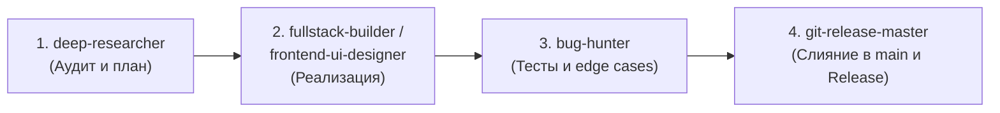

# Lan7 Agent & Skill Architecture

Настоящая архитектура регламентирует структуру специализированных AI-агентов (Subagents) и профессиональных навыков (Skills) для разработки, аудита и сопровождения сетевого стека Lan7 в среде Google Antigravity.

---

## 1. Структура каталога `.agents/`

```text
.agents/
├── README.md                                  # Архитектурный навигатор и детальная памятка оператора
├── manifesto.md                               # Системный манифест инженерных принципов
├── agents/                                    # Изолированные манифесты и протоколы агентов
│   ├── deep-researcher/
│   │   ├── AGENT.md                           # Конфигурация, MCP (serena, memory-bank, sequential-thinking, filesystem)
│   │   └── SKILL.md                           # Persona & Протокол системного аудита (STRICT READ-ONLY)
│   ├── bug-hunter/
│   │   ├── AGENT.md                           # Конфигурация, MCP (serena, sqlite, sequential-thinking, filesystem)
│   │   └── SKILL.md                           # Persona, TDD и поиск первопричин (Root Cause Analysis)
│   ├── fullstack-builder/
│   │   ├── AGENT.md                           # Конфигурация, MCP (serena, memory-bank, sqlite, filesystem)
│   │   └── SKILL.md                           # Сквозной пайплайн FastAPI + SQLite WAL + Vanilla SPA
│   ├── network-domain-specialist/
│   │   ├── AGENT.md                           # Конфигурация, MCP (serena, filesystem)
│   │   └── SKILL.md                           # Топология, FDB/ARP/LLDP расчеты, SNMP, NCM бэкапы
│   ├── frontend-ui-designer/
│   │   ├── AGENT.md                           # Конфигурация, Scope: только интерфейс (Zero-NPM, Vanilla SPA)
│   │   └── SKILL.md                           # Vanilla JS (ES6+), Cytoscape.js оверлеи, формы ввода, M3
│   ├── ui-creator/
│   │   ├── AGENT.md                           # Конфигурация, Креативный UX-архитектор и арт-директор
│   │   └── SKILL.md                           # Нестандартный UX, Halo меню, Faceplates, физика анимаций
│   └── git-release-master/
│       ├── AGENT.md                           # Конфигурация, MCP (github, sequential-thinking, filesystem)
│       └── SKILL.md                           # Управление ветками, аудит Definition of Done, релизы и PR
└── skills/                                    # Каталог переиспользуемых навыков
    ├── lan7-creative-ux/                      # [НОВЫЙ] Halo Control, Switch Faceplate 2x24, Cable Glow
    ├── ui-ux-pro-max/                         # [НОВЫЙ] UI/UX Design Intelligence: 79 стилей, 192 палитры
    ├── web-design-guidelines/                 # [НОВЫЙ] WCAG доступность, 8pt сетка, типографика (Vercel)
    ├── git-release-flow/                      # Управление ветками Git, слияния, Conventional Commits
    ├── ui-form-controls/                      # Валидация IP/MAC/CIDR/VLAN на лету
    ├── modal-and-dialogs/                     # Паттерны M3 Side Sheets и диалогов
    ├── cytoscape-ui-overlays/                 # Floating HUD и контекстные меню над Cytoscape
    ├── pydantic-contracts/                    # Pydantic v2 контракты графа и API
    ├── test-driven-development/               # Async фикстуры pytest, изоляция SQLite
    ├── lan7-frontend-vanilla/                 # Стандарты Vanilla JS SPA и нативного CSS
    ├── lan7-network-collector/                # Pure-Python SNMP, Win32 Ping, SQLite batch
    ├── network-topology-engine/               # Иерархия линков и Spanning Tree от корня
    ├── ncm-ssh-backup/                        # SSH-бэкапы, нормализация CLI и SHA-256
    ├── sqlite-migrations/                     # Неразрушающие миграции без Alembic CLI
    ├── fastapi-pro/                           # Асинхронные роутеры и DI FastAPI
    ├── python-pro/                            # Python 3.12+, типизация, неблокирующий asyncio
    ├── codebase-design/                       # Теория глубоких модулей (John Ousterhout)
    ├── ast-grep/                              # Поиск по AST-структурам кода
    ├── find-skills/                           # Мета-поиск расширений
    ├── frontend-design/                       # Общий компонентный дизайн
    ├── design-taste-frontend/                 # Справочные принципы типографики и верстки
    └── high-end-visual-design/                # Референсы визуальных микроинтеракций
```

---

## 2. Сводная матрица агентов

| Агент | Специализация | MCP-инструменты | Ключевые скиллы | Политика доступа (`tools_policy`) |
| :--- | :--- | :--- | :--- | :--- |
| **`deep-researcher`** | Архитектурный аудит, проектирование | `serena`, `memory-bank`, `sequential-thinking`, `filesystem` | `codebase-design`, `improve-codebase-architecture` | **STRICT READ-ONLY** (любые правки кода заблокированы) |
| **`bug-hunter`** | Локализация багов, устранение регрессий | `serena`, `sequential-thinking`, `filesystem`, `sqlite` | `ast-grep`, `python-pro`, `sqlite-migrations`, `test-driven-development` | Поиск первопричин, подготовка регрессионных тестов и патчей |
| **`fullstack-builder`** | Сквозная разработка фич от БД до UI | `serena`, `memory-bank`, `filesystem`, `sqlite` | `fastapi-pro`, `python-pro`, `lan7-frontend-vanilla`, `pydantic-contracts` | Полный цикл: модели SQLAlchemy, эндпоинты FastAPI, JS-клиент |
| **`network-domain-specialist`** | Сетевые протоколы, топология, NCM | `serena`, `filesystem` | `network-topology-engine`, `lan7-network-collector`, `ncm-ssh-backup`, `python-pro` | Сетевой стек: Win32 ICMP, SNMP ASN.1/UDP, FDB/ARP/LLDP |
| **`frontend-ui-designer`** | Интерфейс, Cytoscape.js, стили | `serena`, `filesystem` | `lan7-frontend-vanilla`, `ui-form-controls`, `modal-and-dialogs`, `cytoscape-ui-overlays` | **UI ONLY**: запрет на изменение бэкенда и добавление NPM |
| **`ui-creator`** | Креативный UX-дизайн, вайрфреймы, концепты | `serena`, `filesystem` | `lan7-creative-ux`, `ui-ux-pro-max`, `web-design-guidelines`, `high-end-visual-design` | **CREATIVE UX**: проектирование UX-сценариев, вайрфреймы, прототипы |
| **`git-release-master`** | Git, слияния, GitHub, контроль версий | `github`, `sequential-thinking`, `filesystem` | `git-release-flow`, `test-driven-development`, `codebase-design` | Ветки, запуск тестов перед слиянием, semver, Conventional Commits |

---

## 3. Подробная памятка по агентам (Правила и условия вызова)

### 3.1. Как вызывать агента в чате
Для вызова агента используйте явное упоминание `@<имя_агента>` или `@[.agents/agents/<имя_агента>]` с четкой постановкой цели:
```text
@<имя_агента> [Контекст задачи] [Целевые файлы] [Требуемый результат]
```

---

### 3.2. Карточки агентов: условия вызова, ограничения и шаблоны команд

#### 🔍 1. `deep-researcher` — Senior Software Architect
* **Когда вызывать**:
  - Нужен глубокий анализ связей между модулями перед началом крупной работы.
  - Требуется составить пошаговый архитектурный план (Roadmap / RFC) без внесения правок в код.
  - Поиск узких мест, циклических зависимостей и скрытого техдолга.
* **Когда НЕ вызывать**:
  - Когда требуется написать рабочий код, исправить баг или создать коммит (у агента строгий режим `STRICT READ-ONLY`).
* **Шаблоны команд**:
  > `@deep-researcher Проанализируй зависимости модуля collector/discovery.py и составь пошаговый план перехода на асинхронный опрос подсетей. Сохрани план в lan7/.md/discovery_plan.md.`
  > 
  > `@deep-researcher Выполни аудит всех эндпоинтов web/routers/ и составь матрицу проверки прав доступа для RBAC без изменения кода.`

---

#### 🐛 2. `bug-hunter` — Principal Debugging Engineer
* **Когда вызывать**:
  - Происходит сбой (`RuntimeError`, `database is locked`, падение циклов мониторинга, 500 Internal Server Error).
  - Падают автотесты (`pytest` возвращает `FAILED`).
  - Логика работает некорректно (например, задваиваются порты в таблице FDB или неверно рассчитываются линки).
* **Когда НЕ вызывать**:
  - Для верстки новых красивых экранов или рутинного рефакторинга работающего кода.
* **Шаблоны команд**:
  > `@bug-hunter При запуске пинга падает ошибка 'sqlite3.OperationalError: database is locked'. Найди первопричину, напиши воспроизводящий тест в tests/ и предложи минимальный надежный патч.`
  > 
  > `@bug-hunter Тест test_lanweb_v2.py падает на проверке удаления коммутатора. Локализуй проблему и исправь каскадное удаление линков.`

---

#### 🚀 3. `fullstack-builder` — Senior Fullstack Developer
* **Когда вызывать**:
  - Разработка сквозного функционала: от создания модели данных в `storage/models.py` и Pydantic-схемы до REST API роутера и отрисовки в Vanilla JS SPA.
  - Доработка серверных обработчиков вместе с их клиентскими контроллерами.
* **Когда НЕ вызывать**:
  - Для чисто дизайнерских правок CSS (лучше передать `frontend-ui-designer`).
  - Для глубоких сетевых расчетов графа L2/L3 (лучше передать `network-domain-specialist`).
* **Шаблоны команд**:
  > `@fullstack-builder Реализуй бэкенд и фронтенд для сохранения пользовательских заметок к коммутаторам: модель SwitchNote, эндпоинты CRUD и блок заметок в паспорте коммутатора.`
  > 
  > `@fullstack-builder Добавь функционал фильтрации таблицы хостов по диапазону IP-адресов на сервере и клиенте.`

---

#### 🌐 4. `network-domain-specialist` — Principal Network Engineer
* **Когда вызывать**:
  - Работа с сетевыми протоколами: Win32 ICMP Echo API (`iphlpapi.dll`), SNMP ASN.1/BER (RFC 1157 / RFC 3416), MIB OID (IF-MIB, BRIDGE-MIB, LLDP-MIB, CDP).
  - Алгоритмы построения топологии сети: Spanning Tree, выбор корня (Root Switch), схлопывание транзитных линков.
  - Модули мониторинга портов, трафика (64-битные счетчики High Capacity) и NCM SSH-бэкапов (Cisco, Eltex, Huawei, MikroTik).
* **Когда НЕ вызывать**:
  - Для верстки модальных окон, CSS-анимаций или работы с Git.
* **Шаблоны команд**:
  > `@network-domain-specialist Добавь опрос 64-битных счётчиков ifHCInOctets/ifHCOutOctets в collector/snmp.py с автоматическим откатом на 32-битные для старых свитчей.`
  > 
  > `@network-domain-specialist Оптимизируй фазу 3 в builder.py: исключи появление петель при циклическом опросе FDB транзитных коммутаторов.`

---

#### 🎨 5. `frontend-ui-designer` — Senior Frontend UI/UX Designer
* **Когда вызывать**:
  - Создание и стилизация интерфейсов: карточки, модальные окна, выдвижные панели (M3 Side Sheets), адаптивная сетка.
  - Работа с канвасом **Cytoscape.js**: контекстные меню, оверлеи портов, SVG-иконки, масштабирование и цветовая подсветка линков.
  - Интерактивные формы: валидация ввода IP/MAC/CIDR/VLAN на лету, индикация ошибок.
  *Строгое ограничение: Zero-NPM (только Vanilla JS ES6+ и нативный CSS).*
* **Когда НЕ вызывать**:
  - Для изменения серверной логики FastAPI, SQL-запросов или сетевых протоколов.
* **Шаблоны команд**:
  > `@frontend-ui-designer Сверстай карточку входа для экрана первоначальной авторизации в стиле Glassmorphism с полями логина/пароля и адаптивным центрированием.`
  > 
  > `@frontend-ui-designer Добавь floating-тулбар масштабирования над холстом Cytoscape без перехвата событий клика по узлам сети.`

---

#### 💡 6. `ui-creator` — Lead Product UX Architect & Creative Director
* **Когда вызывать**:
  - Нужен креативный, нестандартный концепт UI/UX для сетевых инженеров (NOC, дата-центр).
  - Проектирование пространственного взаимодействия с топологией (Halo Radial Dock, живой ток трафика по кабелям, ghost snapping).
  - Разработка интерактивных аппаратных панелей (Switch Port Faceplate 2x24), микро-тултипов и дашбордов высокой плотности данных.
  - Проработка сценариев Empty States, плавных микро-анимаций на чистом CSS и вайрфреймов перед версткой.
* **Когда НЕ вызывать**:
  - Для рутинной механической привязки DOM-событий или правки мелких CSS-селекторов (для этого есть `@frontend-ui-designer`).
* **Шаблоны команд**:
  > `@ui-creator Спроектируй концепт интерактивной лицевой панели коммутатора (Switch Faceplate) с визуализацией SFP/RJ45 портов и микро-тултипами телеметрии.`
  > 
  > `@ui-creator Предложи нестандартное решение для контекстного меню вокруг узла топологии Cytoscape в виде Halo Radial Dock с микро-анимациями.`

---

#### 📦 7. `git-release-master` — Release Engineer & DevOps
* **Когда вызывать**:
  - Подготовка и публикация релиза (поднятие версии `__version__`, обновление `changelog.md`).
  - Проверка готовности ветки к слиянию (**Definition of Done**: запуск полного набора тестов).
  - Слияние фиче-веток в `main` и отправка изменений на GitHub (`git push`).
  - Создание новых веток (`git checkout -b feature/...`).
  - Управление тикетами багов и Pull Requests через GitHub MCP.
* **Когда НЕ вызывать**:
  - Для написания бизнес-логики или сетевых алгоритмов.
* **Шаблоны команд**:
  > `@git-release-master Запусти тесты pytest, проверь чистоту репозитория и выполни слияние feature/switch-passport в main с пушем на origin.`
  > 
  > `@git-release-master Подготовь новую чистую ветку feature/rbac-auth-gate от актуального origin/main.`
  > 
  > `@git-release-master Проверь статус веток, оформи релизный коммит v0.7.21 и поставь git tag.`

---

## 4. Быстрая шпаргалка по выбору агента (Decision Matrix)

| Что нужно сделать? | Рекомендуемый агент | Пример триггера в чате |
|---|---|---|
| **Спланировать рефакторинг / составить Roadmap** | `@deep-researcher` | *«Проанализируй архитектуру и составь план без правок кода»* |
| **Исправить сбой, краш или зависание транзакции** | `@bug-hunter` | *«Падает ошибка database is locked, локализуй и почини»* |
| **Создать новую фичу целиком (API + БД + UI)** | `@fullstack-builder` | *«Добавь функционал тегирования портов от базы данных до веб-интерфейса»* |
| **Доработать расчет топологии, SNMP или ICMP пинг** | `@network-domain-specialist` | *«Добавь опрос оптических уровней SFP через DDM OID»* |
| **Сверстать окно, панель, улучшить стили или Cytoscape** | `@frontend-ui-designer` | *«Сверстай модальное окно смены пароля оператора»* |
| **Придумать нестандартный UX, Halo-меню или Faceplate** | `@ui-creator` | *«Спроектируй концепт интерактивной лицевой панели портов свитча»* |
| **Слить ветку в main, проверить тесты, сделать push** | `@git-release-master` | *«Проверь Definition of Done и влей фичу в main»* |

---

## 5. Типовые сквозные сценарии (Multi-Agent Workflows)

### Сценарий А: Разработка крупной фичи (Feature Delivery Pipeline)

1. **`@deep-researcher`**: исследует кодовую базу, проверяет ограничения `GEMINI.md` и формирует спецификацию (например, `lan7/.md/user_role.md`).
2. **`@fullstack-builder`** (при поддержке **`@frontend-ui-designer`**): реализует модели данных, эндпоинты и разметку SPA.
3. **`@bug-hunter`**: тестирует крайние случаи, проверяет изоляцию сессий и запускает pytest.
4. **`@git-release-master`**: проверяет Definition of Done, поднимает версию в `__init__.py`, обновляет `changelog.md` и пушит в `main`.

---

### Сценарий Б: Срочный фикс сбоя (Hotfix Pipeline)
1. **`@git-release-master`**: создает ветку `hotfix/<name>` от актуального `main`.
2. **`@bug-hunter`**: пишет тест, воспроизводящий баг, и готовит минимальный патч.
3. **`@git-release-master`**: прогоняет `pytest`, делает коммит `fix(...)`, вливает в `main` и отправляет на GitHub.

---

## 6. Контроль качества и правила сборки (Definition of Done)

Каждый агент обязан следовать правилам [`GEMINI.md`](../GEMINI.md):
1. **Портативность (PyInstaller Safety)**: zero C-extensions. Только Pure-Python, Win32 API (`ctypes.windll.iphlpapi`) и стандартная библиотека.
2. **Асинхронный SQLite**: все транзакции строго через `write_gate_session()`. Неразрушающие миграции без сброса баз.
3. **Vanilla SPA**: без Webpack, Vite, React и npm-пайплайнов. Только нативный ES6+ и CSS3.
4. **Обязательный запуск тестов**:
   ```powershell
   & ".\lan7\.venv\Scripts\pytest.exe"
   ```
5. **Фиксация изменений**: каждый релиз обязательно документируется в `lan7/.md/changelog.md`.
