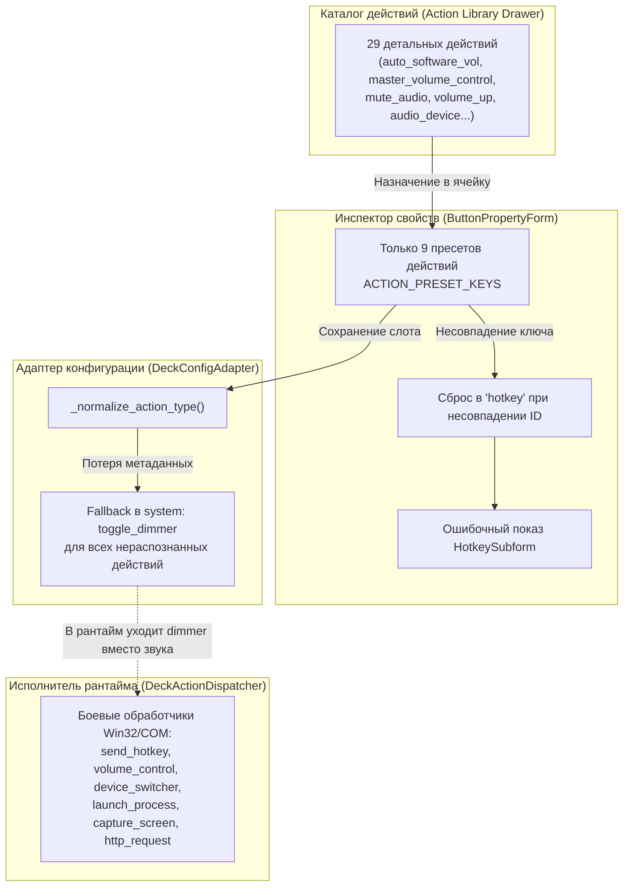

# Архитектурный аудит и спецификация действий редактора кнопок DuckDeck

> **Статус документа:** Утверждённый анализ архитектуры и дефектов  
> **Модуль:** `modules/deck` (DuckDeck WYSIWYG Editor & Action Dispatcher)  
> **Файлы спецификации:** `modules/deck/editor/actions_registry.py`, `modules/deck/editor/widgets/button_property_form.py`, `modules/deck/editor/adapter.py`, `modules/deck/action_dispatcher.py`  
> **Дата аудита:** 2026-11-22  

---

## 1. Введение и цели анализа

Целью данного документа является фиксация полного комплексного анализа всех функций и действий для кнопок макро-панели DuckDeck, представленных в визуальном редакторе ([`DeckEditorWindow`](file:///d:/Projects_X/duckdock/modules/deck/editor/window.py)), а также валидация корректности отображения параметров (название, иконка, комбобокс типа действия, динамические подформы параметров) при их назначении на кнопки.

---

## 2. Полный реестр действий библиотеки DuckDeck (Action Catalog)

В декларативном реестре библиотеки действий ([`actions_registry.py`](file:///d:/Projects_X/duckdock/modules/deck/editor/actions_registry.py)) зарегистрировано **6 категорий** и **29 действий**.

### Сводная матрица слоёв архитектуры

| № | Категория | ID действия в каталоге | Название в UI (RU / EN) | Иконка | Статус в Runtime (`action_dispatcher.py`) | Пресет в инспекторе (`button_property_form.py`) | Поведение при назначении в редакторе |
|---|---|---|---|:---:|---|---|---|
| **1** | **Мульти-действие** (`multi_action`) | `multi_action` | Мульти-действие / Multi Action | 🔀 | ❌ **Заглушка** (макро-цепочки не реализованы) | ❌ Отсутствует в `ACTION_PRESET_KEYS` | ⚠️ Сброс комбобокса на **«Хоткей»**, форма захвата клавиш |
| **2** | | `multi_action_switch` | Переключатель мульти-действий | 🔂 | ❌ **Заглушка** | ❌ Отсутствует | ⚠️ Сброс комбобокса на **«Хоткей»** |
| **3** | **Навигация** (`navigation`) | `create_folder` | Создать папку / Create Folder | 📁 | ❌ **Заглушка** (вложенные папки не поддержаны) | ❌ Отсутствует | ⚠️ Сброс на **«Хоткей»**, при сохранении сброс в `toggle_dimmer` |
| **4** | | `switch_profile` | Сменить профиль / Switch Profile | 🗂️ | ❌ **Заглушка** (профили не переключаются) | ❌ Отсутствует | ⚠️ Сброс на **«Хоткей»**, при сохранении сброс в `toggle_dimmer` |
| **5** | | `prev_page` | Предыдущая страница | ◀ | ⚠️ **Частично** (жест свайпа в UI есть, экшена кнопки нет) | ❌ Отсутствует | ⚠️ Сброс на **«Хоткей»**, при сохранении сброс в `toggle_dimmer` |
| **6** | | `next_page` | Следующая страница | ▶ | ⚠️ **Частично** (жест свайпа в UI есть, экшена кнопки нет) | ❌ Отсутствует | ⚠️ Сброс на **«Хоткей»**, при сохранении сброс в `toggle_dimmer` |
| **7** | | `goto_page` | Перейти на страницу | # | ⚠️ **Частично** (рантайм поддерживает `NavigationParams`) | ❌ Отсутствует | ⚠️ Сброс на **«Хоткей»**, при сохранении сброс в `toggle_dimmer` |
| **8** | | `page_indicator` | Индикатор страниц | 🔢 | ❌ **Заглушка** | ❌ Отсутствует | ⚠️ Сброс на **«Хоткей»**, при сохранении сброс в `toggle_dimmer` |
| **9** | **Саундборд** (`soundboard`) | `play_audio` | Воспроизвести аудио / Play Audio | 🔊 | ❌ **Заглушка** (звуковой движок играет только системные клики) | ❌ Отсутствует | ⚠️ Сброс на **«Хоткей»**, при сохранении сброс в `toggle_dimmer` |
| **10** | | `stop_audio` | Остановить аудио / Stop Audio | 🔇 | ❌ **Заглушка** | ❌ Отсутствует | ⚠️ Сброс на **«Хоткей»**, при сохранении сброс в `toggle_dimmer` |
| **11** | **Stream Deck** (`stream_deck`) | `brightness` | Яркость / Brightness | ☀️ | ❌ **Заглушка** | ❌ Отсутствует | ⚠️ Сброс на **«Хоткей»**, при сохранении сброс в `toggle_dimmer` |
| **12** | | `sleep_display` | Спящий режим экрана | 🌙 | ❌ **Заглушка** | ❌ Отсутствует | ⚠️ Сброс на **«Хоткей»**, при сохранении сброс в `toggle_dimmer` |
| **13** | **Система** (`system`) | `hotkey` | Хоткей / Hotkey | ⌨️ | ✅ **Реализовано** (Win32 `SendInput`) | ✅ `hotkey` (Subform 0) | ✅ Отображает кнопку захвата сочетания клавиш |
| **14** | | `hotkey_switch` | Переключатель хоткеев | ⇄ | ✅ **Реализовано** (State 1 ⇄ State 2) | ✅ `hotkey_switch` (Subform 1) | ✅ Отображает двухпозиционный переключатель |
| **15** | | `website` | Открыть веб-сайт / Website | 🌐 | ✅ **Реализовано** (`os.startfile` / `webbrowser`) | ✅ `website` (Subform 2) | ✅ Отображает поле URL |
| **16** | | `open_website` | Открыть веб-сайт (синоним) | 🌐 | ✅ **Реализовано** (нормализуется в `website`) | 🔄 Мапится на `website` (Subform 2) | ✅ Отображает поле URL |
| **17** | | `open_path` | Открыть путь / файл | 📂 | ✅ **Реализовано** (`os.startfile`) | ✅ `open_path` (Subform 2) | ✅ Отображает поле пути + кнопку обзора 📂 |
| **18** | | `open_app` | Запуск приложения | 🚀 | ✅ **Реализовано** (`subprocess.Popen`) | ✅ `open_app` (Subform 2) | ⚠️ **Баг**: поле пути пустое при `executable=""` |
| **19** | | `close_window` | Закрыть активное окно | ❌ | ✅ **Реализовано** (Win32 `WM_CLOSE`) | ✅ `close_window` | ⚠️ **Баг**: ошибочно показывает кнопку захвата хоткея |
| **20** | | `text_macro` | Текстовый макрос | 📝 | ✅ **Реализовано** (Win32 Clipboard + `Ctrl+V`) | ✅ `text_macro` (Subform 4) | ✅ Поле текста шаблона + чекбокс Enter |
| **21** | | `multimedia` | Управление медиа | ⏯️ | ✅ **Реализовано** (Win32 `VK_MEDIA_*`) | ✅ `multimedia` (Subform 3) | ✅ Комбобокс медиа-команд (Play/Pause, Next...) |
| **22** | **Регулятор громкости** (`volume_controller`) | `auto_software_vol` | Громкость активного приложения | 🎯 | ✅ **Реализовано** (`session_volume.py`) | ❌ Отсутствует в пресетах | ⚠️ Сброс на **«Хоткей»**, параметры громкости недоступны |
| **23** | | `master_volume_control` | Общая громкость | 🔊 | ✅ **Реализовано** (`endpoint_volume.py`) | ❌ Отсутствует в пресетах | ⚠️ Сброс на **«Хоткей»**, параметры громкости недоступны |
| **24** | | `mic_mute_control` | Управление микрофоном | 🎙️ | ✅ **Реализовано** (`audio_manager.toggle_mic_mute`) | ❌ Отсутствует в пресетах | ⚠️ Сброс на **«Хоткей»**, параметры громкости недоступны |
| **25** | | `output_device_toggle` | Переключение аудиоустройства | 🎧 | ✅ **Реализовано** (`device_switcher.py`) | ❌ Отсутствует в пресетах | ⚠️ Сброс на **«Хоткей»**, параметры громкости недоступны |
| **26** | | `mute_audio` | Заглушить звук | 🔇 | ✅ **Реализовано** (`toggle_master_mute`) | ❌ Отсутствует в пресетах | ⚠️ Сброс на **«Хоткей»**, при сохранении сброс в `toggle_dimmer` |
| **27** | | `volume_up` | Увеличить громкость (+5%) | 🔉+ | ✅ **Реализовано** (`step_master_volume(+5)`) | ❌ Отсутствует в пресетах | ⚠️ Сброс на **«Хоткей»**, при сохранении сброс в `toggle_dimmer` |
| **28** | | `volume_down` | Уменьшить громкость (-5%) | 🔉- | ✅ **Реализовано** (`step_master_volume(-5)`) | ❌ Отсутствует в пресетах | ⚠️ Сброс на **«Хоткей»**, при сохранении сброс в `toggle_dimmer` |
| **29** | | `toggle_device` | Переключить устройство | 🎧 | ✅ **Реализовано** (`toggle_audio_device`) | ❌ Отсутствует в пресетах | ⚠️ Сброс на **«Хоткей»**, при сохранении сброс в `toggle_dimmer` |

---

## 3. Детальный анализ выявленных дефектов отображения параметров

### Дефект № 1: Тотальный сброс выпадающего списка действий на «Хоткей» для 20 действий из 29
* **Локализация:** [`modules/deck/editor/widgets/button_property_form.py:749-766`](file:///d:/Projects_X/duckdock/modules/deck/editor/widgets/button_property_form.py#L749-L766).
* **Суть проблемы:** Список пресетов инспектора `combo_actions` инициализируется строго константой `ACTION_PRESET_KEYS`:
  ```python
  ACTION_PRESET_KEYS = [
      "hotkey", "hotkey_switch", "website", "open_app",
      "open_path", "close_window", "text_macro", "multimedia", "volume_control"
  ]
  ```
  При назначении любого действия из категорий *Навигация*, *Саундборд*, *Stream Deck*, *Мульти-действие* или любого специализированного действия из *Регулятора громкости* (например, `master_volume_control`), метод `load_slot_data` не находит его в комбобоксе:
  ```python
  target_idx = 0
  for i in range(self.combo_actions.count()):
      if raw_action == str(self.combo_actions.itemData(i)).lower():
          target_idx = i; break
  self.combo_actions.setCurrentIndex(target_idx)  # Выбирается индекс 0 ('hotkey')
  ```
* **Проявление в UI:** Шапка инспектора показывает корректную локализацию: `Регулятор громкости: Общая громкость`, однако поле «Действия:» принудительно устанавливается в **«Хоткей»**, а ниже выводится форма захвата сочетания клавиш (`HotkeySubform`).

---

### Дефект № 2: Потеря типа действия и сброс в `toggle_dimmer` при сохранении
* **Локализация:** [`modules/deck/editor/adapter.py:608-645`](file:///d:/Projects_X/duckdock/modules/deck/editor/adapter.py#L608-L645) и [`adapter.py:647-747`](file:///d:/Projects_X/duckdock/modules/deck/editor/adapter.py#L647-L747).
* **Суть проблемы:** Метод `DeckConfigAdapter._normalize_action_type` не содержит правил для действий `create_folder`, `switch_profile`, `prev_page`, `next_page`, `goto_page`, `play_audio`, `stop_audio`, `brightness`, `sleep_display`, `mute_audio`, `volume_up`, `volume_down`, `toggle_device`. В результате срабатывает завершающая строка `return "system"`.  
  А метод `_create_default_action("system")` создаёт:
  ```python
  return (
      DeckActionConfig(
          action_type="system",
          params={"command": "toggle_dimmer"},
      ),
      "system",
  )
  ```
* **Проявление в UI:** Если пользователь выбрал в каталоге «Увеличить громкость» или «Воспроизвести аудио» и нажал `Ctrl+S`, конфигурация кнопки на диске превращается в переключатель ночного режима (ночного диммера).

---

### Дефект № 3: Пустое поле пути для кнопок запуска приложений (`open_app`)
* **Локализация:** [`modules/deck/editor/widgets/button_property_form.py:334`](file:///d:/Projects_X/duckdock/modules/deck/editor/widgets/button_property_form.py#L334).
* **Суть проблемы:** Подформа `PathUrlSubform.set_params()` читает путь:
  ```python
  elif self._mode == "open_app":
      self.edit_input.setText(params.get("executable", params.get("path", "")))
  ```
  В боевом конфигурационном файле [`config/deck_config.json`](file:///d:/Projects_X/duckdock/config/deck_config.json#L178-L180) кнопки слотов 6 («Терминал») и 9 («Калькулятор») имеют параметры:
  ```json
  "params": {
    "executable": "",
    "path": "wt.exe",
    "working_dir": null,
    "detached": true
  }
  ```
  Так как ключ `"executable"` физически присутствует в словаре со значением `""`, вызов `params.get("executable", ...)` не возвращает значение по умолчанию, а возвращает `""`!
* **Проявление в UI:** При клике на готовые кнопки «Терминал» и «Калькулятор» поле ввода программы остаётся абсолютно **пустым**.

---

### Дефект № 4: Неверное отображение подформы для «Закрыть активное окно» (`close_window`)
* **Локализация:** [`modules/deck/editor/widgets/button_property_form.py:824-845`](file:///d:/Projects_X/duckdock/modules/deck/editor/widgets/button_property_form.py#L824-L845).
* **Суть проблемы:** В методе `_update_subform_visibility(action_key)` отсутствует ветка для `close_window`:
  ```python
  if action_key == "hotkey":
      self.params_stack.setCurrentIndex(0)
  elif ...:
      ...
  else:
      self.params_stack.setCurrentIndex(0) # Index 0 — это HotkeySubform!
  ```
* **Проявление в UI:** При выборе действия «Закрыть активное окно» (не требующего параметров от пользователя) в строке параметров отображается кнопка захвата хоткея.

---

## 4. Проверка поведения готовых кнопок по умолчанию (`config/deck_config.json`)

Было проведено тестирование загрузки текущей боевой конфигурации первой страницы в форму `ButtonPropertyForm`:

```text
Slot | Название            | Action Type в JSON | Отображение в инспекторе | Статус корректности
--------------------------------------------------------------------------------------------------
   0 | Аудиовыход          | audio_device       | Хоткей (Subform 0)       | ❌ Нет пресета, ошибочный хоткей
   1 | Микрофон            | volume_control     | Регулятор громкости      | ✅ Корректно (microphone + toggle_mute)
   2 | Скриншот            | screenshot         | Хоткей (Subform 0)       | ❌ Нет пресета, ошибочный хоткей
   3 | Discord Deafen      | hotkey             | Хоткей                   | ✅ Корректно (Ctrl + Shift + D)
   4 | OBS Запись          | hotkey             | Хоткей                   | ✅ Корректно (Ctrl + F9)
   5 | RGB Red Alert       | http_request       | Хоткей (Subform 0)       | ❌ Нет пресета, ошибочный хоткей
   6 | Терминал            | open_app           | Запуск приложения        | ⚠️ Поле пути пустое (баг executable="")
   7 | Ночной режим        | system             | Хоткей (Subform 0)       | ❌ Нет пресета, ошибочный хоткей
   8 | Заблокировать       | system             | Хоткей (Subform 0)       | ❌ Нет пресета, ошибочный хоткей
   9 | Калькулятор         | open_app           | Запуск приложения        | ⚠️ Поле пути пустое (баг executable="")
```

---

## 5. Архитектурная схема расхождения слоёв



---

## 6. Actionable Roadmap устранения дефектов и интеграции параметров

### Матрица ответственности (RACI):
* **Accountable / Executor:** `@fullstack-builder` — сквозная реализация правок в UI-компонентах и адаптере.
* **Reviewer / Auditor:** `@code-review` — Pre-Flight аудит инвариантов, чистоты diff и паритета локалей.

---

### Этап 1: Исправление отображения существующих типов действий и параметров ввода

#### Задачи этапа:
1. В `modules/deck/editor/widgets/button_property_form.py` исправить метод `PathUrlSubform.set_params()`:
   ```python
   # Было:
   self.edit_input.setText(params.get("executable", params.get("path", "")))
   # Должно стать:
   target_val = params.get("executable") or params.get("path") or ""
   self.edit_input.setText(target_val)
   ```
2. В `button_property_form.py` добавить подформу для действий без параметров (`NoParamsSubform` с локализованной подсказкой *"Действие не требует дополнительных настроек"*):
   - Использовать её для `close_window` и системных действий (`toggle_dimmer`, `lock_workstation`).
3. В `ButtonPropertyForm.load_slot_data()` добавить авто-мапинг специализированных действий каталога на пресет `volume_control`:
   - `auto_software_vol` -> target: `focus_app`, command: `toggle_mute`
   - `master_volume_control` -> target: `master`, command: `toggle_mute`
   - `mic_mute_control` -> target: `microphone`, command: `toggle_mute`
   - `volume_up` -> target: `master`, command: `volume_up`
   - `volume_down` -> target: `master`, command: `volume_down`

#### Запуск шагов [1.1 - 1.3]:
```text
@fullstack-builder реализуй Этап 1 из .md/deck/edit_action.md:
1. Исправь извлечение пути в PathUrlSubform.set_params (поддержка и executable, и path).
2. Создай подформу NoParamsSubform для действий close_window и отображай её вместо HotkeySubform.
3. Настрой мапинг каталожных действий громкости в volume_control в ButtonPropertyForm.load_slot_data.
4. Проверь прохождение тестов: pytest tests/unit/test_deck_property_form.py tests/unit/test_deck_property_form_subforms.py
```

#### Pre-Flight проверка Этапа 1:
```text
@code-review проведи аудит реализации Этапа 1:
1. Проверь отсутствие хардкода строк в NoParamsSubform (строго t(...) и паритет в locales/ru.json и locales/en.json).
2. Убедись в сохранении бюджета высоты инспектора 220 px.
3. Проверь чистоту diff и отсутствие регрессий в тестах.
```

---

### Этап 2: Поддержка системных действий, скриншотов и переключения аудиоустройств в редакторе

#### Задачи этапа:
1. Расширить `ACTION_PRESET_KEYS` и выпадающий список `combo_actions` типами:
   - `audio_device` (Переключение аудиоустройств)
   - `screenshot` (Скриншот экрана)
   - `system` (Системные команды: Блокировка ПК, Диммер)
2. Создать компактные подформы в пределах 28 px:
   - `AudioDeviceSubform` (Режим: Переключение / Выбор устройства)
   - `ScreenshotSubform` (Цель: Весь экран / Активное окно, Буфер обмена: да/нет)
   - `SystemSubform` (Команда: Диммер / Блокировка экрана)
3. Синхронизировать `DeckConfigAdapter._normalize_action_type` и `_create_default_action`:
   - Добавить явную нормализацию и сохранение параметров для `audio_device`, `screenshot`, `system`, исключив слепой сброс в `toggle_dimmer`.

#### Запуск шагов [2.1 - 2.3]:
```text
@fullstack-builder реализуй Этап 2 из .md/deck/edit_action.md:
1. Добавь пресеты audio_device, screenshot, system в ButtonPropertyForm и локали в locales/*.json.
2. Создай подформы AudioDeviceSubform, ScreenshotSubform, SystemSubform с соблюдением высоты INPUT_HEIGHT (28 px).
3. Добавь мапинг и сохранение параметров в DeckConfigAdapter.
4. Запусти тесты: pytest tests/unit/test_deck_editor_adapter.py tests/unit/test_deck_actions_extended.py
```

#### Pre-Flight проверка Этапа 2:
```text
@code-review проведи аудит реализации Этапа 2:
1. Проверь линтер локализации: pytest tests/unit/test_i18n_linter.py.
2. Проверь корректность сериализации Pydantic v2 моделей в DeckConfigAdapter.
3. Убедись, что существующие кнопки из config/deck_config.json корректно определяют свои типы при открытии.
```

---

### Этап 3: Преобразование заглушек (Stubs) в функциональные действия

#### Задачи этапа:
1. **Навигация по страницам (`prev_page`, `next_page`, `goto_page`):**
   - Связать экшены кнопок с вызовом `bus.deck_page_changed.emit(target_page_id)`.
   - В инспекторе добавить выбор номера или названия целевой страницы.
2. **Саундборд (`play_audio`, `stop_audio`):**
   - Интегрировать воспроизведение пользовательских `.wav` / `.mp3` файлов через `DeckSoundEngine` или `QSoundEffect`.
   - Добавить в инспектор поле выбора аудиофайла с кнопкой обзора.
3. **Stream Deck (`brightness`, `sleep_display`):**
   - Связать `sleep_display` с системным вызовом отключения монитора через `SendMessage(HWND_BROADCAST, WM_SYSCOMMAND, SC_MONITORPOWER, 2)`.
   - Связать `brightness` с регулировкой яркости через `core.dimmer` или WMI.

#### Запуск шагов [3.1 - 3.3]:
```text
@fullstack-builder реализуй Этап 3 из .md/deck/edit_action.md:
1. Реализуй рантайм-обработчики навигации по страницам через EventBus в ActionDispatcher.
2. Реализуй воспроизведение пользовательских звуков в play_audio через DeckSoundEngine.
3. Реализуй отключение экрана в sleep_display через WinAPI SendMessage SC_MONITORPOWER.
4. Покрой новый функционал модульными тестами в tests/unit/test_deck_actions_extended.py.
```

#### Pre-Flight проверка Этапа 3:
```text
@code-review проведи аудит реализации Этапа 3:
1. Проверь изоляцию потоков: все I/O операции обязаны выполняться в неблокирующем QThreadPool.
2. Проверь платформенные инварианты: WinAPI вызовы не должны вызывать зависаний GUI.
3. Убедись в 100% PASS всего набора тестов pytest tests/.
```
