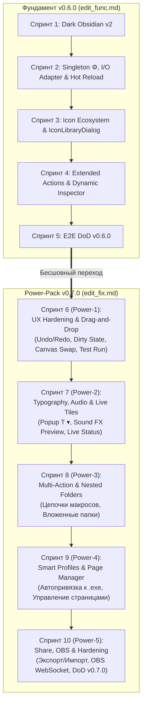

# DuckDeck Editor v0.7.0: Power-Pack Roadmap & Advanced Capabilities

> **Статус документа:** Активное техническое задание и Actionable Roadmap расширения возможностей  
> **Версия подсистемы:** DuckDeck Editor v0.7.0 (Power-Pack: Automation, Workflow & Smart Profiles)  
> **Базовый фундамент:** [edit_func.md](file:///d:/Projects_X/duckdock/.md/deck/edit_func.md) (v0.6.0: Спринты 1–5 — Core I/O, Dark Obsidian v2, Icon Library, Extended Actions, E2E DoD)  
> **Целевая среда:** Windows 10/11 x64, Desktop GUI (PySide6 / Qt6, Python 3.12+)  
> **Дисплейное окружение:** Двухмониторный комплекс (Primary 27" 2560×1440 dGPU + Secondary 7" 1024×600 JRP7813S iGPU).  
> **Архитектурный закон:** `GEMINI.md` (Zero-Bespoke Invariant, Platform-First, Feature-First Modularity, Localization-First RU/EN, Weak Coupling через EventBus).

---

## 1. Архитектурная совместимость с v0.6.0

Все возможности пакета **v0.7.0 (Power-Pack)** спроектированы так, чтобы органично надстраиваться над фундаментом v0.6.0 **без ломки существующих контрактов и без переписывания кодовой базы**:



### Точки соприкосновения и преемственность:
1. **Config Adapter (`adapter.py`) & Pydantic:** Модели v0.6.0 расширяются обратно-совместимыми полями (`app_binding: Optional[str]`, `sub_pages: dict`, `multi_actions: list`) без поломки старых файлов `deck_config.json`.
2. **Dynamic Inspector (`ButtonPropertyForm`):** Адаптивный стек параметров v0.6.0 принимает новые специализированные подформы (Multi-Action Editor, Font Popup `T ▾`, Sound Selector `sound_override`).
3. **Core Focus Guardian (`focus_guardian.py`):** Существующий Win32 хук активного окна задействуется для мгновенного переключения профилей при смене игры или рабочего софта.
4. **Сетка холста (`DeckCanvasWidget`):** Получает поддержку нативного Qt Drag-and-Drop (MIME type `application/x-duckdeck-action`) для перетаскивания и смены мест кнопок (Swap).

---

## 2. Матрица ответственности (RACI) для v0.7.0

| Спринт / Компонент | `@deep-researcher` | `@frontend-ui-designer` | `@ui-creator` | `@fullstack-builder` | `@bug-hunter` | `@code-review` |
| :--- | :---: | :---: | :---: | :---: | :---: | :---: |
| **Спринт 6: UX Safety, DND & Test Run** | Informed | **Responsible** | Support | Support | Support | Pre-Flight |
| **Спринт 7: Typography, Audio & Live Tiles** | Informed | Support | **Responsible** | Support | Informed | Pre-Flight |
| **Спринт 8: Multi-Action & Folders** | **Accountable** | Support | Informed | **Responsible** | Support | Pre-Flight |
| **Спринт 9: Smart Profiles & Page Manager** | **Accountable** | Support | Informed | **Responsible** | Support | Pre-Flight |
| **Спринт 10: Share, OBS & DoD v0.7.0** | Informed | Support | Informed | Support | **Responsible** | Pre-Flight |

---

## 3. Детальный Actionable Roadmap по спринтам v0.7.0

### Спринт 6 (Power-1): UX Hardening, Drag-and-Drop и Безопасность данных

#### 6.0. Задачи спринта:
- [ ] **Шаг 6.1: Стек истории действий Undo / Redo (`QUndoStack`)**
  - Создание команд `QUndoCommand` для ключевых операций:
    - `AssignActionCommand`: назначение действия на слот;
    - `ClearSlotCommand`: удаление действия (защита от случайного клика по корзине 🗑️);
    - `SwapButtonsCommand`: обмен местами кнопок на холсте;
    - `UpdateTitleCommand`: изменение текста кнопки.
  - Подключение глобальных хоткеев `Ctrl+Z` (Undo) и `Ctrl+Y` / `Ctrl+Shift+Z` (Redo).
- [ ] **Шаг 6.2: Отслеживание несохраненных изменений (Dirty State & Autosave)**
  - Индикатор изменений в шапке окна: звездочка `DuckDeck Editor *`.
  - Перехват события `closeEvent`: если есть несохраненные изменения, открывать стилизованный диалог подтверждения: *"Сохранить изменения перед выходом? (Сохранить / Не сохранять / Отмена)"*.
  - Опция в настройках редактора: `Автосохранение (Autosave)` с дебаунсом 500 мс (сохраняет конфиг на лету).
- [ ] **Шаг 6.3: Нативный Drag-and-Drop (DND) на холсте**
  - **DND из библиотеки:** Перетаскивание карточки `ActionItemWidget` из правого ящика на любую ячейку холста `[0]..[9]` с подсветкой слота-мишени синим контуром `#38bdf8`.
  - **DND между ячейками (Swap / Move):** Перетаскивание назначенной кнопки из одного слота в другой:
    - При сбросе на занятую ячейку — взаимный обмен параметрами (Swap);
    - При зажатой клавише `Ctrl` — дублирование кнопки на целевой слот (Copy).
- [ ] **Шаг 6.4: Кнопка «▶ Тестировать действие» (Test Run) в инспекторе**
  - Добавить в правый угол формы инспектора кнопку `▶ Тест` (tooltip: `deck.editor.inspector.tooltips.test_action`).
  - При клике передавать DTO активного слота в `DeckActionDispatcher.execute_action()` для моментального тестового запуска с основного 27" монитора.

#### Блок запуска шагов Спринта 6:
```text
#### Запуск шагов [6.1 - 6.4]:
@frontend-ui-designer и @fullstack-builder реализуйте Спринт 6 из .md/deck/edit_fix.md:
1. Интегрируйте QUndoStack в DeckEditorWindow с поддержкой отмены назначения, удаления и свопа кнопок (Ctrl+Z / Ctrl+Y).
2. Реализуйте dirty-state флаг и безопасный диалог закрытия окна при несохраненных правках.
3. Добавьте нативный Drag-and-Drop: перетаскивание из библиотеки и обмен ячеек (Swap/Copy) на холсте.
4. Добавьте кнопку '▶ Тест' в инспектор для проверки макроса без тач-экрана.
5. Обеспечьте 100% паритет ключей локализации в locales/ru.json и locales/en.json.
Критерий завершения: Кнопки свободно перетаскиваются между слотами, случайное удаление отменяется по Ctrl+Z, тест макроса работает штатно.

#### Pre-Flight проверка:
@code-review проведи аудит реализации Спринта 6:
Проверь освобождение ресурсов команд QUndoStack, чистоту MIME-данных DND и защиту от случайной потери конфига.
```

---

### Спринт 7 (Power-2): Кастомизация типографики, звуки клика и Live Status Tiles

#### 7.0. Задачи спринта:
- [ ] **Шаг 7.1: Всплывающее меню настройки шрифта (Раскрытие кнопки `T ▾`)**
  - По клику на кнопку `btn_font` в [button_property_form.py](file:///d:/Projects_X/duckdock/modules/deck/editor/widgets/button_property_form.py) отображать компактное темное всплывающее меню:
    - *Размер шрифта:* переключатель `9px` / `11px` (по умолчанию) / `13px` / `15px`;
    - *Позиция текста:* `Снизу` (под иконкой) / `По центру` / `Сверху`;
    - *Цвет текста:* палитра быстрого выбора (Белый `#f8fafc`, Серый `#94a3b8`, Cyan `#38bdf8`, Amber `#f59e0b`);
    - *Чекбокс:* `Скрыть заголовок` (только иконка).
  - Сохранение настроек в полях `font_size`, `font_color`, `text_alignment` в DTO и конфиге.
- [ ] **Шаг 7.2: Индивидуальный звук нажатия (`sound_override`)**
  - Добавить в форму инспектора секцию аудио-отклика:
    - Выпадающий список: `По умолчанию` / `Без звука` / `Выбрать файл...`;
    - Кнопка воспроизведения `▶` для мгновенного предпрослушивания выбранного звука WAV через [DeckSoundEngine](file:///d:/Projects_X/duckdock/modules/deck/sound_engine.py).
- [ ] **Шаг 7.3: Подсистема живых динамических тайлов (Live Status Tiles)**
  - Добавить в инспектор выпадающий список привязки реактивного статуса:
    - `mic_mute` — смена иконки 🎙️ / 🔇 и цвета рамки при системном мьюте микрофона;
    - `audio_device` — индикация текущего выхода (наушники/динамики);
    - `dimmer` — индикация состояния затемнения экрана;
    - `cpu_temp` / `gpu_temp` — вывод текущей температуры железа прямо на кнопку с цветовой индикацией (зеленый/желтый/красный).

#### Блок запуска шагов Спринта 7:
```text
#### Запуск шагов [7.1 - 7.3]:
@ui-creator и @frontend-ui-designer реализуйте Спринт 7 из .md/deck/edit_fix.md:
1. Реализуйте всплывающее меню кнопки 'T ▾' с выбором размера, цвета шрифта и вертикального выравнивания.
2. Добавьте блок выбора sound_override с кнопкой предварительного прослушивания WAV.
3. Интегрируйте селектор Live Status Tiles (микрофон, аудиовыход, температура железа) с привязкой к EventBus.
4. Добавьте ключи локализации в locales/ru.json и locales/en.json.
Критерий завершения: Настройки шрифта корректно транслируются на 7" экран, звук предпрослушивается, живые тайлы меняют вид по событиям шины.

#### Pre-Flight проверка:
@code-review проведи аудит реализации Спринта 7:
Проверь отсутствие визуальных артефактов при кастомных шрифтах и неблокирующее воспроизведение аудиофайлов.
```

---

### Спринт 8 (Power-3): Цепочки макросов (Multi-Action) и вложенные папки

#### 8.0. Задачи спринта:
- [ ] **Шаг 8.1: Конструктор цепочек макросов (Multi-Action Sequence Builder)**
  - Для действия типа `Multi Action` разворачивать в инспекторе блочный редактор шагов:
    - Список шагов с возможностью добавления, удаления и перетаскивания (Reorder):
      1. Запуск программы (`open_app`);
      2. Задержка в миллисекундах (`delay`: 100..5000 ms);
      3. Нажатие сочетания клавиш (`hotkey`);
      4. Вставка текста (`text_macro`);
      5. Звуковой сигнал (`sound`).
  - Поддержка исполнения цепочки в `DeckActionDispatcher` в асинхронной корутине/таймере без блокировки UI потока.
- [ ] **Шаг 8.2: Поддержка вложенных папок (Nested Folders / Sub-grids)**
  - Реализация действия `create_folder` («Создать папку»):
    - Слот кнопки превращается в контейнер подстраницы (Folder Sub-grid).
    - Двойной клик по папке на холсте редактора «проваливает» сетку внутрь папки.
    - В шапке холста отображается навигационная цепочка: `Главная > Медиа` и первая кнопка автоматически резервируется под `[◀ Назад]`.
  - Синхронизация папок с `DeckView`: тап по папке на 7" экране мгновенно переключает отображаемую сетку на подпапку.

#### Блок запуска шагов Спринта 8:
```text
#### Запуск шагов [8.1 - 8.2]:
@fullstack-builder и @frontend-ui-designer реализуйте Спринт 8 из .md/deck/edit_fix.md:
1. Разработайте интерфейс Multi-Action Sequence Builder в инспекторе свойств с добавлением задержек и команд.
2. Реализуйте неблокирующее последовательное исполнение шагов в DeckActionDispatcher.
3. Реализуйте механизм вложенных папок с хлебными крошками на холсте и автоматической кнопкой возврата '◀ Назад'.
4. Синхронизируйте структуру папок в моделях models.py и конфиге deck_config.json.
Критерий завершения: Мульти-экшены отрабатывают с соблюдением таймингов задержек, навигация по папкам работает в обе стороны на обоих мониторах.

#### Pre-Flight проверка:
@code-review проведи аудит реализации Спринта 8:
Проверь предотвращение бесконечной рекурсии папок и потокобезопасность асинхронного таймера задержек макросов.
```

---

### Спринт 9 (Power-4): Умные профили (Smart App Binding) и менеджер страниц

#### 9.0. Задачи спринта:
- [ ] **Шаг 9.1: Автоматическое переключение профилей по активному окну (Smart Profiles)**
  - В редакторе профилей добавить свойство: `Привязка к приложению (.exe)` (например, `photoshop.exe`, `blender.exe`, `cs2.exe`, `obs64.exe`).
  - Возможность выбора запущенного процесса из выпадающего списка или через обзор файлов.
  - Интеграция с [core/focus_guardian.py](file:///d:/Projects_X/duckdock/core/focus_guardian.py): при получении Win32 события `EVENT_SYSTEM_FOREGROUND` определять имя процесса и, если есть привязка, переключать активную страницу/профиль в `DeckView` без задержек.
- [ ] **Шаг 9.2: Продвинутый менеджер страниц и профилей**
  - Контекстное меню по правому клику на кружок страницы в `PageNavigationBar`:
    - *Переименовать страницу*;
    - *Дублировать страницу (клонирование всех 10 слотов)*;
    - *Очистить все слоты*;
    - *Удалить страницу*.
  - Drag-and-Drop переупорядочивание страниц в полосе пагинации (поменять местами страницу 2 и 3).
  - Диалог создания профиля `+ New Profile...` с выбором шаблона (Пустой, Стример, Разработчик, Геймер).

#### Блок запуска шагов Спринта 9:
```text
#### Запуск шагов [9.1 - 9.2]:
@fullstack-builder реализуй Спринт 9 из .md/deck/edit_fix.md:
1. Интегрируй автопереключение профилей по имени активного процесса (.exe) на базе Win32 событий фокуса.
2. Добавь контекстное меню управления страницами в PageNavigationBar (переименование, дублирование, удаление).
3. Реализуйте drag-to-reorder страниц в полосе пагинации.
4. Добавьте локализованные диалоги в locales/ru.json и locales/en.json.
Критерий завершения: Переключение на окно игры или софта на 27" экране моментально активирует нужный профиль на 7" сенсоре.

#### Pre-Flight проверка:
@code-review проведи аудит реализации Спринта 9:
Проверь отсутствие просадки FPS в играх при Win32 хуках фокуса и изоляцию логики отслеживания процессов.
```

---

### Спринт 10 (Power-5): Шеринг (Экспорт/Импорт), плагины OBS и приемка DoD v0.7.0

#### 10.0. Задачи спринта:
- [ ] **Шаг 10.1: Экспорт и импорт пользовательских сетапов (`.duckprofile`)**
  - Экспорт: упаковка JSON структуры профиля и связанных пользовательских картинок `resources/deck/custom_icons/` в ZIP-архив `.duckprofile`.
  - Импорт: распаковка архива, валидация версий Pydantic схемой, размещение иконок и бесшовное добавление профиля в список.
  - Добавление кнопок «Экспорт» и «Импорт» в `EditorHeaderBar`.
- [ ] **Шаг 10.2: Интеграция с OBS Studio WebSocket**
  - Добавление действий в категорию `Stream Deck`:
    - *Переключение сцены OBS* (выбор сцены из списка);
    - *Старт/Стоп записи или стрима*;
    - *Показать/Скрыть источник* (оверлей веб-камеры, донаты).
  - Фоновый легковесный клиент `asyncio` / `websocket` с автоматическим переподключением к локальному порту OBS (4455).
- [ ] **Шаг 10.3: Итоговый чеклист Definition of Done (DoD) v0.7.0**
  - 100% покрытие новыми unit и интеграционными тестами (`pytest tests/`).
  - Полный паритет словарей локализации (`pytest tests/core/test_i18n_linter.py`).
  - Актуализация архитектурной документации в [.md/backend.md](file:///d:/Projects_X/duckdock/.md/backend.md) и [.md/changelog.md](file:///d:/Projects_X/duckdock/.md/changelog.md).
  - Обновление слепка семантической памяти в MCP Serena (`architecture`, `deck_power_pack`) и Memory Bank.

#### Блок запуска шагов Спринта 10:
```text
#### Запуск шагов [10.1 - 10.3]:
@bug-hunter и @git-release-master выполните Спринт 10 из .md/deck/edit_fix.md:
1. Разработайте функционал экспорта и импорта профилей в пакет .duckprofile.
2. Интегрируйте базовый клиент OBS Studio WebSocket для управления сценами и стримом.
3. Проведите полный прогон pytest tests/ и линтера локализации test_i18n_linter.py.
4. Обновите спецификацию .md/backend.md, changelog.md и семантическую память Serena.
Критерий завершения: 100% тестов PASS, экспорт/импорт профилей валидируется без ошибок, релиз v0.7.0 готов к развертыванию.

#### Pre-Flight проверка:
@code-review проведи итоговый аудит пакета v0.7.0:
Проверь чистоту зависимостей, отсутствие утечек сокетов OBS и сохранение всех инвариантов стабильности.
```

---

## 4. Сводное расписание релизного цикла DuckDeck

```
  v0.5.0 (Готово)        ===>    v0.6.0 (Мастер-план: Спринты 1–5)    ===>    v0.7.0 (Power-Pack: Спринты 6–10)
  ───────────────────            ─────────────────────────────────            ─────────────────────────────────
  • UI Shell 1080x740            • Спринт 1: Dark Obsidian v2                 • Спринт 6: Undo/Redo, DND, Test
  • Холст 2x5 + Тачбар           • Спринт 2: Singleton ⚙, I/O Adapter         • Спринт 7: Шрифты T▾, Звуки, Live
  • Инспектор QStackedWidget     • Спринт 3: Icon Menu & Library Dialog       • Спринт 8: Multi-Action & Папки
  • Двуязычный поиск             • Спринт 4: System, Volume Actions           • Спринт 9: Smart Profiles по .exe
  • Захват клавиш Hotkey         • Спринт 5: E2E DoD v0.6.0                   • Спринт 10: Экспорт/Импорт, OBS
```

Мастер-план v0.6.0 зафиксирован в [.md/deck/edit_func.md](file:///d:/Projects_X/duckdock/.md/deck/edit_func.md), а расширенный пакет v0.7.0 зафиксирован в [.md/deck/edit_fix.md](file:///d:/Projects_X/duckdock/.md/deck/edit_fix.md). Они полностью согласованы друг с другом и готовы к пошаговому выполнению.
