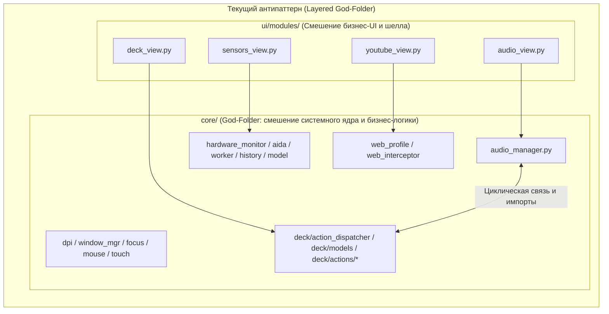

# RFC: Переход DuckDock на модульную Feature-First архитектуру (Спринт 6)

> **Статус документа:** Принят к реализации (Approved RFC & Actionable Roadmap)
> **Инициаторы:** Архитектурный совет (@deep-researcher, @code-review, @fullstack-builder)
> **Целевой релиз:** DuckDock v0.4.0 (Спринт 6: Модуляризация и Deck Foundation)
> **Базовый инвариант:** `GEMINI.md` (Platform-First, Zero-Bespoke, Stealth Focus `WS_EX_NOACTIVATE`, `Qt.NoFocus`, кинематическая изоляция тач-событий)
> **Критерий успеха:** 100% сохранение работоспособности кодовой базы (135/135 тестов `PASS`) на каждом этапе миграции с использованием фасадов обратной совместимости (Re-export Shims).

---

## 1. Контекст и проблемы текущей слоистой архитектуры

Исторически кодовая база DuckDock строилась по классическому двухуровневому слоистому принципу:

- Слой `core/` (первоначально задуманный для системных примитивов Windows API, DPI, хуков и драйверов тайлинга).
- Слой `ui/` (графические виджеты PySide6 и представления экранов).

По мере добавления функционала во 2–5 спринтах (мониторинг железа LibreHardwareMonitor, AIDA64 mmap, PyCaw аудиомикшер, YouTube с блокировкой рекламы на QWebEngineView и макро-панель DuckDeck) слой `core/` превратился в **God-Folder**, а архитектура столкнулась с тремя фундаментальными структурными дефектами.



### 1.1. God-Folder в `core/`

В директории `core/` оказались перемешаны компоненты совершенно разного жизненного цикла и назначения:

1. **Низкоуровневый системный фундамент**: `dpi.py`, `window_manager.py`, `focus_guardian.py`, `mouse_barrier.py`, `touch_filter.py`, `event_bus.py`.
2. **Бизнес-домен телеметрии**: `hardware_monitor.py`, `aida_reader.py`, `telemetry_worker.py`, `telemetry_history.py`, `telemetry_model.py`.
3. **Бизнес-домен медиа и браузера**: `web_profile.py`, `web_interceptor.py`.
4. **Бизнес-домен аудио**: `audio_manager.py`.
5. **Бизнес-домен макро-колодки**: `core/deck/` с шестью подпапками и действиями.

### 1.2. Смешение уровней абстракции

Низкоуровневые системные инварианты ОС Windows (DPI awareness v2, `WS_EX_NOACTIVATE`, манипуляции HWND, перехват курсора) находятся на одном уровне файловой иерархии с прикладной логикой:

- разбором URL YouTube и AdBlock-правилами;
- чтением Ring 0 датчиков через UAC-обертку;
- форматированием friendly-имен для процессов аудиомикшера;
- десериализацией конфигурации тайлов DuckDeck.

Это затрудняет локализацию дефектов, тестирование и масштабирование системы.

### 1.3. Циклический антипаттерн `audio_manager <-> deck`

Наиболее критический архитектурный долг возник в интеграции подсистемы DuckDeck:

- `core/audio_manager.py` напрямую импортирует `core.deck.models.AudioDeviceInfo` и `core.deck.actions.audio_device_switcher`.
- При этом `audio_device_switcher.py` физически размещен внутри директории `core/deck/actions/`, хотя по своей природе является системным COM-клиентом Windows Core Audio (`IPolicyConfig`), не имеющим отношения к колодке DuckDeck.
- `core/deck/action_dispatcher.py` в свою очередь напрямую импортирует `from core.audio_manager import AudioManager`.

Возникла жесткая перекрестная связь двух прикладных модулей в обход шины событий `EventBus`, нарушающая инвариант изоляции доменов.

---

## 2. Результаты совместного аудита (@deep-researcher и @code-review)

В ходе предпроектного исследования кодовой базы (135 автоматических тестов, 21 модуль ядра и UI) экспертами зафиксированы следующие выводы:

| Направление аудита                 | Состояние кодовой базы                                                                                                                      | Заключение аудита                                                                                                                                       |
| :--------------------------------- | :------------------------------------------------------------------------------------------------------------------------------------------ | :------------------------------------------------------------------------------------------------------------------------------------------------------ |
| **Тестовое покрытие**              | 135 unit и integration тестов (100% `PASS`). Активно используются прямые импорты из `core.*` и `ui.modules.*`.                              | Миграция обязана происходить строго через **Re-export Shims** (фасады-переходники), чтобы ни один тест не упал в процессе переноса файлов.              |
| **Инвариант Stealth Focus**        | Реализован во всех View, но через дублирование логики установки `setFocusPolicy(Qt.NoFocus)` в каждом конструкторе.                         | Необходим общий абстрактный базовый класс `TouchModuleView` в `core/ui_base.py`, принудительно гарантирующий `Qt.NoFocus` на уровне фреймворка.         |
| **Связанность модулей (Coupling)** | Модули телеметрии и медиа слабо связаны с ядром (общаются через `EventBus`). Модули Deck и Audio имеют циклическую сцепку через COM-клиент. | Выделение `platform/device_switcher.py` в `modules/audio/` полностью устраняет сцепку; коммуникация между Deck и Audio переводится на DTO и `EventBus`. |
| **Границы Shell vs Feature**       | Окно `MainWindow` жестко агрегирует 4 экрана (`SensorsView`, `YouTubeView`, `AudioMixerView`, `DeckView`).                                  | В будущем шелл должен динамически подключать модули через унифицированный контракт `TouchModuleView`, не зная об их внутреннем устройстве.              |

---

## 3. Архитектурные законы модульности (Modularity Laws)

Для поддержания чистоты архитектуры DuckDock на этапе перехода к версии v0.4.0 и последующих релизах утверждаются 5 незыблемых законов:

### Закон 1: The Dependency Rule (Иерархия зависимостей)

Зависимости в проекте имеют строго нисходящее направление:
$$\text{ui (Shell)} \longrightarrow \text{modules (Features)} \longrightarrow \text{core (Foundation)}$$

- Каталог `core/` является независимым фундаментом и **НИКОГДА** не импортирует ничего из `modules/` или `ui/`.
- Доменные модули в `modules/` импортируют `core/`, но **НИКОГДА** не импортируют код шелла из `ui/`.
- Шелл `ui/` агрегирует представления модулей для компоновки главного окна и сайдбара.

### Закон 2: Sibling Modules Isolation (Изоляция соседних модулей)

Модули одного уровня (`modules/audio`, `modules/deck`, `modules/telemetry`, `modules/media`) полностью изолированы друг от друга:

- Прямой импорт `from modules.audio import ...` внутри `modules.deck` **КАТЕГОРИЧЕСКИ ЗАПРЕЩЕН**.
- Любое межмодульное взаимодействие осуществляется исключительно асинхронно через центральную шину `core.event_bus.bus` либо через стандартные структуры данных Python / DTO.

### Закон 3: Разрыв связи Audio <-> Deck (Audio Platform Decoupling)

- Низкоуровневый COM-модуль переключения конечных точек Windows `IPolicyConfig` размещается в `modules/audio/platform/device_switcher.py`.
- Модуль `deck` регистрирует системное действие смены аудиоустройства, передавая запрос через сигнал `bus.playback_device_change_requested` либо вызывая унифицированный контракт. Модель `AudioDeviceInfo` перемещается в `modules/audio/models.py`.

### Закон 4: Инвариант Stealth Focus (`TouchModuleView`)

Все пользовательские представления функциональных модулей обязаны наследоваться от базового класса:

```python
# core/ui_base.py
from PySide6.QtCore import Qt
from PySide6.QtWidgets import QWidget

class TouchModuleView(QWidget):
    """
    Базовый класс экрана DuckDock.
    Гарантирует инвариант Stealth Focus: окно и все дочерние элементы
    не перехватывают фокус у основного 27" монитора.
    """
    def __init__(self, parent: QWidget | None = None) -> None:
        super().__init__(parent)
        self.setFocusPolicy(Qt.NoFocus)

    def cleanup(self) -> None:
        """Очистка таймеров, потоков и отписка от EventBus."""
        pass
```

### Закон 5: Re-export Shims & Zero-Downtime Migration

При физическом перемещении модулей старые файлы в `core/` и `ui/modules/` не удаляются, а превращаются в фасады обратной совместимости:

```python
# core/audio_manager.py (Shim)
import warnings
warnings.warn("core.audio_manager moved to modules.audio.service", DeprecationWarning, stacklevel=2)
from modules.audio.service import AudioManager, AudioSessionInfo, APP_FRIENDLY_NAMES
__all__ = ["AudioManager", "AudioSessionInfo", "APP_FRIENDLY_NAMES"]
```

Это исключает регрессию в 135 тестах и внешних скриптах, обеспечивая непрерывную сборку.

---

## 4. Целевая файловая структура (Feature-First)

```text
duckdock/
├── main.py                             # Точка входа: DPI Awareness V2, CASO env, QApplication
├── config.json                         # Конфигурация приложения
├── pyproject.toml                      # Настройки pytest, ruff, версии проекта
├── pytest.ini                          # Конфигурация запуска тестов
├── requirements.txt                    # Зафиксированные зависимости (PySide6, pycaw, comtypes)
│
├── core/                               # FOUNDATION: Платформенные примитивы и системные инварианты
│   ├── __init__.py
│   ├── dpi.py                          # SetProcessDpiAwarenessContext (Per-Monitor V2)
│   ├── event_bus.py                    # Центральная шина QObject сигналов (Слабая связанность)
│   ├── focus_guardian.py               # WS_EX_NOACTIVATE, возврат фокуса и курсора на монитор 1
│   ├── mouse_barrier.py                # ClipCursor / барьер случайного вылета курсора мыши
│   ├── touch_filter.py                 # Детекция и фильтрация тач-сообщений (TouchCursorFilter)
│   ├── window_manager.py               # Поиск HWND, удаление рамок, тайлинг 944x600, ProcessWatcher
│   ├── ui_base.py                      # Базовые UI-классы: TouchModuleView(Qt.NoFocus)
│   └── shims/                          # (Временные Re-export шлейфы для обратной совместимости)
│
├── ui/                                 # APPLICATION SHELL: Компоновка каркаса и общие виджеты
│   ├── __init__.py
│   ├── main_window.py                  # Главное окно 1024x600 (Frameless, WS_EX_NOACTIVATE)
│   ├── sidebar.py                      # Сайдбар 80x600 (тач-кнопки 64x64, переключение вкладок)
│   ├── dimmer_overlay.py               # Сквозной слой затемнения экрана (DimmerOverlay)
│   ├── showcase_view.py                # Витрина состояния модулей
│   ├── widgets/                        # Общие переиспользуемые UI-компоненты
│   │   ├── __init__.py
│   │   ├── sparkline.py                # Высокопроизводительный спарклайн нагрузки (QPainter)
│   │   ├── touch_slider.py             # Сенсорный слайдер с мгновенным прыжком значения
│   │   └── marquee_label.py            # Плавная бегущая строка для длинных названий треков
│   └── modules/                        # Re-export Shims для ui.modules.*
│
├── modules/                            # DOMAIN FEATURES: Автономные функциональные подсистемы
│   │
│   ├── audio/                          # ПОДСИСТЕМА АУДИОМИКШЕРА
│   │   ├── __init__.py
│   │   ├── service.py                  # PyCaw фасад (AudioManager: Master/Sessions)
│   │   ├── models.py                   # Pydantic модели: AudioSessionInfo, AudioDeviceInfo
│   │   ├── view.py                     # Сенсорный микшер AudioMixerView (TouchModuleView)
│   │   ├── widgets/                    # SessionCardWidget, MasterControlWidget
│   │   │   └── __init__.py
│   │   └── platform/                   # Системные Win32/COM драйверы
│   │       ├── __init__.py
│   │       └── device_switcher.py      # IPolicyConfig переключатель аудиоустройств
│   │
│   ├── telemetry/                      # ПОДСИСТЕМА АППАРАТНОЙ ТЕЛЕМЕТРИИ
│   │   ├── __init__.py
│   │   ├── hardware_monitor.py         # LibreHardwareMonitor C# DLL (Ring 0 / UAC)
│   │   ├── aida_reader.py              # AIDA64 Shared Memory mmap парсер
│   │   ├── worker.py                   # TelemetryWorker (асинхронный сбор в QThread)
│   │   ├── history.py                  # RingBuffer и TelemetryHistory (60 срез-буфер)
│   │   ├── models.py                   # Pydantic TelemetrySnapshot
│   │   ├── view.py                     # Двухуровневый NOC-дашборд SensorsView (TouchModuleView)
│   │   └── widgets/                    # HeroMetricCard, NocGridCard
│   │       └── __init__.py
│   │
│   ├── media/                          # ПОДСИСТЕМА МЕДИА И БРАУЗЕРА
│   │   ├── __init__.py
│   │   ├── web_profile.py              # WebProfileManager: Chromium кэш, куки, персистентность
│   │   ├── interceptor.py              # AdBlockInterceptor: блокировка рекламы и телеметрии
│   │   ├── view.py                     # Сенсорный YouTube плеер YouTubeView (TouchModuleView)
│   │   └── widgets/                    # MiniMediaBar, WebControls
│   │       └── __init__.py
│   │
│   ├── deck/                           # ПОДСИСТЕМА МАКРО-КОЛОДКИ DUCKDECK
│   │   ├── __init__.py
│   │   ├── view.py                     # Сенсорная сетка DeckView (TouchModuleView)
│   │   ├── action_dispatcher.py        # Диспетчер действий ActionDispatcher (QThreadPool)
│   │   ├── models.py                   # Pydantic модели: DeckButtonConfig, DeckPageConfig и др.
│   │   ├── widgets/                    # DeckButtonWidget, DeckGrid, DotPagingWidget
│   │   │   └── __init__.py
│   │   ├── actions/                    # Исполнители макро-действий
│   │   │   ├── __init__.py
│   │   │   ├── hotkey.py               # Эмуляция SendInput клавиатуры с LIFO-отжатием
│   │   │   ├── process.py              # Запуск процессов, URL и системных протоколов
│   │   │   ├── screen.py               # Снятие скриншотов с сохранением и буфером обмена
│   │   │   ├── http.py                 # Асинхронные HTTP веб-хуки (GET/POST)
│   │   │   ├── filesystem.py           # Быстрое открытие папок Проводника
│   │   │   └── win_system.py           # Блокировка ОС, сон, системные команды
│   │   └── editor/                     # (Заглушка визуального конфигуратора кнопок на будущее)
│   │       ├── __init__.py
│   │       └── editor_view.py
│   │
│   └── settings/                       # ПОДСИСТЕМА НАСТРОЕК
│       ├── __init__.py
│       ├── config.py                   # AppConfig, DisplayConfig, StealthConfig, load_config
│       ├── view.py                     # SettingsView (сенсорные настройки DuckDock)
│       └── widgets/
│           └── __init__.py
│
└── tests/                              # ТЕСТОВЫЙ НАБОР (135 тестов)
    ├── integration/                    # Интеграционные сквозные тесты
    └── unit/                           # Модульные изолированные тесты
```

---

## 5. Граф зависимостей целевой архитектуры

```mermaid
graph TD
    subgraph UI_Shell ["Application Shell (ui/)"]
        MW[MainWindow]
        SB[SidebarDock]
        DO[DimmerOverlay]
        SW[ShowcaseView]
    end

    subgraph UI_Widgets ["Shared Widgets (ui/widgets/)"]
        SP[SparklineWidget]
        TS[TouchSlider]
        ML[MarqueeLabel]
    end

    subgraph Domain_Modules ["Feature Modules (modules/)"]
        subgraph Mod_Audio ["modules/audio/"]
            AM[AudioManager / service.py]
            AV[AudioMixerView / view.py]
            ADS[IPolicyConfig / platform]
            AMD[Audio Models]
        end

        subgraph Mod_Telemetry ["modules/telemetry/"]
            HM[HardwareMonitor]
            TW[TelemetryWorker]
            TH[TelemetryHistory]
            SV[SensorsView / view.py]
        end

        subgraph Mod_Media ["modules/media/"]
            WP[WebProfileManager]
            ABI[AdBlockInterceptor]
            YV[YouTubeView / view.py]
            MMB[MiniMediaBar]
        end

        subgraph Mod_Deck ["modules/deck/"]
            DV[DeckView / view.py]
            AD[ActionDispatcher]
            DM[Deck Models]
            ACT["Actions (hotkey, proc, screen, http, sys)"]
        end

        subgraph Mod_Settings ["modules/settings/"]
            CFG[AppConfig / Loader]
            STV[SettingsView]
        end
    end

    subgraph Foundation ["Core Foundation (core/)"]
        EB[EventBus / bus]
        DPI[DPI Awareness V2]
        FG[FocusGuardian]
        MB[MouseBarrier]
        WM[WindowManager]
        TF[TouchFilter]
        UB[TouchModuleView / ui_base.py]
    end

    %% Связи UI Shell с модулями
    MW --> SB
    MW --> DO
    MW --> SW
    MW --> AV
    MW --> SV
    MW --> YV
    MW --> DV
    MW --> CFG

    %% Связи модулей с Foundation
    AV --> UB
    SV --> UB
    YV --> UB
    DV --> UB

    AV --> EB
    SV --> EB
    YV --> EB
    DV --> EB

    MW --> FG
    MW --> MB
    MW --> WM
    MW --> TF
    MW --> DPI

    %% Использование общих виджетов
    SV --> SP
    AV --> TS
    YV --> ML

    %% Внутренние связи модулей
    AM --> ADS
    AM --> AMD
    AV --> AM
    TW --> HM
    TW --> TH
    SV --> TW

    YV --> WP
    YV --> ABI
    SB --> MMB

    DV --> AD
    AD --> ACT
    AD --> DM

    %% Межмодульная коммуникация СТРОГО через EventBus
    AD -.->|События смены аудио/диммера| EB
    EB -.->|Слушатели сигналов| AM
    EB -.->|Слушатели сигналов| DO
```



---

## 6. Пошаговый план миграции (7 фаз без регрессий)

Главная цель плана — **Zero-Downtime Migration**. На каждом из 7 этапов тестовый набор из 135 тестов обязан сохранять статус **100% PASS**.

> [!IMPORTANT]
> **Критический нюанс реализации Re-export Shims и `unittest.mock.patch`:**
> В тестах (`tests/unit/test_audio_manager.py`, `tests/unit/test_audio_device_switcher.py`, `tests/integration/test_deck_integration.py` и др.) строковые пути патчей ссылаются на старые пути модулей (например, `@patch("core.deck.actions.audio_device_switcher.switch_default_device")`, `patch("core.audio_manager.AudioUtilities.GetAllSessions")`, `patch("ui.modules.audio_view.AudioManager")`).
> Простой импорт `from new_module import Target` в файле-шиме приводит к рассинхронизации локального скоупа нового модуля и патча. Поэтому все переходные шимы обязаны регистрировать алиас в `sys.modules`:
>
> ```python
> import sys
> import warnings
> import modules.audio.service as _service
> warnings.warn("core.audio_manager moved to modules.audio.service", DeprecationWarning, stacklevel=2)
> from modules.audio.service import *  # noqa: F401, F403
> sys.modules[__name__] = _service
> ```

---

### Фаза 0: Core Foundation & UI Base

- **Подшаг 0.1: Создание базового класса `TouchModuleView` в `core/ui_base.py`**
  - Создать `core/ui_base.py` с классом:

    ```python
    from typing import Optional
    from PySide6.QtCore import Qt
    from PySide6.QtWidgets import QWidget

    class TouchModuleView(QWidget):
        """Базовый класс экранов DuckDock с принудительным инвариантом Stealth Focus."""
        def __init__(self, parent: Optional[QWidget] = None) -> None:
            super().__init__(parent)
            self.setFocusPolicy(Qt.NoFocus)

        def cleanup(self) -> None:
            """Безопасная очистка ресурсов, таймеров и отписка от шины EventBus."""
            pass
    ```

- **Подшаг 0.2: Извлечение `TouchSlider` в `ui/widgets/touch_slider.py`**
  - Извлечь класс `TouchSlider` из `ui/modules/audio_view.py` в отдельный виджет `ui/widgets/touch_slider.py`.
  - Сохранить кинематику мгновенного прыжка к точке тача (`mousePressEvent`, `mouseMoveEvent`) и стиль `Qt.NoFocus`.
  - В `ui/modules/audio_view.py` оставить shim: `from ui.widgets.touch_slider import TouchSlider`.
- **Подшаг 0.3: Извлечение `MarqueeLabel` в `ui/widgets/marquee_label.py`**
  - Извлечь класс `MarqueeLabel` из `ui/modules/youtube_view.py` в отдельный виджет `ui/widgets/marquee_label.py`.
  - Сохранить логику бегущей строки (`QTimer`, переопределение `paintEvent`) и `Qt.NoFocus`.
  - В `ui/modules/youtube_view.py` оставить shim: `from ui.widgets.marquee_label import MarqueeLabel`.
- **Подшаг 0.4: Актуализация пакета `ui/widgets/__init__.py`**
  - Экспортировать: `SparklineWidget`, `TouchSlider`, `MarqueeLabel`.
- **Критерий завершения:** `pytest tests/` -> **135/135 PASS** (✅ Завершено).

---

### Фаза 1: Модуль Audio (`modules/audio/`)

- **Подшаг 1.1: Создание структуры директорий `modules/audio/`**
  - Создать структуру каталогов: `modules/audio/`, `modules/audio/platform/`, `modules/audio/widgets/` с файлами `__init__.py`.
- **Подшаг 1.2: Перенос платформенного COM-клиента `device_switcher.py`**
  - Перенести `core/deck/actions/audio_device_switcher.py` в `modules/audio/platform/device_switcher.py`.
  - Экспортировать функции: `switch_default_device`, `toggle_audio_device`, `get_playback_devices`, `get_default_playback_device_id`.
  - Настроить Re-export Shim в `core/deck/actions/audio_device_switcher.py` с алиасом `sys.modules[__name__] = _dev_switcher`.
- **Подшаг 1.3: Модели аудиостека в `modules/audio/models.py`**
  - Перенести Pydantic-модель `AudioSessionInfo` из `core/audio_manager.py`.
  - Перенести Pydantic-модель `AudioDeviceInfo` из `core/deck/models.py`.
  - Перенести словарь сопоставлений `APP_FRIENDLY_NAMES`.
- **Подшаг 1.4: Сервис аудиомикшера `modules/audio/service.py`**
  - Перенести `core/audio_manager.py` в `modules/audio/service.py`.
  - Обновить импорты: использовать `modules.audio.models` и `modules.audio.platform.device_switcher`.
  - **Полностью удалить любые импорты из `core.deck.*`** (разрыв циклической связи).
  - Настроить Re-export Shim в `core/audio_manager.py` с алиасом в `sys.modules`.
- **Подшаг 1.5: UI-представление `modules/audio/view.py`**
  - Перенести `ui/modules/audio_view.py` в `modules/audio/view.py`.
  - Унаследовать `AudioMixerView` от `TouchModuleView`.
  - Импортировать `TouchSlider` из `ui.widgets.touch_slider`, `AudioManager` из `modules.audio.service`.
  - Настроить Re-export Shim в `ui/modules/audio_view.py` с алиасом в `sys.modules`.
- **Критерий завершения:** `pytest tests/` -> **135/135 PASS** (✅ Завершено). Проверка графа импортов фиксирует 0 зависимостей аудио от колодки.

---

### Фаза 2: Модуль Telemetry (`modules/telemetry/`)

- **Подшаг 2.1: Создание структуры каталогов `modules/telemetry/`**
  - Создать каталоги `modules/telemetry/` и `modules/telemetry/widgets/` с файлами `__init__.py`.
- **Подшаг 2.2: Перенос доменной логики и моделей сбора метрик**
  - Перенести `core/telemetry_model.py` -> `modules/telemetry/models.py` (`TelemetrySnapshot`).
  - Перенести `core/telemetry_history.py` -> `modules/telemetry/history.py` (`RingBuffer`, `TelemetryHistory`).
  - Перенести `core/hardware_monitor.py` -> `modules/telemetry/hardware_monitor.py` (`HardwareMonitor`, `is_admin`, C# DLL interop).
  - Перенести `core/aida_reader.py` -> `modules/telemetry/aida_reader.py` (`AidaReader`, XML mmap).
  - Перенести `core/telemetry_worker.py` -> `modules/telemetry/worker.py` (`TelemetryWorker`, `measure_network_latency`).
- **Подшаг 2.3: Перенос дашборда `SensorsView` в `modules/telemetry/view.py`**
  - Перенести `ui/modules/sensors_view.py` -> `modules/telemetry/view.py`.
  - Унаследовать `SensorsView` от `TouchModuleView`.
  - Использовать `SparklineWidget` из `ui.widgets.sparkline`.
- **Подшаг 2.4: Настройка Re-export Shims телеметрии**
  - Оформить шимы с `sys.modules` aliasing в:
    - `core/telemetry_model.py`
    - `core/telemetry_history.py`
    - `core/hardware_monitor.py`
    - `core/aida_reader.py`
    - `core/telemetry_worker.py`
    - `ui/modules/sensors_view.py`
- **Критерий завершения:** `pytest tests/` -> **135/135 PASS** (✅ Завершено).

---

### Фаза 3: Модуль Media (`modules/media/`)

- **Подшаг 3.1: Создание структуры каталогов `modules/media/`**
  - Создать каталоги `modules/media/` и `modules/media/widgets/` с файлами `__init__.py`.
- **Подшаг 3.2: Перенос браузерных компонентов и фильтрации**
  - Перенести `core/web_profile.py` -> `modules/media/web_profile.py` (`WebProfileManager`).
  - Перенести `core/web_interceptor.py` -> `modules/media/interceptor.py` (`AdBlockInterceptor`, UA-константы).
- **Подшаг 3.3: Выделение `MiniMediaBar` в `modules/media/widgets/mini_media_bar.py`**
  - Извлечь класс `MiniMediaBar` из `ui/modules/youtube_view.py` в отдельный модуль виджета.
- **Подшаг 3.4: Перенос плеера `YouTubeView` в `modules/media/view.py`**
  - Перенести `ui/modules/youtube_view.py` -> `modules/media/view.py`.
  - Унаследовать `YouTubeView` от `TouchModuleView`.
  - Использовать `MarqueeLabel` из `ui.widgets.marquee_label`.
- **Подшаг 3.5: Настройка Re-export Shims медиа**
  - Оформить шимы с `sys.modules` aliasing в `core/web_profile.py`, `core/web_interceptor.py`, `ui/modules/youtube_view.py`.
  - *Архитектурное примечание (@code-review):* В `ui/main_window.py` на этапах Фаз 3–5 сохраняется переходный импорт `from ui.modules.youtube_view import YouTubeView`, работающий прозрачно через Re-export Shim. Окончательное переключение на прямой импорт `from modules.media.view import YouTubeView` зафиксировано в Подшаге 6.1 (Фаза 6: Shell Integration).
- **Критерий завершения:** `pytest tests/` -> **135/135 PASS** (✅ Завершено).

---

### Фаза 4: Модуль Deck (`modules/deck/`)

- **Подшаг 4.1: Создание структуры каталогов `modules/deck/`**
  - Создать каталоги: `modules/deck/`, `modules/deck/actions/`, `modules/deck/widgets/`, `modules/deck/editor/`.
- **Подшаг 4.2: Конфигурационные Pydantic-модели `modules/deck/models.py`**
  - Перенести `core/deck/models.py` -> `modules/deck/models.py`.
  - Оставить схемы: `DeckButtonConfig`, `DeckPageConfig`, `DeckRootConfig`, `DeckConfigLoader`, `ActionType`, `HotkeyParams`, `AudioDeviceParams`, `LaunchParams`, `HttpRequestParams`, `ScreenshotParams`, `SystemParams`, `NavigationParams`.
  - Добавить shim-реэкспорт `AudioDeviceInfo` из `modules.audio.models`.
- **Подшаг 4.3: Перенос обработчиков макро-действий в `modules/deck/actions/`**
  - Перенести:
    - `core/deck/actions/hotkey_sender.py` -> `modules/deck/actions/hotkey_sender.py`
    - `core/deck/actions/process_launcher.py` -> `modules/deck/actions/process_launcher.py`
    - `core/deck/actions/http_client.py` -> `modules/deck/actions/http_client.py`
    - `core/deck/actions/screen_capture.py` -> `modules/deck/actions/screen_capture.py`
- **Подшаг 4.4: Диспетчер действий `modules/deck/action_dispatcher.py` и Sibling Decoupling**
  - Перенести `core/deck/action_dispatcher.py` -> `modules/deck/action_dispatcher.py`.
  - Для управления устройствами использовать вызовы драйвера `modules.audio.platform.device_switcher` либо внедренный экземпляр `audio_manager`.
  - Исключить прямой импорт `from core.audio_manager import AudioManager` в верхнем скоупе файла.
- **Подшаг 4.5: Виджеты и экран колодки `modules/deck/view.py`**
  - Перенести вспомогательные классы `DeckButtonWidget` и `DotPagingWidget` в `modules/deck/widgets/`.
  - Перенести `ui/modules/deck_view.py` -> `modules/deck/view.py` с наследованием от `TouchModuleView`.
  - Принимать `audio_manager` опционально через внедрение зависимостей (Dependency Injection).
- **Подшаг 4.6: Настройка Re-export Shims колодки**
  - Оформить шимы в `core/deck/models.py`, `core/deck/action_dispatcher.py`, `core/deck/actions/*.py`, `ui/modules/deck_view.py`.
- **Критерий завершения:** `pytest tests/` -> **135/135 PASS** (✅ Завершено).

---

### Фаза 5: Модуль Settings (`modules/settings/`)

- **Подшаг 5.1: Создание структуры каталогов `modules/settings/`**
  - Создать каталоги `modules/settings/` и `modules/settings/widgets/` с файлами `__init__.py`.
- **Подшаг 5.2: Перенос конфигурации `modules/settings/config.py`**
  - Перенести `core/config.py` -> `modules/settings/config.py`.
  - Экспортировать: `DisplayConfig`, `StealthConfig`, `AppConfig`, функцию `load_config()`.
- **Подшаг 5.3: Каркас экрана настроек `modules/settings/view.py`**
  - Создать `SettingsView(TouchModuleView)` с базовой разметкой для последующей настройки разрешения экрана, порогов диммера и горячих клавиш.
- **Подшаг 5.4: Re-export Shim для конфигурации**
  - Оформить шим в `core/config.py` с алиасом `sys.modules[__name__] = _config`.
- **Критерий завершения:** `pytest tests/` -> **135/135 PASS** (✅ Завершено).

---

### Фаза 6: Shell Integration & Final Audit

- **Подшаг 6.1: Переключение каркаса приложения на прямые импорты**
  - В `main.py`: импортировать `load_config` из `modules.settings.config`.
  - В `ui/main_window.py`: переключить экраны на прямые импорты из `modules.*.view`:
    - Заменить переходный импорт `from ui.modules.youtube_view import YouTubeView` на прямой `from modules.media.view import YouTubeView`.
    - Импортировать `SensorsView`, `DeckView`, `AudioMixerView` из соответствующих `modules.*.view`, а `AppConfig` из `modules.settings.config`.
  - В `ui/sidebar.py`: импортировать `MiniMediaBar` из `modules.media.widgets.mini_media_bar`.
- **Подшаг 6.2: Полный регрессионный прогон и проверка линтера**
  - Запустить `pytest tests/` — подтвердить 135/135 PASS.
  - Запустить `ruff check .` — подтвердить отсутствие предупреждений и мертвых импортов.
- **Подшаг 6.3: Генеральный Pre-Flight аудит (@code-review)**
  - Проверка 5 Modularity Laws:
    1. Иерархия `ui -> modules -> core` соблюдена строго (в `core/` нет импортов из `modules` или `ui`).
    2. Sibling Modules изолированы друг от друга (`modules/deck` не импортирует код `modules/audio/service`).
    3. Системный Win32/COM драйвер смены аудиоустройств изолирован в `modules/audio/platform/device_switcher.py`.
    4. Все View экраны наследуются от `TouchModuleView` и гарантируют `Qt.NoFocus`.
    5. Re-export Shims обеспечивают прозрачную работу любого внешнего кода.
- **Подшаг 6.4: Синхронизация документации и семантической памяти (Definition of Done)**
  - Актуализировать архитектурные схемы и контракты в `.md/backend.md`.
  - Добавить запись о релизе `v0.4.0` в `.md/changelog.md`.
  - Обновить слепки в Serena MCP (`architecture`, `focus_invariants`, `audio_subsystem`).
  - Обновить файлы Memory Bank (`activeContext.md`, `progress.md`).
- **Критерий завершения:** 135/135 PASS, чистый аудит `@code-review`, синхронизированная документация.

---

## 7. Actionable Roadmap & Промпты запуска

### Матрица ответственности (RACI)

| Этап миграции                  | Ответственный (Responsible) | Подотчетный (Accountable) | Консультант (Consulted) | Наблюдатель (Informed) |
| :----------------------------- | :-------------------------- | :------------------------ | :---------------------- | :--------------------- |
| **Фаза 0: Core & Widgets**     | `@fullstack-builder`        | Lead Architect            | `@code-review`          | Dev Team               |
| **Фаза 1: Audio Module**       | `@fullstack-builder`        | Lead Architect            | `@code-review`          | Dev Team               |
| **Фаза 2: Telemetry Module**   | `@fullstack-builder`        | Lead Architect            | `@code-review`          | Dev Team               |
| **Фаза 3: Media Module**       | `@fullstack-builder`        | Lead Architect            | `@code-review`          | Dev Team               |
| **Фаза 4: Deck Module**        | `@fullstack-builder`        | Lead Architect            | `@code-review`          | Dev Team               |
| **Фаза 5: Settings Module**    | `@fullstack-builder`        | Lead Architect            | `@code-review`          | Dev Team               |
| **Фаза 6: Shell & Pre-Flight** | `@fullstack-builder`        | Lead Architect            | `@code-review`          | Dev Team               |

---

### Блоки интерактивных промптов к этапам

#### Запуск Фазы 0 (Core Foundation & UI Base):

```text
@fullstack-builder реализуй подшаги 0.1–0.4 Фазы 0 из .md/deck/rfc_module.md:
1. Создай core/ui_base.py с классом TouchModuleView(QWidget) с принудительным Qt.NoFocus и методом cleanup().
2. Вынеси TouchSlider в ui/widgets/touch_slider.py и MarqueeLabel в ui/widgets/marquee_label.py.
3. Добавь Re-export Shims в ui/modules/audio_view.py и ui/modules/youtube_view.py.
4. Проверь прохождение тестов: .\.venv\Scripts\pytest.exe.
```

```text
#### Pre-Flight проверка Фазы 0:
@code-review проведи аудит реализации Фазы 0:
Проверь отсутствие циклических импортов в ui/widgets/, соблюдение инварианта Qt.NoFocus и чистоту Re-export Shims.
```

---

#### Запуск Фазы 1 (Модуль Audio & устранение цикличности):

```text
@fullstack-builder реализуй подшаги 1.1–1.5 Фазы 1 из .md/deck/rfc_module.md:
1. Создай структуру modules/audio/ (platform/, widgets/, models.py, service.py, view.py).
2. Перенеси audio_device_switcher в modules/audio/platform/device_switcher.py.
3. Перенеси AudioDeviceInfo в modules/audio/models.py, а AudioManager в modules/audio/service.py.
4. Наследуй AudioMixerView от TouchModuleView в modules/audio/view.py.
5. Настрой прозрачные Re-export Shims с sys.modules aliasing в core/audio_manager.py, core/deck/actions/audio_device_switcher.py и ui/modules/audio_view.py.
6. Проверь прохождение тестов: .\.venv\Scripts\pytest.exe.
```

```text
#### Pre-Flight проверка Фазы 1:
@code-review проведи аудит реализации Фазы 1:
Убедись, что циклическая зависимость core/audio_manager.py <-> core/deck полностью ликвидирована и audio не зависит от deck.
```

---

#### Запуск Фаз 2 и 3 (Модули Telemetry и Media):

```text
@fullstack-builder реализуй подшаги 2.1–2.4 и 3.1–3.5 из .md/deck/rfc_module.md:
1. Создай modules/telemetry/ и перенеси туда hardware_monitor, aida_reader, worker, history, model, SensorsView.
2. Создай modules/media/ и перенеси туда web_profile, interceptor, YouTubeView, MiniMediaBar.
3. Обеспечь наследование SensorsView и YouTubeView от TouchModuleView.
4. Настрой Re-export Shims с sys.modules aliasing в core/ и ui/modules/.
5. Проверь прохождение всех 135 тестов: .\.venv\Scripts\pytest.exe.
```

```text
#### Pre-Flight проверка Фаз 2 и 3:
@code-review проведи аудит реализации Фаз 2 и 3:
Проверь изоляцию UAC-вызовов LibreHardwareMonitor и сохранение CASO iGPU параметров WebEngineView.
```

---

#### Запуск Фаз 4 и 5 (Модули Deck и Settings):

```text
@fullstack-builder реализуй подшаги 4.1–4.6 и 5.1–5.4 из .md/deck/rfc_module.md:
1. Создай modules/deck/ (actions/, widgets/, models.py, action_dispatcher.py, view.py).
2. Устрани прямой импорт AudioManager в Deck, переведя на DI и platform switcher.
3. Создай modules/settings/ (config.py, view.py).
4. Оформи Re-export Shims в core/deck/ и core/config.py.
5. Запусти pytest tests/ — подтверди 135 PASS.
```

```text
#### Pre-Flight проверка Фаз 4 и 5:
@code-review проведи аудит реализации Фаз 4 и 5:
Проверь соблюдение контрактов Pydantic для конфигурации колодки и отсутствие регрессий диспетчера действий.
```

---

#### Запуск Фазы 6 (Сборка шелла, очистка и финализация):

```text
@fullstack-builder реализуй подшаги 6.1–6.4 из .md/deck/rfc_module.md:
1. Обнови ui/main_window.py, ui/sidebar.py и main.py на прямые импорты из modules.*.
2. Подтверди статус 135/135 тестов и чистоту ruff.
3. Выполни Definition of Done: changelog.md, backend.md, Serena memory, Memory Bank.
```

```text
#### Итоговый Pre-Flight аудит:
@code-review проведи генеральный аудит архитектуры DuckDock v0.4.0:
Проверь соблюдение всех 5 Modularity Laws, инвариантов Stealth Focus и целостность кодовой базы.
```
