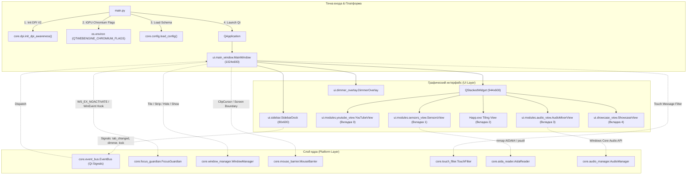

# DuckDock / TouchWM: Архитектурная спецификация модулей

> **Статус:** v0.1.3 (Актуальная спецификация)  
> **Целевая среда:** Windows 10/11 x64, 27" Primary (dGPU) + 7" 1024×600 JRP7813S Touchscreen (iGPU AMD Radeon Graphics).

---

## 1. Схема взаимодействия подсистем

---

## 2. Контракты ядра (Core Contracts)

### `AudioManager` (`core/audio_manager.py`)
Потокобезопасный синглтон-фасад к Windows Core Audio API через `pycaw` и `comtypes`.
* `get_master_volume() -> float`: Текущая общая громкость системы (0.0 — 1.0).
* `set_master_volume(volume: float) -> None`: Установка общего уровня громкости.
* `toggle_master_mute() -> bool`: Переключение общего Mute, возвращает актуальный статус.
* `get_audio_sessions() -> List[AudioSessionInfo]`: Сканирование процессов со звуковыми потоками (Pydantic v2 модель).
* `set_session_volume(pid: int, volume: float) -> None`: Индивидуальная громкость процесса.
* `toggle_session_mute(pid: int) -> bool`: Отключение/включение звука для конкретного PID.

### `FocusGuardian` (`core/focus_guardian.py`)
Обеспечивает режим Stealth Focus (`WS_EX_NOACTIVATE`) и защиту от потери фокуса приложениями основного экрана.
* `enable_stealth_mode(hwnd: int) -> None`: Наложение `WS_EX_NOACTIVATE` на окно.
* `start_hook() -> bool`: Запуск глобального хука `SetWinEventHook` (`EVENT_SYSTEM_FOREGROUND`).
* `stop_hook() -> None`: Деактивация хука событий.
* `on_touch_detected(primary_pos: Tuple[int, int]) -> None`: Реакция на сенсорное касание и возврат фокуса/курсора.

### `MouseBarrier` (`core/mouse_barrier.py`)
Изоляция мыши на основном экране с предотвращением случайного вылета на сенсорную панель.
* `clip_cursor_to_primary() -> bool`: Ограничение перемещения системного курсора границами dGPU монитора.
* `release_cursor() -> None`: Освобождение курсора (`ClipCursor(NULL)`).
* `save_cursor_pos() -> None`: Запоминание координат курсора перед тач-событием.
* `restore_cursor_pos() -> None`: Возврат курсора на запомненные координаты основного монитора.

### `TouchFilter` (`core/touch_filter.py`)
* `is_touch_event(msg: int, wparam: int, lparam: int) -> bool`: Дифференциация сенсорных касаний от кликов физической мыши.

### `WindowManager` (`core/window_manager.py`)
Низкоуровневые манипуляции окнами сторонних процессов через WinAPI.
* `find_window_by_process(exe_name: str) -> Optional[int]`: Поиск корневого HWND процесса.
* `strip_window_decorations(hwnd: int) -> bool`: Удаление системного заголовка (`WS_CAPTION`) и толстых рамок (`WS_THICKFRAME`).
* `tile_window(hwnd: int, rect: Tuple[int, int, int, int]) -> bool`: Принудительное позиционирование в область 944×600.
* `set_window_visible(hwnd: int, visible: bool) -> None`: Скрытие/отображение встроенного окна при переключении вкладок.

### `AidaReader` (`core/aida_reader.py`)
* `read_sensors() -> Dict[str, Any]`: Парсинг XML-структуры из Shared Memory AIDA64 (`AIDA64_SensorValues`).
* `is_available() -> bool`: Проверка доступности shared memory региона.

---

## 3. Шина событий (`core/event_bus.py`)

Централизованный диспетчер сигналов Qt:
* `tab_changed = Signal(int)`: Переключение активной вкладки рабочего пространства (0–4).
* `dimmer_toggled = Signal(bool)`: Включение/выключение сквозного затемнения.
* `lock_requested = Signal()`: Запрос блокировки сенсорного экрана.
* `audio_master_changed = Signal(float, bool)`: Оповещение об изменении общего звука `(volume, is_muted)`.
* `audio_session_changed = Signal(int, float, bool)`: Изменение сессии процесса `(pid, volume, is_muted)`.

---

## 4. Спецификация сенсорных компонентов UI (`ui/`)

* **Главное окно (`ui/main_window.py`)**: Размер 1024×600, `Qt.FramelessWindowHint`, `Qt.WA_ShowWithoutActivating`, горизонтальный `QHBoxLayout` (сайдбар 80px + стек 944px).
* **Сайдбар (`ui/sidebar.py`)**: Ширина 80px, сенсорные кнопки 64×64px с отступами, политика `Qt.NoFocus`.
* **Сенсорный слайдер (`TouchSlider` в `ui/modules/audio_view.py`)**:
  - `QSlider` с переопределенным `mousePressEvent`.
  - Мгновенный расчет позиции через `QStyle.sliderValueFromPosition` (установка значения в 1 тач без перетаскивания).
* **Кинетическая прокрутка**: `QScroller.grabGesture(..., QScroller.LeftMouseButtonGesture)` во всех скролл-списках.
