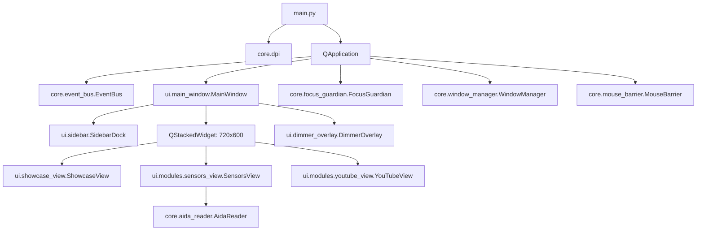

# DuckDock / TouchWM: Архитектурная спецификация модулей

## 1. Схема взаимодействия подсистем

## 2. Контракты ядра

* `WindowManager`:
  * `find_window_by_process(exe_name: str) -> Optional[int]`
  * `strip_window_decorations(hwnd: int) -> bool`
  * `tile_window(hwnd: int, rect: Tuple[int, int, int, int]) -> bool`
  * `set_window_visible(hwnd: int, visible: bool) -> None`

* `FocusGuardian`:
  * `enable_stealth_mode(hwnd: int) -> None`
  * `start_hook() -> bool`
  * `stop_hook() -> None`
  * `on_touch_detected(primary_pos: Tuple[int, int]) -> None`

* `AidaReader`:
  * `read_sensors() -> Dict[str, Any]`
  * `is_available() -> bool`
