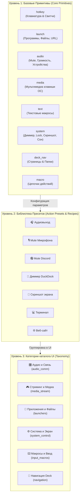
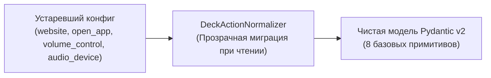

# Архитектурный план и спецификация: Реорганизация действий DuckDeck (Action Engine & Presets)

> **Статус:** Утверждено к реализации
> **Область:** `modules/deck/` (Models, ActionDispatcher, Editor, DTO, Drawer, Inspector)
> **Цель:** Полная ликвидация «свалки готовых действий», переход к строгой 3-уровневой архитектуре: **Базовые Примитивы $\rightarrow$ Библиотека Пресетов $\rightarrow$ Категории каталога**, с обеспечением 100% обратной совместимости существующих конфигураций.

---

## 1. Проблематика и архитектурная концепция

### 1.1. Первопричины деградации в «свалку»

При историческом развитии DuckDeck произошло смешение трёх разнородных понятий:

1. **Исполнительный движок (Execution Engine)**: как система физически взаимодействует с Windows (SendInput, запуск процесса, COM-аудио, WinAPI).
2. **Шаблоны конфигурации (Presets / Recipes)**: готовые пользовательские кнопки ("Mute Discord", "Скриншот экрана", "Терминал").
3. **Группировка каталога (Taxonomy)**: разделы для отображения в интерфейсе редактора.

В результате комбобокс инспектора отображал плоский список из 14 технических движков под именем _«Готовые действия»_, правая шторка содержала 24 пункта с дубликатами (`website`/`open_website`, `output_device_toggle`/`toggle_device`), а `ActionType` в Pydantic разросся до 26 литералов, часть из которых приводила к `unsupported_action` в диспетчере.

### 1.2. Целевая 3-уровневая архитектура



---

## 2. Уровень 1: 8 Базовых примитивов (Core Primitives)

Каждый базовый примитив ортогонален другим, решает ровно одну техническую задачу и имеет строго типизированные параметры Pydantic v2.

|   №   | ActionType     | Название            | Назначение и контракт параметров                                                                                                                                                                                                                                            | Поддерживаемые режимы                                                               |
| :---: | :------------- | :------------------ | :-------------------------------------------------------------------------------------------------------------------------------------------------------------------------------------------------------------------------------------------------------------------------- | :---------------------------------------------------------------------------------- |
| **1** | **`hotkey`**   | Клавиатурный ввод   | Эмуляция клавиатуры через Win32 `SendInput`.<br>`keys: list[str]` — комбинация клавиш;<br>`mode: Literal["press", "toggle"]`;<br>`toggle_keys: list[str] = []` — вторая позиция для переключателя.                                                                          | Одиночный клик, двухпозиционный тумблер (State 1 ⇄ State 2).                        |
| **2** | **`launch`**   | Запуск и открытие   | Универсальный запуск целей ОС через `ShellExecuteEx` / `subprocess.Popen`.<br>`target: str` — путь к `.exe`, файлу, папке или URL;<br>`args: list[str] = []` — аргументы командной строки;<br>`working_dir: Optional[str] = None`.                                          | Автоматическое определение типа: URL (`http/https`), исполняемый файл или документ. |
| **3** | **`audio`**    | Аудиоподсистема     | Управление громкостью, устройствами и микрофоном.<br>`target: Literal["master", "focus_app", "mic", "device"]`;<br>`command: Literal["toggle_mute", "step", "set_level", "toggle_device"]`;<br>`step_percent: int = 5`;<br>`devices: list[str] = ["Наушники", "Динамики"]`. | Замена разрозненных `volume_control`, `audio_device`, `system mic mute`.            |
| **4** | **`media`**    | Мультимедиа клавиши | Аппаратные виртуальные клавиши Windows мультимедиа.<br>`command: Literal["play_pause", "next_track", "prev_track", "stop", "volume_up", "volume_down"]`.                                                                                                                    | Управление плеерами Яндекс Музыка, Spotify, YouTube.                                |
| **5** | **`text`**     | Текстовый макрос    | Вставка шаблонного текста через буфер обмена Windows с эмуляцией Ctrl+V.<br>`text: str` — текст вставки;<br>`send_enter: bool = False` — автоматическое нажатие Enter.                                                                                                      | Быстрый ввод команд, промптов, фраз в чат.                                          |
| **6** | **`system`**   | Системный контроль  | Системные функции Windows и оболочки DuckDock.<br>`command: Literal["dimmer", "screenshot", "lock_pc", "sleep_display", "close_window"]`;<br>`screenshot_target: Literal["primary", "active_window"] = "primary"`.                                                          | Ночной режим 7" экрана, захват экрана, блокировка Win+L.                            |
| **7** | **`deck_nav`** | Навигация DuckDeck  | Перемещение по страницам и иерархическим папкам сетки.<br>`target: Literal["next_page", "prev_page", "goto_page", "folder_open", "folder_back"]`;<br>`page_id: Optional[str] = None`.                                                                                       | Листание страниц 2x5, вход и выход из папок.                                        |
| **8** | **`macro`**    | Мульти-действие     | Последовательное выполнение цепочки примитивов.<br>`steps: list[DeckActionConfig]`;<br>`delay_ms: int = 50`.                                                                                                                                                                | Запуск сложных цепочек сценариев.                                                   |

---

## 3. Уровень 2: Таксономия каталога (6 Категорий)

Каталог правой шторки (Action Library Drawer) группирует пресеты по 6 человекопонятным разделам:

1. 🎛️ **`audio_comm` (Аудио и Связь)**:
   - Управление системным микрофоном, переключение вывода звука, раздельная громкость приложений и горячие клавиши мессенджеров (Discord, Teams).
2. 🎮 **`media_stream` (Медиа и Стриминг)**:
   - Управление медиаплеером, саундборд, горячие клавиши OBS Studio (запись, стрим, смена сцен).
3. 🚀 **`launchers` (Приложения и Файлы)**:
   - Быстрый запуск часто используемого софта, открытие рабочих каталогов, системных папок и веб-сервисов.
4. ⚙️ **`system_control` (Система и Экран)**:
   - Режимы дисплея DuckDock (диммер, засыпание), скриншоты экрана/окна, блокировка ПК, закрытие окон.
5. ⌨️ **`input_macros` (Ввод и Макросы)**:
   - Произвольные хоткеи, двухпозиционные триггеры, текстовые сниппеты и сложные макро-последовательности.
6. 🧭 **`navigation` (Навигация DuckDeck)**:
   - Страницы сетки, переход на страницу по номеру, папки и подсетки.

---

## 4. Уровень 3: Реестр готовых пресетов (Presets Registry)

Пресет инкапсулирует базовый примитив, предоставляя готовую плитку «из коробки»:

```python
class ActionPresetDefinition(BaseModel):
    id: str                          # Уникальный ID пресета (например "discord_mute")
    category: str                    # ID категории из таксономии ("audio_comm")
    title_key: str                   # Ключ локализации названия
    desc_key: str                    # Ключ локализации описания/тултипа
    icon: str                        # Эмодзи/иконка по умолчанию
    color_accent: str                # Неоновый акцент по умолчанию
    status_source: Optional[str]     # Источник Live-статуса ("mic_mute", "audio_device", "dimmer")
    base_action: DeckActionConfig    # Сконфигурированный базовый примитив
    keywords: list[str]              # Двуязычные поисковые теги (RU/EN)
```

### Эталонная матрица пресетов

| Категория            | ID Пресета             | Иконка |  Акцент   | Базовый примитив | Преднастроенные параметры                                         |
| :------------------- | :--------------------- | :----: | :-------: | :--------------- | :---------------------------------------------------------------- |
| **`audio_comm`**     | `output_device_toggle` |   🎧   | `#06b6d4` | `audio`          | `target="device", command="toggle_device", status="audio_device"` |
|                      | `mic_mute_toggle`      |   🎙️   | `#ef4444` | `audio`          | `target="mic", command="toggle_mute", status="mic_mute"`          |
|                      | `focus_app_vol_up`     |  🔊+   | `#10b981` | `audio`          | `target="focus_app", command="step", step_percent=5`              |
|                      | `focus_app_vol_down`   |  🔉-   | `#10b981` | `audio`          | `target="focus_app", command="step", step_percent=-5`             |
|                      | `discord_mute`         |   🎤   | `#818cf8` | `hotkey`         | `keys=["ctrl", "shift", "m"]`                                     |
|                      | `discord_deafen`       |   🎧   | `#818cf8` | `hotkey`         | `keys=["ctrl", "shift", "d"]`                                     |
| **`media_stream`**   | `media_play_pause`     |   ⏯️   | `#f59e0b` | `media`          | `command="play_pause"`                                            |
|                      | `media_next_track`     |   ⏭️   | `#f59e0b` | `media`          | `command="next_track"`                                            |
|                      | `media_prev_track`     |   ⏮️   | `#f59e0b` | `media`          | `command="prev_track"`                                            |
|                      | `obs_record_toggle`    |   ⏺️   | `#dc2626` | `hotkey`         | `keys=["ctrl", "f9"]`                                             |
|                      | `soundboard_play`      |   🎵   | `#a855f7` | `audio`          | `target="soundboard", file_path=""`                               |
| **`system_control`** | `toggle_dimmer`        |   🌙   | `#f59e0b` | `system`         | `command="dimmer", status="dimmer"`                               |
|                      | `screenshot_primary`   |   📸   | `#38bdf8` | `system`         | `command="screenshot", screenshot_target="primary"`               |
|                      | `lock_workstation`     |   🔒   | `#ef4444` | `system`         | `command="lock_pc"`                                               |
|                      | `show_desktop`         |   🗔    | `#06b6d4` | `hotkey`         | `keys=["win", "d"]`                                               |
|                      | `task_manager`         |   ⚡   | `#10b981` | `hotkey`         | `keys=["ctrl", "shift", "esc"]`                                   |
| **`launchers`**      | `launch_terminal`      |   💻   | `#10b981` | `launch`         | `target="wt.exe"`                                                 |
|                      | `launch_browser`       |   🌐   | `#38bdf8` | `launch`         | `target="https://"`                                               |
|                      | `open_downloads`       |   📂   | `#f59e0b` | `launch`         | `target="%USERPROFILE%\\Downloads"`                               |
| **`input_macros`**   | `custom_hotkey`        |   ⌨️   | `#38bdf8` | `hotkey`         | `keys=[]`                                                         |
|                      | `hotkey_toggle`        |   ⇄    | `#a855f7` | `hotkey`         | `mode="toggle"`                                                   |
|                      | `paste_text`           |   📝   | `#10b981` | `text`           | `text="", send_enter=False`                                       |
| **`navigation`**     | `nav_next_page`        |   ▶    | `#71717a` | `deck_nav`       | `target="next_page"`                                              |
|                      | `nav_prev_page`        |   ◀    | `#71717a` | `deck_nav`       | `target="prev_page"`                                              |
|                      | `create_folder`        |   📁   | `#f59e0b` | `deck_nav`       | `target="folder_open"`                                            |

---

## 5. Обратная совместимость, миграция данных и инварианты первого запуска (Zero-Downtime & Clean Startup)

### 5.1. Нормализация устаревших типов конфигурации

Для защиты существующих пользовательских файлов `deck_config.json` в `DeckConfigLoader` и `DeckConfigAdapter` встроен фасад автоматической нормализации:



#### Таблица правил трансляции устаревших типов:

- `website` ($\text{url}$) $\rightarrow$ `launch` ($\text{target}=\text{url}, \text{kind}="url"$)
- `open_app` ($\text{executable}, \text{args}$) $\rightarrow$ `launch` ($\text{target}=\text{executable}, \text{args}=\text{args}$)
- `open_path` ($\text{path}$) $\rightarrow$ `launch` ($\text{target}=\text{path}$)
- `volume_control` ($\text{target}, \text{command}$) $\rightarrow$ `audio` ($\text{target}=\text{target}, \text{command}=\text{command}$)
- `audio_device` ($\text{mode}, \text{devices}$) $\rightarrow$ `audio` ($\text{target}="device", \text{command}="toggle_device"$)
- `hotkey_switch` ($\text{state\_1}, \text{state\_2}$) $\rightarrow$ `hotkey` ($\text{mode}="toggle"$)
- `system` ($\text{command}="toggle\_dimmer"$) $\rightarrow$ `system` ($\text{command}="dimmer"$)

### 5.2. Инвариант чистого первого запуска и защита от мутаций (First-Run & Zero-Mutation Invariant)

В ходе разработки был выявлен и устранен критический архитектурный дефект: при первом запуске (или после удаления страниц) DuckDeck создавал 2 дефолтные страницы с 10 хардкодными демо-кнопками (Discord, OBS, Spotify, Calc, Dimmer и т.д.), сдвигая кастомные страницы пользователя на позицию 3, а запуск редактора с флагом `--editor` принудительно перезаписывал холст через `load_demo_profile_into_window`.

Для устранения проблемы зафиксированы 4 строгих правила:

1. **Factory Default (1 чистая страница):**
   Метод `DeckConfigLoader.get_default_config()` при отсутствии файла конфигурации создает строго **1 пустую страницу** без кнопок:
   ```python
   pages=[
       DeckPageConfig(
           id="default",
           name="Основной",
           grid_rows=2,
           grid_cols=5,
           buttons=[],  # Чистая страница без демо-кнопок
       )
   ]
   ```
2. **Чистый запуск редактора (`main.py`):**
   При старте редактора (`--editor` / `--deck-editor`) принудительный вызов `load_demo_profile_into_window()` полностью устранен. Редактор всегда открывает актуальный пользовательский файл `config/deck_config.json`, сохраняя его исходную структуру.
3. **Изоляция тестов (Zero Mutation Invariant):**
   Тестовый набор (`pytest tests/`) категорически не имеет права читать или мутировать боевой файл `config/deck_config.json`. Все тесты используют изолированную фикстуру `sample_two_page_deck_config_path` (или `isolated_deck_config`) в песочнице `tmp_path`.
4. **Прямая навигация `deck_nav`:**
   В `modules/deck/view.py` обработчик нажатия кнопок поддерживает примитив `deck_nav` наряду с `navigation` (`if btn_config.action.action_type in ("navigation", "deck_nav"):`), обеспечивая мгновенное переключение страниц внутри интерфейса без блокировки GUI-потока.

---

## 6. Редизайн компонентов UI Редактора

### 6.1. ButtonPropertyForm (Инспектор свойств)

- **Разделение полей**:
  1. Выпадающий список **«Тип действия»** (строго 8 базовых примитивов с иконками).
  2. Кнопка с выпадающим меню **«⚡ Шаблоны...»** (быстрое заполнение кнопки из каталога пресетов) + кнопка очистки слота 🗑️.
- **Поддержка чистого состояния первого запуска (Unconfigured Slot)**:
  - При выделении пустого слота (сетка 2x5 после чистого первого запуска) инспектор находится в нейтральном неконфигурированном состоянии без ложной подстановки устаревших значений (например, «System: Hotkey»).
  - Выбор пресета из меню «Шаблоны...» или правой шторки мгновенно заполняет слот и переводит его в настроенное состояние.
  - Кнопка корзины 🗑️ сбрасывает слот до чистого неконфигурированного состояния.
- **Стек параметров**:
  - 11 разрозненных старых подформ заменяются на компактные виджеты с фиксированной высотой $28\text{ px}$:
    - `HotkeySubform` (ввод хоткея, тумблер mode press/toggle);
    - `LaunchSubform` (путь/URL, кнопка обзора `QFileDialog`, аргументы);
    - `AudioSubform` (цель, команда, шаг, саундборд);
    - `MediaSubform` (команды мультимедиа);
    - `TextSubform` (текст, флаг Enter);
    - `SystemSubform` (команды диммера, скриншота, блокировки);
    - `DeckNavSubform` (команда навигации: следующая/предыдущая, переход к конкретной странице `goto_page` с выбором из существующих страниц профиля);
    - `MacroSubform` (информационная плашка шагов макроса).

### 6.2. ActionLibraryDrawer (Каталог библиотеки справа)

- Отображает 6 структурированных категорий таксономии.
- При клике на карточку пресета в выбранную кнопку DuckDeck переносятся:
  - Иконка по умолчанию (`icon`);
  - Заголовок (`title`);
  - Акцентный цвет (`color_accent`);
  - Привязка к Live-статусу (`status_source`);
  - Конфигурация базового действия (`DeckActionConfig`).

---

## 7. Actionable Roadmap реализации

### Матрица ответственности (RACI)

| Роль агента                 | Зона ответственности                                                                                | Режим инструментов     |
| :-------------------------- | :-------------------------------------------------------------------------------------------------- | :--------------------- |
| **`@deep-researcher`**      | Архитектурный аудит контрактов, инвентаризация legacy-типов, спецификация таксономии и UX-бюджета   | **STRICT READ-ONLY**   |
| **`@fullstack-builder`**    | Модели Pydantic v2, нормализатор миграции, ActionDispatcher, DTO, адаптер конфигураций              | Полный доступ          |
| **`@frontend-ui-designer`** | Редизайн `ButtonPropertyForm`, меню шаблонов, подформы параметров, `ActionLibraryDrawer`, стили QSS | UI & Styles Only       |
| **`@bug-hunter`**           | TDD юнит-тесты моделей и нормализатора, регрессионные тесты диспетчера, E2E тесты редактора         | Изменение кода + Тесты |
| **`@code-review`**          | Pre-Flight аудит: паритет локалей RU/EN, инварианты фокуса (Qt.NoFocus), чистота diff, DoD          | **STRICT READ-ONLY**   |
| **`@git-release-master`**   | Фиксация релизных тегов, актуализация Changelog, синхронизация памяти Serena и Memory Bank          | Релизный цикл          |

---

### Этап 1: Модели данных Pydantic v2 и нормализатор миграции (Data Layer & Zero-Downtime Migration) [✓ ВЫПОЛНЕНО]

#### Шаг 1.1: Архитектурный аудит существующих схем и матрица нормализации [✓]

- **Ответственный:** `@deep-researcher`
- **Файлы:** `modules/deck/models.py`, `tests/modules/deck/test_deck_actions.py`
- **Пояснение и содержание работ:**
  1. Провести полную инвентаризацию всех 26 устаревших значений `ActionType` и связанных параметров в существующей кодовой базе.
  2. Зафиксировать точные правила взаимно-однозначного маппинга для каждого устаревшего типа в 8 новых примитивов (`hotkey`, `launch`, `audio`, `media`, `text`, `system`, `deck_nav`, `macro`).
  3. Составить спецификацию для граничных случаев: сохранение пути `working_dir` и аргументов `args` при конвертации `open_app` $\rightarrow$ `launch`, преобразование `volume_control` (`target="focus_app"` / `"master"` / `"microphone"`) в параметры `AudioActionParams`, маппинг `hotkey_switch` в двухпозиционный `hotkey` с флагом `mode="toggle"`.
  4. Сформировать спецификацию модели `ActionPresetDefinition` для каталога готовых действий.

#### Шаг 1.2: Схемы Pydantic v2 для 8 базовых примитивов, спецификация `ActionPresetDefinition` и чистый Factory Default [✓]

- **Ответственный:** `@fullstack-builder`
- **Файлы:** `modules/deck/models.py`
- **Пояснение и содержание работ:**
  1. Зафиксировать в `modules/deck/models.py` чистый литерал:
     ```python
     ActionType = Literal[
         "hotkey",    # Клавиатурный ввод и двухпозиционные тумблеры
         "launch",    # Запуск процессов, файлов, папок и веб-ссылок
         "audio",     # Громкость, микрофон, переключение устройств и саундборд
         "media",     # Мультимедийные клавиши Windows
         "text",      # Текстовые сниппеты с авто-вставкой
         "system",    # Системные функции (диммер, скриншот, блокировка)
         "deck_nav",  # Навигация по страницам и папкам макро-панели
         "macro",     # Последовательные цепочки действий
     ]
     ```
  2. Создать типизированные Pydantic v2 модели параметров для каждого базового примитива (`HotkeyActionParams`, `LaunchActionParams`, `AudioActionParams`, `MediaActionParams`, `TextActionParams`, `SystemActionParams`, `DeckNavActionParams`, `MacroActionParams`).
  3. Создать декларативную модель пресета `ActionPresetDefinition` (с полями `id`, `category`, `title_key`, `desc_key`, `icon`, `color_accent`, `status_source`, `base_action`, `keywords`).
  4. Реализовать инвариант чистого первого запуска в `DeckConfigLoader.get_default_config()`: при отсутствии файла конфигурации создается ровно **1 пустая страница** без кнопок (`pages=[DeckPageConfig(id="default", name="Основной", grid_rows=2, grid_cols=5, buttons=[])]`), исключая появление фантомных дефолтных страниц.
  5. Обновить метод `DeckActionConfig.get_typed_params()` для возврата строго типизированного объекта одной из 8 новых моделей.

#### Шаг 1.3: Реализация `DeckActionNormalizer` и хука валидации `model_validator` [✓]

- **Ответственный:** `@fullstack-builder`
- **Файлы:** `modules/deck/models.py`
- **Пояснение и содержание работ:**
  1. Реализовать класс `DeckActionNormalizer` с методом `normalize_dict(data: dict[str, Any]) -> dict[str, Any]`.
  2. Встроить в `DeckActionConfig` валидатор до валидации полей:
     ```python
     @model_validator(mode="before")
     @classmethod
     def _normalize_legacy_action(cls, data: Any) -> Any:
         if isinstance(data, dict):
             return DeckActionNormalizer.normalize_dict(data)
         return data
     ```
  3. Обеспечить прозрачную трансляцию устаревших ключей параметров (`executable`, `url`, `path`, `state_1`, `state_2`) в единое поле `action_params` новой модели.
  4. Гарантировать сохранение пользовательских параметров при последующей сериализации (`model_dump()`), автоматически переводя старый конфиг на новый формат при первой же перезаписи.

#### Шаг 1.4: TDD-тестирование сериализации, валидации и миграции данных [✓]

- **Ответственный:** `@bug-hunter`
- **Файлы:** `tests/modules/deck/test_deck_actions.py`, `tests/unit/test_deck_actions_extended.py`, `tests/conftest.py`
- **Пояснение и содержание работ:**
  1. Написать параметризованный тест для проверки миграции каждого из 18+ устаревших типов конфигураций (`website`, `open_app`, `open_path`, `volume_control`, `audio_device`, `hotkey_switch`, `screenshot`, `play_audio`, `stop_audio`, `system` и т.д.).
  2. Проверить валидацию каждого из 8 новых примитивов с валидными и невалидными значениями параметров.
  3. Проверить сериализацию/десериализацию через `model_dump_json()` и `model_validate_json()`.
  4. Внедрить в `tests/conftest.py` изолирующую фикстуру `sample_two_page_deck_config_path` (в песочнице `tmp_path`), гарантируя нулевую мутацию боевого файла `config/deck_config.json` при прогоне тестов.
  5. Убедиться, что все тесты `tests/modules/deck/` продолжают успешно проходить без единой ошибки (`100% PASS`).

---

### Этап 2: Реестр пресетов и модернизация ActionDispatcher (Presets & Dispatcher Layer) [✓ ВЫПОЛНЕНО]

#### Шаг 2.1: Проектирование таксономии и двуязычная локализация (Localization-First RU/EN) [✓]

- **Ответственный:** `@deep-researcher` & `@fullstack-builder`
- **Файлы:** `locales/ru.json`, `locales/en.json`, `tests/core/test_i18n_linter.py`
- **Пояснение и содержание работ:**
  1. Внести в `locales/ru.json` и `locales/en.json` секции для 6 категорий каталога пресетов (`deck.editor.categories.*`).
  2. Добавить ключи локализации названий и подсказок для всех пресетов эталонной матрицы.
  3. Добавить ключи названий 8 базовых примитивов (`deck.editor.primitives.*`).
  4. Запустить линтер `pytest tests/core/test_i18n_linter.py` и обеспечить 100% паритет ключей RU/EN.

#### Шаг 2.2: Реализация `ActionPresetsRegistry` и обновление DTO контрактов [✓]

- **Ответственный:** `@fullstack-builder`
- **Файлы:** `modules/deck/presets.py`, `modules/deck/editor/dto.py`
- **Пояснение и содержание работ:**
  1. Реализовать реестр пресетов `ActionPresetsRegistry` с 6 категориями и эталонными пресетами.
  2. Наполнить реестр эталонной матрицей пресетов с привязкой к категориям, цветам, иконкам и `DeckActionConfig`.
  3. Реализовать методы выборки и двуязычного поиска (`get_all_presets`, `get_preset_by_id`, `get_presets_by_category`, `search_presets`).
  4. В `modules/deck/editor/dto.py` расширить `ActionItemDTO` полями пресетов.

#### Шаг 2.3: Рефакторинг `ActionDispatcher` и `ActionRunnable` на чистый match-case [✓]

- **Ответственный:** `@fullstack-builder`
- **Файлы:** `modules/deck/action_dispatcher.py`, `modules/deck/view.py`, `main.py`
- **Пояснение и содержание работ:**
  1. В `ActionRunnable.run()` реализовать строгий `match action_type:` по 8 базовым примитивам (`hotkey`, `launch`, `audio`, `media`, `text`, `system`, `deck_nav`, `macro`).
  2. В `modules/deck/view.py` включить поддержку `deck_nav` наряду с `navigation` для мгновенного переключения страниц без блокировки GUI.
  3. В `main.py` убрать принудительный вызов `load_demo_profile_into_window`, обеспечив открытие пользовательского файла настроек без инъекции демо-кнопок.
  4. Сохранить инвариант защиты от дребезга сенсорного ввода (cooldown 250 мс) и Sibling Isolation.

#### Шаг 2.4: Юнит-тестирование исполнения 8 примитивов диспетчера [✓]

- **Ответственный:** `@bug-hunter`
- **Файлы:** `tests/modules/deck/test_deck_actions.py`, `tests/unit/test_deck_presets_and_executors.py`
- **Пояснение и содержание работ:**
  1. Написать изолированные тесты для каждой из 8 ветвей `match-case` диспетчера.
  2. Протестировать цепочку выполнения мульти-действий `macro` и обработку некорректных параметров.
  3. Проверить отсутствие мутаций боевого конфига и утечек потоков в `QThreadPool`.
  4. Подтвердить 100% PASS всего тестового набора (`518 PASS`).

---

### Этап 3: Редизайн интерфейса инспектора и библиотеки (Inspector & Action Drawer UX)

#### Шаг 3.1: Архитектурный UX/UI аудит компоновки, бюджет высоты 220 px и поддержка чистого состояния (Unconfigured State)

- **Ответственный:** `@frontend-ui-designer` & `@deep-researcher`
- **Файлы:** `modules/deck/editor/styles.py`, `modules/deck/editor/widgets/button_property_form.py`
- **Пояснение и содержание работ:**
  1. Спроектировать двухрядную компоновку выбора действий в инспекторе `ButtonPropertyForm`:
     - Ряд 1: Выпадающий список **«Тип действия»** (строго 8 базовых примитивов с иконками, высота 28 px).
     - Ряд 2: Кнопка с выпадающим меню **«⚡ Шаблоны...»** (`QMenu` со структурированными подменю по 6 категориям) + кнопка сброса/очистки слота 🗑️.
  2. Зафиксировать жесткий бюджет вертикального пространства инспектора: высота блока параметров не должна превышать $56\text{ px}$ (2 ряда по $28\text{ px}$), а общая высота инспектора строго укладывается в $220\text{ px}$.
  3. **Учет инварианта первого запуска (Unconfigured Slot State):**
     - В связи с тем, что при первом запуске создается 1 пустая страница без кнопок, инспектор при клике на пустой слот обязан отображать нейтральное пустое состояние (Empty State) без ложного выставления устаревших значений (например, «System: Hotkey»).
     - Выбор пресета из меню «⚡ Шаблоны...» или перетаскивание из `ActionLibraryDrawer` переводит слот в настроенное состояние.
     - Кнопка корзины 🗑️ очищает слот обратно в неконфигурированное состояние.
  4. Убедиться, что всем интерактивным элементам (кнопки, комбобоксы, слайдеры) принудительно задается `self.setFocusPolicy(Qt.NoFocus)` для соблюдения инварианта Stealth Focus.

#### Шаг 3.2: Редизайн `ButtonPropertyForm` и унификация стека подформ параметров

- **Ответственный:** `@frontend-ui-designer`
- **Файлы:** `modules/deck/editor/widgets/button_property_form.py`
- **Пояснение и содержание работ:**
  1. В `ButtonPropertyForm` заменить комбобокс `ACTION_PRESET_KEYS` (содержавший 14 смешанных действий) на чистый список 8 базовых примитивов (`hotkey`, `launch`, `audio`, `media`, `text`, `system`, `deck_nav`, `macro`).
  2. Добавить кнопку `btn_presets_menu` («⚡ Шаблоны...») с динамически генерируемым `QMenu`, сгруппированным по 6 категориям из `ActionPresetsRegistry`. Выбор пресета мгновенно заполняет иконку кнопки, название, цвет, источник статуса и параметры базового действия.
  3. Реализовать стек компактных специализированных подформ ($\le 28\text{ px}$):
     - `HotkeySubform` (захват клавиш, тумблер mode press/toggle).
     - `LaunchSubform` (поле пути/URL, кнопка обзора `QFileDialog`, аргументы).
     - `AudioSubform` (цель: master/focus_app/mic/device/soundboard, команда, шаг).
     - `MediaSubform` (комбобокс мультимедийных команд).
     - `TextSubform` (ввод текста макроса, чекбокс "Enter").
     - `SystemSubform` (выбор системной команды: диммер, скриншот, lock, sleep).
     - **`DeckNavSubform`** (команды навигации: `next_page`, `prev_page`, `goto_page`, `folder_open`, `folder_back`; при `goto_page` — динамический комбобокс доступных страниц профиля).
     - `MacroSubform` (информационная плашка шагов макроса).
     - `UnconfiguredSubform` (нейтральная плашка «Слот не настроен» с кнопкой вызова шаблонов).
  4. Обновить логику `load_slot_data(dto)`: при получении неконфигурированного слота форма не подставляет фиктивные значения, а переходит в `UnconfiguredSubform`.
  5. Реализовать полноценный метод `retranslate_ui()`: динамическое обновление всех текстовых меток, пунктов комбобоксов, тултипов и пунктов меню шаблонов без сброса введенных пользователем значений.

#### Шаг 3.3: Модернизация каталога пресетов `ActionLibraryDrawer` и карточек категорий

- **Ответственный:** `@frontend-ui-designer`
- **Файлы:** `modules/deck/editor/widgets/action_drawer.py`, `modules/deck/editor/widgets/action_category.py`, `modules/deck/editor/widgets/action_item.py`
- **Пояснение и содержание работ:**
  1. В `ActionLibraryDrawer` переключить источник данных на `ActionPresetsRegistry.get_categories_dto()`.
  2. Обеспечить отображение 6 структурированных категорий с иконками и локализованными заголовками.
  3. В `ActionCategorySection` и `ActionItemWidget`: при клике на плитку пресета испускать сигнал `action_selected` с полным объектом `ActionPresetDefinition`.
  4. Поддержать быстрое наполнение пустой сетки: назначение пресета на пустой слот в 1 клик или через Drag & Drop.
  5. Обеспечить сквозной поиск через `ActionSearchBar` по двуязычным поисковым тегам (`keywords`) в реальном времени с показом плейсхолдера при отсутствии результатов.
  6. Поддержать реактивную смену языка через каскадный вызов `retranslate_ui()`.

#### Шаг 3.4: Тестирование UI компонентов инспектора и шторки

- **Ответственный:** `@bug-hunter`
- **Файлы:** `tests/unit/test_deck_property_form.py`, `tests/unit/test_deck_property_form_subforms.py`, `tests/unit/test_deck_editor_action_drawer.py`
- **Пояснение и содержание работ:**
  1. Обновить тесты формы инспектора: проверка корректной смены подформ при переключении комбобокса 8 примитивов.
  2. Проверить работу с неконфигурированным слотом первого запуска (Unconfigured State).
  3. Проверить работу подформы `DeckNavSubform` (переключение команд, выбор страницы).
  4. Проверить применение пресета из меню «Шаблоны...» и шторки с корректным обновлением всех полей формы.
  5. Протестировать фильтрацию карточек в `ActionLibraryDrawer` по русским и английским поисковым фразам.
  6. Проверить вызовы `retranslate_ui()` и подтвердить отсутствие потери фокуса (инвариант `Qt.NoFocus`).
  7. Обеспечить изоляцию всех тестов через `tmp_path` (Zero Mutation боевого конфига).

#### Запуск шагов [3.1 - 3.4]:

```text
#### Запуск шага 3.1:
@deep-researcher и @frontend-ui-designer проведите UX/UI аудит шага 3.1 из .md/deck/deck_action.md:
1. Зафиксируйте габариты компонентов инспектора ButtonPropertyForm: высота подформ <= 56 px, общий бюджет <= 220 px.
2. Согласуйте структуру выпадающего меню пресетов по 6 категориям и пустое состояние неконфигурированного слота (Unconfigured State).

#### Запуск шагов [3.2 - 3.3]:
@frontend-ui-designer реализуй шаги 3.2 и 3.3 из .md/deck/deck_action.md:
1. В modules/deck/editor/widgets/button_property_form.py сократи комбобокс действий до 8 примитивов, добавь меню шаблонов btn_presets_menu, DeckNavSubform, UnconfiguredSubform и компактные подформы.
2. В modules/deck/editor/widgets/action_drawer.py подключи загрузку категорий из ActionPresetsRegistry с двуязычным поиском и наполнением пустых слотов.
3. Обеспечь строгое соблюдение Qt.NoFocus на всех создаваемых виджетах и поддержку retranslate_ui().
Критерий завершения: инспектор укладывается в 220 px, корректно работает со слотами чистого первого запуска, шторка отображает 6 категорий пресетов, переключение языка работает мгновенно.

#### Запуск шага 3.4:
@bug-hunter реализуй шаг 3.4 из .md/deck/deck_action.md:
1. Обнови тесты в tests/unit/test_deck_property_form.py, tests/unit/test_deck_property_form_subforms.py и tests/unit/test_deck_editor_action_drawer.py (включая DeckNavSubform и пустые слоты).
2. Убедись в изоляции тестовых конфигураций (Zero Mutation) и успешном прохождении всех UI-тестов инспектора и шторки.

#### Pre-Flight проверка Этапа 3:
@code-review проведи аудит реализации Этапа 3:
1. Проверь отсутствие перехвата фокуса (Qt.NoFocus) и соблюдение визуального бюджета 220 px.
2. Проверь корректность обработки неконфигурированных слотов первого запуска и работу DeckNavSubform.
3. Проверь отсутствие хардкода строк в UI и корректность вызовов t().
4. Запусти pytest tests/unit/test_deck_property_form*.py tests/unit/test_deck_editor_action_drawer.py.
```

---

### Этап 4: Интеграция, сквозное E2E тестирование и Definition of Done (Release Stabilization)

#### Шаг 4.1: Адаптация связующих слоев `DeckConfigAdapter`, `commands.py` и Drag & Drop

- **Ответственный:** `@fullstack-builder`
- **Файлы:** `modules/deck/editor/adapter.py`, `modules/deck/editor/commands.py`, `modules/deck/editor/manager.py`
- **Пояснение и содержание работ:**
  1. В `DeckConfigAdapter` обновить маппинг `ButtonSlotDTO` $\longleftrightarrow$ `DeckButtonConfig` для бесшовной поддержки 8 примитивов и метаданных пресетов.
  2. В `modules/deck/editor/commands.py` обеспечить корректную запись в стек отмены (Undo/Redo) при применении пресета к слоту сетки.
  3. Проверить и стабилизировать Drag-and-Drop: перетаскивание карточки пресета из `ActionLibraryDrawer` на ячейку `GridCellWidget` должно полностью конфигурировать слот (иконка, акцент, заголовок, базовое действие).

#### Шаг 4.2: Сквозное E2E тестирование сценариев настройки и сохранения DuckDeck

- **Ответственный:** `@bug-hunter` & `@fullstack-builder`
- **Файлы:** `tests/integration/test_deck_editor_e2e.py`, `tests/integration/test_deck_integration.py`
- **Пояснение и содержание работ:**
  1. Реализовать сквозной E2E тест:
     - Запуск окна редактора DuckDeck.
     - Выбор ячейки сетки (слот 0).
     - Выбор пресета "output_device_toggle" из категории "audio_comm" в правой шторке.
     - Проверка обновления DTO слота (иконка 🎧, цвет `#06b6d4`, статус `audio_device`, действие `audio`).
     - Изменение параметров через подформу (выбор конкретного устройства).
     - Сохранение конфигурации в `deck.json` и верификация валидности сохраненного JSON-файла.
  2. Реализовать тест обратной совместимости:
     - Загрузка устаревшего конфигурационного файла, содержащего `website`, `volume_control` и `audio_device`.
     - Проверка, что редактор и сетка успешно инициализируются, отображают кнопки и нормализуют действия без ошибок.
  3. Проверить отмену и повтор действий (Undo/Redo) при смене пресетов.

#### Шаг 4.3: Pre-Flight аудит кодовой базы, проверка инвариантов и Definition of Done

- **Ответственный:** `@code-review` & `@git-release-master`
- **Файлы:** Кодовая база проекта, `pyproject.toml`, `.md/changelog.md`, Memory Bank, MCP Serena
- **Пояснение и содержание работ:**
  1. Запустить полный цикл тестов: `pytest tests/` (100% PASS, 0 FAILED).
  2. Запустить линтер локализации: `pytest tests/core/test_i18n_linter.py` (100% паритет ключей, отсутствие хардкода).
  3. Проверить соблюдение 5 законов модульности (`GEMINI.md`): The Dependency Rule, Sibling Isolation, EventBus Weak Coupling, Stealth Focus Invariant, Re-export Shims.
  4. Обновить документацию и семантическую память:
     - Актуализировать `.md/backend.md` и `.md/changelog.md` (секция нового релиза).
     - Обновить слепки в MCP Serena (`architecture`, `deck_subsystem`).
     - Актуализировать файлы Memory Bank (`activeContext.md`, `progress.md`).

#### Запуск шагов [4.1 - 4.3]:

```text
#### Запуск шага 4.1:
@fullstack-builder реализуй шаг 4.1 из .md/deck/deck_action.md:
1. В modules/deck/editor/adapter.py и manager.py обеспечь маппинг ButtonSlotDTO и поддержку Drag & Drop пресетов.
2. В modules/deck/editor/commands.py обеспечь сохранение полной истории Undo/Redo для новых пресетов.

#### Запуск шага 4.2:
@bug-hunter и @fullstack-builder реализуйте шаг 4.2 из .md/deck/deck_action.md:
1. В tests/integration/test_deck_editor_e2e.py добавь сквозной E2E-тест выбора пресета, редактирования подформы, сохранения и нормализации legacy-файлов.
2. Запусти pytest tests/integration/ и убедись в успешном прохождении интеграционных сценариев.

#### Финальный аудит шага 4.3 (Definition of Done):
@code-review проведи финальный Pre-Flight аудит всего проекта:
1. Запусти полный набор тестов: pytest tests/. Все тесты обязаны завершиться со статусом PASS.
2. Запусти линтер локализации: pytest tests/core/test_i18n_linter.py (100% паритет RU/EN).
3. Проверь отсутствие хардкода строк в UI, отсутствие перехвата фокуса (Qt.NoFocus) и чистоту git diff.

#### Релизная синхронизация:
@git-release-master зафиксируй релиз:
1. Актуализируй .md/changelog.md и версию в pyproject.toml.
2. Синхронизируй семантическую память Serena (write_memory) и файлы Memory Bank (activeContext.md, progress.md).
```

---

## 8. Чек-лист соответствия Definition of Done

- [x] **Data Layer & Models**:
  - [x] 8 базовых примитивов зафиксированы в `ActionType` (`hotkey`, `launch`, `audio`, `media`, `text`, `system`, `deck_nav`, `macro`).
  - [x] Модели параметров примитивов строго типизированы в Pydantic v2 без использования `Any`.
  - [x] Модель `ActionPresetDefinition` описывает готовые карточки каталога.
  - [x] Класс `DeckActionNormalizer` прозрачно мигрирует все 18+ устаревших типов конфигураций при чтении.
  - [x] Инвариант чистого первого запуска (Factory Default): `DeckConfigLoader.get_default_config()` возвращает ровно 1 пустую страницу (`buttons=[]`).
- [x] **Presets & Dispatcher Layer**:
  - [x] Реестр `ActionPresetsRegistry` содержит 6 категорий и 20+ преднастроенных пресетов эталонной матрицы.
  - [x] В `ActionDispatcher` и `ActionRunnable` реализован чистый `match-case` по 8 базовым примитивам.
  - [x] Изоляция COM-аудио и The Dependency Rule строго соблюдены (нет прямых импортов `AudioManager` или UI).
  - [x] Защита от дребезга сенсорного экрана (cooldown 250 мс) и возврат сигналов в GUI поток сохранены.
  - [x] Поддержка переключения страниц сетки `deck_nav` в `DeckView`.
  - [x] Чистый запуск редактора в `main.py` без инъекции `load_demo_profile_into_window`.
- [ ] **UI Inspector & Action Library Drawer (Этап 3)**:
  - [ ] В `ButtonPropertyForm` комбобокс действий сокращен до 8 базовых примитивов.
  - [ ] Добавлено выпадающее меню пресетов «⚡ Шаблоны...», сгруппированное по 6 категориям.
  - [ ] Поддержка чистого состояния неконфигурированного слота (Unconfigured State) для 1-й пустой страницы.
  - [ ] Стек параметров сокращен до компактных специализированных подформ (высота строки $\le 28\text{ px}$), включая `DeckNavSubform` и `UnconfiguredSubform`.
  - [ ] Общий визуальный бюджет высоты формы инспектора строго укладывается в $220\text{ px}$.
  - [ ] В `ActionLibraryDrawer` отображаются 6 категорий с живым поиском по двуязычным тегам и быстрым наполнением пустых слотов.
  - [ ] Инвариант `Qt.NoFocus` применен ко всем новым интерактивным элементам управления.
  - [ ] Инвариант `retranslate_ui()` обеспечивает мгновенное обновление интерфейса без потери введенных данных.
- [ ] **Тестирование и локализация**:
  - [x] 100% паритет ключей в `locales/ru.json` и `locales/en.json` подтвержден линтером `pytest tests/core/test_i18n_linter.py`.
  - [x] Написаны юнит-тесты на проверку нормализации всех устаревших форматов конфигов.
  - [x] Написаны юнит-тесты выполнения каждого из 8 примитивов в диспетчере.
  - [x] Изоляция тестовых конфигов (Zero Mutation Invariant): тесты не мутируют `config/deck_config.json` благодаря изолированным фикстурам в `tests/conftest.py`.
  - [ ] Написаны UI-тесты инспектора и шторки, а также сквозной E2E-тест выбора и сохранения пресета.
  - [ ] Все тесты кодовой базы (`pytest tests/`) имеют статус `PASS` (100%).
- [ ] **Память и релизный протокол**:
  - [ ] Обновлены слепки в MCP Serena (`architecture`, `deck_subsystem`).
  - [ ] Обновлены файлы Memory Bank (`activeContext.md`, `progress.md`).
  - [ ] Обновлен журнал изменений `.md/changelog.md`.
