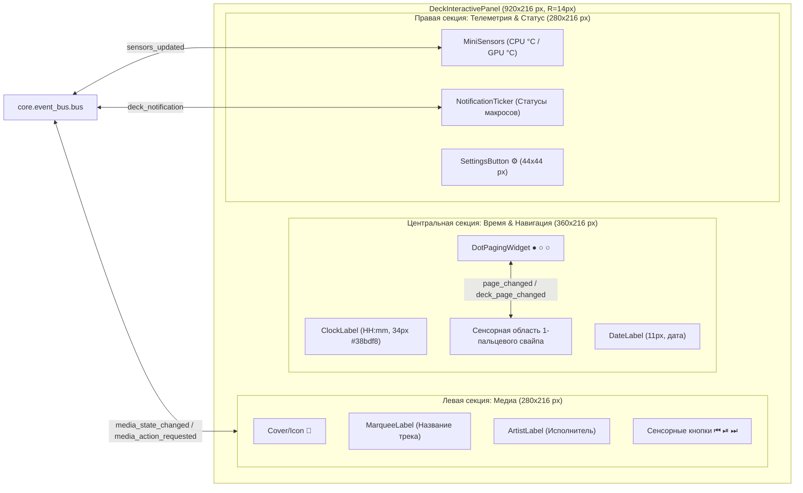

# DuckDeck v0.4.0: Архитектурный драфт базового функционала и интерактивной панели

> **Статус документа:** Активный архитектурный драфт и Actionable Roadmap
> **Версия подсистемы:** DuckDeck v0.4.0 (Спринт 6)
> **Целевая среда:** Windows 10/11 x64, сенсорный дисплей 7" (1024×600 JRP7813S на iGPU AMD Radeon Graphics, рабочая область 944×600 за вычетом сайдбара 80px).
> **Базовый инвариант:** `GEMINI.md` (Platform-First, Zero-Bespoke, Stealth Focus `WS_EX_NOACTIVATE`, `Qt.NoFocus`, кинематическая изоляция тач-событий).
> **Расположение в UI:** Рабочая область Вкладки 2 (`ui.modules.deck_view.DeckView`).

---

## 1. Концепция DuckDeck v0.4.0

DuckDeck v0.4.0 реорганизует пространство сенсорного экрана 944×600 в эргономичную двухуровневую систему:

1. **Сетка быстрых действий (2 строки × 5 колонок = 10 кнопок на страницу):**
   - Габариты каждого сенсорного тайла: **174 × 168 px** (отступы 12 px, скругление 14 px).
   - Оптимизировано по закону Фиттса под естественную моторику кисти и крупное пятно контакта пальца.
   - Первичный режим развертывания — **Stubs Mode** (демо-реакции со звуком/тактильным вдавливанием), сохраняющий полную совместимость с ядром экшенов.
2. **Интерактивная сенсорная панель `DeckInteractivePanel` (3-й ряд):**
   - Габариты: **920 × 216 px** (скругление углов 14 px, фон `#111622`, тонкая акцентная окантовка `#1e2638`).
   - Занимает весь нижний ряд рабочей зоны (строка 3), объединяя функции мультимедийного пульта, системных часов, индикатора страниц, монитора датчиков железа и тикера уведомлений.
   - **Формула строгой высоты рабочей области (600 px):**
     $$12\text{ px (top)} + 168\text{ px (ряд 1)} + 12\text{ px (gap)} + 168\text{ px (ряд 2)} + 12\text{ px (gap)} + 216\text{ px (панель)} + 12\text{ px (bottom)} = 600\text{ px}$$
     Устраняет геометрическую пустоту в 48 px, образовавшуюся в результате демонтажа верхнего `HeaderBar`.

```
┌────────────────────────────────────────────────────────────────────────────────────────┐
│  DuckDeck Workspace (944 × 600 px, чистая область 920 × 576 px, margins 12 px)        │
├────────────────────────────────────────────────────────────────────────────────────────┤
│  [ Ряд 1 ]: [174×168]   [174×168]   [174×168]   [174×168]   [174×168]  (10 кнопок) │
│  [ Ряд 2 ]: [174×168]   [174×168]   [174×168]   [174×168]   [174×168]              │
├────────────────────────────────────────────────────────────────────────────────────────┤
│  [ Ряд 3 ]: Интерактивная сенсорная панель DeckInteractivePanel (920 × 216 px)        │
│  ┌───────────────────────┬───────────────────────────┬───────────────────────────────┐ │
│  │ Левая секция: Медиа   │ Центральная: Часы/Свайп   │ Правая: Датчики / Шестеренка  │ │
│  │ 🎵 Track (Marquee)    │      14:45                │ CPU: 48°C  GPU: 52°C          │ │
│  │    Artist Name        │   15 ноя, воскресенье     │ [Notification Ticker]         │ │
│  │ [⏮]  [⏯]  [⏭]        │         ● ○ ○             │ [⚙ Settings]                  │ │
│  └───────────────────────┴───────────────────────────┴───────────────────────────────┘ │
└────────────────────────────────────────────────────────────────────────────────────────┘
```

---

## 2. Архитектура и компонентный состав `DeckInteractivePanel`

Панель представляет собой автономный составной виджет `modules.deck.widgets.interactive_panel.DeckInteractivePanel` (архитектура Feature-First), инкапсулирующий три горизонтальные функциональные секции.



### 2.1. Левая секция — Мультимедийный пульт

- **Информационный блок:**
  - Иконка/обложка: размер 48×48 px, скругление 8 px (динамическая иконка 🎵 или миниатюра альбома).
  - `MarqueeLabel` (Бегущая строка): виджет плавного горизонтального скроллинга длинных названий треков на базе `ui.widgets.marquee_label.MarqueeLabel` (QTimer 30 мс, смещение по пикселям, пауза 1.5 с в начальной точке).
  - `ArtistLabel`: компактный текст (11 px, цвет `#94a3b8`, обрезка `ElideRight`).
- **Органы управления:**
  - 3 сенсорные кнопки: `⏮` (Предыдущий), `⏯` (Play/Pause), `⏭` (Следующий).
  - Размеры кнопок: 44×44 px, отступы 6 px, радиус 10 px.
  - Все кнопки жестко получают флаг `Qt.NoFocus` и `Qt.WA_ShowWithoutActivating`.
- **Связь с EventBus:**
  - Прием статуса: подписка на сигнал `bus.media_state_changed` (`{"title": str, "artist": str, "is_playing": bool}`).
  - Отправка действий: эмиссия сигнала `bus.media_action_requested.emit("prev" | "toggle_play" | "next")`.

### 2.2. Центральная секция — Системное время, пагинация и свайп

- **Часы и дата:**
  - Цифровые часы: формат `HH:mm`, крупный акцентный шрифт 34 px (Bold, `#38bdf8`, моноширинное позиционирование цифр для устранения дрожания ширины).
  - Дата: компактная подпись под часами (11 px, `#64748b`, например `15 ноя, воскресенье`).
  - Обновление по таймеру раз в 1000 мс с синхронизацией по границе секунды.
- **Точечный индикатор страниц (Dot Pagination):**
  - Динамический блок точек: `● ○ ○` (число точек соответствует количеству страниц профиля, по умолчанию 3 страницы).
  - Каждая точка — кликабельный сенсорный элемент с диаметром 14 px (активная — `#38bdf8`, неактивная — `#334155`).
  - Нажатие на точку мгновенно переключает страницу DuckDeck и эмитит `bus.deck_page_changed`.
- **Сенсорная область свайпа:**
  - Центральная секция служит приоритетной зоной перехвата горизонтального свайпа одним пальцем:
    - Свайп влево (`dx < -60 px`) → переход на следующую страницу (`page + 1`).
    - Свайп вправо (`dx > +60 px`) → переход на предыдущую страницу (`page - 1`).

### 2.3. Правая секция — Телеметрия железа, уведомления и шестеренка

- **Мини-монитор датчиков (CPU & GPU):**
  - Интеграция с сигналом `bus.sensors_updated` (поступает от `aida_reader` или системного сборщика).
  - Два компактных бейджа:
    - `CPU: 48°C` (при T > 75°C цвет плавно меняется с `#10b981` на `#f59e0b` / `#ef4444`).
    - `GPU: 52°C` (с аналогичной цветовой дифференциацией).
  - Компактный шрифт 12 px SemiBold, моноширинные числа.
- **Строка системных уведомлений (Notification Ticker):**
  - Вывод всплывающего статуса макросов и событий DuckDeck через подписку на `bus.deck_notification` (например: `«Наушники подключены»`, `«Скриншот в буфере»`, `«[Stub Action] OBS Запись»`).
  - Анимация плавного появления (Fade-In 200 мс) и автоматический откат к базовому статусу через 3 секунды.
- **Сенсорная иконка настроек (Шестеренка):**
  - Кнопка ⚙ габаритами 44×44 px, радиус 10 px.
  - Флаг `Qt.NoFocus`.
  - При клике/тапе отображает статусное уведомление в тикере: `«Настройки Deck (в разработке v0.5.0)»` либо открывает легковесный диалог конфигурации профилей.

---

## 3. Инвариант заглушек для кнопок (Stubs Mode)

Для изоляции UX-разработки интерфейса и предотвращения случайных срабатываний сторонних утилит при отладке вводится **Stubs Mode**:

1. **Поведение кнопок сетки 2×5:**
   - Все 10 кнопок текущей страницы временно функционируют в режиме симуляции отклика.
   - При тапе запускается цикл тактильной анимации:
     - `idle` → `pressed` (смещение содержимого на 2 px вниз) → `executing` (пульсация окантовки) → `success` (зеленый акцент на 400 мс) → возврат в `idle`.
   - В Notification Ticker интерактивной панели транслируется текстовое сообщение:
     `[Stub Action] Вызвана кнопка: {title} (ID: {action_id})`.
2. **100% сохранность боевых экшенов:**
   - Существующий код обработчиков в `core/deck/actions/` сохраняется в неизменном виде:
     - `AudioDeviceSwitcher` (`IPolicyConfig` COM WASAPI),
     - `HotkeySender` (аппаратные скан-коды `SendInput` с защитой модификаторов),
     - `ProcessLauncher` (`subprocess.Popen` detached `CREATE_NO_WINDOW`),
     - `HttpClient` (асинхронные REST вызовы в thread pool),
     - `ScreenCapture` (`BitBlt` DC первичного экрана 2560×1440).
   - Переключение между `Stubs Mode` и боевым выполнением регулируется единым флагом в `deck_config.json`:
     `"simulation_mode": true | false`.

---

## 4. Кинетика свайпа и изоляция от `TouchCursorFilter`

### 4.1. Проблема конфликта жестов

В DuckDock на уровне окна действует глобальный фильтр `TouchCursorFilter` (`core/touch_filter.py`), выполняющий:

- Подавление паразитного смещения системного курсора мыши (Anti-Cursor Warp на мониторе 1).
- Перехват **двухпальцевого вертикального свайпа** для глобального переключения вкладок приложения (0: Media, 1: Sensors, 2: Deck, 3: Audio, 4: Showcase).

Если локальный виджет страниц DuckDeck начнет перехватывать любые тач-события без фильтрации осей и пальцев, возникнет деструктивная конкуренция:

1. Двухпальцевый жест может случайно триггерить горизонтальную пагинацию DuckDeck.
2. Однопальцевые тапы по кнопкам могут ложно интерпретироваться как микродвижения свайпа.

### 4.2. Архитектурное разграничение кинематики

```
Тач-событие на дисплее (QTouchEvent)
             │
             ├── Число точек == 2 ?
             │         └── ДА ──► TouchCursorFilter (Глобальный перехват)
             │                      └── Вертикальный свайп (|avg_dy| >= 70px) ──► bus.tab_changed
             │
             └── Число точек == 1 (Однопальцевый ввод)
                       │
                       └── Передается виджетам без глобального перехвата
                             │
                             ├── Тап по кнопке (dx, dy < 15px) ──► DeckButtonWidget (Click)
                             │
                             └── Горизонтальное движение по DeckInteractivePanel / DeckView:
                                   ├── dt <= 600 мс
                                   ├── |dx| >= 60 px
                                   └── |dx| > 1.5 * |dy| (Строгая горизонтальная ось)
                                         └── ДА ──► Переключение страниц DuckDeck (prev / next)
```

### 4.3. Параметры детектора 1-пальцевого свайпа

- **Зона приоритетного свайпа:** Центральная секция `DeckInteractivePanel` (между часами и точками) является выделенным треком свайпа, не содержащим кнопок и исключающим конкуренцию за `mousePressEvent`.
- **Фильтрация на сетке кнопок:** При начале свайпа непосредственно по плитке `DeckButtonWidget` в `DeckGrid` устанавливается `eventFilter`. Если горизонтальное смещение превышает порог $|dx| \ge 20\text{ px}$, нажатие кнопки отменяется (`btn.set_state("idle")`, `btn._is_pressed = False`), а жест трансформируется в пагинацию страниц.
- **Минимальная дистанция свайпа:** `|dx| >= 60 px` (защита от дрожания пальца при обычном тапе).
- **Временное окно жеста:** `dt <= 600 ms` (исключение медленного протягивания или зажатия).
- **Угловой фильтр доминирования оси:** `|dx| > 1.5 * |dy|` (гарантирует, что жест был строго направлен по горизонтали, отсекая диагональные и вертикальные паразитные отклонения).
- **Подавление клика:** При успешном распознавании свайпа флаг `_swipe_consumed = True` блокирует вызов события `mouseReleaseEvent` на лежащих под пальцем элементах.

---

## 5. Спецификация кнопок, структура медиаресурсов и аудио-отклик

### 5.1. Физическая структура каталогов ресурсов

Для изоляции статических ассетов и гарантированной сборки в дистрибутив через `DuckDock.spec` вводится выделенное дерево ресурсов подсистемы Deck:

```text
duckdock/
├── resources/
│   └── deck/
│       ├── icons/                  # Векторные SVG и растровые PNG иконки (fallback на Unicode)
│       │   ├── system/             # Системные действия (folder, sound, mic, lock, explorer)
│       │   ├── apps/               # Иконки программ (discord, obs, telegram, steam, browser)
│       │   └── navigation/         # Навигация (prev, next, settings)
│       └── sounds/                 # Аудио-отклики (WAV 16-bit, 44.1/48 kHz)
│           ├── button_click.wav    # Базовый клик плитки (дефолтный отклик)
│           ├── button_click2.wav   # Акцентный клик плитки
│           ├── button_sw_page.wav  # Звук смены страницы/вкладки дека
│           ├── button_offline.wav  # Звук ошибки / заблокированного действия
│           └── button_online.wav   # Звук успешного подключения / исполнения
├── config/
│   ├── deck_config.json            # Основной файл конфигурации страниц и кнопок
│   └── user_icons/                 # (Опционально) Пользовательские иконки вне дистрибутива
```

> **Важно по ресурсам:**
>
> 1. Каталоги `resources/deck/icons/` поддерживают fallback на системные Unicode-эмодзи при отсутствии локальных файлов.
> 2. Каталог `resources/deck` и файл `config/deck_config.json` обязаны быть зарегистрированы в секции `datas` файла `DuckDock.spec`.
> 3. Модуль `PySide6.QtMultimedia` обязан быть добавлен в `hiddenimports` спецификации `DuckDock.spec` для исключения крашей скомпилированного дистрибутива.

### 5.2. Модель хранения и конфигурация кнопок

Конфигурация макро-панели хранится в формате JSON (`config/deck_config.json`) и строго валидируется через Pydantic v2 (`core/deck/models.py`).

Каждая кнопка описывается набором параметров:

- **Страница размещения (`page_id`):** идентификатор родительской страницы в массиве `pages`.
- **Номер кнопки (`slot_index`):** позиция в сетке (0..9 для матрицы 2×5), определяющая координаты `(row = slot // cols, col = slot % cols)`.
- **Имя кнопки (`name`):** уникальный строковый идентификатор кнопки для логирования, поиска и телеметрии.
- **Путь к иконке (`icon_path`):** относительный путь к файлу (`resources/deck/icons/...`) или абсолютный путь (с fallback на Unicode-эмодзи).
- **Размер иконки (`icon_size`):** целевой размер отрисовки глифа/изображения в пикселях (по умолчанию `48 px`, диапазон 16..128 px).
- **Подпись кнопки (`title`):** отображаемый текст метки тайла.
- **Категория и параметры действия (`category` и `action`):** строго типизированный блок действия.
- **Индивидуальный звук (`sound_override`):** опциональный переопределенный WAV-файл клика для конкретной кнопки.

### 5.3. Категории действий

1. **`system` (Системные операции):**
   - Открытие папки: `{"type": "open_folder", "path": "..."}` через `os.startfile` или `explorer.exe` в изолированном фоновом потоке.
   - Создание папки/файла: `{"type": "create_item", "target": "folder"|"file", "path": "..."}`.
   - Переключение звука: `{"type": "toggle_audio_device", "devices": ["Наушники", "Динамики"]}` через `IPolicyConfig` COM WASAPI.
   - Микрофон: `{"type": "toggle_mic_mute"}` (WASAPI endpoint mute).
   - Скриншот: `{"type": "screenshot", "target": "primary_screen"}` (Win32 BitBlt 2560×1440 первичного экрана в буфер обмена).
2. **`shortcut` (Клавиатурные сочетания и хоткеи):**
   - Отправка сочетаний клавиш без потери фокуса активным окном на экране 1: `{"keys": ["ctrl", "shift", "d"]}` через Win32 `SendInput` с аппаратными скан-кодами (`KEYEVENTF_SCANCODE`).
3. **`program` (Запуск программ и ярлыков):**
   - Запуск исполняемых файлов `.exe`, скриптов `.bat`/`.cmd` и ярлыков Windows `.lnk`.
   - Параметры: `target_path`, `working_dir`, `args`.
   - Изолированный запуск через `subprocess.Popen` с `CREATE_NO_WINDOW` / `DETACHED_PROCESS`.
4. **`api` (Взаимодействие со сторонними сервисами):**
   - REST HTTP запросы: `{"url": "...", "method": "POST"|"GET", "headers": {...}, "json_body": {...}, "timeout_sec": 1.5}`.
   - Асинхронное исполнение через `QThreadPool.globalInstance()`.

### 5.4. Звуковая подсистема интерфейса (Zero-Latency Audio)

- Для воспроизведения звуков нажатия и переключения вкладок используется `PySide6.QtMultimedia.QSoundEffect`.
- WAV-семплы предварительно загружаются в RAM при инициализации `DeckView`, обеспечивая отклик 0 мс без блокировки Qt Event Loop и без кражи фокуса активного полноэкранного приложения.
- Настройки звука задаются в секции `sound_settings` конфигурационного файла с возможностью полного отключения (`"enabled": false`) или регулировки громкости (`"volume": 0.0 .. 1.0`).

---

## 6. Actionable Roadmap реализации DuckDeck v0.4.0

### Матрица ответственности (RACI)

| Роль                | Зона ответственности                                                  | Агент                |
| :------------------ | :-------------------------------------------------------------------- | :------------------- |
| **Fullstack Lead**  | Сквозная реализация UI-виджетов, геометрии сетки, интеграции EventBus | `@fullstack-builder` |
| **Quality & Audit** | Pre-Flight проверка инвариантов фокуса, DPI и отсутствия регрессий    | `@code-review`       |

---

### Этап 1: Рефакторинг геометрии `DeckView` под матрицу 2×5, ресурсы и Pydantic-схему

- **Шаг 1.1 (Геометрия 944×600 px и демонтаж HeaderBar) [ВЫПОЛНЕНО]:**
  - Модифицировать `modules/deck/view.py` и `modules/deck/widgets/deck_grid.py`: демонтировать жесткий верхний `HeaderBar` (48 px).
  - Пересчитать геометрию рабочей зоны:
    - Внешние поля контейнера: 12 px со всех сторон.
    - Сетка `DeckGrid`: 2 ряда × 5 колонок (ровно 10 кнопок на страницу). Фиксированные размеры каждой кнопки: `174 × 168 px`, межплиточные промежутки: `12 px`, чистая высота сетки: `372 px` ($12 + 168 + 12 + 168 + 12$).
    - Зарезервировать нижнюю область под `DeckInteractivePanel` габаритами **`920 × 216 px`** (высота строго закрывает рабочую область $12 + 372 + 216 = 600\text{ px}$).
  - Проверена формула высоты: $12 + 168 + 12 + 168 + 12 + 216 + 12 = 600\text{ px}$.
    > **Запуск шага 1.1:**
    >
    > ```text
    > @fullstack-builder реализуй шаг 1.1 из .md/deck/deck_base_func.md: переведи modules/deck/view.py и widgets/deck_grid.py на сетку 2x5 (кнопки 174x168 px, высота 372 px), демонтируй HeaderBar и зарезервируй нижнюю область 920x216 px под DeckInteractivePanel. Проверь формулу высоты 12+168+12+168+12+216+12 = 600 px.
    > ```

- **Шаг 1.2 (Pydantic v2 модели и конфиг кнопок) [ВЫПОЛНЕНО]:**
  - Обновить `modules/deck/models.py` и `config/deck_config.json`:
    - 10 кнопок на страницу по умолчанию, валидация `slot_index: int` (0..9).
    - Поддержка параметров `icon_path`, `icon_size` (дефолт 48 px), `title`, `name`.
    - Поддержка категорий действий `category`: `system`, `shortcut`, `program`, `api`.
    - Секция звуковых настроек `SoundSettings` (`enabled: bool`, `volume: float`, `default_tap_sound`, `page_switch_sound`, `error_sound`).
      > **Запуск шага 1.2:**
      >
      > ```text
      > @fullstack-builder реализуй шаг 1.2 из .md/deck/deck_base_func.md: в modules/deck/models.py обнови DeckButtonConfig (slot_index 0..9, icon_path, icon_size, category) и добавь модель SoundSettings. Актуализируй config/deck_config.json под 10 кнопок на страницу.
      > ```

- **Шаг 1.3 (Расширение шины сигналов `core.event_bus`):**
  - В `core/event_bus.py` зарегистрировать сигналы взаимодействия DuckDeck:
    - `deck_notification = Signal(str)` (трансляция сообщений в тикер панели).
    - `deck_page_changed = Signal(str)` (синхронизация смены активного профиля).
      > **Запуск шага 1.3:**
      >
      > ```text
      > @fullstack-builder реализуй шаг 1.3 из .md/deck/deck_base_func.md: в core/event_bus.py добавь сигналы deck_notification = Signal(str) и deck_page_changed = Signal(str).
      > ```

- **Шаг 1.4 (Спецификация дистрибутива `DuckDock.spec`):**
  - Добавить в `datas`: `('resources/deck', 'resources/deck')` и `('config/deck_config.json', 'config')`.
  - Добавить в `hiddenimports`: `'PySide6.QtMultimedia'`.
    > **Запуск шага 1.4:**
    >
    > ```text
    > @fullstack-builder реализуй шаг 1.4 из .md/deck/deck_base_func.md: в DuckDock.spec добавь resources/deck и config/deck_config.json в datas, а 'PySide6.QtMultimedia' — в hiddenimports.
    > ```

- **Шаг 1.5 (Адаптация существующих тестов):**
  - В `tests/unit/test_deck_view.py`: обновить ассерты геометрии (удалить проверку 48 px HeaderBar, добавить проверку 2×5 сетки 372 px и плейсхолдера панели 216 px).
  - Обеспечить 100% `PASS` существующего набора тестов без регрессий.
    > **Запуск шага 1.5:**
    >
    > ```text
    > @fullstack-builder реализуй шаг 1.5 из .md/deck/deck_base_func.md: обнови tests/unit/test_deck_view.py под сетку 2x5 и высоту 600 px (удали прямые проверки HeaderBar 48 px). Добейся 100% PASS всех тестов: pytest tests/.
    > ```

- **Шаг 1.6 (Автоматическая верификация Этапа 1):**
  - Выполнить целевой прогон тестов `pytest tests/unit/test_deck_view.py tests/unit/test_deck_actions.py`.
  - Запустить полный сьют `pytest tests/` для гарантии отсутствия регрессий (100% PASS).
  - Проверить математику геометрии: высота сетки 372 px + панель 216 px + 36 px отступы = 600 px.
    > **Запуск шага 1.6:**
    >
    > ```text
    > @fullstack-builder выполни шаг 1.6 из .md/deck/deck_base_func.md: проведи автоматическую верификацию Этапа 1 — запусти pytest tests/unit/test_deck_view.py и pytest tests/, убедись в 100% PASS и отсутствии геометрических аномалий.
    > ```

- **Шаг 1.7 (Pre-Flight код-ревью Этапа 1):**
  - Многоосевой аудит изменений Этапа 1 силами агента `@code-review` (STRICT READ-ONLY):
    - Инвариант `Qt.NoFocus` на всех виджетах сетки и контейнеров.
    - Валидность Pydantic v2 схем (slot_index, categories, SoundSettings).
    - Корректность сборки дистрибутива в `DuckDock.spec` (`PySide6.QtMultimedia`, `resources/deck`).
      > **Запуск шага 1.7:**
      >
      > ```text
      > @code-review проведи аудит реализации Этапа 1 (шаг 1.7 из .md/deck/deck_base_func.md): проверь сохранение инварианта Qt.NoFocus, точность формулы высоты 600 px, валидность Pydantic v2 схем, регистрацию ресурсов в DuckDock.spec и 100% PASS тестов.
      > ```

#### Комплексный запуск Этапа 1 [шаги 1.1 - 1.7]:

```text
@fullstack-builder реализуй Этап 1 из d:\Projects_X\duckdock\.md\deck\deck_base_func.md:
1. Модифицируй modules/deck/view.py и modules/deck/widgets/deck_grid.py:
   - Раскладка кнопок 2x5 (кнопки 174x168 px, высота сетки 372 px).
   - Зарезервируй строку под DeckInteractivePanel (920x216 px).
   - Проверь формулу высоты: 12 + 168 + 12 + 168 + 12 + 216 + 12 = 600 px.
2. В core/event_bus.py добавь сигналы deck_notification = Signal(str) и deck_page_changed = Signal(str).
3. В modules/deck/models.py расширь DeckButtonConfig (slot_index 0..9, icon_path, icon_size, category) и модель SoundSettings.
4. В DuckDock.spec добавь resources/deck, config/deck_config.json и hiddenimport 'PySide6.QtMultimedia'.
5. Обнови tests/unit/test_deck_view.py под новую геометрию 600 px.
6. Выполни автоматическую верификацию (шаг 1.6) через pytest tests/ (100% PASS).
```

#### Pre-Flight проверка Этапа 1:

```text
@code-review проведи аудит реализации Этапа 1:
- Проверь математику пиксельной сетки 944x600 (отсутствие выхода за экран и скроллбаров).
- Проверь валидность Pydantic v2 моделей и корректность миграции deck_config.json.
- Проверь сохранение инварианта Qt.NoFocus на всех элементах.
- Проверь 100% успешное выполнение всего тест-сьюта pytest tests/.
```

---

### Этап 2: Реализация интерактивной панели `DeckInteractivePanel`

- **Шаг 2.1 (Каркас панели):**
  - Создать модуль `modules/deck/widgets/interactive_panel.py` с классом `DeckInteractivePanel(TouchModuleView)` (габариты 920×216 px, фон `#111622`, радиус 14 px, `Qt.NoFocus`).
  - Горизонтальная компоновка из 3 секций: Левая (280 px), Центральная (360 px), Правая (280 px).
    > **Запуск шага 2.1:**
    >
    > ```text
    > @fullstack-builder реализуй шаг 2.1 из .md/deck/deck_base_func.md: создай modules/deck/widgets/interactive_panel.py с классом DeckInteractivePanel(TouchModuleView) размером 920x216 px (Qt.NoFocus, фон #111622, R=14px) и 3 горизонтальными секциями (280, 360, 280 px).
    > ```

- **Шаг 2.2 (Левая секция — Мультимедиа):**
  - Обложка 48×48 px с радиусом 8 px.
  - Кастомный `MarqueeLabel` (на базе `ui.widgets.marquee_label.MarqueeLabel` с плавным пиксельным смещением по таймеру 30 мс).
  - Текст исполнителя (11 px, `#94a3b8`, `ElideRight`).
  - Сенсорные кнопки `⏮`, `⏯`, `⏭` (44×44 px, `Qt.NoFocus`, стили `#161b26`, эмитят `bus.media_action_requested`).
  - Подписка на `bus.media_state_changed` с обновлением названия, автора и статуса play/pause.
    > **Запуск шага 2.2:**
    >
    > ```text
    > @fullstack-builder реализуй шаг 2.2 из .md/deck/deck_base_func.md: в левой секции DeckInteractivePanel добавь обложку 48x48, пиксельный MarqueeLabel для трека, подпись автора, кнопки ⏮ ⏯ ⏭ (эмиссия bus.media_action_requested) и подписку на bus.media_state_changed.
    > ```

- **Шаг 2.3 (Центральная секция — Часы & Dot-пагинация):**
  - Часы `HH:mm` (34 px Bold `#38bdf8`, моноширинное выравнивание цифр) + дата (11 px `#64748b`). Синхронизация по секундам.
  - Виджет пагинации `DotPagingWidget` (`● ○ ○`) с сенсорными точками 14 px (активная `#38bdf8`, неактивная `#334155`). Тап по точке переключает страницу Deck и эмитит `bus.deck_page_changed`.
    > **Запуск шага 2.3:**
    >
    > ```text
    > @fullstack-builder реализуй шаг 2.3 из .md/deck/deck_base_func.md: в центральной секции DeckInteractivePanel реализуй часы HH:mm (34px Bold #38bdf8, таймер 1000мс) с датой и виджет DotPagingWidget (● ○ ○) с эмиссией bus.deck_page_changed при тапе по точкам.
    > ```

- **Шаг 2.4 (Правая секция — Телеметрия & Тикер & Настройки):**
  - Мини-индикаторы температур CPU и GPU, подключенные к `bus.sensors_updated` (цветовая дифференциация при $T > 75^\circ\text{C}$).
  - Однострочный `NotificationTicker` для всплывающих уведомлений из `bus.deck_notification` с плавным угасанием через 3 секунды.
  - Сенсорная кнопка настроек ⚙ (44×44 px, `Qt.NoFocus`, при клике шлет статус в тикер).
    > **Запуск шага 2.4:**
    >
    > ```text
    > @fullstack-builder реализуй шаг 2.4 из .md/deck/deck_base_func.md: в правой секции DeckInteractivePanel добавь бейджи CPU/GPU (подписка на bus.sensors_updated), NotificationTicker (подписка на bus.deck_notification с затуханием 3с) и кнопку ⚙ (Qt.NoFocus).
    > ```

- **Шаг 2.5 (Интеграция в `DeckView` и модульные тесты):**
  - Встроить `DeckInteractivePanel` в нижний контейнер `modules/deck/view.py`.
  - Реализовать метод `cleanup()` с корректной остановкой таймеров и безопасной отпиской от `EventBus`.
  - Создать `tests/unit/test_deck_panel.py` для тестирования сигналов, часов и тикера.
    > **Запуск шага 2.5:**
    >
    > ```text
    > @fullstack-builder реализуй шаг 2.5 из .md/deck/deck_base_func.md: встрой DeckInteractivePanel в нижний ряд modules/deck/view.py, добавь метод cleanup() для таймеров/шины и напиши тесты в tests/unit/test_deck_panel.py. Проверь pytest tests/.
    > ```

- **Шаг 2.6 (Интеграционная верификация интерактивной панели):**
  - Запуск `pytest tests/unit/test_deck_panel.py` и проверка реактивности сигналов EventBus (медиа, датчики, тикер).
  - Проверка синхронизации часов и точечной пагинации при кликах.
  - Проверка метода `cleanup()` на гарантированную остановку таймеров без утечек ресурсов Qt.
    > **Запуск шага 2.6:**
    >
    > ```text
    > @fullstack-builder выполни шаг 2.6 из .md/deck/deck_base_func.md: проведи верификацию интерактивной панели — запусти pytest tests/unit/test_deck_panel.py, проверь реактивность EventBus, синхронизацию часов и гарантированную остановку таймеров в cleanup().
    > ```

- **Шаг 2.7 (Pre-Flight код-ревью Этапа 2):**
  - Аудит реализации панели силами `@code-review` (STRICT READ-ONLY):
    - Отсутствие утечек памяти и остановка всех таймеров (`MarqueeLabel`, `Clock`, `NotificationTicker`).
    - Корректная отписка от `core.event_bus.bus`.
    - Соблюдение инварианта `Qt.NoFocus` на кнопках плеера и шестеренке.
      > **Запуск шага 2.7:**
      >
      > ```text
      > @code-review проведи аудит реализации Этапа 2 (шаг 2.7 из .md/deck/deck_base_func.md): проверь утечки таймеров (MarqueeLabel, Clock, Ticker) и корректность cleanup(), безопасность подписок на EventBus и отсутствие кражи фокуса при взаимодействии с панелью.
      > ```

#### Комплексный запуск Этапа 2 [шаги 2.1 - 2.7]:

```text
@fullstack-builder реализуй Этап 2 из d:\Projects_X\duckdock\.md\deck\deck_base_func.md:
1. Создай модуль modules/deck/widgets/interactive_panel.py (размер 920x216 px, 3 секции: Медиа с Marquee, Часы + DotPaging, Датчики CPU/GPU + NotificationTicker + ⚙).
2. Подключи панель к шине core.event_bus.bus (media_state_changed, media_action_requested, sensors_updated, deck_notification).
3. Интегрируй панель в нижний ряд modules/deck/view.py.
4. Реализуй метод cleanup() для гарантированной остановки таймеров и отписки от EventBus.
5. Напиши юнит-тесты в tests/unit/test_deck_panel.py.
6. Выполни верификацию (шаг 2.6) через pytest tests/unit/test_deck_panel.py и pytest tests/ (100% PASS).
```

#### Pre-Flight проверка Этапа 2:

```text
@code-review проведи аудит реализации Этапа 2:
- Проверь утечки таймеров в MarqueeLabel, Clock и NotificationTicker (остановка в cleanup()).
- Проверь безопасность подписок на EventBus и отсутствие кражи фокуса (Qt.NoFocus на всех элементах).
- Проверь 100% прохождение тест-сьюта pytest tests/.
```

---

### Этап 3: Детекция горизонтального свайпа и кинематика переключения страниц

- **Шаг 3.1 (Сенсорный детектор свайпа) [ВЫПОЛНЕНО]:**
  - Зафиксирована центральная зона `DeckInteractivePanel` (`DeckCenterSection`, 360x216 px) как приоритетный трек свайпа.
  - Встроен фильтр тач-событий `DeckSwipeDetector` с кинематическими порогами:
    - Время жеста $dt \le 600\text{ ms}$.
    - Дистанция $|dx| \ge 60\text{ px}$.
    - Угловой фильтр доминирования оси: $|dx| > 1.5 \cdot |dy|$.
  - Реализованы сигналы `swipe_detected = Signal(str)` ('left' / 'right'), `swipe_left`, `swipe_right`.
  - Подавление синтетического клика мыши после свайпа (`suppress_mouse_release`).
  - 100% покрытие модульными тестами в `tests/unit/test_deck_panel.py`.
    > **Запуск шага 3.1:**
      >
      > ```text
      > @fullstack-builder реализуй шаг 3.1 из .md/deck/deck_base_func.md: в центральной секции DeckInteractivePanel реализуй распознавание 1-пальцевого горизонтального свайпа с порогами dt <= 600ms, |dx| >= 60px и |dx| > 1.5*|dy|.
      > ```

- **Шаг 3.2 (Изоляция от глобального `TouchCursorFilter` и кнопок) [ВЫПОЛНЕНО]:**
  - Обеспечена бесконфликтность с глобальным 2-пальцевым свайпом переключения вкладок в `core/touch_filter.py`: события при `len(points) > 1` свободно передаются глобальному фильтру без перехвата.
  - При начале свайпа на плитке `DeckButtonWidget` в `DeckGrid` реализован сброс состояния кнопки (`btn.set_state("idle")`, `btn._is_pressed = False`) при $|dx| \ge 20\text{ px}$.
  - При успешном распознавании свайпа выставляется флаг `_swipe_consumed = True` для гарантированного подавления синтетического клика мыши (`mouseReleaseEvent`).
  - Покрыто комплексными модульными тестами в `tests/unit/test_deck_swipe_isolation.py`.
    > **Запуск шага 3.2:**
    >
    > ```text
    > @fullstack-builder реализуй шаг 3.2 из .md/deck/deck_base_func.md: обеспечь бесконфликтность с core.touch_filter.TouchCursorFilter (2 пальца = вкладки), добавь сброс состояния DeckButtonWidget при |dx| >= 20px и подавляй mouseReleaseEvent при распознанном свайпе.
    > ```

- **Шаг 3.3 (Связка с пагинацией) [ВЫПОЛНЕНО]:**
  - Свайп влево (`dx < -60 px`) $\rightarrow$ переход на следующую страницу (`page_idx + 1`).
  - Свайп вправо (`dx > +60 px`) $\rightarrow$ переход на предыдущую страницу (`page_idx - 1`).
  - Синхронная кинетическая анимация точек `● ○ ○` на базе `QVariantAnimation` (220 мс, `QEasingCurve.OutCubic`).
  - Двусторонняя реактивность с шиной `core.event_bus.bus.deck_page_changed` (с защитой от рекурсивной эмиссии).
  - Поддержка выбора страницы через клик по точкам `DotPagingWidget.page_selected`.
  - Защита граничных условий (свайп вправо на первой странице и влево на последней).
  - 100% покрытие модульными тестами в `tests/unit/test_deck_swipe_paging.py`.
    > **Запуск шага 3.3:**
    >
    > ```text
    > @fullstack-builder реализуй шаг 3.3 из .md/deck/deck_base_func.md: свяжи жест свайпа влево/вправо со сменой страницы DeckView (эмиссия bus.deck_page_changed) и синхронной анимацией точек в DotPagingWidget.
    > ```

- **Шаг 3.4 (Верификация кинематики жестов и изоляции) [ВЫПОЛНЕНО]:**
  - Прогон тестов распознавания 1-пальцевого свайпа и проверка отсутствия интерференции с 2-пальцевым фильтром `TouchCursorFilter`.
  - Проверка сброса состояния кнопки сетки и подавления синтетического клика мыши (`mouseReleaseEvent`) после свайпа.
  - Успешный прогон `pytest tests/unit/test_gestures.py tests/unit/test_deck_panel.py tests/unit/test_deck_swipe_isolation.py tests/unit/test_deck_swipe_paging.py` (35/35 PASS) и полный сьют `pytest tests/` (165/165 PASS).
    > **Запуск шага 3.4:**
    >
    > ```text
    > @fullstack-builder выполни шаг 3.4 из .md/deck/deck_base_func.md: проведи верификацию кинематики свайпа — запусти тесты жестов (pytest tests/unit/test_gestures.py и тесты свайпа панели), проверь изоляцию от 2-пальцевого вертикального свайпа и подавление ложных кликов.
    > ```

- **Шаг 3.5 (Pre-Flight код-ревью Этапа 3):**
  - Аудит сенсорной логики силами `@code-review` (STRICT READ-ONLY):
    - Угловой фильтр доминирования оси ($|dx| > 1.5 \cdot |dy|$).
    - Корректность сброса состояния кнопки при сдвиге пальца ($|dx| \ge 20\text{ px}$).
    - Отсутствие ложных срабатываний и блокировок обычных тапов.
      > **Запуск шага 3.5:**
      >
      > ```text
      > @code-review проведи аудит реализации Этапа 3 (шаг 3.5 из .md/deck/deck_base_func.md): проверь чистоту обработки тач-событий, угловой фильтр осей, сброс состояния кнопок сетки при горизонтальном сдвиге и отсутствие блокировки обычных тапов.
      > ```

#### Комплексный запуск Этапа 3 [шаги 3.1 - 3.5]:

```text
@fullstack-builder реализуй Этап 3 из d:\Projects_X\duckdock\.md\deck\deck_base_func.md:
1. Реализуй обработчик жестов свайпа в DeckInteractivePanel (пороги dt <= 600ms, |dx| >= 60px, |dx| > 1.5*|dy|).
2. Обеспечь сброс нажатия кнопки при горизонтальном сдвиге пальца по сетке DeckGrid (|dx| >= 20px).
3. Обеспечь бесконфликтное сосуществование с глобальным 2-пальцевым фильтром core.touch_filter.TouchCursorFilter.
4. Выполни верификацию кинематики (шаг 3.4) через pytest tests/unit/test_gestures.py и тесты панели (100% PASS).
```

#### Pre-Flight проверка Этапа 3:

```text
@code-review проведи аудит реализации Этапа 3:
- Проверь отсутствие интерференции между 1-пальцевым горизонтальным свайпом страниц и 2-пальцевым вертикальным свайпом экранов.
- Убедись, что обычные тапы по кнопкам сетки не блокируются и не вызывают ложных свайпов.
```

---

### Этап 4: Режим заглушек (Stubs Mode), звуковой движок и DoD верификация

- **Шаг 4.1 (Stubs Mode в ActionDispatcher):**
  - Добавить поддержку параметра `"simulation_mode": true` в `config/deck_config.json` и `DeckActionDispatcher`.
  - В режиме заглушек при тапе на кнопку сетки:
    - Воспроизводить тактильный цикл (вдавливание + подсветка успеха).
    - Транслировать статус в `bus.deck_notification.emit(f"[Stub Action] {button.title} (ID: {button.id})")`.
  - 100% боевых классов действий в `modules/deck/actions/` сохраняются неизменными.
    > **Запуск шага 4.1:**
    >
    > ```text
    > @fullstack-builder реализуй шаг 4.1 из .md/deck/deck_base_func.md: внедри флаг simulation_mode в modules/deck/action_dispatcher.py. При True воспроизводи тактильный цикл кнопки и эмитти bus.deck_notification без запуска фоновых задач. Сохрани боевые экшены.
    > ```

- **Шаг 4.2 (Звуковой движок `DeckSoundEngine`):**
  - Реализовать менеджер звуков на базе `PySide6.QtMultimedia.QSoundEffect` с предзагрузкой семплов в RAM:
    - `button_click.wav` (клик плитки),
    - `button_sw_page.wav` (переключение страницы),
    - `button_offline.wav` (ошибка / блокировка).
  - Настройки громкости и включения из секции `sound_settings`.
    > **Запуск шага 4.2:**
    >
    > ```text
    > @fullstack-builder реализуй шаг 4.2 из .md/deck/deck_base_func.md: реализуй DeckSoundEngine на базе QSoundEffect с предзагрузкой button_click.wav, button_sw_page.wav, button_offline.wav и управлением громкостью из sound_settings.
    > ```

- **Шаг 4.3 (Модульные тесты и локальная верификация):**
  - Добавить модульные тесты в `tests/unit/test_deck_panel.py` и `tests/unit/test_deck_actions.py`.
  - Запустить целевые тесты модуля `pytest tests/unit/test_deck*.py`.
    > **Запуск шага 4.3:**
    >
    > ```text
    > @fullstack-builder реализуй шаг 4.3 из .md/deck/deck_base_func.md: напиши тесты в tests/unit/test_deck_panel.py и tests/unit/test_deck_actions.py, проверь реактивность симуляции и аудио-отклик.
    > ```

- **Шаг 4.4 (Финальная DoD верификация спринта):**
  - Запуск полного сьюта `pytest tests/` (все unit и integration тесты должны иметь статус 100% `PASS`).
  - Проверка сборки дистрибутива через `pyinstaller DuckDock.spec --dry-run` или валидацию манифеста ресурсов.
    > **Запуск шага 4.4:**
    >
    > ```text
    > @fullstack-builder выполни шаг 4.4 из .md/deck/deck_base_func.md: проведи полную DoD верификацию Спринта 6 — запусти полный сьют pytest tests/ (100% PASS), проверь сохранение всех боевых экшенов и корректность spec-файла сборки.
    > ```

- **Шаг 4.5 (Финальный Pre-Flight аудит релиза v0.4.0):**
  - Итоговый многоосевой аудит изменений DuckDeck v0.4.0 перед слиянием в `main` силами `@code-review` (STRICT READ-ONLY):
    - Сверка со всеми пунктами Релизного чеклиста (GEMINI.md раздел 4).
    - Проверка чистоты diff, версионирования и отсутствия регрессий.
      > **Запуск шага 4.5:**
      >
      > ```text
      > @code-review проведи финальный Pre-Flight аудит релиза DuckDeck v0.4.0 (шаг 4.5 из .md/deck/deck_base_func.md): сверь реализацию со всеми пунктами чеклиста DoD (раздел 7), проверь чистоту diff, отсутствие утечек фокуса и памяти, и готовность к релизу.
      > ```

#### Комплексный запуск Этапа 4 [шаги 4.1 - 4.5]:

```text
@fullstack-builder реализуй Этап 4 из d:\Projects_X\duckdock\.md\deck\deck_base_func.md:
1. Реализуй simulation_mode в DeckActionDispatcher с выводом статуса в bus.deck_notification.
2. Реализуй DeckSoundEngine на базе QSoundEffect с предзагрузкой button_click.wav и button_sw_page.wav.
3. Сохрани боевую работоспособность обработчиков в modules/deck/actions/.
4. Добавь тесты в tests/unit/test_deck_panel.py.
5. Выполни финальную верификацию (шаг 4.4) и добейся 100% PASS всего набора тестов (pytest tests/).
```

#### Pre-Flight проверка:

```text
@code-review проведи финальный аудит реализации Этапа 4:
- Проверь 100% прохождение тест-сьюта pytest tests/.
- Проверь чистоту diff и отсутствие поломки сигнатур существующих экшенов.
```

---

## 7. Чеклист соответствия архитектурным инвариантам (DoD)

- [ ] **Stealth Focus:** Ни один элемент панели (кнопки плеера, индикаторы, точки, шестеренка) не имеет фокуса (`Qt.NoFocus`), окно не активируется при тачах (`WS_EX_NOACTIVATE`).
- [ ] **Геометрия 944×600:** Строгое соблюдение формулы высоты: 10 кнопок $174 \times 168\text{ px}$ в два ряда ($372\text{ px}$) + панель $920 \times 216\text{ px}$ в третьем ряду + отступы 12 px = ровно 600 px без зазоров и скроллбаров.
- [ ] **Кинематическая чистота:** 1-пальцевый горизонтальный свайп изолирован от глобального 2-пальцевого вертикального фильтра `TouchCursorFilter`.
- [ ] **Слабая связанность:** Интерактивная панель взаимодействует со средой исключительно через сигналы `core.event_bus.bus` (`deck_notification`, `deck_page_changed`, `media_state_changed`, `sensors_updated`).
- [ ] **Сохранение экшенов:** Все боевые обработчики сохранены в `modules/deck/actions/` и готовы к боевому включению снятием флага `simulation_mode`.
- [ ] **Ресурсная база и PyInstaller:** Файлы звуков (`button_click.wav`, `button_sw_page.wav`), каталоги иконок и конфиг интегрированы в `datas` спецификации `DuckDock.spec`, а `PySide6.QtMultimedia` добавлен в `hiddenimports`.
- [x] **Спецификация кнопок и Pydantic v2:** Модель `DeckButtonConfig` поддерживает слоты 0..9, категории `system`, `shortcut`, `program`, `api`, размеры и пути к иконкам, а также секцию звуковых настроек `SoundSettings`.
- [ ] **Регрессионная стабильность:** 100% тестов проходят успешно (`pytest tests/`).
