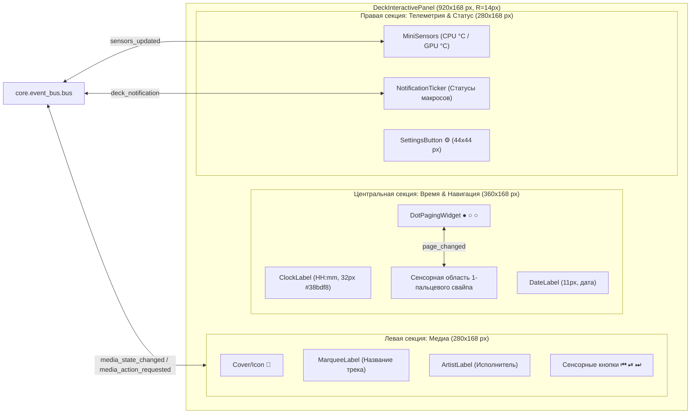

# DuckDeck v0.4.0: Архитектурный драфт базового функционала и интерактивной панели

> **Статус документа:** Активный архитектурный драфт и Actionable Roadmap
> **Версия подсистемы:** DuckDeck v0.4.0 (Спринт 6)
> **Целевая среда:** Windows 10/11 x64, сенсорный дисплей 7" (1024×600 JRP7813S на iGPU AMD Radeon Graphics, рабочая область 944×600 за вычетом сайдбара 80px).
> **Базовый инвариант:** `GEMINI.md` (Platform-First, Zero-Bespoke, Stealth Focus `WS_EX_NOACTIVATE`, `Qt.NoFocus`, кинематическая изоляция тач-событий).
> **Расположение в UI:** Рабочая область Вкладки 2 (`ui.modules.deck_view.DeckView`).

---

## 1. Концепция DuckDeck v0.4.0

DuckDeck v0.4.0 реорганизует пространство сенсорного экрана 944×600 в эргономичную двухуровневую систему:

1. **Сетка быстрых действий (2 строки × 5 колонок = 10 кнопок на страницу):**
   - Габариты каждого сенсорного тайла: **174 × 168 px** (отступы 12 px, скругление 14 px).
   - Оптимизировано по закону Фиттса под естественную моторику кисти и крупное пятно контакта пальца.
   - Первичный режим развертывания — **Stubs Mode** (демо-реакции со звуком/тактильным вдавливанием), сохраняющий полную совместимость с ядром экшенов.
2. **Интерактивная сенсорная панель `DeckInteractivePanel` (3-й ряд):**
   - Габариты: **920 × 168 px** (скругление углов 14 px, фон `#111622`, тонкая акцентная окантовка `#1e2638`).
   - Занимает весь нижний ряд рабочей зоны (строка 3), объединяя функции мультимедийного пульта, системных часов, индикатора страниц, монитора датчиков железа и тикера уведомлений.

```
┌────────────────────────────────────────────────────────────────────────────────────────┐
│  DuckDeck Workspace (944 × 600 px, чистая область 920 × 528 px, margins 12 px)        │
├────────────────────────────────────────────────────────────────────────────────────────┤
│  [ Ряд 1 ]: [174×168]   [174×168]   [174×168]   [174×168]   [174×168]  (10 кнопок) │
│  [ Ряд 2 ]: [174×168]   [174×168]   [174×168]   [174×168]   [174×168]              │
├────────────────────────────────────────────────────────────────────────────────────────┤
│  [ Ряд 3 ]: Интерактивная сенсорная панель DeckInteractivePanel (920 × 168 px)        │
│  ┌───────────────────────┬───────────────────────────┬───────────────────────────────┐ │
│  │ Левая секция: Медиа   │ Центральная: Часы/Свайп   │ Правая: Датчики / Шестеренка  │ │
│  │ 🎵 Track (Marquee)    │      14:45                │ CPU: 48°C  GPU: 52°C          │ │
│  │    Artist Name        │   15 ноя, воскресенье     │ [Notification Ticker]         │ │
│  │ [⏮]  [⏯]  [⏭]        │         ● ○ ○             │ [⚙ Settings]                  │ │
│  └───────────────────────┴───────────────────────────┴───────────────────────────────┘ │
└────────────────────────────────────────────────────────────────────────────────────────┘
```

---

## 2. Архитектура и компонентный состав `DeckInteractivePanel`

Панель представляет собой автономный составной виджет `ui.modules.deck.interactive_panel.DeckInteractivePanel`, инкапсулирующий три горизонтальные функциональные секции.



### 2.1. Левая секция — Мультимедийный пульт

- **Информационный блок:**
  - Иконка/обложка: размер 40×40 px, скругление 8 px (динамическая иконка 🎵 или миниатюра альбома).
  - `MarqueeLabel` (Бегущая строка): виджет плавного горизонтального скроллинга длинных названий треков (QTimer 30 мс, смещение по пикселям, пауза 1.5 с в начальной точке).
  - `ArtistLabel`: компактный текст (11 px, цвет `#94a3b8`, обрезка `ElideRight`).
- **Органы управления:**
  - 3 сенсорные кнопки: `⏮` (Предыдущий), `⏯` (Play/Pause), `⏭` (Следующий).
  - Размеры кнопок: 44×44 px, отступы 6 px, радиус 10 px.
  - Все кнопки жестко получают флаг `Qt.NoFocus` и `Qt.WA_ShowWithoutActivating`.
- **Связь с EventBus:**
  - Прием статуса: подписка на сигнал `bus.media_state_changed` (`{"title": str, "artist": str, "is_playing": bool}`).
  - Отправка действий: эмиссия сигнала `bus.media_action_requested.emit("prev" | "toggle_play" | "next")`.

### 2.2. Центральная секция — Системное время, пагинация и свайп

- **Часы и дата:**
  - Цифровые часы: формат `HH:mm`, крупный акцентный шрифт 32 px (Bold, `#38bdf8`, моноширинное позиционирование цифр для устранения дрожания ширины).
  - Дата: компактная подпись под часами (11 px, `#64748b`, например `15 ноя, воскресенье`).
  - Обновление по таймеру раз в 1000 мс с синхронизацией по границе секунды.
- **Точечный индикатор страниц (Dot Pagination):**
  - Динамический блок точек: `● ○ ○` (число точек соответствует количеству страниц профиля, по умолчанию 3 страницы).
  - Каждая точка — кликабельный сенсорный элемент с диаметром 12 px (активная — `#38bdf8`, неактивная — `#334155`).
  - Нажатие на точку мгновенно переключает страницу DuckDeck.
- **Сенсорная область свайпа:**
  - Центральная секция служит активной зоной перехвата горизонтального свайпа одним пальцем:
    - Свайп влево (`dx < -60 px`) → переход на следующую страницу (`page + 1`).
    - Свайп вправо (`dx > +60 px`) → переход на предыдущую страницу (`page - 1`).

### 2.3. Правая секция — Телеметрия железа, уведомления и шестеренка

- **Мини-монитор датчиков (CPU & GPU):**
  - Интеграция с сигналом `bus.sensors_updated` (поступает от `aida_reader` или системного сборщика).
  - Два компактных бейджа:
    - `CPU: 48°C` (при T > 75°C цвет плавно меняется с `#10b981` на `#f59e0b` / `#ef4444`).
    - `GPU: 52°C` (с аналогичной цветовой дифференциацией).
  - Компактный шрифт 12 px SemiBold, моноширинные числа.
- **Строка системных уведомлений (Notification Ticker):**
  - Вывод всплывающего статуса макросов и событий DuckDeck (например: `«Наушники подключены»`, `«Скриншот в буфере»`, `«Макро Discord выполнен»`).
  - Анимация плавного появления (Fade-In 200 мс) и автоматический откат к базовому статусу через 3 секунды.
- **Сенсорная иконка настроек (Шестеренка):**
  - Кнопка ⚙ габаритами 44×44 px, радиус 10 px.
  - Флаг `Qt.NoFocus`.
  - При клике/тапе отображает статусное уведомление в тикере: `«Настройки Deck (в разработке v0.5.0)»` либо открывает легковесный диалог конфигурации профилей.

---

## 3. Инвариант заглушек для кнопок (Stubs Mode)

Для изоляции UX-разработки интерфейса и предотвращения случайных срабатываний сторонних утилит при отладке вводится **Stubs Mode**:

1. **Поведение кнопок сетки 2×5:**
   - Все 10 кнопок текущей страницы временно функционируют в режиме симуляции отклика.
   - При тапе запускается цикл тактильной анимации:
     - `idle` → `pressed` (смещение содержимого на 2 px вниз) → `executing` (пульсация окантовки) → `success` (зеленый акцент на 400 мс) → возврат в `idle`.
   - В Notification Ticker интерактивной панели транслируется текстовое сообщение:
     `[Stub Action] Вызвана кнопка: {title} (ID: {action_id})`.
2. **100% сохранность боевых экшенов:**
   - Существующий код обработчиков в `core/deck/actions/` сохраняется в неизменном виде:
     - `AudioDeviceSwitcher` (`IPolicyConfig` COM WASAPI),
     - `HotkeySender` (аппаратные скан-коды `SendInput` с защитой модификаторов),
     - `ProcessLauncher` (`subprocess.Popen` detached `CREATE_NO_WINDOW`),
     - `HttpClient` (асинхронные REST вызовы в thread pool),
     - `ScreenCapture` (`BitBlt` DC первичного экрана 2560×1440).
   - Переключение между `Stubs Mode` и боевым выполнением регулируется единым флагом в `deck_config.json`:
     `"simulation_mode": true | false`.

---

## 4. Кинетика свайпа и изоляция от `TouchCursorFilter`

### 4.1. Проблема конфликта жестов

В DuckDock на уровне окна действует глобальный фильтр `TouchCursorFilter` (`core/touch_filter.py`), выполняющий:

- Подавление паразитного смещения системного курсора мыши (Anti-Cursor Warp на мониторе 1).
- Перехват **двухпальцевого вертикального свайпа** для глобального переключения вкладок приложения (0: Media, 1: Sensors, 2: Deck, 3: Audio, 4: Showcase).

Если локальный виджет страниц DuckDeck начнет перехватывать любые тач-события без фильтрации осей и пальцев, возникнет деструктивная конкуренция:

1. Двухпальцевый жест может случайно триггерить горизонтальную пагинацию DuckDeck.
2. Однопальцевые тапы по кнопкам могут ложно интерпретироваться как микродвижения свайпа.

### 4.2. Архитектурное разграничение кинематики

```
Тач-событие на дисплее (QTouchEvent)
             │
             ├── Число точек == 2 ?
             │         └── ДА ──► TouchCursorFilter (Глобальный перехват)
             │                      └── Вертикальный свайп (|avg_dy| >= 70px) ──► bus.tab_changed
             │
             └── Число точек == 1 (Однопальцевый ввод)
                       │
                       └── Передается виджетам без глобального перехвата
                             │
                             ├── Тап по кнопке (dx, dy < 15px) ──► DeckButtonWidget (Click)
                             │
                             └── Горизонтальное движение по DeckInteractivePanel / DeckView:
                                   ├── dt <= 600 мс
                                   ├── |dx| >= 60 px
                                   └── |dx| > 1.5 * |dy| (Строгая горизонтальная ось)
                                         └── ДА ──► Переключение страниц DuckDeck (prev / next)
```

### 4.3. Параметры детектора 1-пальцевого свайпа

- **Минимальная дистанция:** `|dx| >= 60 px` (защита от дрожания пальца при обычном тапе).
- **Временное окно жеста:** `dt <= 600 ms` (исключение медленного протягивания или зажатия).
- **Угловой фильтр доминирования оси:** `|dx| > 1.5 * |dy|` (гарантирует, что жест был строго направлен по горизонтали, отсекая диагональные и вертикальные паразитные отклонения).
- **Подавление клика:** При успешном распознавании свайпа флаг `_swipe_consumed = True` блокирует вызов события `mouseReleaseEvent` на лежащих под пальцем дочерних элементах.

---

## 5. Спецификация кнопок, структура медиаресурсов и аудио-отклик

### 5.1. Физическая структура каталогов ресурсов

Для изоляции статических ассетов и гарантированной сборки в дистрибутив через `DuckDock.spec` вводится выделенное дерево ресурсов подсистемы Deck:

```text
duckdock/
├── resources/
│   └── deck/
│       ├── icons/                  # Векторные SVG и растровые PNG иконки
│       │   ├── system/             # Системные действия (folder, sound, mic, lock, explorer)
│       │   ├── apps/               # Иконки программ (discord, obs, telegram, steam, browser)
│       │   └── navigation/         # Навигация (prev, next, settings)
│       └── sounds/                 # Аудио-отклики (WAV 16-bit, 44.1/48 kHz)
│           ├── tap_soft.wav        # Звук нажатия на плитку (клик)
│           ├── tap_accent.wav      # Звук выполнения действия
│           ├── page_switch.wav     # Звук смены страницы/вкладки дека
│           └── error.wav           # Звук ошибки / заблокированного действия
├── config/
│   ├── deck_config.json            # Основной файл конфигурации страниц и кнопок
│   └── user_icons/                 # (Опционально) Пользовательские иконки вне дистрибутива
```

### 5.2. Модель хранения и конфигурация кнопок

Конфигурация макро-панели хранится в формате JSON (`config/deck_config.json`) и строго валидируется через Pydantic v2 (`core/deck/models.py`).

Каждая кнопка описывается набором параметров:

- **Страница размещения (`page_id`):** идентификатор родительской страницы в массиве `pages`.
- **Номер кнопки (`slot_index`):** позиция в сетке (0..9 для матрицы 2×5), определяющая координаты `(row = slot // cols, col = slot % cols)`.
- **Имя кнопки (`name`):** уникальный строковый идентификатор кнопки для логирования, поиска и телеметрии.
- **Путь к иконке (`icon_path`):** относительный путь к файлу (`resources/deck/icons/...`) или абсолютный путь (с fallback на Unicode-эмодзи).
- **Размер иконки (`icon_size`):** целевой размер отрисовки глифа/изображения в пикселях (по умолчанию `48 px`, диапазон 16..128 px).
- **Подпись кнопки (`title`):** отображаемый текст метки тайла.
- **Категория и параметры действия (`category` и `action`):** строго типизированный блок действия.
- **Индивидуальный звук (`sound_override`):** опциональный переопределенный WAV-файл клика для конкретной кнопки.

### 5.3. Категории действий

1. **`system` (Системные операции):**
   - Открытие папки: `{"type": "open_folder", "path": "..."}` через `os.startfile` или `explorer.exe` в изолированном фоновом потоке.
   - Создание папки/файла: `{"type": "create_item", "target": "folder"|"file", "path": "..."}`.
   - Переключение звука: `{"type": "toggle_audio_device", "devices": ["Наушники", "Динамики"]}` через `IPolicyConfig` COM WASAPI.
   - Микрофон: `{"type": "toggle_mic_mute"}` (WASAPI endpoint mute).
   - Скриншот: `{"type": "screenshot", "target": "primary_screen"}` (Win32 BitBlt 2560×1440 первичного экрана в буфер обмена).
2. **`shortcut` (Клавиатурные сочетания и хоткеи):**
   - Отправка сочетаний клавиш без потери фокуса активным окном на экране 1: `{"keys": ["ctrl", "shift", "d"]}` через Win32 `SendInput` с аппаратными скан-кодами (`KEYEVENTF_SCANCODE`).
3. **`program` (Запуск программ и ярлыков):**
   - Запуск исполняемых файлов `.exe`, скриптов `.bat`/`.cmd` и ярлыков Windows `.lnk`.
   - Параметры: `target_path`, `working_dir`, `args`.
   - Изолированный запуск через `subprocess.Popen` с `CREATE_NO_WINDOW` / `DETACHED_PROCESS`.
4. **`api` (Взаимодействие со сторонними сервисами):**
   - REST HTTP запросы: `{"url": "...", "method": "POST"|"GET", "headers": {...}, "json_body": {...}, "timeout_sec": 1.5}`.
   - Асинхронное исполнение через `QThreadPool.globalInstance()`.

### 5.4. Звуковая подсистема интерфейса (Zero-Latency Audio)

- Для воспроизведения звуков нажатия и переключения вкладок используется `PySide6.QtMultimedia.QSoundEffect`.
- WAV-семплы предварительно загружаются в RAM при инициализации `DeckView`, обеспечивая отклик 0 мс без блокировки Qt Event Loop и без кражи фокуса активного полноэкранного приложения.
- Настройки звука задаются в секции `sound_settings` конфигурационного файла с возможностью полного отключения (`"enabled": false`) или регулировки громкости (`"volume": 0.0 .. 1.0`).

---

## 6. Actionable Roadmap реализации DuckDeck v0.4.0

### Матрица ответственности (RACI)

| Роль                | Зона ответственности                                                  | Агент                |
| :------------------ | :-------------------------------------------------------------------- | :------------------- |
| **Fullstack Lead**  | Сквозная реализация UI-виджетов, геометрии сетки, интеграции EventBus | `@fullstack-builder` |
| **Quality & Audit** | Pre-Flight проверка инвариантов фокуса, DPI и отсутствия регрессий    | `@code-review`       |

---


### Этап 1: Рефакторинг геометрии `DeckView` под матрицу 2×5, ресурсы и Pydantic-схему

- **Шаг 1.1:** Удалить рудиментарный верхний HeaderBar (48 px) из `ui/modules/deck_view.py`. Пересчитать геометрию рабочей области 944×600:
  - Margins: 12 px со всех сторон.
  - Строки 0 и 1: Сетка кнопок 2×5 (ровно 10 кнопок на страницу). Фиксированные размеры каждой кнопки: `174 × 168 px`, промежутки между тайлами: `12 px`.
  - Строка 2: Контейнер для `DeckInteractivePanel` размером `920 × 168 px`.
- **Шаг 1.2:** Обновить модель конфигурации `core/deck/models.py` и `config/deck_config.json` под новую схему:
  - 10 кнопок на страницу по умолчанию, поле `slot_index` (0..9).
  - Поддержка параметров `icon_path`, `icon_size` (дефолт 48 px), `title`, `name`.
  - Категории действий `category`: `system`, `shortcut`, `program`, `api`.
  - Секция звуковых настроек `sound_settings` (`enabled`, `volume`, `default_tap_sound`, `page_switch_sound`).
- **Шаг 1.3:** Подключить структуру ресурсов `resources/deck/` в спецификацию сборки `DuckDock.spec` (`datas`).

#### Запуск шагов [1.1 - 1.3]:

```text
@fullstack-builder реализуй Этап 1 из d:\Projects_X\duckdock\.md\deck\deck_base_func.md:
1. Модифицируй ui/modules/deck_view.py: переведи раскладку на сетку 2x5 (кнопки 174x168 px) и зарезервируй строку 2 под DeckInteractivePanel (920x168 px).
2. Обнови core/deck/models.py и config/deck_config.json под схему со slot_index, категориями (system, shortcut, program, api), icon_path, icon_size и sound_settings.
3. Добавь маппинг resources/deck в DuckDock.spec.
4. Убедись, что все виджеты сохраняют Qt.NoFocus и не деформируют сетку 944x600.
5. Критерий завершения: DeckView отображает ровно 10 кнопок (2 ряда по 5), плейсхолдер нижней панели 920x168 px, pytest tests/ завершается 100% PASS.
```

#### Pre-Flight проверка:

```text
@code-review проведи аудит реализации Этапа 1:
- Проверь валидность Pydantic v2 моделей и корректность миграции deck_config.json.
- Проверь отсутствие кражи фокуса (Qt.NoFocus на всех элементах).
- Проверь строгое соответствие пиксельной сетки 944x600 без поломки скроллбаров.
```

@code-review проведи аудит реализации Этапа 1:

- Проверь отсутствие кражи фокуса (Qt.NoFocus на всех элементах).
- Проверь строгое соответствие пиксельной сетки 944x600 без поломки скроллбаров.

````

---

### Этап 2: Реализация интерактивной панели `DeckInteractivePanel`

* **Шаг 2.1:** Создать модуль `ui/modules/deck/interactive_panel.py` с классом `DeckInteractivePanel(QFrame)` (размер 920×168 px, фон `#111622`, радиус 14 px).
* **Шаг 2.2:** Реализовать левую секцию (Медиа):
  - Кастомный `MarqueeLabel` для длинных названий треков с плавной прокруткой без мерцания.
  - Кнопки `⏮`, `⏯`, `⏭` (`Qt.NoFocus`, стили `#161b26`, при нажатии эмитят `bus.media_action_requested`).
  - Подписка на `bus.media_state_changed` с обновлением названия, автора и состояния воспроизведения.
* **Шаг 2.3:** Реализовать центральную секцию (Часы & Индикатор страниц):
  - Крупные часы `HH:mm` (32px Bold `#38bdf8`) + дата (11px).
  - Виджет пагинации `DotPagingWidget` (`● ○ ○`) с поддержкой кликов по точкам.
* **Шаг 2.4:** Реализовать правую секцию (Датчики & Тикер & Настройки):
  - Мини-индикаторы температур CPU и GPU, подключенные к `bus.sensors_updated`.
  - Однострочный `NotificationTicker` для всплывающих статусов.
  - Сенсорная кнопка настроек ⚙ (44×44 px, `Qt.NoFocus`).

#### Запуск шагов [2.1 - 2.4]:
```text
@fullstack-builder реализуй Этап 2 из d:\Projects_X\duckdock\.md\deck\deck_base_func.md:
1. Создай модуль ui/modules/deck/interactive_panel.py и внедри три секции (Медиа с Marquee, Часы + DotPaging, Датчики CPU/GPU + Ticker + ⚙).
2. Подключи панель к шине сигналов core.event_bus.bus (media_state_changed, media_action_requested, sensors_updated).
3. Интегрируй панель в нижний ряд ui/modules/deck_view.py.
4. Критерий завершения: Панель отрисовывается в нижнем ряду, часы тикают, медиа-кнопки шлют сигналы, точки переключают страницы.
````

#### Pre-Flight проверка:

```text
@code-review проведи аудит реализации Этапа 2:
- Проверь утечки таймеров в MarqueeLabel и Clock (корректная остановка в closeEvent/hideEvent).
- Проверь безопасность подписок на EventBus.
```

---

### Этап 3: Детекция горизонтального свайпа и кинематика переключения страниц

- **Шаг 3.1:** Встроить фильтр событий сенсорного ввода для распознавания 1-пальцевого горизонтального свайпа в `DeckInteractivePanel` (и опционально в область сетки `DeckView`).
- **Шаг 3.2:** Реализовать кинематические пороги:
  - Время касания `dt <= 600 ms`.
  - Дистанция `|dx| >= 60 px`.
  - Условие оси: `|abs(dx)| > 1.5 * abs(dy)`.
- **Шаг 3.3:** Связать успешный свайп влево/вправо с переключением активной страницы Deck и синхронной анимацией точек `● ○ ○`.

#### Запуск шагов [3.1 - 3.3]:

```text
@fullstack-builder реализуй Этап 3 из d:\Projects_X\duckdock\.md\deck\deck_base_func.md:
1. Реализуй обработчик жестов свайпа в DeckInteractivePanel / DeckView с порогами dt <= 600ms, |dx| >= 60px, |dx| > 1.5*|dy|.
2. Обеспечь бесконфликтное сосуществование с глобальным 2-пальцевым TouchCursorFilter.
3. Критерий завершения: Свайп пальцем по панели плавно переключает страницы кнопок влево и вправо; 2-пальцевый свайп по-прежнему переключает вкладки DuckDock.
```

#### Pre-Flight проверка:

```text
@code-review проведи аудит реализации Этапа 3:
- Проверь отсутствие интерференции между 1-пальцевым свайпом страниц и 2-пальцевым свайпом экранов.
- Убедись, что обычные тапы по кнопкам не блокируются и не вызывают ложных свайпов.
```

---

### Этап 4: Режим заглушек (Stubs Mode), сохранение экшенов и интеграция тикера

- **Шаг 4.1:** Добавить поддержку параметра `"simulation_mode": true` в конфигурацию DuckDeck.
- **Шаг 4.2:** В режиме заглушек при тапе на любую из 10 кнопок воспроизводить визуальный отклик (вдавливание + success) и отправлять статусное уведомление в `NotificationTicker` интерактивной панели.
- **Шаг 4.3:** Сохранить 100% работоспособность и интерфейсы существующих обработчиков в `core/deck/actions/` (`AudioDeviceSwitcher`, `HotkeySender`, `ProcessLauncher`, `HttpClient`, `ScreenCapture`).
- **Шаг 4.4:** Написать модульные тесты в `tests/test_deck_panel.py` для проверки геометрии, отсутствия кражи фокуса и реактивности сигналов.

#### Запуск шагов [4.1 - 4.4]:

```text
@fullstack-builder реализуй Этап 4 из d:\Projects_X\duckdock\.md\deck\deck_base_func.md:
1. Реализуй Stubs Mode для кнопок сетки с отправкой событий в NotificationTicker интерактивной панели.
2. Гарантируй полную сохранность боевых классов действий в core/deck/actions/.
3. Добавь pytest-тесты в tests/test_deck_panel.py для валидации контрактов панели и EventBus.
4. Критерий завершения: 100% тестов проходят успешно (pytest tests/), кнопки визуально реагируют на тач со статусом в тикере.
```

#### Pre-Flight проверка:

```text
@code-review проведи аудит реализации Этапа 4:
- Проверь 100% прохождение тест-сьюта.
- Проверь чистоту diff и отсутствие поломки сигнатур существующих экшенов.
```

---

## 7. Чеклист соответствия архитектурным инвариантам (DoD)

- [ ] **Stealth Focus:** Ни один элемент панели (кнопки плеера, индикаторы, шестеренка) не имеет фокуса (`Qt.NoFocus`), окно не активируется при тачах (`WS_EX_NOACTIVATE`).
- [ ] **Геометрия 944×600:** Строгое соблюдение размеров (10 кнопок 174×168 px в два ряда + панель 920×168 px в третьем ряду).
- [ ] **Кинематическая чистота:** 1-пальцевый горизонтальный свайп изолирован от глобального 2-пальцевого вертикального фильтра `TouchCursorFilter`.
- [ ] **Слабая связанность:** Интерактивная панель взаимодействует со средой исключительно через сигналы `core.event_bus.bus`.
- [ ] **Сохранение экшенов:** Все ранее написанные боевые обработчики сохранены и готовы к включению отключением флага симуляции.
- [ ] **Ресурсная база:** Каталоги `resources/deck/icons/` и `resources/deck/sounds/` интегрированы в спецификацию сборки `DuckDock.spec`.
- [ ] **Спецификация кнопок и Pydantic v2:** Модель `DeckButtonConfig` поддерживает слоты 0..9, категории `system`, `shortcut`, `program`, `api`, размеры и пути к иконкам, а также секцию звуковых настроек `sound_settings`.
