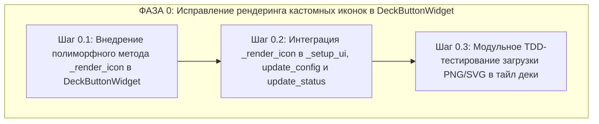
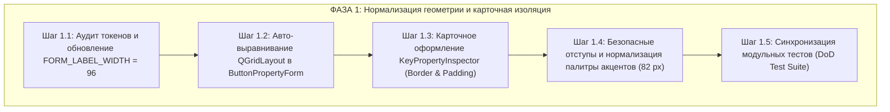
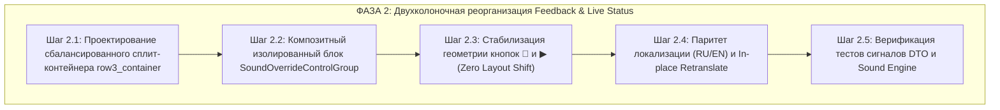
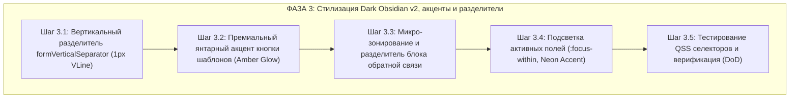
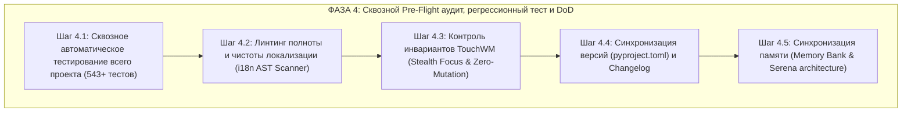
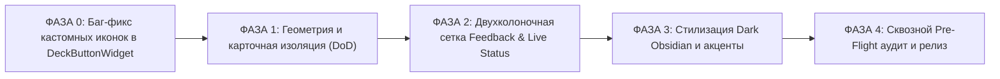

# Архитектурная спецификация и план редизайна панели атрибутов кнопок (ButtonPropertyForm)

> **Статус:** Анализ завершен, Фазы 0, 1, 2, 3 и 4 детально декомпозированы, готов к исполнению
> **Роль-исследователь:** `@deep-researcher` (Архитектурный аудит и граф зависимостей)
> **Целевые модули:** `modules/deck/widgets/deck_button.py`, `modules/deck/editor` (`KeyPropertyInspector`, `ButtonPropertyForm`, `ColorAccentPicker`, `styles.py`, `window.py`)
> **Дизайн-система:** Dark Obsidian v2 (PySide6 / Qt, Slate Palette, WS_EX_NOACTIVATE, Bilingual Localization-First)

---

## 1. Архитектурный аудит кодовой базы и первопричины дефектов (RCA)

### 1.1. Аудит обрезки надписей («Живой стат» вместо «Живой статус:»)

#### Механика и локализация в кодовой базе:

1. В дизайн-токенах редактора зафиксирована константа:
   ```python
   # modules/deck/editor/styles.py:112
   FORM_LABEL_WIDTH = 60
   ```
2. В конструкторе `ButtonPropertyForm` все текстовые метки левой колонки сетки принудительно ограничиваются этим значением:
   ```python
   # modules/deck/editor/widgets/button_property_form.py:1172, 1197, 1244, 1324
   self.lbl_title_field.setFixedWidth(FORM_LABEL_WIDTH)   # Строка 0: "Название:"
   self.lbl_actions_field.setFixedWidth(FORM_LABEL_WIDTH) # Строка 1: "Действия:"
   self.lbl_params_field.setFixedWidth(FORM_LABEL_WIDTH)  # Строка 2: "Хоткей:" / "Параметры:"
   self.lbl_status_field.setFixedWidth(FORM_LABEL_WIDTH)  # Строка 3: "Живой статус:"
   ```
3. Точные метрики ширины текста при системном шрифте Qt (Segoe UI / Roboto 12px Medium, DPI 100%–125%):
   - `Название:` — 9 символов $\approx 56\text{ px}$ (укладывается впритык при 60 px);
   - `Действия:` — 9 символов $\approx 58\text{ px}$ (укладывается впритык при 60 px);
   - `Хоткей:` — 7 символов $\approx 46\text{ px}$ (укладывается);
   - `Параметры:` — 10 символов $\approx 72\text{ px}$ (**обрезается** до «Параметр...» при выборе действий без хоткея);
   - `Живой статус:` — 13 символов $\approx 88\text{–}92\text{ px}$ (**обрезается** ровно до «Живой стат»);
   - В английской локали `Live Status:` — 12 символов $\approx 76\text{ px}$ (**обрезается** до «Live Stat...»).

#### Взаимосвязь с гридом:

Все 4 метки размещены в нулевом столбце единого `fields_grid = QGridLayout()`:

```python
fields_grid.addWidget(self.lbl_title_field, 0, 0, Qt.AlignVCenter)
fields_grid.addWidget(self.lbl_actions_field, 1, 0, Qt.AlignVCenter)
fields_grid.addWidget(self.lbl_params_field, 2, 0, Qt.AlignVCenter)
fields_grid.addWidget(self.lbl_status_field, 3, 0, Qt.AlignVCenter)
```

Использование `setFixedWidth(60)` на отдельных метках искусственно подавляет способность `QGridLayout` автоматически вычислять естественную ширину столбца по самому широкому дочернему элементу.

---

### 1.2. Аудит эффекта обрезки снизу и поведения при ресайзе окна

#### Анализ цепочки компоновки:

1. **Иерархия контейнеров:**
   `DeckEditorWindow` $\rightarrow$ `main_splitter` (QSplitter) $\rightarrow$ `workspace_container` (QVBoxLayout: `_workspace_layout`) $\rightarrow$
   - `self.header_bar` (52 px)
   - `self.canvas_widget` (`stretch=1`, `min_height=300 px`)
   - `self.pagination_bar` (36 px)
   - `self.workspace_separator` (1 px)
   - `self.inspector` (`stretch=0`, `height=260 px`)
2. **Почему растяжение окна не влияет на высоту инспектора:**
   - В `_workspace_layout` фактор растяжения `stretch=1` назначен **только** для `canvas_widget`.
   - Для `KeyPropertyInspector` и `ButtonPropertyForm` жестко вызвано:
     ```python
     # modules/deck/editor/widgets/property_inspector.py:64
     self.setFixedHeight(INSPECTOR_HEIGHT)  # INSPECTOR_HEIGHT = 260
     # modules/deck/editor/widgets/button_property_form.py:1071
     self.setFixedHeight(INSPECTOR_HEIGHT)
     ```
   - В результате при любом растяжении окна по вертикали (даже на 1440p / 4K) инспектор строго заблокирован на 260 px.
3. **Почему панель визуально кажется обрезанной снизу:**
   - В стилях `modules/deck/editor/styles.py:680-685` задано:
     ```css
     QFrame#propertyInspector,
     KeyPropertyInspector {
       background-color: #0f141f;
       border: none;
     }
     ```
     У инспектора **полностью отсутствует нижняя рамка и скругление**.
   - Внутри `ButtonPropertyForm` отступы заданы как `root_layout.setContentsMargins(12, 10, 12, 10)`. Нижний отступ составляет всего 10 px.
   - Контейнер окна `workspace_container` имеет `setContentsMargins(12, 12, 12, 12)`.
   - Фон `workspace_container` — `#0b0d13` (`SURFACE_0_CANVAS`), фон инспектора — `#0f141f` (`SURFACE_1_PANEL`). На мониторах с низкой контрастностью или высокой яркостью нижняя кромка инспектора сливается с фоном рабочей области, а контент четвертой строки («Живой статус», «Звук клика») оказывается визуально прижат к нижнему краю окна, создавая ощущение отсечения.
4. **Геометрический перекос левой колонки (Превью vs Палитра):**
   - Плитка кнопки: `PREVIEW_TILE_SIZE = 84 px`.
   - Палитра цветов `ColorAccentPicker`: 5 кнопок по 20 px + 4 промежутка по 6 px = **124 px**.
   - Палитра на 40 px шире плитки превью, из-за чего она выпирает вправо под правую форму и смещает сетку параметров.

---

### 1.3. Граф зависимостей и реестр тестов (DoD Инварианты)

При любых изменениях `FORM_LABEL_WIDTH` и `INSPECTOR_HEIGHT` необходимо учитывать строгие контрактные тесты, которые проверяют эти токены напрямую:

| Файл теста                                         | Строка             | Проверяемое условие                               | Влияние изменений                          |
| :------------------------------------------------- | :----------------- | :------------------------------------------------ | :----------------------------------------- |
| `tests/unit/test_deck_editor_inspector_widgets.py` | 106                | `assert FORM_LABEL_WIDTH == 60`                   | Требует синхронизации константы            |
| `tests/unit/test_deck_editor_inspector_widgets.py` | 103                | `assert INSPECTOR_HEIGHT == 260`                  | Контроль базового токена высоты            |
| `tests/unit/test_deck_editor_inspector_widgets.py` | 119-128            | `test_styles_qss_rules_presence`                  | Проверка наличия ключевых селекторов в QSS |
| `tests/unit/test_deck_editor_inspector_widgets.py` | 398, 536, 579, 619 | `assert form.height() == INSPECTOR_HEIGHT`        | Проверка высоты форм тачбара               |
| `tests/unit/test_deck_property_form.py`            | 29-30              | `assert form.height() == INSPECTOR_HEIGHT == 260` | Проверка бюджета высоты формы кнопки       |
| `tests/unit/test_deck_property_form_subforms.py`   | 50                 | `assert form.height() == INSPECTOR_HEIGHT == 260` | Проверка высоты при смене подформ          |

> **Критический архитектурный инвариант:**
> Изменение геометрии обязано выполняться без нарушения прохождения всех **43 модульных тестов** инспектора и общего пакета из **543 тестов** репозитория. Константа `INSPECTOR_HEIGHT = 260` может быть сохранена как номинальная высота по умолчанию (или диапазон), а `FORM_LABEL_WIDTH` обновлен синхронно в коде и тестах.

---

### 1.4. Детальный аудит строки 3 (Feedback & Live Status)

#### Текущее состояние в кодовой базе:

В строке 3 формы (`button_property_form.py:1320-1375`) размещен контейнер `row3_container`:

```python
# modules/deck/editor/widgets/button_property_form.py:1326-1374
row3_container = QWidget(self)
row3_container.setFixedHeight(INPUT_HEIGHT)
row3_layout = QHBoxLayout(row3_container)
row3_layout.setContentsMargins(0, 0, 0, 0)
row3_layout.setSpacing(6)

row3_layout.addWidget(self.combo_status_source, 1)   # Выбор телеметрии
row3_layout.addWidget(self.lbl_click_sound_field)    # Текст "Звук клика:"
row3_layout.addWidget(self.combo_click_sound, 1)     # Выбор режима звука
row3_layout.addWidget(self.btn_click_sound_browse)   # Кнопка 📁
row3_layout.addWidget(self.btn_click_sound_preview)  # Кнопка ▶

fields_grid.addWidget(self.lbl_status_field, 3, 0, Qt.AlignVCenter)
fields_grid.addWidget(row3_container, 3, 1, 1, 2)
```

#### Анатомия дефекта строки 3:

1. **Асимметрия выравнивания меток:**
   Метка `lbl_status_field` находится в общей левой колонке сетки `fields_grid` (выровнена с «Название:», «Действия:», «Хоткей:»). А метка `lbl_click_sound_field` («Звук клика:») не привязана ни к какой сетке — она брошена прямо в поток `QHBoxLayout` перед вторым комбобоксом. Это ломает вертикальные направляющие и создает ощущение визуальной «каши».
2. **Динамическое сжатие при выборе кастомного звука:**
   По умолчанию кнопки `btn_click_sound_browse` (📁) и `btn_click_sound_preview` (▶) скрыты (`setVisible(False)`). При переключении режима в `"custom"` (`_on_click_sound_changed`) они динамически становятся видимыми (`setVisible(True)`):
   $$\text{Суммарная ширина кнопок} = 30\text{ px} + 6\text{ px} + 30\text{ px} + 6\text{ px} = 72\text{ px}$$
   Это приводит к мгновенному рывку интерфейса: оба комбобокса (`combo_status_source` и `combo_click_sound`) сжимаются на 36 px каждый. На стандартной ширине формы длинный текст «По умолчанию» или имя выбранного файла усекается, а стрелка выпадающего списка перекрывает текст.
3. **Публичный контракт и сигналы, требующие 100% сохранения:**
   - Атрибуты виджетов: `combo_status_source`, `combo_click_sound`, `btn_click_sound_browse`, `btn_click_sound_preview`, `lbl_status_field`, `lbl_click_sound_field`.
   - Слоты и сигналы:
     - `_on_status_source_changed(index)` $\rightarrow$ `self.property_changed.emit("status_source", key)`
     - `_on_click_sound_changed(index)` $\rightarrow$ `self.property_changed.emit("sound_override", mode)`
     - `_on_click_sound_browse_clicked()` $\rightarrow$ открытие диалога выбора файла, эмит `("sound_override", path)`
     - `_on_click_sound_preview_clicked()` $\rightarrow$ вызов `DeckSoundEngine.preview_sound(path)` или `DeckSoundEngine.play_tap()`
   - Прямое обращение тестов: `tests/unit/test_deck_live_tiles.py` и `test_deck_property_form.py` напрямую проверяют `form.combo_status_source.currentData()` и `count()`.

---

### 1.5. Аудит визуальных акцентов, разделителей и стилей QSS

#### Анализ разделителей:

1. В `button_property_form.py:1120-1127` горизонтальный разделитель `separator` (`QFrame.HLine`, 1 px) отделяет только шапку формы (`header_layout`) от остального содержимого.
2. В `content_layout = QHBoxLayout()` между левой колонкой предпросмотра (`left_preview_layout`) и правой сеткой параметров (`fields_grid`) разделитель **полностью отсутствует** — между ними задан лишь пустой `spacing = 12`.
3. Из-за отсутствия вертикального разделителя плитка предварительного просмотра (84×84) и палитра акцентов зрительно смешиваются с первой колонкой текстовых меток («Название:», «Действия:» и т.д.), создавая ощущение незаконченного прототипа.

#### Анализ кнопки шаблонов `btn_presets_menu`:

1. В `styles.py:978-1006` кнопка стилизована как:
   ```css
   QPushButton#btnPresetsMenu {
     background-color: #101c2e;
     border: 1px solid #1e3a5f;
     color: #38bdf8;
   }
   ```
   Фон кнопки мало контрастирует с соседним комбобоксом `combo_actions` (`#101522`), из-за чего она теряется в строке действий, несмотря на то, что это главная точка входа в быстрый каталог готовых сценариев.
2. Придание кнопке теплого янтарного бейджа (`#f59e0b` / Amber-500) создаст сильный визуальный якорь и подчеркнет возможность выбора готового шаблона в один клик.

---

### 1.6. Аудит дефекта отображения кастомных иконок на тайлах сенсорной панели (`DeckButtonWidget`)

#### Симптомы дефекта:

При выборе пользовательского изображения (PNG/SVG) через контекстное меню или библиотеку иконок в редакторе (например, `resources/deck/custom_icons/filezilla_1.png`) и последующем сохранении:

- **В редакторе (`EditorGridCell` и `KeyPreviewTile`):** Иконка отображается идеально.
- **На экране сенсорной панели DuckDeck (`DeckButtonWidget`):** Вместо картинки крупным оранжевым текстом отображается надпись `stom_ic` (фрагмент пути `resources/deck/custom_icons/filezilla_1.png`, обрезанный границами кнопки) — см. Рис. 1.

#### Первопричина в кодовой базе:

1. **Как рендерит редактор (`modules/deck/editor/widgets/grid_cell.py:225-238`):**

   ```python
   if icon and os.path.isfile(icon):
       pixmap = QPixmap(icon)
       if not pixmap.isNull():
           scaled = pixmap.scaled(48, 48, Qt.KeepAspectRatio, Qt.SmoothTransformation)
           self.lbl_icon.setPixmap(scaled)
       else:
           self.lbl_icon.setText(icon)
   else:
       self.lbl_icon.setText(icon)
   ```

   Редактор проверяет, является ли `icon` существующим файлом, загружает `QPixmap`, масштабирует его и устанавливает через `setPixmap`.

2. **Как рендерит сенсорная панель (`modules/deck/widgets/deck_button.py:94-100` и `282-286`):**

   ```python
   # deck_button.py:94
   self.lbl_icon = QLabel(self.button_config.icon, self)
   self.lbl_icon.setStyleSheet(
       f"font-size: {self.icon_font_size}px; color: {self.button_config.color_accent};"
   )

   # deck_button.py:282 (update_config)
   self.lbl_icon.setText(button_config.icon or "")
   ```

   В рантайм-виджете `DeckButtonWidget` **полностью отсутствует логика проверки графических файлов и загрузки `QPixmap`**!
   Строка пути к файлу (`"resources/deck/custom_icons/filezilla_1.png"`) передается напрямую в `QLabel.setText(...)`. При шрифте `font-size: 52px` и цвете `color_accent: #f59e0b` `QLabel` отрисовывает путь как гигантский текст, из которого в габариты кнопки 174×168 px влезает только фрагмент `stom_ic`!

3. **Разрешение путей к иконкам:**
   Путь может быть задан как:
   - Относительный от корня рабочей директории: `resources/deck/custom_icons/filezilla_1.png`;
   - Относительный без префикса resources: `deck/custom_icons/filezilla_1.png`;
   - Поле `button_config.icon_path` (вместо или вместе с `button_config.icon`).
     Виджет обязан полиморфно проверять оба поля (`icon_path` или `icon`), резолвить путь относительно корня приложения и папки `resources/`, загружать `QPixmap` и масштабировать его под размер сетки (48–56 px).

---

## 2. Детальный разбор: ФАЗА 0. Исправление рендеринга кастомных графических иконок в `DeckButtonWidget` (Quick Fix)

Цель Фазы 0 — оперативно устранить критический баг отображения кастомных иконок на сенсорном экране панели DuckDeck, внедрив полиморфный рендеринг `QPixmap` / Unicode в `DeckButtonWidget` до начала рефакторинга геометрии инспектора.



---

### Шаг 0.1. Внедрение полиморфного метода `_render_icon` в `DeckButtonWidget`

- **Файлы:** [`modules/deck/widgets/deck_button.py`](file:///d:/Projects_X/duckdock/modules/deck/widgets/deck_button.py).
- **Контракт изменения:**
  Реализовать метод безопасного разрешения и рендеринга иконки:

  ```python
  def _render_icon(self, icon_str_or_path: Optional[str] = None) -> None:
      """
      Полиморфный рендеринг иконки тайла:
      - Если передан путь к графическому файлу (PNG/SVG/ICO/WebP) -> QPixmap сглаженный до icon_size.
      - Если передан глиф/эмодзи Unicode -> QLabel.setText с цветовым акцентом.
      """
      candidate = icon_str_or_path or self.button_config.icon_path or self.button_config.icon or ""

      # 1. Попытка разрешения графического файла
      resolved_path = None
      if candidate:
          if os.path.isfile(candidate):
              resolved_path = candidate
          else:
              # Проверка относительно корня проекта и resources/
              p1 = os.path.join(os.getcwd(), candidate)
              p2 = os.path.join(os.getcwd(), "resources", candidate)
              if os.path.isfile(p1):
                  resolved_path = p1
              elif os.path.isfile(p2):
                  resolved_path = p2

      # 2. Отрисовка графического пиксмапа
      if resolved_path:
          pixmap = QPixmap(resolved_path)
          if not pixmap.isNull():
              target_size = getattr(self.button_config, "icon_size", 48) or 48
              scaled = pixmap.scaled(
                  target_size,
                  target_size,
                  Qt.KeepAspectRatio,
                  Qt.SmoothTransformation,
              )
              self.lbl_icon.setPixmap(scaled)
              self.lbl_icon.setText("")
              return

      # 3. Фолбэк на текст / эмодзи Unicode
      self.lbl_icon.setPixmap(QPixmap())  # Очистка пиксмапа
      self.lbl_icon.setText(candidate if candidate else "⚡")
      color = self.button_config.color_accent or "#38bdf8"
      self.lbl_icon.setStyleSheet(
          f"font-size: {self.icon_font_size}px; color: {color};"
      )
  ```

---

### Шаг 0.2. Интеграция `_render_icon` в жизненный цикл `DeckButtonWidget`

- **Файлы:** [`modules/deck/widgets/deck_button.py`](file:///d:/Projects_X/duckdock/modules/deck/widgets/deck_button.py).
- **Контракт изменения:**
  1. В `_setup_ui()` заменить прямое присвоение текста:
     ```python
     self.lbl_icon = QLabel(self)
     self.lbl_icon.setAlignment(Qt.AlignCenter)
     self.lbl_icon.setFocusPolicy(Qt.NoFocus)
     self._render_icon()
     self._content_layout.addWidget(self.lbl_icon)
     ```
  2. В `update_config(self, button_config: DeckButtonConfig)`:
     ```python
     self.button_config = button_config
     self._render_icon()
     self.lbl_title.setText(button_config.title or "")
     # ... обновление типографики заголовка ...
     ```
  3. В `update_status(self, ..., icon: Optional[str] = None)`:
     ```python
     if icon is not None:
         self._render_icon(icon)
     ```

---

### Шаг 0.3. Модульное TDD-тестирование загрузки PNG/SVG в тайл деки

- **Файлы:** [`tests/modules/deck/test_deck_view.py`](file:///d:/Projects_X/duckdock/tests/modules/deck/test_deck_view.py) (или новый `tests/unit/test_deck_button_custom_icon.py`).
- **Тестовый протокол:**
  1. Создание временного тестового PNG изображения 64×64 px через `QPixmap(64, 64)`.
  2. Инициализация `DeckButtonWidget` с `icon=str(temp_png_path)`:
     - Проверка: `btn.lbl_icon.pixmap().isNull() is False`;
     - Проверка: `btn.lbl_icon.text() == ""`.
  3. Инициализация `DeckButtonWidget` со стандартным эмодзи `icon="🚀"`:
     - Проверка: `btn.lbl_icon.pixmap().isNull() is True`;
     - Проверка: `btn.lbl_icon.text() == "🚀"`.
  4. Прогон:
     ```powershell
     pytest tests/modules/deck/test_deck_view.py tests/unit/test_deck_live_tiles.py
     ```
     Статус: **PASS**.

---

## 3. Детальный разбор: ФАЗА 1. Нормализация геометрии, устранение обрезки и карточная изоляция

Цель Фазы 1 — полностью устранить дефекты обрезки надписей и визуального прилипания к низу окна, создать выразительный карточный контур для панели инспектора и гарантировать 100% прохождение тестов без регрессий.



### Шаг 1.1. Аудит токенов и обновление `FORM_LABEL_WIDTH`

- **Файлы:** [`modules/deck/editor/styles.py`](file:///d:/Projects_X/duckdock/modules/deck/editor/styles.py), [`tests/unit/test_deck_editor_inspector_widgets.py`](file:///d:/Projects_X/duckdock/tests/unit/test_deck_editor_inspector_widgets.py).
- **Контракт изменения:** Увеличить базовую константу ширины меток с 60 до **96 px** (`FORM_LABEL_WIDTH = 96`).
- **Синхронизация теста:** В `test_deck_editor_inspector_widgets.py:106` обновить `assert FORM_LABEL_WIDTH == 96`.

### Шаг 1.2. Рефакторинг геометрии меток в `ButtonPropertyForm`

- **Файлы:** [`modules/deck/editor/widgets/button_property_form.py`](file:///d:/Projects_X/duckdock/modules/deck/editor/widgets/button_property_form.py).
- **Контракт изменения:** В `fields_grid = QGridLayout()` задать `columnMinimumWidth(0, 96)` и снять жесткий `setFixedWidth` у меток полей.

### Шаг 1.3. Карточное оформление `KeyPropertyInspector` (Контур и глубина)

- **Файлы:** [`modules/deck/editor/styles.py`](file:///d:/Projects_X/duckdock/modules/deck/editor/styles.py), [`modules/deck/editor/widgets/property_inspector.py`](file:///d:/Projects_X/duckdock/modules/deck/editor/widgets/property_inspector.py).
- **Контракт изменения:** Добавить контур `border: 1px solid BORDER_SURFACE_1`, скругление `border-radius: 10px` и внутренний отступ 1 px.

### Шаг 1.4. Безопасные внутренние отступы и нормализация палитры акцентов

- **Файлы:** [`modules/deck/editor/widgets/button_property_form.py`](file:///d:/Projects_X/duckdock/modules/deck/editor/widgets/button_property_form.py).
- **Контракт изменения:** Увеличить нижний отступ формы до 14 px. В `ColorAccentPicker` уменьшить свотчи до 14 px с шагом 3 px ($5 \times 14 + 4 \times 3 = 82\text{ px}$ под плитку 84 px).

### Шаг 1.5. Синхронизация модульных тестов и DoD-верификация

- **Файлы:** `tests/unit/test_deck_editor_inspector_widgets.py`, `test_deck_property_form.py`, `test_deck_property_form_subforms.py`.
- **Критерии:** 43 PASSED, 0 FAILED, 100% паритет локалей в `test_i18n_linter.py`.

---

## 4. Детальный разбор: ФАЗА 2. Двухколоночная реорганизация строки Feedback & Live Status

Цель Фазы 2 — ликвидировать хаос и динамические скачки строки 3, структурировав параметры живой телеметрии и звукового отклика кнопки в две симметричные, сбалансированные под-колонки с изолированной геометрией кнопок.



### Шаг 2.1. Проектирование сбалансированного сплит-контейнера `row3_container`

- **Файлы:** [`modules/deck/editor/widgets/button_property_form.py`](file:///d:/Projects_X/duckdock/modules/deck/editor/widgets/button_property_form.py).
- **Контракт изменения:**
  Разбить `row3_container` горизонтальным лэйаутом на две равноправные половины (`status_subgroup` и `sound_subgroup`) с отступом 16 px. `lbl_status_field` остается в колонке 0 сетки `fields_grid` с фиксированным выравниванием 96 px.

### Шаг 2.2. Композитный изолированный блок `SoundOverrideControlGroup`

- **Файлы:** [`modules/deck/editor/widgets/button_property_form.py`](file:///d:/Projects_X/duckdock/modules/deck/editor/widgets/button_property_form.py).
- **Контракт изменения:**
  Обернуть элементы звука в изолированную группу `sound_group_container` со `self.lbl_click_sound_field`, `self.combo_click_sound`, `btn_click_sound_browse` и `btn_click_sound_preview`.

### Шаг 2.3. Стабилизация геометрии кнопок 📁 и ▶ (Zero Layout Shift)

- **Файлы:** [`modules/deck/editor/widgets/button_property_form.py`](file:///d:/Projects_X/duckdock/modules/deck/editor/widgets/button_property_form.py), [`modules/deck/editor/styles.py`](file:///d:/Projects_X/duckdock/modules/deck/editor/styles.py).
- **Контракт изменения:**
  Зафиксировать размеры кнопок обзора и теста на 28×28 px с `Qt.NoFocus`. Переключение в режим `"custom"` не изменяет ширину соседнего блока телеметрии.

### Шаг 2.4. Паритет локализации (RU/EN) и In-place Retranslate Invariant

- **Файлы:** `locales/ru.json`, `locales/en.json`, `modules/deck/editor/widgets/button_property_form.py`.
- **Контракт изменения:**
  Сохранение выбранных пользователем опций и бесшовное обновление текстовых меток при горячем переключении языка.

### Шаг 2.5. Верификация тестов сигналов DTO и Sound Engine

- **Файлы:** `tests/unit/test_deck_live_tiles.py`, `tests/unit/test_deck_property_form.py`, `tests/modules/deck/test_deck_sound_engine.py`.
- **Критерии:** Полная работоспособность сигналов `status_source` и `sound_override`.

---

## 5. Детальный разбор: ФАЗА 3. Стилизация Dark Obsidian v2, акценты и разделители

Цель Фазы 3 — трансформировать форму свойств кнопки из утилитарного интерфейса в законченный премиальный инструмент NOC/Deck-окружения: внедрить вертикальный разделитель между визуальной и конфигурационной зонами, акцентировать каталог готовых шаблонов и обеспечить мягкую эстетичную подсветку активного контекста.



### Шаг 3.1. Внедрение вертикального разделителя `formVerticalSeparator`

- **Файлы:** [`modules/deck/editor/widgets/button_property_form.py`](file:///d:/Projects_X/duckdock/modules/deck/editor/widgets/button_property_form.py), [`modules/deck/editor/styles.py`](file:///d:/Projects_X/duckdock/modules/deck/editor/styles.py).
- **Контракт изменения:**
  1. В `content_layout` добавить `v_separator = QFrame(self)` (`QFrame.VLine`, ширина 1 px) между `left_preview_layout` и `fields_grid`.
  2. В `styles.py` назначить селектор `QFrame#formVerticalSeparator` с цветом `BORDER_SURFACE_1` (`#1e2638`).

### Шаг 3.2. Премиальный янтарный акцент кнопки шаблонов (Amber Glow)

- **Файлы:** [`modules/deck/editor/styles.py`](file:///d:/Projects_X/duckdock/modules/deck/editor/styles.py).
- **Контракт изменения:**
  Модернизировать селектор `btnPresetsMenu`: фон `rgba(245, 158, 11, 0.10)`, рамка `1px solid rgba(245, 158, 11, 0.35)`, цвет текста `#fbbf24` (Amber 300) с ховером `#f59e0b`. Сохранить `Qt.NoFocus`.

### Шаг 3.3. Микро-зонирование блока обратной связи

- **Файлы:** [`modules/deck/editor/widgets/button_property_form.py`](file:///d:/Projects_X/duckdock/modules/deck/editor/widgets/button_property_form.py), [`modules/deck/editor/styles.py`](file:///d:/Projects_X/duckdock/modules/deck/editor/styles.py).
- **Контракт изменения:**
  Добавить горизонтальный разделитель `feedback_separator` перед строкой 3 для создания деликатного визуального разделения параметров действия и фоновой телеметрии.

### Шаг 3.4. Подсветка активных полей ввода и фокусных состояний

- **Файлы:** [`modules/deck/editor/styles.py`](file:///d:/Projects_X/duckdock/modules/deck/editor/styles.py).
- **Контракт изменения:**
  Усилить фокусные состояния полей ввода мягким неоновым контуром `BORDER_FOCUS_NEON` (`#38bdf8`) и фоном `#121929` при строгом сохранении `Qt.NoFocus` на кнопках.

### Шаг 3.5. Тестирование QSS селекторов и верификация (DoD)

- **Файлы:** [`tests/unit/test_deck_editor_inspector_widgets.py`](file:///d:/Projects_X/duckdock/tests/unit/test_deck_editor_inspector_widgets.py).
- **Критерии:** Проверка селекторов в `test_styles_qss_rules_presence`, статус `43 PASSED`.

---

## 6. Детальный разбор: ФАЗА 4. Сквозной Pre-Flight аудит, регрессионный тест и DoD

Цель Фазы 4 — гарантировать безупречный Definition of Done (DoD), провести многоосевой аудит изменений силами `@code-review`, выполнить верификацию всех 543+ тестов репозитория, проконтролировать линтер локализации и актуализировать проектную память и документацию силами `@git-release-master`.



### Шаг 4.1. Сквозное автоматическое тестирование (Full Regression Suite)

- **Роль:** `@code-review` / `@bug-hunter`
- **Команды запуска:**

  ```powershell
  # 1. Таргетированные тесты компонентов инспектора и тайлов деки
  pytest tests/unit/test_deck_editor_inspector_widgets.py tests/unit/test_deck_property_form.py tests/unit/test_deck_property_form_subforms.py tests/unit/test_deck_live_tiles.py tests/modules/deck/test_deck_view.py

  # 2. Полный регрессионный прогон всего репозитория
  pytest tests/
  ```

- **Критерии приемки:**
  - **100% PASS** всего набора (543+ тестов со статусом `PASSED`);
  - 0 `FAILED`, 0 `ERROR`;
  - Отсутствие новых runtime-предупреждений (warnings).

### Шаг 4.2. Линтинг полноты и чистоты локализации (i18n / l10n Gate)

- **Роль:** `@code-review`
- **Команды запуска:**
  ```powershell
  pytest tests/core/test_i18n_linter.py
  ```
- **Критерии валидации:**
  1. `test_locales_files_exist_and_valid_json` — JSON-файлы валидны и читаемы.
  2. `test_i18n_dictionary_parity` — 100% паритет ключей RU/EN.
  3. `test_i18n_ast_no_hardcoded_cyrillic_in_ui` — AST-сканер подтверждает отсутствие хардкода строковых литералов в `modules/deck/`.
  4. `test_i18n_interpolation_placeholders_consistency` — интерполяционные аргументы идентичны в RU и EN.

### Шаг 4.3. Контроль системных инвариантов TouchWM (Pre-Flight Audit)

- **Роль:** `@code-review` (STRICT READ-ONLY)
- **Чек-лист инвариантов:**
  - **Stealth Focus Invariant:** Все кнопки, комбобоксы и свотчи имеют `Qt.NoFocus`.
  - **In-place Retranslate Invariant:** Бесшовное обновление интерфейса без потери пользовательских данных.
  - **Zero-Mutation Invariant:** Сохранение структуры DTO и контрактов шины событий.
  - **Чистота Diff:** Отсутствие неиспользуемых импортов, соблюдение PEP8 / Ruff.

### Шаг 4.4. Синхронизация версий и проектной документации

- **Роль:** `@git-release-master`
- **Протокол версионирования:**
  1. В `pyproject.toml` обновить версию на `0.5.9`.
  2. В `.md/changelog.md` добавить релизную секцию `## [0.5.9] - 2026-11-24` (Added / Fixed).
  3. В `.md/backend.md` обновить схему инспектора свойств и актуальные токены геометрии.

### Шаг 4.5. Синхронизация семантической памяти (Memory Bank & Serena)

- **Роль:** `@git-release-master`
- **Протокол обновления памяти:**
  1. В **MCP Memory Bank** (`duckdock`): `activeContext.md` и `progress.md`.
  2. В **MCP Serena**: вызов `serena:write_memory(memory_name="deck_editor", content=...)`.

---

## 7. Итоговый Actionable Roadmap задачи (5 Фаз: Фаза 0..4)



### Матрица ответственности (RACI)

- **Accountable (A):** `@deep-researcher` (Архитектурный надзор, инварианты)
- **Responsible (R):** `@fullstack-builder` (Фаза 0, Фаза 1, Фаза 2), `@frontend-ui-designer` (Фаза 3), `@git-release-master` (Фаза 4)
- **Consulted (C):** `@ui-creator` (Эстетика, дизайн-система)
- **Informed (I):** `@code-review` (Pre-Flight контроль)

---

### ФАЗА 0. Исправление рендеринга кастомных графических иконок в `DeckButtonWidget`

> **Цель:** Устранить вывод текстового пути `"stom_ic"` на сенсорном экране панели DuckDeck, внедрив полиморфный рендеринг `QPixmap` / Unicode в `DeckButtonWidget`.

#### Запуск Фазы 0:

```text
@fullstack-builder реализуй Фазу 0 из .md/deck/edit_atribut.md:
1. Шаг 0.1: Внедрить метод _render_icon(self, icon_str_or_path=None) в modules/deck/widgets/deck_button.py: проверка существования файла изображения, загрузка QPixmap, масштабирование под icon_size с Qt.KeepAspectRatio и фолбэк на Unicode-текст/эмодзи.
2. Шаг 0.2: Интегрировать _render_icon в _setup_ui(), update_config() и update_status() вместо прямого QLabel.setText.
3. Шаг 0.3: Написать модульный тест для DeckButtonWidget с загрузкой PNG/SVG кастомной иконки (проверка lbl_icon.pixmap().isNull() is False), подтвердить PASS тестов в pytest tests/modules/deck/test_deck_view.py.
```

#### Pre-Flight проверка Фазы 0:

```text
@code-review проведи аудит реализации Фазы 0:
1. Убедись, что кастомные файлы из resources/deck/custom_icons/ корректно отрисовываются как QPixmap, а эмодзи (например "⚡") — как текст.
2. Проверь отсутствие регрессий в update_config и update_status при переключении страниц и живых статусов.
3. Проверь сохранение Stealth Focus Invariant (Qt.NoFocus).
```

---

### ФАЗА 1. Нормализация геометрии, устранение обрезки и карточная изоляция

> **Цель:** Устранить обрезку надписей, восстановить нижний контур карточки инспектора, центрировать палитру акцентов и обеспечить 100% PASS тестов.

#### Запуск Фазы 1:

```text
@fullstack-builder реализуй Фазу 1 из .md/deck/edit_atribut.md:
1. Шаг 1.1: Обнови FORM_LABEL_WIDTH = 96 в modules/deck/editor/styles.py и синхронизируй тест test_styles_inspector_constants.
2. Шаг 1.2: В ButtonPropertyForm настрой columnMinimumWidth(0, 96) для fields_grid и сними жесткий setFixedWidth у меток полей.
3. Шаг 1.3: Оформи KeyPropertyInspector карточным стилем: border: 1px solid BORDER_SURFACE_1, border-radius: 10px.
4. Шаг 1.4: В ColorAccentPicker задай размер кнопок 14px с отступом 3px (ширина 82px под плитку 84px), увеличь нижний отступ формы до 14px.
5. Шаг 1.5: Запусти pytest tests/unit/test_deck_editor_inspector_widgets.py tests/unit/test_deck_property_form.py tests/unit/test_deck_property_form_subforms.py и добейся 43 PASSED.
```

#### Pre-Flight проверка Фазы 1:

```text
@code-review проведи аудит реализации Фазы 1:
1. Проверь отсутствие обрезки надписей «Живой статус:» и «Параметры:» на RU и EN.
2. Убедись, что контур инспектора очерчен со всех 4 сторон с радиусом 10px.
3. Проверь сохранение Stealth Focus Invariant (Qt.NoFocus).
```

---

### ФАЗА 2. Двухколоночная реорганизация строки Feedback & Live Status

> **Цель:** Ликвидировать динамические рывки строки 3, структурировав статус и звук клика в сбалансированную двухколоночную сетку с изоляцией кнопок действий.

#### Запуск Фазы 2:

```text
@fullstack-builder реализуй Фазу 2 из .md/deck/edit_atribut.md:
1. Шаг 2.1: Раздели row3_container на две симметричные половины с отступом 16px: телеметрия слева, звук справа.
2. Шаг 2.2: Оберни элементы звука в изолированную группу sound_group_container с сохранением stretch=1 у комбобокса.
3. Шаг 2.3: Стабилизируй кнопки 📁 и ▶ на фиксированном размере 28x28 px с Qt.NoFocus, исключив деформацию левой колонки статуса при показе.
4. Шаг 2.4: Обеспечь 100% паритет локалей RU/EN в retranslate_ui() без сброса выбранных пользователем опций.
5. Шаг 2.5: Запусти pytest tests/unit/test_deck_live_tiles.py tests/unit/test_deck_property_form.py и подтверди прохождение всех тестов.
```

#### Pre-Flight проверка Фазы 2:

```text
@code-review проведи аудит реализации Фазы 2:
1. Проверь отсутствие layout-сдвигов левого комбобокса при переключении звука в режим "custom".
2. Убедись в сохранении всех публичных атрибутов (combo_status_source, combo_click_sound, btn_click_sound_browse, btn_click_sound_preview).
3. Проверь сохранение сигналов property_changed для status_source и sound_override.
```

---

### ФАЗА 3. Стилизация Dark Obsidian v2, акценты и разделители

> **Цель:** Придать инспектору законченный премиальный вид профессионального NOC/Deck инструмента с четким зонированием.

#### Запуск Фазы 3:

```text
@frontend-ui-designer реализуй Фазу 3 из .md/deck/edit_atribut.md:
1. Шаг 3.1: Внедри вертикальный разделитель formVerticalSeparator (1px VLine) между плиткой превью и сеткой полей.
2. Шаг 3.2: Стилизуй кнопку btn_presets_menu с премиальным янтарным бейджем (Amber Glow #f59e0b) в styles.py.
3. Шаг 3.3: Добавь горизонтальный суб-разделитель feedbackSeparator перед строкой живого статуса и звука.
4. Шаг 3.4: Настрой мягкую подсветку активных полей ввода при фокусе (#121929, неоновый контур).
5. Шаг 3.5: Добавь проверку FormVerticalSeparator в test_styles_qss_rules_presence и подтверди 43 PASSED.
```

#### Pre-Flight проверка Фазы 3:

```text
@code-review проведи аудит реализации Фазы 3:
1. Проверь визуальное разделение превью кнопки и формы параметров через VLine.
2. Убедись в читаемости и контрастности янтарного бейджа кнопки шаблонов.
3. Проверь отсутствие регрессий в test_styles_qss_rules_presence.
```

---

### ФАЗА 4. Сквозной Pre-Flight аудит, регрессионный тест и DoD

> **Цель:** Финальная валидация кодовой базы, проверка паритета локалей, синхронизация памяти и оформление релиза.

#### Запуск Фазы 4:

```text
@git-release-master реализуй Фазу 4 из .md/deck/edit_atribut.md:
1. Шаг 4.1: Запусти полный регрессионный прогон pytest tests/ и добейся 100% PASS (543+ тестов).
2. Шаг 4.2: Выполни проверку линтера локализации pytest tests/core/test_i18n_linter.py (6/6 PASS).
3. Шаг 4.3: Синхронизируй версию в pyproject.toml (0.5.9) и оформи секцию [0.5.9] в .md/changelog.md.
4. Шаг 4.4: Актуализируй контракты инспектора в .md/backend.md.
5. Шаг 4.5: Обнови состояние в Memory Bank (activeContext.md, progress.md) и MCP Serena.
```

#### Pre-Flight проверка Фазы 4:

```text
@code-review проведи итоговый аудит задачи по .md/deck/edit_atribut.md:
1. Проверь статус полного прогона тестов pytest tests/ (100% PASS).
2. Проверь чистоту diff, отсутствие хардкода строк в UI и соблюдение Stealth Focus Invariant.
3. Подтверди готовность релиза к слиянию.
```
