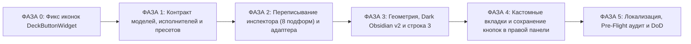

# Power-Pack план: Редизайн инспектора атрибутов, переписывание системы действий и кастомная библиотека DuckDeck

> **Статус:** Аудит завершен, Фазы 0–5 детально декомпозированы, готов к исполнению
> **Роли-исследователи:** `@deep-researcher`, `@bug-hunter`
> **Целевые модули:** `modules/deck/models.py`, `modules/deck/presets.py`, `modules/deck/executors.py`, `modules/deck/action_dispatcher.py`, `modules/deck/custom_library.py`, `modules/deck/widgets/deck_button.py`, `modules/deck/editor/` (`adapter.py`, `window.py`, `styles.py`, `KeyPropertyInspector`, `ButtonPropertyForm`, `ActionLibraryDrawer`, `ActionCategorySection`, `EditorGridCell`)
> **Дизайн-система:** Dark Obsidian v2 (PySide6 / Qt, Slate Palette, `WS_EX_NOACTIVATE`, Bilingual Localization-First)

---

## 1. Архитектурный аудит кодовой базы и первопричины дефектов (RCA)

### 1.1. Аудит обрезки надписей («Живой стат» вместо «Живой статус:»)

- В `modules/deck/editor/styles.py` зафиксировано `FORM_LABEL_WIDTH = 60`.
- В `ButtonPropertyForm` все 4 метки левой колонки (`Название:`, `Действия:`, `Параметры:`, `Живой статус:`) принудительно ограничены `setFixedWidth(60)`, что подавляет автовыравнивание `QGridLayout`:
  - `Параметры:` ($\approx 72\text{ px}$) обрезается до `Параметр`;
  - `Живой статус:` ($\approx 88\text{–}92\text{ px}$) обрезается до `Живой стат`;
  - в EN-локали `Live Status:` ($\approx 76\text{ px}$) обрезается до `Live Stat...`.

### 1.2. Аудит эффекта обрезки снизу и геометрии левой колонки

- `KeyPropertyInspector` и `ButtonPropertyForm` имеют `border: none`, из-за чего нижняя кромка инспектора сливается с фоном рабочей области (`#0b0d13`), а нижний отступ (`10 px`) визуально прижимает строку 3 к краю.
- Плитка превью `KeyPreviewTile` имеет ширину `84 px`, а палитра цветов `ColorAccentPicker` (5 × `20 px` + 4 × `6 px`) — `124 px`, из-за чего палитра выпирает вправо и смещает сетку параметров.

### 1.3. Контрактные тесты и зависимые файлы (DoD Инварианты)

При рефакторинге затрагиваются следующие тестовые наборы, которые **обязаны обновляться синхронно в своей фазе** (принцип Zero-Downtime — 100% `PASS` после каждой фазы):

- `tests/unit/test_deck_soundboard.py` — завязан на удаляемый функционал саундборда (удалить или переориентировать на проверку `click_sound` / `DeckSoundEngine` в Фазе 1).
- `tests/unit/test_deck_editor_adapter.py` — проверка `DeckConfigAdapter` (обновить в Фазе 2).
- `tests/unit/test_deck_property_form.py` и `tests/unit/test_deck_property_form_subforms.py` — проверяют `btn_presets_menu`, `LEGACY_ACTION_KEYS`, `SoundboardSubform`, `INSPECTOR_HEIGHT == 260` (обновить под 8 чистых подформ в Фазе 2).
- `tests/unit/test_deck_editor_inspector_widgets.py` — проверяет `FORM_LABEL_WIDTH`, `INSPECTOR_HEIGHT == 260` и QSS-селекторы `styles.py` (обновить в Фазе 3).
- `tests/unit/test_deck_editor_action_drawer.py` — проверяет `ActionPresetsRegistry` и `ActionLibraryDrawer` (обновить в Фазе 1 и Фазе 4).

### 1.4. Аудит строки 3 (Feedback & Live Status)

- Метка `lbl_click_sound_field` («Звук клика:») брошена в поток `QHBoxLayout` без симметричной группировки.
- При переключении звука клика на `"custom"` динамически появляются кнопки `📁` и `▶` ($72\text{ px}$), вызывая рывок и сжатие левого комбобокса `combo_status_source`.

### 1.5. Аудит визуальных разделителей и акцентов

- Отсутствует вертикальный разделитель `QFrame.VLine` между левой колонкой превью и правой сеткой параметров (`fields_grid`), а также горизонтальный суб-разделитель перед строкой обратной связи.
- Кнопка `⚡ Шаблоны...` (`btnPresetsMenu`) дублировала правую панель и вносила путаницу — **полностью удаляется**; шаблоны живут только в правой панели, а в шапке инспектора добавляется акцентная кнопка сохранения кнопки в библиотеку (`⭐`).

### 1.6. Аудит рендеринга кастомных иконок в `DeckButtonWidget`

- В редакторе (`EditorGridCell`) путь к PNG/SVG проверяется через `os.path.isfile` и рисуется через `QPixmap`.
- В рантайм-виджете `modules/deck/widgets/deck_button.py` проверка файла отсутствует: строка пути (например `resources/deck/custom_icons/filezilla_1.png`) передаётся напрямую в `QLabel.setText(...)`, отрисовываясь гигантским текстом `stom_ic`.

### 1.7. Аудит системы действий, шаблонов и маршрутизации подформ (Критическое RCA)

1. **Главная причина бага «Громкость приложения (+5%) → Параметр: Переключение»:**
   - В `modules/deck/models.py` у `AudioActionParams` задан дефолт `devices: List[str] = ["Наушники", "Динамики"]`.
   - При сериализации пресетов в `modules/deck/presets.py` через `.model_dump()` поле `devices` попадает в **каждый** аудио-пресет (`focus_app_vol_up`, `mic_mute_toggle`, `master_mute_toggle`).
   - В `ButtonPropertyForm.resolve_subform_route` и `DeckConfigAdapter.slot_to_dto` проверка `or bool(p.get("devices"))` отправляет все аудио-пресеты на подформу `AudioDeviceSubform` («Переключение») вместо `VolumeSubform`.
2. **Несоответствие UI-подформ и исполнителей (`executors.py`):**
   - `VolumeSubform` шлёт `target="microphone"` и `command="volume_up" / "volume_down"` со статичным `step_percent=5`, тогда как `AudioExecutor` проверяет `target == "mic"` и `command == "step"` с `step_percent` со знаком `+`/`-` (в итоге микрофон падает с ошибкой, громкость мастера `+`/`-` ничего не делает, а «Тише» на активном окне увеличивает громкость).
   - `AudioDeviceSubform` предлагает режим `"specific"` без поля выбора устройства, а `AudioExecutor` ждёт `mode="set"` и `target_device_id`.
   - `PathUrlSubform` при редактировании шлёт `url`/`executable`/`path`, не обновляя `target` и `kind`.
   - `ScreenshotSubform` шлёт `target="primary_screen"`, а `SystemActionParams` ждёт `screenshot_target="primary" | "active_window"`.
   - `HotkeySwitchSubform` не передаёт `mode="toggle"`, `keys`, `toggle_keys`, а `DeckConfigAdapter.dto_to_slot` для `hotkey` перезаписывает весь `action` на `{"keys": parsed_keys}`, уничтожая режим тумблера.
   - `SystemSubform` содержит только 3 команды, хотя у `system` их 5 (включая `screenshot` и `close_window`).
3. **Хаос в UI и истории изменений:**
   - В `combo_actions` загружаются 8 примитивов + 12 скрытых `LEGACY_ACTION_KEYS`.
   - В `presets.py` 8 категорий, а в `_show_presets_menu()` — 6 склеенных групп; пункт «Открыть библиотеку действий...» не обработан в `window.py`.
   - `apply_preset()` эмитит 7 отдельных `property_changed` сигналов подряд, создавая 7 записей в `QUndoStack` и перезагружая форму посреди обновления.
4. **Решения по объёму функционала:**
   - **Действие Саундборд (`soundboard_play`, `soundboard_stop`, `SoundboardSubform`, `target="soundboard"`) полностью удаляется** из библиотеки, подформ, моделей и пресетов. **Важно:** `DeckSoundEngine` и настройка звука клика кнопки (`sound_override` в строке 3 инспектора) **сохраняются** и продолжают работать в штатном режиме.
   - **Макро-цепочка (`macro_sequence`) остаётся как заготовка (`is_wip=True`)** с информационной подформой.
   - **Кнопка `⚡ Шаблоны...` полностью удаляется** из инспектора — готовые и пользовательские шаблоны доступны только в правой панели (`ActionLibraryDrawer`), которая расширяется поддержкой **пользовательских вкладок (категорий)** и **сохранением настроенных кнопок**.

---

## 2. Архитектура переработки (6 Фаз: Фаза 0..5)



### Матрица ответственности (RACI)

- **Accountable (A):** `@deep-researcher` (Архитектурный надзор и инварианты)
- **Responsible (R):** `@fullstack-builder` (Фазы 0, 1, 2, 4), `@frontend-ui-designer` (Фаза 3), `@git-release-master` (Фаза 5)
- **Consulted (C):** `@ui-creator` (Эстетика Dark Obsidian v2)
- **Informed (I):** `@code-review` (Pre-Flight аудит каждой фазы)

---

## 3. Детальный разбор фаз и Actionable Roadmap

### ФАЗА 0. Исправление рендеринга кастомных графических иконок в `DeckButtonWidget` (Quick Fix)

> **Цель:** Устранить вывод текстового пути `"stom_ic"` на сенсорном экране панели DuckDeck, внедрив полиморфный рендеринг `QPixmap` / Unicode в `DeckButtonWidget`.

- **Файлы:** `modules/deck/widgets/deck_button.py`, `tests/modules/deck/test_deck_view.py` (или `tests/unit/test_deck_button_custom_icon.py`).
- **Шаги:**
  - **0.1:** Реализовать `_render_icon(self, icon_str_or_path: Optional[str] = None)`: проверка `icon_path`/`icon` как файла (абсолютный путь, относительно `cwd` и `resources/`), загрузка и масштабирование `QPixmap` до `icon_size` с `Qt.KeepAspectRatio`, фолбэк на Unicode/эмодзи.
  - **0.2:** Интегрировать `_render_icon()` в `_setup_ui()`, `update_config()` и `update_status()` вместо прямого `QLabel.setText()`.
  - **0.3:** Написать TDD-тест для `DeckButtonWidget` с временным PNG 64×64 и эмодзи.

```text
#### Запуск Фазы 0:
@fullstack-builder реализуй Фазу 0 из .md/deck/edit_atrib2.md:
1. Шаг 0.1: Внедрить полиморфный метод _render_icon(self, icon_str_or_path=None) в modules/deck/widgets/deck_button.py.
2. Шаг 0.2: Интегрировать _render_icon в _setup_ui(), update_config() и update_status().
3. Шаг 0.3: Написать модульный тест загрузки PNG/эмодзи в DeckButtonWidget и прогнать pytest tests/modules/deck/test_deck_view.py.

#### Pre-Flight проверка Фазы 0:
@code-review проведи аудит Фазы 0:
Проверь отрисовку файлов из resources/deck/custom_icons/ как QPixmap, фолбэк на эмодзи, отсутствие регрессий и Qt.NoFocus.
```

---

### ФАЗА 1. Зачистка legacy и единый контракт моделей, исполнителей и пресетов

> **Цель:** Убрать расхождения между моделями, пресетами и исполнителями, полностью вычистить саундборд, сохранить макроцепочку как заготовку (`is_wip=True`).

- **Файлы:** `modules/deck/models.py`, `modules/deck/presets.py`, `modules/deck/executors.py`, `modules/deck/action_dispatcher.py`, `modules/deck/editor/window.py`.
- **Шаги:**
  - **1.1 (Модели в `models.py`):**
    - `AudioActionParams`: убрать дефолтный список `devices` (`devices: Optional[List[str]] = None`), убрать поля и target/command саундборда; оставить `target: Literal["master", "mic", "focus_app", "device"]` и `command: Literal["toggle_mute", "volume_up", "volume_down", "toggle_device", "set_device"]`, `step_percent: int = 5`, `mode: Literal["toggle", "set"] = "toggle"`, `target_device_id: Optional[str] = None`.
    - `LaunchActionParams`: единые `kind: Literal["app", "file", "url"] = "app"` и `target: str = ""`.
    - `SystemActionParams`: единые `command: Literal["toggle_dimmer", "screenshot", "lock_workstation", "sleep_display", "close_window"]` и `screenshot_target: Literal["primary", "active_window"] = "primary"`.
    - `HotkeyActionParams`: `mode: Literal["press", "toggle"] = "press"`, `keys: List[str]`, `toggle_keys: List[str]`.
    - Вычистить избыточные legacy-классы, оставив только тонкую миграцию старых конфигов в `DeckActionNormalizer`.
  - **1.2 (Исполнители в `executors.py` и `action_dispatcher.py`):**
    - `AudioExecutor`: удалить ветку `soundboard`; реализовать точную обработку `target == "mic"`, `target == "master"` (`toggle_mute`, `volume_up`, `volume_down`), `target == "focus_app"` (`toggle_mute`, `volume_up`, `volume_down`), `target == "device"` (`toggle_device`, `set_device` по `target_device_id`).
    - Убрать legacy-ветки саундборда из `ActionRunnable._run_action_config`.
    - В `DeckEditorWindow._on_test_action_requested` передавать `audio_manager` при тестовом запуске `▶`.
  - **1.3 (Пресеты в `presets.py` и синхронизация тестов):**
    - Удалить категорию `soundboard` и пресеты `soundboard_play` / `soundboard_stop` (остаётся 7 категорий).
    - Оставить `macro_sequence` в категории `multi_action` с `is_wip=True` (заготовка).
    - Сериализовать `base_action.params` всех пресетов с `exclude_none=True`, чтобы `devices` присутствовал **только** у `output_device_toggle`.
    - Удалить/очистить `tests/unit/test_deck_soundboard.py` (оставив только тесты `DeckSoundEngine.play_tap` / `preview_sound`, если применимо) и обновить `tests/unit/test_deck_editor_action_drawer.py` под 7 категорий (без `soundboard`).

```text
#### Запуск Фазы 1:
@fullstack-builder реализуй Фазу 1 из .md/deck/edit_atrib2.md:
1. Унифицируй модели параметров в modules/deck/models.py (без дефолтного devices и без саундборда).
2. Синхронизируй executors.py и action_dispatcher.py (единый AudioExecutor, удаление саундборда, передача audio_manager в тест ▶).
3. Обнови modules/deck/presets.py: удали саундборд, оставь macro_sequence (is_wip=True), сериализуй params с exclude_none=True.
4. Синхронизируй тесты (test_deck_soundboard.py, test_deck_editor_action_drawer.py) и подтверди PASS.

#### Pre-Flight проверка Фазы 1:
@code-review проведи аудит Фазы 1:
Проверь 100% соответствие контрактов models.py <-> executors.py <-> presets.py и отсутствие утечек параметров.
```

---

### ФАЗА 2. Переписывание инспектора (`ButtonPropertyForm`) и адаптера (`DeckConfigAdapter`)

> **Цель:** Удалить кнопку «Шаблоны...», `LEGACY_ACTION_KEYS` и сломанную маршрутизацию. Построить 8 чистых подформ (1 примитив = 1 подформа) и чистый двусторонний маппинг.

- **Файлы:** `modules/deck/editor/widgets/button_property_form.py`, `modules/deck/editor/adapter.py`, `modules/deck/editor/window.py`.
- **Шаги:**
  - **2.1 (Удаление шаблонов и legacy из `ButtonPropertyForm`):**
    - Полностью удалить `btn_presets_menu`, `_show_presets_menu()`, `apply_preset()`, `LEGACY_ACTION_KEYS`, `SoundboardSubform` и 13 разрозненных подформ.
    - В `combo_actions` оставить ровно 8 чистых примитивов (`hotkey`, `launch`, `audio`, `media`, `text`, `system`, `deck_nav`, `macro`).
    - На пустом слоте (`UnconfiguredSubform`) показывать только текстовую подсказку перетащить шаблон из правой панели или выбрать действие выше (без кнопки шаблонов).
  - **2.2 (8 чистых подформ инспектора в рамках `INPUT_HEIGHT = 28 px`):**
    - `HotkeySubform`: компактный переключатель режима (`Одиночное` / `Тумблер`) + 1 или 2 `HotkeyCaptureButton` (`mode`, `keys`, `toggle_keys`) в одну строку 28 px.
    - `LaunchSubform`: комбобокс типа (`Приложение` / `Файл или папка` / `Веб-ссылка`) + `QLineEdit` (`target`) + кнопка обзора `📁` (скрыта для `url`).
    - `AudioSubform`: переключатель режима (`Громкость / Mute` | `Аудиоустройство`):
      - для громкости: комбобокс цели (`Активное окно`, `Общий звук`, `Микрофон`) + комбобокс команды (`Вкл/Выкл звук`, `Громче +5%`, `Тише -5%`);
      - для устройства: комбобокс режима (`Переключение`, `Конкретное устройство`) + комбобокс выбора устройства. **Важно (Sibling Isolation):** список устройств `[(device_id, name)]` передаётся в `ButtonPropertyForm.set_audio_devices()` через Dependency Injection из `DeckEditorWindow` / `view.py`, без прямого `from modules.audio` внутри UI-формы.
    - `MediaSubform`: комбобокс мультимедиа-команд (`play_pause`, `next_track`, `prev_track`, `stop`, `mute`, `volume_up`, `volume_down`).
    - `TextSubform`: поле текста + чекбокс `Enter`.
    - `SystemSubform`: комбобокс команд (`toggle_dimmer`, `screenshot`, `lock_workstation`, `sleep_display`, `close_window`) + при выборе `screenshot` показ опции `screenshot_target` (`primary` / `active_window`) и чекбокса буфера обмена.
    - `DeckNavSubform`: цель (`next_page`, `prev_page`, `goto_page`, `folder_back`) + поле `page_id` при `goto_page`.
    - `MacroSubform`: заготовка-заглушка (`NoParamsSubform` с подсказкой о будущем редакторе цепочек).
  - **2.3 (Чистый адаптер `DeckConfigAdapter` и синхронизация тестов):**
    - Убрать эвристики и `action.params.update(...)` поверх старых ключей.
    - Сохранять `mode`/`toggle_keys` у `hotkey` при конвертации `dto_to_slot` и `slot_to_dto`.
    - Гарантировать прямую маршрутизацию: `stack_idx` определяется строго по `action_type` (0..7) и `unconfigured` (8).
    - Синхронизировать `tests/unit/test_deck_property_form.py`, `tests/unit/test_deck_property_form_subforms.py` и `tests/unit/test_deck_editor_adapter.py` под 8 чистых подформ (без `btn_presets_menu`, `LEGACY_ACTION_KEYS`, `SoundboardSubform`) с сохранением `INSPECTOR_HEIGHT == 260`.

```text
#### Запуск Фазы 2:
@fullstack-builder реализуй Фазу 2 из .md/deck/edit_atrib2.md:
1. Удали btn_presets_menu, _show_presets_menu, apply_preset, SoundboardSubform и LEGACY_ACTION_KEYS в modules/deck/editor/widgets/button_property_form.py.
2. Реализуй 8 чистых подформ под 8 примитивов в рамках INPUT_HEIGHT = 28px (с DI для списка аудиоустройств, Qt.NoFocus и retranslate_ui()).
3. Перепиши маппинг в modules/deck/editor/adapter.py без cross-contamination параметров и с сохранением hotkey toggle.
4. Обнови test_deck_property_form.py, test_deck_property_form_subforms.py и test_deck_editor_adapter.py, подтверди 100% PASS.

#### Pre-Flight проверка Фазы 2:
@code-review проведи аудит Фазы 2:
Проверь маршрутизацию всех 8 примитивов, корректность Undo/Redo, Qt.NoFocus и отсутствие legacy-костылей.
```

---

### ФАЗА 3. Геометрия инспектора, двухколоночная строка 3 и стилизация Dark Obsidian v2

> **Цель:** Устранить обрезку надписей («Живой стат», «Параметр»), оформить инспектор карточным контуром, стабилизировать строку 3 без рывков и добавить разделители/фокусные акценты.

- **Файлы:** `modules/deck/editor/styles.py`, `modules/deck/editor/widgets/property_inspector.py`, `modules/deck/editor/widgets/button_property_form.py`, `tests/unit/test_deck_editor_inspector_widgets.py`.
- **Шаги:**
  - **3.1 (Геометрия и карточный контур):**
    - Увеличить `FORM_LABEL_WIDTH = 96` в `styles.py` (синхронизировать `test_styles_inspector_constants`).
    - В `ButtonPropertyForm` задать `fields_grid.setColumnMinimumWidth(0, 96)` и снять `setFixedWidth(60)` у меток полей; нижний отступ формы увеличить до `14 px`.
    - Оформить `KeyPropertyInspector` карточным стилем: `border: 1px solid BORDER_SURFACE_1`, `border-radius: 10px`.
    - В `ColorAccentPicker` задать размер свотчей `14 px` с шагом `3 px` (ширина `82 px` под плитку `84 px`).
  - **3.2 (Двухколоночная строка 3 — Zero Layout Shift):**
    - Разбить `row3_container` на две симметричные группы (`status_subgroup` и `sound_group_container` с `spacing=16`).
    - Зафиксировать `btn_click_sound_browse` и `btn_click_sound_preview` на `28×28 px` с `Qt.NoFocus`, чтобы переключение на `"custom"` не сжимало левый комбобокс статуса.
  - **3.3 (Стилизация Dark Obsidian v2 и разделители):**
    - Добавить вертикальный разделитель `formVerticalSeparator` (`QFrame.VLine`, `1 px`) между `left_preview_layout` и `fields_grid`.
    - Добавить горизонтальный суб-разделитель `feedbackSeparator` перед строкой 3.
    - Настроить подсветку активных полей ввода при фокусе (`#121929`, неоновый контур `BORDER_FOCUS_NEON`), сохраняя `Qt.NoFocus` на кнопках.
    - Стилизовать кнопку `btnSaveToLibrary` (`⭐`) в шапке инспектора и кнопку `+ Вкладка` в правой панели.

```text
#### Запуск Фазы 3:
@frontend-ui-designer реализуй Фазу 3 из .md/deck/edit_atrib2.md:
1. Шаг 3.1: Обнови FORM_LABEL_WIDTH = 96, карточный контур KeyPropertyInspector (border-radius: 10px) и ColorAccentPicker (82px).
2. Шаг 3.2: Реорганизуй row3_container в 2 симметричные половины без layout-сдвигов.
3. Шаг 3.3: Добавь formVerticalSeparator, feedbackSeparator и фокусную подсветку в styles.py и ButtonPropertyForm.

#### Pre-Flight проверка Фазы 3:
@code-review проведи аудит Фазы 3:
Проверь отсутствие обрезки «Живой статус:» и «Параметры:» на RU/EN, отсутствие layout-сдвигов и прохождение тестов инспектора.
```

---

### ФАЗА 4. Пользовательские вкладки и сохранение кастомных кнопок в правой панели

> **Цель:** Реализовать в правой панели (`ActionLibraryDrawer`) создание/переименование/удаление своих вкладок (категорий) и сохранение туда настроенных пользовательских кнопок с последующим Drag-and-Drop.

- **Файлы:** `modules/deck/custom_library.py` (новый), `modules/deck/editor/dto.py`, `modules/deck/editor/widgets/action_drawer.py`, `modules/deck/editor/widgets/action_category.py`, `modules/deck/editor/widgets/action_item.py`, `modules/deck/editor/widgets/button_property_form.py`, `modules/deck/editor/widgets/grid_cell.py`, `modules/deck/editor/window.py`.
- **Шаги:**
  - **4.1 (Хранилище `CustomLibraryStorage` в `modules/deck/custom_library.py`):**
    - Pydantic v2 модели `CustomTabConfig` (`id`, `title`, `icon`) и `CustomButtonPreset` (`id`, `tab_id`, `title`, `icon`, `color_accent`, `status_source`, `sound_override`, `action`, `keywords`).
    - Атомарное чтение/запись (`.tmp` + `os.replace`) в `config/deck_custom_library.json` (изолированно от системных пресетов `ActionPresetsRegistry`).
    - Методы: `list_tabs()`, `create_tab(title, icon)`, `rename_tab(tab_id, new_title)`, `delete_tab(tab_id)`, `add_item(tab_id, item)`, `rename_item(item_id, new_title)`, `delete_item(item_id)`, `to_categories_dto()`.
  - **4.2 (UI вкладок в `ActionLibraryDrawer` и `ActionCategorySection`):**
    - Кнопка **`+ Вкладка`** (`Qt.NoFocus`) в шапке `ActionLibraryDrawer` рядом с поиском — открывает компактный диалог ввода названия и иконки вкладки.
    - В `ActionCategoryDTO` и `ActionItemDTO` (`dto.py`) добавить поля `raw_title: Optional[str] = None` и `is_custom: bool = False`: метод `get_title()` для пользовательских элементов возвращает `raw_title` напрямую (без вызова `t()`), а для системных категорий/пресетов продолжает использовать `t(self.title_key)` (гарантия прохождения `test_i18n_linter.py`).
    - В шапке пользовательской категории (`ActionCategoryHeader`): контекстное меню (ПКМ) и/или мини-кнопки управления — **«Переименовать вкладку»**, **«Удалить вкладку»**.
    - На пользовательской карточке (`ActionItemWidget`): контекстное меню (ПКМ) — **«Переименовать»**, **«Удалить из библиотеки»**.
    - Обновление `ActionLibraryDrawer.reload_library()` с объединением пользовательских вкладок и системных категорий `ActionPresetsRegistry` с сохранением состояния раскрытия и текущего поискового фильтра.
  - **4.3 (Сохранение кнопки в правую панель и полный Drag-and-Drop):**
    - В шапке `ButtonPropertyForm` (рядом с `▶` и `🗑️`) добавить кнопку **`⭐`** («Сохранить в библиотеку», `btnSaveToLibrary`, `Qt.NoFocus`), а также пункт **«Сохранить в библиотеку...»** в контекстное меню `EditorGridCell`.
    - Диалог сохранения: ввод/редактирование подписи кнопки + выбор целевой пользовательской вкладки (или кнопка «+ Новая вкладка» прямо в диалоге).
    - В `ActionItemWidget.mouseMoveEvent` дополнить MIME-payload (`application/x-duckdeck-action`) полями `is_custom`, `default_config`, `color_accent`, `status_source`, `sound_override`.
    - В `DeckEditorWindow._on_canvas_action_dropped`: если `is_custom=True`, восстанавливать `ButtonSlotDTO` из сохранённого пользовательского пресета (`CustomLibraryStorage` / MIME-payload) со всеми атрибутами (`action_type`, `action_params`, `color_accent`, `status_source`, `sound_override`, `icon`, `title`), а не искать в `ActionPresetsRegistry`.
  - **4.4 (Тесты Фазы 4):** добавить модульные тесты в `tests/unit/test_deck_custom_library.py` и обновить `test_deck_editor_action_drawer.py` (CRUD вкладок, сохранение/удаление кнопок, Drag-and-Drop payload).

```text
#### Запуск Фазы 4:
@fullstack-builder реализуй Фазу 4 из .md/deck/edit_atrib2.md:
1. Создай modules/deck/custom_library.py с атомарным сохранением в config/deck_custom_library.json.
2. Расширь dto.py (raw_title, is_custom), ActionLibraryDrawer, ActionCategorySection и ActionItemWidget управлением вкладками и кнопками.
3. Добавь сохранение кнопки в библиотеку из ButtonPropertyForm (⭐) и EditorGridCell, а также полный Drag-and-Drop кастомных кнопок на холст.
4. Напиши тесты в tests/unit/test_deck_custom_library.py и подтверди PASS.

#### Pre-Flight проверка Фазы 4:
@code-review проведи аудит Фазы 4:
Проверь атомарность сохранения JSON, изоляцию от системных пресетов, полный перенос параметров при Drag-and-Drop и Qt.NoFocus.
```

---

### ФАЗА 5. Локализация (RU/EN), сквозной Pre-Flight аудит и DoD

> **Цель:** 100% паритет локалей RU/EN без хардкода строк, прохождение всех unit/интеграционных тестов и актуализация документации/памяти.

- **Файлы:** `locales/ru.json`, `locales/en.json`, `tests/`, `pyproject.toml`, `.md/changelog.md`, `.md/backend.md`.
- **Шаги:**
  - **5.1 (Локализация):** вынести все новые ключи (8 примитивов, подформы, управление кастомными вкладками, диалог сохранения в библиотеку) в `locales/ru.json` и `locales/en.json`, удалить неиспользуемые ключи саундборда и `actions_presets`.
  - **5.2 (Тесты):** обновить и добавить тесты на новую модель действий, 8 подформ инспектора, `DeckConfigAdapter`, `CustomLibraryStorage` и Drag-and-Drop кастомных кнопок.
  - **5.3 (Верификация):** прогон `pytest tests/` (100% PASS) и `pytest tests/core/test_i18n_linter.py` (100% PASS).
  - **5.4 (Релиз и память):** обновить версию в `pyproject.toml`, `.md/changelog.md`, `.md/backend.md`, Memory Bank (`activeContext.md`, `progress.md`) и MCP Serena.

```text
#### Запуск Фазы 5:
@git-release-master реализуй Фазу 5 из .md/deck/edit_atrib2.md:
1. Обеспечь 100% паритет locales/ru.json и locales/en.json и прохождение pytest tests/core/test_i18n_linter.py.
2. Запусти полный прогон pytest tests/ и добейся 100% PASS.
3. Синхронизируй pyproject.toml, .md/changelog.md, .md/backend.md, Memory Bank и MCP Serena.

#### Pre-Flight проверка Фазы 5:
@code-review проведи итоговый аудит всех 6 фаз (Фаза 0..5):
Подтверди 100% PASS pytest tests/, чистоту diff, соблюдение Localization-First и Stealth Focus Invariant.
```
