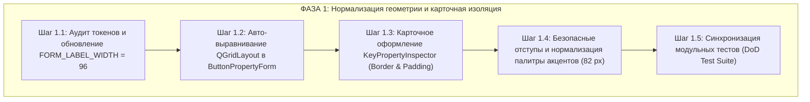
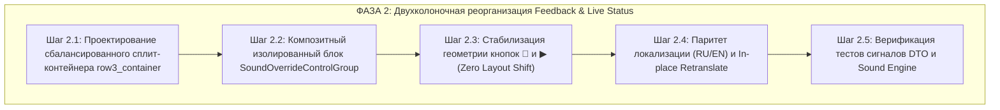
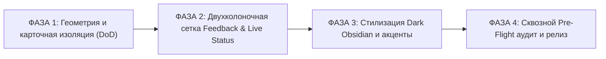

# Архитектурная спецификация и план редизайна панели атрибутов кнопок (ButtonPropertyForm)

> **Статус:** Анализ завершен, Фаза 1 и Фаза 2 детально декомпозированы, готов к исполнению  
> **Роль-исследователь:** `@deep-researcher` (Архитектурный аудит и граф зависимостей)  
> **Целевые модули:** `modules/deck/editor` (`KeyPropertyInspector`, `ButtonPropertyForm`, `ColorAccentPicker`, `styles.py`, `window.py`)  
> **Дизайн-система:** Dark Obsidian v2 (PySide6 / Qt, Slate Palette, WS_EX_NOACTIVATE, Bilingual Localization-First)

---

## 1. Архитектурный аудит кодовой базы и первопричины дефектов (RCA)

### 1.1. Аудит обрезки надписей («Живой стат» вместо «Живой статус:»)

#### Механика и локализация в кодовой базе:
1. В дизайн-токенах редактора зафиксирована константа:
   ```python
   # modules/deck/editor/styles.py:112
   FORM_LABEL_WIDTH = 60
   ```
2. В конструкторе `ButtonPropertyForm` все текстовые метки левой колонки сетки принудительно ограничиваются этим значением:
   ```python
   # modules/deck/editor/widgets/button_property_form.py:1172, 1197, 1244, 1324
   self.lbl_title_field.setFixedWidth(FORM_LABEL_WIDTH)   # Строка 0: "Название:"
   self.lbl_actions_field.setFixedWidth(FORM_LABEL_WIDTH) # Строка 1: "Действия:"
   self.lbl_params_field.setFixedWidth(FORM_LABEL_WIDTH)  # Строка 2: "Хоткей:" / "Параметры:"
   self.lbl_status_field.setFixedWidth(FORM_LABEL_WIDTH)  # Строка 3: "Живой статус:"
   ```
3. Точные метрики ширины текста при системном шрифте Qt (Segoe UI / Roboto 12px Medium, DPI 100%–125%):
   * `Название:` — 9 символов $\approx 56\text{ px}$ (укладывается впритык при 60 px);
   * `Действия:` — 9 символов $\approx 58\text{ px}$ (укладывается впритык при 60 px);
   * `Хоткей:` — 7 символов $\approx 46\text{ px}$ (укладывается);
   * `Параметры:` — 10 символов $\approx 72\text{ px}$ (**обрезается** до «Параметр...» при выборе действий без хоткея);
   * `Живой статус:` — 13 символов $\approx 88\text{–}92\text{ px}$ (**обрезается** ровно до «Живой стат»);
   * В английской локали `Live Status:` — 12 символов $\approx 76\text{ px}$ (**обрезается** до «Live Stat...»).

#### Взаимосвязь с гридом:
Все 4 метки размещены в нулевом столбце единого `fields_grid = QGridLayout()`:
```python
fields_grid.addWidget(self.lbl_title_field, 0, 0, Qt.AlignVCenter)
fields_grid.addWidget(self.lbl_actions_field, 1, 0, Qt.AlignVCenter)
fields_grid.addWidget(self.lbl_params_field, 2, 0, Qt.AlignVCenter)
fields_grid.addWidget(self.lbl_status_field, 3, 0, Qt.AlignVCenter)
```
Использование `setFixedWidth(60)` на отдельных метках искусственно подавляет способность `QGridLayout` автоматически вычислять естественную ширину столбца по самому широкому дочернему элементу.

---

### 1.2. Аудит эффекта обрезки снизу и поведения при ресайзе окна

#### Анализ цепочки компоновки:
1. **Иерархия контейнеров:**
   `DeckEditorWindow` $\rightarrow$ `main_splitter` (QSplitter) $\rightarrow$ `workspace_container` (QVBoxLayout: `_workspace_layout`) $\rightarrow$
   * `self.header_bar` (52 px)
   * `self.canvas_widget` (`stretch=1`, `min_height=300 px`)
   * `self.pagination_bar` (36 px)
   * `self.workspace_separator` (1 px)
   * `self.inspector` (`stretch=0`, `height=260 px`)
2. **Почему растяжение окна не влияет на высоту инспектора:**
   * В `_workspace_layout` фактор растяжения `stretch=1` назначен **только** для `canvas_widget`.
   * Для `KeyPropertyInspector` и `ButtonPropertyForm` жестко вызвано:
     ```python
     # modules/deck/editor/widgets/property_inspector.py:64
     self.setFixedHeight(INSPECTOR_HEIGHT)  # INSPECTOR_HEIGHT = 260
     # modules/deck/editor/widgets/button_property_form.py:1071
     self.setFixedHeight(INSPECTOR_HEIGHT)
     ```
   * В результате при любом растяжении окна по вертикали (даже на 1440p / 4K) инспектор строго заблокирован на 260 px.
3. **Почему панель визуально кажется обрезанной снизу:**
   * В стилях `modules/deck/editor/styles.py:680-685` задано:
     ```css
     QFrame#propertyInspector, KeyPropertyInspector {
         background-color: #0f141f;
         border: none;
     }
     ```
     У инспектора **полностью отсутствует нижняя рамка и скругление**.
   * Внутри `ButtonPropertyForm` отступы заданы как `root_layout.setContentsMargins(12, 10, 12, 10)`. Нижний отступ составляет всего 10 px.
   * Контейнер окна `workspace_container` имеет `setContentsMargins(12, 12, 12, 12)`.
   * Фон `workspace_container` — `#0b0d13` (`SURFACE_0_CANVAS`), фон инспектора — `#0f141f` (`SURFACE_1_PANEL`). На мониторах с низкой контрастностью или высокой яркостью нижняя кромка инспектора сливается с фоном рабочей области, а контент четвертой строки («Живой статус», «Звук клика») оказывается визуально прижат к нижнему краю окна, создавая ощущение отсечения.
4. **Геометрический перекос левой колонки (Превью vs Палитра):**
   * Плитка кнопки: `PREVIEW_TILE_SIZE = 84 px`.
   * Палитра цветов `ColorAccentPicker`: 5 кнопок по 20 px + 4 промежутка по 6 px = **124 px**.
   * Палитра на 40 px шире плитки превью, из-за чего она выпирает вправо под правую форму и смещает сетку параметров.

---

### 1.3. Граф зависимостей и реестр тестов (DoD Инварианты)

При любых изменениях `FORM_LABEL_WIDTH` и `INSPECTOR_HEIGHT` необходимо учитывать строгие контрактные тесты, которые проверяют эти токены напрямую:

| Файл теста | Строка | Проверяемое условие | Влияние изменений |
| :--- | :--- | :--- | :--- |
| `tests/unit/test_deck_editor_inspector_widgets.py` | 106 | `assert FORM_LABEL_WIDTH == 60` | Требует синхронизации константы |
| `tests/unit/test_deck_editor_inspector_widgets.py` | 103 | `assert INSPECTOR_HEIGHT == 260` | Контроль базового токена высоты |
| `tests/unit/test_deck_editor_inspector_widgets.py` | 398, 536, 579, 619 | `assert form.height() == INSPECTOR_HEIGHT` | Проверка высоты форм тачбара |
| `tests/unit/test_deck_property_form.py` | 29-30 | `assert form.height() == INSPECTOR_HEIGHT == 260` | Проверка бюджета высоты формы кнопки |
| `tests/unit/test_deck_property_form_subforms.py` | 50 | `assert form.height() == INSPECTOR_HEIGHT == 260` | Проверка высоты при смене подформ |

> **Критический архитектурный инвариант:**  
> Изменение геометрии обязано выполняться без нарушения прохождения всех **43 модульных тестов** инспектора. Константа `INSPECTOR_HEIGHT = 260` может быть сохранена как номинальная высота по умолчанию (или диапазон), а `FORM_LABEL_WIDTH` обновлен синхронно в коде и тестах.

---

### 1.4. Детальный аудит строки 3 (Feedback & Live Status)

#### Текущее состояние в кодовой базе:
В строке 3 формы (`button_property_form.py:1320-1375`) размещен контейнер `row3_container`:
```python
# modules/deck/editor/widgets/button_property_form.py:1326-1374
row3_container = QWidget(self)
row3_container.setFixedHeight(INPUT_HEIGHT)
row3_layout = QHBoxLayout(row3_container)
row3_layout.setContentsMargins(0, 0, 0, 0)
row3_layout.setSpacing(6)

row3_layout.addWidget(self.combo_status_source, 1)   # Выбор телеметрии
row3_layout.addWidget(self.lbl_click_sound_field)    # Текст "Звук клика:"
row3_layout.addWidget(self.combo_click_sound, 1)     # Выбор режима звука
row3_layout.addWidget(self.btn_click_sound_browse)   # Кнопка 📁
row3_layout.addWidget(self.btn_click_sound_preview)  # Кнопка ▶

fields_grid.addWidget(self.lbl_status_field, 3, 0, Qt.AlignVCenter)
fields_grid.addWidget(row3_container, 3, 1, 1, 2)
```

#### Анатомия дефекта строки 3:
1. **Асимметрия выравнивания меток:**  
   Метка `lbl_status_field` находится в общей левой колонке сетки `fields_grid` (выровнена с «Название:», «Действия:», «Хоткей:»). А метка `lbl_click_sound_field` («Звук клика:») не привязана ни к какой сетке — она брошена прямо в поток `QHBoxLayout` перед вторым комбобоксом. Это ломает вертикальные направляющие и создает ощущение визуальной «каши».
2. **Динамическое сжатие при выборе кастомного звука:**  
   По умолчанию кнопки `btn_click_sound_browse` (📁) и `btn_click_sound_preview` (▶) скрыты (`setVisible(False)`). При переключении режима в `"custom"` (`_on_click_sound_changed`) они динамически становятся видимыми (`setVisible(True)`):
   $$\text{Суммарная ширина кнопок} = 30\text{ px} + 6\text{ px} + 30\text{ px} + 6\text{ px} = 72\text{ px}$$
   Это приводит к мгновенному рывку интерфейса: оба комбобокса (`combo_status_source` и `combo_click_sound`) сжимаются на 36 px каждый. На стандартной ширине формы длинный текст «По умолчанию» или имя выбранного файла усекается, а стрелка выпадающего списка перекрывает текст.
3. **Публичный контракт и сигналы, требующие 100% сохранения:**
   * Атрибуты виджетов: `combo_status_source`, `combo_click_sound`, `btn_click_sound_browse`, `btn_click_sound_preview`, `lbl_status_field`, `lbl_click_sound_field`.
   * Слоты и сигналы:
     - `_on_status_source_changed(index)` $\rightarrow$ `self.property_changed.emit("status_source", key)`
     - `_on_click_sound_changed(index)` $\rightarrow$ `self.property_changed.emit("sound_override", mode)`
     - `_on_click_sound_browse_clicked()` $\rightarrow$ открытие диалога выбора файла, эмит `("sound_override", path)`
     - `_on_click_sound_preview_clicked()` $\rightarrow$ вызов `DeckSoundEngine.preview_sound(path)` или `DeckSoundEngine.play_tap()`
   * Прямое обращение тестов: `tests/unit/test_deck_live_tiles.py` и `test_deck_property_form.py` напрямую проверяют `form.combo_status_source.currentData()` и `count()`.

---

## 2. Детальный разбор: ФАЗА 1. Нормализация геометрии, устранение обрезки и карточная изоляция

Цель Фазы 1 — полностью устранить дефекты обрезки надписей и визуального прилипания к низу окна, создать выразительный карточный контур для панели инспектора и гарантировать 100% прохождение тестов без регрессий.



### Шаг 1.1. Аудит токенов и обновление `FORM_LABEL_WIDTH`
* **Файлы:** [`modules/deck/editor/styles.py`](file:///d:/Projects_X/duckdock/modules/deck/editor/styles.py), [`tests/unit/test_deck_editor_inspector_widgets.py`](file:///d:/Projects_X/duckdock/tests/unit/test_deck_editor_inspector_widgets.py).
* **Контракт изменения:** Увеличить базовую константу ширины меток с 60 до **96 px** (`FORM_LABEL_WIDTH = 96`).
* **Синхронизация теста:** В `test_deck_editor_inspector_widgets.py:106` обновить `assert FORM_LABEL_WIDTH == 96`.

### Шаг 1.2. Рефакторинг геометрии меток в `ButtonPropertyForm`
* **Файлы:** [`modules/deck/editor/widgets/button_property_form.py`](file:///d:/Projects_X/duckdock/modules/deck/editor/widgets/button_property_form.py).
* **Контракт изменения:** В `fields_grid = QGridLayout()` задать `columnMinimumWidth(0, 96)` и снять жесткий `setFixedWidth` у меток полей.

### Шаг 1.3. Карточное оформление `KeyPropertyInspector` (Контур и глубина)
* **Файлы:** [`modules/deck/editor/styles.py`](file:///d:/Projects_X/duckdock/modules/deck/editor/styles.py), [`modules/deck/editor/widgets/property_inspector.py`](file:///d:/Projects_X/duckdock/modules/deck/editor/widgets/property_inspector.py).
* **Контракт изменения:** Добавить контур `border: 1px solid BORDER_SURFACE_1`, скругление `border-radius: 10px` и внутренний отступ 1 px.

### Шаг 1.4. Безопасные внутренние отступы и нормализация палитры акцентов
* **Файлы:** [`modules/deck/editor/widgets/button_property_form.py`](file:///d:/Projects_X/duckdock/modules/deck/editor/widgets/button_property_form.py).
* **Контракт изменения:** Увеличить нижний отступ формы до 14 px. В `ColorAccentPicker` уменьшить свотчи до 14 px с шагом 3 px ($5 \times 14 + 4 \times 3 = 82\text{ px}$ под плитку 84 px).

### Шаг 1.5. Синхронизация модульных тестов и DoD-верификация
* **Файлы:** `tests/unit/test_deck_editor_inspector_widgets.py`, `test_deck_property_form.py`, `test_deck_property_form_subforms.py`.
* **Критерии:** 43 PASSED, 0 FAILED, 100% паритет локалей в `test_i18n_linter.py`.

---

## 3. Детальный разбор: ФАЗА 2. Двухколоночная реорганизация строки Feedback & Live Status

Цель Фазы 2 — ликвидировать хаос и динамические скачки строки 3, структурировав параметры живой телеметрии и звукового отклика кнопки в две симметричные, сбалансированные под-колонки с изолированной геометрией кнопок.



---

### Архитектурная схема компоновки строки 3 (Before vs After)

#### До реорганизации (Хаотичный поток в одной строке):
```text
[ Живой стат ] [ Отключен ▾ ] [ Звук клика: ] [ По умолчанию ▾ ] (при custom: [📁][▶] ломают ширину)
```

#### После реорганизации (Сбалансированный двухколоночный сплит):
```text
┌───────────────────────────────────────┬────────────────────────────────────────────────────────┐
│  КОЛОНКА 1: ЖИВОЙ СТАТУС              │  КОЛОНКА 2: ЗВУКОВОЙ ОТКЛИК КЛИКА                      │
│                                       │                                                        │
│  Живой статус: [ Отключен         ▾ ] │  Звук клика: [ Выбрать файл...    ▾ ] [ 📁 ] [ ▶ ]     │
└───────────────────────────────────────┴────────────────────────────────────────────────────────┘
```

---

### Шаг 2.1. Проектирование сбалансированного сплит-контейнера `row3_container`
* **Файлы:** [`modules/deck/editor/widgets/button_property_form.py`](file:///d:/Projects_X/duckdock/modules/deck/editor/widgets/button_property_form.py).
* **Контракт изменения:**
  1. В `fields_grid` строка 3 перестраивается так, чтобы колонка телеметрии и колонка звука получили четкое разделение:
     * `lbl_status_field` остается в колонке 0 сетки `fields_grid` с выравниванием по ширине 96 px.
     * `row3_container` (колонки 1–2 сетки) разбивается горизонтальным лэйаутом на две равноправные логические половины (`status_subgroup` и `sound_subgroup`) с разделяющим спейсингом 16 px.
  2. **Левая половина (Live Status):**
     Содержит `self.combo_status_source` с коэффициентом растяжения `stretch=1`.
  3. **Правая половина (Click Sound):**
     Содержит горизонтальный лэйаут с:
     - `self.lbl_click_sound_field` с аккуратной шириной подписи;
     - `sound_controls_container` со `self.combo_click_sound` и кнопками действий.
* **Результат:** 
  Метка «Звук клика:» визуально отделена от выпадающего списка статуса, создавая четкую визуальную симметрию строки.

---

### Шаг 2.2. Композитный изолированный блок `SoundOverrideControlGroup`
* **Файлы:** [`modules/deck/editor/widgets/button_property_form.py`](file:///d:/Projects_X/duckdock/modules/deck/editor/widgets/button_property_form.py).
* **Контракт изменения:**
  1. Обернуть блок управления звуком в изолированный контейнер:
     ```python
     self.sound_group_container = QWidget(row3_container)
     sound_layout = QHBoxLayout(self.sound_group_container)
     sound_layout.setContentsMargins(0, 0, 0, 0)
     sound_layout.setSpacing(6)
     
     sound_layout.addWidget(self.lbl_click_sound_field, 0, Qt.AlignVCenter)
     sound_layout.addWidget(self.combo_click_sound, 1)
     sound_layout.addWidget(self.btn_click_sound_browse, 0)
     sound_layout.addWidget(self.btn_click_sound_preview, 0)
     ```
  2. Связать видимость кнопок так, чтобы правая граница группы оставалась стабильной, а `combo_status_source` в левой половине **никогда не менял свой размер** при переключении режима звука.

---

### Шаг 2.3. Стабилизация геометрии кнопок 📁 и ▶ (Zero Layout Shift)
* **Файлы:** [`modules/deck/editor/widgets/button_property_form.py`](file:///d:/Projects_X/duckdock/modules/deck/editor/widgets/button_property_form.py), [`modules/deck/editor/styles.py`](file:///d:/Projects_X/duckdock/modules/deck/editor/styles.py).
* **Контракт изменения:**
  1. Кнопки `btn_click_sound_browse` и `btn_click_sound_preview` получают компактный эргономичный размер 28×28 px:
     ```python
     self.btn_click_sound_browse.setFixedSize(28, 28)
     self.btn_click_sound_preview.setFixedSize(28, 28)
     self.btn_click_sound_browse.setFocusPolicy(Qt.NoFocus)
     self.btn_click_sound_preview.setFocusPolicy(Qt.NoFocus)
     ```
  2. В стилях `styles.py` для `btn_click_sound_browse` задать оформление в стиле Dark Obsidian (`SURFACE_2_CARD`, тонкий бордер `BORDER_SURFACE_1`, мягкий ховер `SURFACE_3_HOVER`).
  3. Для `btn_click_sound_preview` использовать проверенный класс `InspectorTestButton` с неоново-зеленым ховером `#10b981`.

---

### Шаг 2.4. Паритет локализации (RU/EN) и In-place Retranslate Invariant
* **Файлы:** [`locales/ru.json`](file:///d:/Projects_X/duckdock/locales/ru.json), [`locales/en.json`](file:///d:/Projects_X/duckdock/locales/en.json), [`modules/deck/editor/widgets/button_property_form.py`](file:///d:/Projects_X/duckdock/modules/deck/editor/widgets/button_property_form.py).
* **Метрики длины строк:**
  * RU: `"click_sound": "Звук клика:"` (11 символов $\approx 74\text{ px}$)
  * EN: `"click_sound": "Click Sound:"` (12 символов $\approx 76\text{ px}$)
  * RU: `"click_sound_default": "По умолчанию"`, `"click_sound_muted": "Без звука"`, `"click_sound_custom": "Выбрать файл..."`
  * EN: `"click_sound_default": "Default"`, `"click_sound_muted": "Muted"`, `"click_sound_custom": "Custom File..."`
* **Инвариант Retranslate:**
  В методе `ButtonPropertyForm.retranslate_ui()`:
  * Сохраняется текущий выбранный ключ `itemData(currentIndex())` до блокировки сигналов;
  * Обновляются подписи `lbl_status_field`, `lbl_click_sound_field`, тултипы кнопок `btn_click_sound_browse` («Выбрать аудиофайл») и `btn_click_sound_preview` («Прослушать звук клика»);
  * Циклом восстанавливаются тексты элементов комбобоксов через `setItemText(i, t(...))` без сброса активного индекса.

---

### Шаг 2.5. Верификация тестов сигналов DTO и Sound Engine
* **Файлы:** [`tests/unit/test_deck_live_tiles.py`](file:///d:/Projects_X/duckdock/tests/unit/test_deck_live_tiles.py), [`tests/unit/test_deck_property_form.py`](file:///d:/Projects_X/duckdock/tests/unit/test_deck_property_form.py), [`tests/modules/deck/test_deck_sound_engine.py`](file:///d:/Projects_X/duckdock/tests/modules/deck/test_deck_sound_engine.py).
* **Тестовый протокол:**
  1. Проверка сигналов изменения источника живого статуса:
     * Выбор `cpu_temp` эмитит `("status_source", "cpu_temp")`.
     * Выбор `none` эмитит `("status_source", "none")`.
  2. Проверка сигналов кастомного звука клика:
     * Выбор `muted` скрывает кнопки 📁/▶ и эмитит `("sound_override", "muted")`.
     * Выбор `default` скрывает кнопки и эмитит `("sound_override", None)`.
     * Выбор `custom` отображает кнопки 📁/▶ и эмитит путь к аудиофайлу.
  3. Прогон всего пакета:
     ```powershell
     pytest tests/unit/test_deck_live_tiles.py tests/unit/test_deck_property_form.py tests/modules/deck/test_deck_sound_engine.py
     ```
     Статус: **PASS**.

---

## 4. Обновленный Actionable Roadmap задачи (4 Фазы)



### Матрица ответственности (RACI)
* **Accountable (A):** `@deep-researcher` (Архитектурный надзор, инварианты)
* **Responsible (R):** `@fullstack-builder` (Фаза 1, Фаза 2), `@frontend-ui-designer` (Фаза 3)
* **Consulted (C):** `@ui-creator` (Эстетика, токены палитры)
* **Informed (I):** `@code-review` (Pre-Flight контроль), `@git-release-master` (DoD)

---

### ФАЗА 1. Нормализация геометрии, устранение обрезки и карточная изоляция
> **Цель:** Устранить обрезку надписей, восстановить нижний контур карточки инспектора, центрировать палитру акцентов и обеспечить 100% PASS тестов.

#### Запуск Фазы 1:
```text
@fullstack-builder реализуй Фазу 1 из .md/deck/edit_atribut.md:
1. Шаг 1.1: Обнови FORM_LABEL_WIDTH = 96 в modules/deck/editor/styles.py и синхронизируй тест test_styles_inspector_constants.
2. Шаг 1.2: В ButtonPropertyForm настрой columnMinimumWidth(0, 96) для fields_grid и сними жесткий setFixedWidth у меток полей.
3. Шаг 1.3: Оформи KeyPropertyInspector карточным стилем: border: 1px solid BORDER_SURFACE_1, border-radius: 10px.
4. Шаг 1.4: В ColorAccentPicker задай размер кнопок 14px с отступом 3px (ширина 82px под плитку 84px), увеличь нижний отступ формы до 14px.
5. Шаг 1.5: Запусти pytest tests/unit/test_deck_editor_inspector_widgets.py tests/unit/test_deck_property_form.py tests/unit/test_deck_property_form_subforms.py и добейся 43 PASSED.
```

#### Pre-Flight проверка Фазы 1:
```text
@code-review проведи аудит реализации Фазы 1:
1. Проверь отсутствие обрезки надписей «Живой статус:» и «Параметры:» на RU и EN.
2. Убедись, что контур инспектора очерчен со всех 4 сторон с радиусом 10px.
3. Проверь сохранение Stealth Focus Invariant (Qt.NoFocus).
```

---

### ФАЗА 2. Двухколоночная реорганизация строки Feedback & Live Status
> **Цель:** Ликвидировать динамические рывки строки 3, структурировав статус и звук клика в сбалансированную двухколоночную сетку с изоляцией кнопок действий.

#### Запуск Фазы 2:
```text
@fullstack-builder реализуй Фазу 2 из .md/deck/edit_atribut.md:
1. Шаг 2.1: Раздели row3_container на две симметричные половины с отступом 16px: телеметрия слева, звук справа.
2. Шаг 2.2: Оберни элементы звука в изолированную группу sound_group_container с сохранением stretch=1 у комбобокса.
3. Шаг 2.3: Стабилизируй кнопки 📁 и ▶ на фиксированном размере 28x28 px с Qt.NoFocus, исключив деформацию левой колонки статуса при показе.
4. Шаг 2.4: Обеспечь 100% паритет локалей RU/EN в retranslate_ui() без сброса выбранных пользователем опций.
5. Шаг 2.5: Запусти pytest tests/unit/test_deck_live_tiles.py tests/unit/test_deck_property_form.py и подтверди прохождение всех тестов.
```

#### Pre-Flight проверка Фазы 2:
```text
@code-review проведи аудит реализации Фазы 2:
1. Проверь отсутствие layout-сдвигов левого комбобокса при переключении звука в режим "custom".
2. Убедись в сохранении всех публичных атрибутов (combo_status_source, combo_click_sound, btn_click_sound_browse, btn_click_sound_preview).
3. Проверь сохранение сигналов property_changed для status_source и sound_override.
```

---

### ФАЗА 3. Стилизация Dark Obsidian v2, акценты и разделители
> **Цель:** Придать инспектору законченный премиальный вид профессионального NOC/Deck инструмента.

1. **Вертикальный микро-разделитель (V-Separator):**
   * Внедрить тонкую линию `QFrame.VLine` (`1px solid #1e2638`) между левой колонкой предпросмотра (84 px) и правой сеткой параметров.
2. **Янтарный бейдж кнопки «⚡ Шаблоны...»:**
   * Стилизовать кнопку пресетов с теплым акцентом `#f59e0b` (Amber-400), выделив ее среди стандартных полей.
3. **Псевдокласс фокуса секции (`:focus-within`):**
   * Мягкое свечение границ активного поля ввода (`rgba(56, 189, 248, 0.12)`).

#### Запуск Фазы 3:
```text
@frontend-ui-designer реализуй Фазу 3 из .md/deck/edit_atribut.md:
1. Добавь вертикальный разделитель VLine между превью плитки и полями параметров.
2. Оформи кнопку btn_presets_menu с янтарной молнией и бейджем в modules/deck/editor/styles.py.
3. Добавь эстетичную подсветку активного поля при фокусе без перехвата глобального фокуса.
```

---

### ФАЗА 4. Сквозной Pre-Flight аудит, регрессионный тест и DoD
> **Цель:** Финальная валидация кодовой базы, проверка паритета локалей и подготовка к релизу.

1. Полный прогон тестового пакета: `pytest tests/`.
2. Прогон линтера локализации: `pytest tests/unit/test_i18n_linter.py`.
3. Контроль Definition of Done (DoD): отсутствие мутаций, отсутствие хардкода строк в коде, соблюдение `Qt.NoFocus`.

#### Pre-Flight проверка Фазы 4:
```text
@code-review проведи итоговый аудит задачи по .md/deck/edit_atribut.md:
1. Запусти полный набор тестов pytest tests/.
2. Проверь чистоту diff, соблюдение законов модульности и паритет локалей RU/EN.
```
