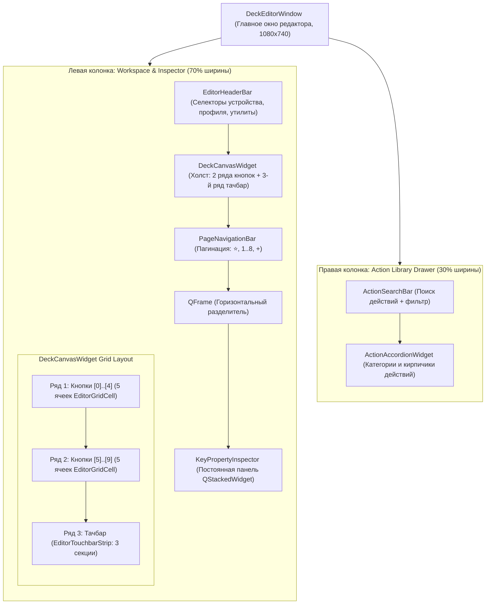
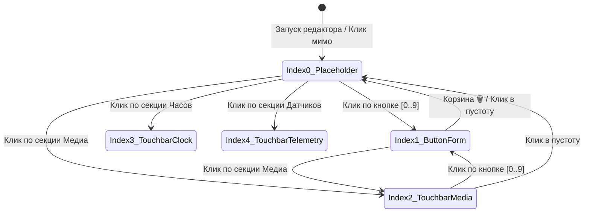

# DuckDeck Button & Touchbar Editor: Архитектурное проектирование и Actionable Roadmap

> **Статус документа:** Активное техническое задание и Actionable Roadmap
> **Версия подсистемы:** DuckDeck Editor v0.5.0 (UI Shell / Wireframe Prototype)
> **Целевая среда:** Windows 10/11 x64, Desktop GUI (PySide6 / Qt6, Python 3.12+)
> **Дисплейное окружение:** Основной монитор (Primary 27" 2560×1440 dGPU) для удобной работы мышью/клавиатурой; синхронизация с сенсорным экраном (Secondary 7" 1024×600 JRP7813S iGPU)
> **Компоновка холста:** **2 ряда по 5 кнопок (10 слотов) + 3-й ряд: единый интерактивный тачбар (DeckInteractivePanel)**
> **Архитектура инспектора:** Постоянная нижняя панель Property Inspector на базе `QStackedWidget` с исходным состоянием-плейсхолдером `Select a key to configure its action.` (Рис. 1), переключающаяся на форму настроек при клике на элемент (Рис. 2)
> **Базовый стандарт:** `GEMINI.md` (Zero-Bespoke Invariant, Platform-First, Feature-First Modularity, Weak Coupling через EventBus)
> **Целевой модуль в кодовой базе:** `modules.deck.editor`

---

## 1. Концепция и назначение DuckDeck Editor

**DuckDeck Editor** — это специализированное конфигурационное десктопное приложение (Desktop Configurator / WYSIWYG Editor), предназначенное для визуального создания, переназначения, кастомизации и компоновки элементов экрана DuckDeck.

В то время как экран DuckDock на 7" сенсорном дисплее (1024×600) оптимизирован исключительно под быстрый пальцевый ввод без отвлечения от работы или игр, редактор кнопок разворачивается на основном мониторе в полноценном десктопном окне и предоставляет оператору классическую эргономичную среду настройки:

1. **Ряд 1 (5 кнопок):** Сенсорные макро-кнопки быстрого вызова (слоты `0`..`4`).
2. **Ряд 2 (5 кнопок):** Сенсорные макро-кнопки быстрого вызова (слоты `5`..`9`).
3. **Ряд 3 (Интерактивный тачбар):** Длинная сенсорная полоса `DeckInteractivePanel` (920×216 px в нативном разрешении), состоящая из трех независимых функциональных зон:
   - **Левая зона (Медиа):** Обложка трека, бегущая строка `MarqueeLabel`, кнопки управления `⏮ ⏯ ⏭`.
   - **Центральная зона (Часы & Навигация):** Цифровые часы `HH:mm`, дата, точечный индикатор страниц `● ○ ○`, зона свайпа страниц.
   - **Правая зона (Телеметрия & Статус):** Мини-монитор железа (CPU/GPU °C), тикер системных уведомлений макросов, сервисная кнопка `⚙`.

В редакторе **и кнопки (Ряды 1-2), и секции тачбара (Ряд 3) являются интерактивными элементами холста**. Постоянная нижняя панель инспектора свойств (`KeyPropertyInspector`) отображает понятную заглушку `Select a key to configure its action.` при отсутствии выбора и мгновенно активирует соответствующую форму при клике на любой элемент.

---

## 2. Анализ референсной модели (Рис. 1 и Рис. 2)

Интерфейс редактора воспроизводит классическую двухпанельную компоновку Elgato Stream Deck:

| Элемент интерфейса                              | Состояние по умолчанию (Рис. 1)                                                                                                                             | Состояние выбранной кнопки (Рис. 2)                                                                                                                                            | Состояние выбранной секции тачбара (Ряд 3)                                                                         |
| :---------------------------------------------- | :---------------------------------------------------------------------------------------------------------------------------------------------------------- | :----------------------------------------------------------------------------------------------------------------------------------------------------------------------------- | :----------------------------------------------------------------------------------------------------------------- |
| **Сетка холста (Canvas Grid)**                  | Элементы в нейтральном состоянии. Отображаются иконки назначенных кнопок и 3 секции тачбара.                                                                | Выбранная кнопка подсвечена синей рамкой фокуса (`#0078d4` / `#38bdf8`, толщина 2px, скругление 12px).                                                                         | **Выбранная секция тачбара** подсвечена синей рамкой фокуса (`#0078d4` / `#38bdf8`, скругление 10px).              |
| **Нижняя панель (Property Inspector)**          | **Пустое состояние (Placeholder):** постоянная панель с крупной центрированной подсказкой `Select a key to configure its action.` серым цветом (`#71717a`). | **Инспектор кнопки:** шапка с категорией и типом (`System: Hotkey`), кнопка удаления `🗑️`, плитка превью иконки с кнопками `+` и `v`, поля ввода `Title`, `Actions`, `Hotkey`. | **Инспектор тачбара:** шапка `Touchbar: Section Settings`, переключатели модулей, источников данных и отображения. |
| **Библиотека действий (Action Library Drawer)** | Категории свернуты (`Multi Action`, `Navigation`, `Soundboard`, `Stream Deck`, `System`, `Volume Controller`). Строка поиска сверху.                        | Категории раскрываются по клику (аккордеон). Действия перетаскиваются в ячейки кнопок.                                                                                         | Возможность назначения действий и модулей на элементы тачбара.                                                     |

```
┌────────────────────────────────────────────────────────────────────────────────────────────────────────┐
│  DuckDeck Button & Touchbar Editor (1080 × 740 px)                                         [—] [□] [✕] │
├─────────────────────────────────────────────────────────────────┬──────────────────────────────────────┤
│  [DuckDeck Touch (2x5 + Strip) v]  [Default Profile v] [🔔] [⚙]  │  [ 🔍 Search... ]                [☰] │
├─────────────────────────────────────────────────────────────────┼──────────────────────────────────────┤
│  Рабочая область холста (Canvas Workspace):                     │  >  Multi Action                     │
│  ┌──────────┐  ┌──────────┐  ┌──────────┐  ┌──────────┐  ┌──────────┐   │  v  Navigation               │
│  │ [0] 🖲️   │  │ [1] 🚀   │  │ [2]      │  │ [3]      │  │ [4]      │   │     [+] Create Folder       │
│  └──────────┘  └──────────┘  └──────────┘  └──────────┘  └──────────┘   │     [🗂️] Switch Profile      │
│  ┌──────────┐  ┌──────────┐  ┌──────────┐  ┌──────────┐  ┌──────────┐   │     [◀] Previous Page        │
│  │ [5]      │  │ [6]      │  │ [7]      │  │ [8] ☀️   │  │ [9]      │   │     [▶] Next Page           │
│  └──────────┘  └──────────┘  └──────────┘  └──────────┘  └──────────┘   │     [#] Go to Page           │
│  ┌──────────────────────────────────────────────────────────────────┐   │     [1] Page Indicator       │
│  │ Ряд 3: DeckInteractivePanel (3 интерактивные секции)             │   │  >  Soundboard               │
│  │ ┌──────────────┐  ┌─────────────────────┐  ┌──────────────────┐  │   │  >  Stream Deck              │
│  │ │ Секция Медиа │  │ Секция Часов/Свайпа │  │ Секция Датчиков  │  │   │  >  System                   │
│  │ │ 🎵 Track...  │  │     14:45 • ● ○ ○   │  │ CPU: 48°C  [⚙]   │  │   │  >  Volume Controller       │
│  │ └──────────────┘  └─────────────────────┘  └──────────────────┘  │   │                              │
│  └──────────────────────────────────────────────────────────────────┘   │                              │
│        [⭐]   (1)  ((2))  (3)  (4)  (5)  (6)  (7)  (8)   [+]     │                                     │
├─────────────────────────────────────────────────────────────────┤                                      │
│  Property Inspector:                                            │                                      │
│  [ Рис. 1: Ничего не выбрано ]                                  │                                      │
│                 Select a key to configure its action.           │                                      │
│                                                                 │                                      │
│  [ Рис. 2: При выборе кнопки [0] активируется форма ]           │                                      │
│  [System: Hotkey]                                          [🗑️] │                                      │
│  ┌──────────┐  Title:   [ Open Discord                ] [T v]   │                                      │
│  │ [+]  [v] │  Actions: [ Preset Actions           v ]          │                                      │
│  │    🖲️    │  Hotkey:  [ Click to assign          v ]          │                                      │
│  └──────────┘                                                   │                                      │
└─────────────────────────────────────────────────────────────────┴──────────────────────────────────────┘
```

---

## 3. Детальная структура и декомпозиция компонентов

Редактор компонуется из модульных виджетов слоя `modules.deck.editor`, размещенных внутри `DeckEditorWindow`:



### 3.1. Верхняя панель управления (`EditorHeaderBar`)

- `DeviceSelector` (`QComboBox`):
  - `DuckDeck Touch (2x5 + Strip)` _(по умолчанию)_.
  - `Classic Stream Deck (3x5)`.
- `ProfileSelector` (`QComboBox`): Профили (`Default Profile`, `Gaming`, `Streaming`, `+ New Profile...`).
- Иконки утилит справа: Уведомления `🔔`, Магазин `🧩`, Настройки `⚙`, Профиль `👤`.

### 3.2. Холст раскладки (`DeckCanvasWidget`)

Холст компонуется в `QGridLayout` со следующей геометрией:

1. **Ряд 1 (Колонки 0..4):** 5 ячеек `EditorGridCell` (размер 96×96 px, отступ 12 px, скругление 12 px).
2. **Ряд 2 (Колонки 0..4):** 5 ячеек `EditorGridCell` (размер 96×96 px, отступ 12 px, скругление 12 px).
3. **Ряд 3 (Колонки 0..4, `colspan=5`):** Единая интерактивная полоса `EditorTouchbarStrip`:
   - Высота: **68 px**, скругление **12 px**, фон `#161b26`, окантовка `#2a3447`.
   - Включает **3 независимые кликабельные секции `TouchbarSectionWidget`**:
     - _Секция Медиа (32%):_ иконка 🎵, название трека `MarqueeLabel`, кнопки ⏮ ⏯ ⏭.
     - _Секция Часов и Свайпа (38%):_ цифровые часы `14:45`, дата, точки страниц `● ○ ○`.
     - _Секция Датчиков (30%):_ показатели `CPU 48°C`, `GPU 52°C`, сервисная шестеренка ⚙.

- **Логика выделения:**
  - Клик по кнопке подсвечивает ее синей рамкой (`border: 2px solid #0078d4`) и снимает выделение с остальных элементов.
  - Клик по секции тачбара подсвечивает конкретную секцию синей рамкой.
  - Клик по пустому пространству холста снимает выделение со всех элементов и переключает инспектор на плейсхолдер.

### 3.3. Панель пагинации страниц (`PageNavigationBar`)

- Размещается непосредственно под холстом (под 3-м рядом).
- Содержит: `⭐` (Home), кнопки страниц `1`, `2`, `3` ... `8`, кнопку `+` (добавить страницу).

### 3.4. Постоянная нижняя панель инспектора свойств (`KeyPropertyInspector`)

Инспектор постоянно занимает нижнюю треть левой колонки (высота ~210-230 px) и переключает внутренние представления через `QStackedWidget`:



- **Index 0 (Placeholder — Рис. 1):**
  - Центрированная метка `QLabel`:
    ```text
    Select a key to configure its action.
    ```
    Шрифт: 14 px, цвет `#71717a`, выравнивание по центру (`Qt.AlignCenter`).
- **Index 1 (Button Form — Рис. 2):**
  - **Header Row:** Метка категории и типа действия `System: Hotkey` (жирный шрифт 13 px `#e4e4e7`) + кнопка удаления `🗑️` справа (очищает слот и возвращает на Index 0).
  - **Form Row:**
    - Левый блок: `KeyPreviewTile` (плитка 84×84 px с текущей иконкой, кнопка `+` в левом верхнем углу для загрузки картинки, кнопка `v` в правом верхнем углу для меню иконки).
    - Правый блок:
      - `Title:` поле ввода (`QLineEdit`) + кнопка параметров шрифта `T v`.
      - `Actions:` выпадающий список (`QComboBox`, "Preset Actions").
      - `Hotkey:` интерактивная кнопка захвата сочетания клавиш (`QPushButton` "Click to assign" со стрелкой `v`).
- **Index 2..4 (Формы настройки секций тачбара):**
  - Настройка параметров медиаплеера, формата системных часов/свайпа и датчиков телеметрии.

### 3.5. Правая панель библиотеки действий (`ActionLibraryDrawer`)

- Поле быстрого поиска `Search...` с лупой `🔍` и кнопкой вида.
- Древовидный аккордеон со сворачиваемыми разделами: `Multi Action`, `Navigation`, `Soundboard`, `Stream Deck`, `System`, `Volume Controller`.

---

## 4. Дизайн-система и цветовые токены (Dark Obsidian)

| Токен дизайна              | HEX-значение          | Назначение                                                             |
| :------------------------- | :-------------------- | :--------------------------------------------------------------------- |
| `--bg-window`              | `#121214`             | Главный фон окна приложения                                            |
| `--bg-panel`               | `#18181b`             | Фон рабочих колонок и разделителей                                     |
| `--bg-card`                | `#222227`             | Фон ячеек кнопок [0..9]                                                |
| `--bg-strip`               | `#161b26`             | Фон интерактивного тачбара 3-го ряда                                   |
| `--bg-strip-section-hover` | `#1e2638`             | Подсветка секции тачбара при наведении                                 |
| `--border-subtle`          | `#2e2e36`             | Тонкие границы между панелями и карточками                             |
| `--border-focus`           | `#0078d4` / `#38bdf8` | **Акцентный синий фокус выбранной кнопки или секции (Рис. 2)**         |
| `--text-primary`           | `#f4f4f5`             | Основной белый текст заголовков                                        |
| `--text-secondary`         | `#9ca3af`             | Подписи полей формы                                                    |
| `--text-placeholder`       | `#71717a`             | **Цвет плейсхолдера "Select a key to configure its action." (Рис. 1)** |
| `--accent-danger`          | `#ef4444`             | Цвет иконки корзины (удаление действия кнопки)                         |

---

## 5. Actionable Roadmap реализации заготовки редактора

> **Цель этапа:** Создать полностью кликабельную заготовку (UI Shell) окна редактора с классической постоянной панелью инспектора, компоновкой **2 ряда по 5 кнопок + 3-й ряд тачбар из 3-х секций**, переключением плейсхолдера Рис. 1 на форму Рис. 2 и раскрывающимся аккордеоном действий, **без боевого выполнения макросов**.

### Матрица ответственности (RACI)

| Компонент / Задача                        | `@deep-researcher` | `@frontend-ui-designer` | `@fullstack-builder` | `@code-review` |
| :---------------------------------------- | :----------------: | :---------------------: | :------------------: | :------------: |
| Проектирование компоновки и состояний     |  **Accountable**   |        Consulted        |      Consulted       |    Informed    |
| Каркас окна и QSS стили                   |      Informed      |     **Responsible**     |       Support        |   Pre-Flight   |
| Холст: 2 ряда кнопок + тачбар (3 секции)  |      Informed      |     **Responsible**     |       Support        |   Pre-Flight   |
| Постоянный инспектор (Placeholder ↔ Form) |      Informed      |     **Responsible**     |       Support        |   Pre-Flight   |
| Библиотека действий и поиск               |      Informed      |     **Responsible**     |       Support        |   Pre-Flight   |
| Демо-лончер и верификация (pytest)        |      Informed      |         Support         |   **Responsible**    |   Pre-Flight   |

---

### Фаза 1: Каркас окна, дизайн-система и базовый сплиттер (`DeckEditorWindow`)

#### 1.0. Архитектурный аудит и анализ узких мест Фазы 1 (@deep-researcher, @frontend-ui-designer, @ui-creator)

Перед реализацией каркаса окна зафиксированы ключевые инженерные и интерфейсные инварианты:

| Узкое место / Риск                                            | Анализ первопричины                                                                                                                                                                                                                                 | Архитектурное решение и инвариант                                                                                                                                                                                                                                     |
| :------------------------------------------------------------ | :-------------------------------------------------------------------------------------------------------------------------------------------------------------------------------------------------------------------------------------------------- | :-------------------------------------------------------------------------------------------------------------------------------------------------------------------------------------------------------------------------------------------------------------------- |
| **Фокус ввода vs Stealth Focus (`GEMINI.md` §1.3)**           | В DuckDock действует инвариант `WS_EX_NOACTIVATE` и `Qt.NoFocus` для экрана 7" субскрина. Если ошибочно унаследовать окно редактора от `TouchModuleView`, клавиатурный ввод в поля `QLineEdit` (Title, Search) и захват Hotkey будут заблокированы. | `DeckEditorWindow` — это десктопный конфигуратор на основном мониторе 27". Он наследуется от классического `QMainWindow` со стандартной политикой фокуса (`Qt.ClickFocus` / `Qt.StrongFocus`). Никакие хуки скрытия курсора к нему не применяются.                    |
| **Схлопывание панелей QSplitter (Collapsing)**                | По умолчанию в Qt пользователь может потянуть разделитель и схлопнуть правую или левую панель в 0 px (`collapsible=True`).                                                                                                                          | Принудительно установить `splitter.setChildrenCollapsible(False)`. Задать жесткие границы: Левая рабочая область — `min-width: 640px`; Правая библиотека действий — `min-width: 280px`, `max-width: 420px`.                                                           |
| **Нарушение начальных пропорций 70/30**                       | Метод `setStretchFactor(0, 7)` и `setStretchFactor(1, 3)` в Qt не задает физические пиксели до первого вызова `show()`, что приводит к делению 50/50.                                                                                               | В `__init__` явно передавать массив начальных ширин `splitter.setSizes([756, 324])` (точно 70% и 30% от базовой ширины 1080 px).                                                                                                                                      |
| **Родной белый заголовок в Windows 10/11 (`GEMINI.md` §1.1)** | По умолчанию Windows рендерит белую рамку окна (`WS_CAPTION`), разрушающую палитру Dark Obsidian. Кастомный frameless ломает Aero Snap и перемещение между мониторами с разным DPI.                                                                 | Сохранить нативное окно `QMainWindow`, но через Win32 API (`ctypes.windll.dwmapi.DwmSetWindowAttribute`) применить `DWMWA_USE_IMMERSIVE_DARK_MODE` (код 20 / fallback 19). Изолировать вызов в `styles.py` с перехватом `OSError` для безопасного запуска в Linux/CI. |
| **Изоляция слоев (`GEMINI.md` §6.1, §6.2)**                   | Опасность импорта компонентов из слоя `ui/` (shell) или соседних модулей (`modules.audio`, `modules.telemetry`).                                                                                                                                    | Пакет `modules.deck.editor` строго самодостаточен. Никаких импортов из `ui/` или других папок `modules/`. Все стили, виджеты и контейнеры локализованы внутри `modules/deck/editor`.                                                                                  |
| **Бесшовный переход между фазами (Плейсхолдеры)**             | Без промежуточных каркасных виджетов окно на Фазе 1 было бы пустым, что делает невозможной визуальную верификацию разметки из Рис. 1.                                                                                                               | На Фазе 1 создаются структурированные контейнеры-плейсхолдеры (`PlaceholderBox`) с пунктирными границами `#2e2e36` и центрированными подписями всех будущих зон (Header, Canvas, Inspector, Search, Accordion).                                                       |

---

#### Пошаговый план реализации Фазы 1:

- [ ] **Шаг 1.1: Дизайн-токены Dark Obsidian, QSS стили и Win32 Dark Titlebar (`modules/deck/editor/styles.py`)**
  - Создать константы цветовой палитры и геометрии:
    - Фоны: `BG_WINDOW = "#121214"`, `BG_PANEL = "#18181b"`, `BG_CARD = "#222227"`, `BG_STRIP = "#161b26"`.
    - Границы: `BORDER_SUBTLE = "#2e2e36"`, `BORDER_FOCUS = "#0078d4"`, `BORDER_HOVER = "#3f3f46"`.
    - Текст: `TEXT_PRIMARY = "#f4f4f5"`, `TEXT_SECONDARY = "#9ca3af"`, `TEXT_MUTED = "#71717a"`.
    - Размеры: `WINDOW_DEFAULT_SIZE = (1080, 740)`, `WINDOW_MIN_SIZE = (960, 640)`.
  - Сформировать единую таблицу стилей `EDITOR_MAIN_QSS`:
    - Базовый фон `QMainWindow` и панели `#121214`.
    - Стилизация `QSplitter` и `QSplitter::handle:horizontal`:
      - Ширина разделителя 2 px, цвет `#2e2e36`, курсор `split-h`.
      - Эффект наведения: цвет `#38bdf8` (акцентный синий) для мгновенного тактильного отклика.
    - Стилизация кастомных тонких скроллбаров `QScrollBar:vertical` (ширина 6 px, скругление 3 px, бегунок `#2e2e36`, ховер `#3f3f46`, дорожка `#18181b`).
    - Стили карточек-плейсхолдеров с пунктирной рамкой `border: 1px dashed #2e2e36; border-radius: 8px;`.
  - Реализовать функцию `apply_immersive_dark_titlebar(window: QMainWindow) -> bool`:
    - Использование `dwmapi.DwmSetWindowAttribute` с `DWMWA_USE_IMMERSIVE_DARK_MODE` (20 для Win11/Win10 20H1+, 19 для Win10 1809+).
    - Полная изоляция от ошибок платформы (safe try/except OSError, fallback на Linux/тестах).
  - Реализовать фасадную функцию `apply_editor_theme(window: QMainWindow)`.

- [ ] **Шаг 1.2: Структурные контейнеры-плейсхолдеры (`modules/deck/editor/widgets/placeholders.py`)**
  - Создать переиспользуемый виджет `PlaceholderBox(QFrame)`:
    - Принимает параметры: `label: str`, `min_height: int = 40`, `fixed_height: Optional[int] = None`.
    - Пунктирная граница `#2e2e36`, скругление 8 px, фон `#18181b`.
    - Центрированная типографика `#71717a`, размер шрифта 12-13 px.
  - Создать специализированные слоты-плейсхолдеры для визуализации структуры окна:
    - `HeaderBarSlot` (высота 52 px): под селекторы устройств и профилей (Фаза 2).
    - `CanvasAreaSlot` (минимальная высота 300 px): под холст 2×5 кнопок и тачбар (Фаза 3).
    - `PaginationBarSlot` (высота 36 px): под кнопки страниц `⭐ 1..8 +` (Фаза 3).
    - `InspectorSlot` (высота 220 px): под `KeyPropertyInspector` (Фаза 4).
    - `SearchSlot` (высота 52 px): под поисковую строку библиотеки действий (Фаза 5).
    - `ActionListSlot` (растягивающийся): под аккордеон действий (Фаза 5).

- [ ] **Шаг 1.3: Каркас главного окна и сплиттер 70/30 (`modules/deck/editor/window.py`)**
  - Создать класс `DeckEditorWindow(QMainWindow)`:
    - Установка заголовка `DuckDeck Button & Touchbar Editor`.
    - Задание базовых размеров `resize(1080, 740)` и минимальных ограничений `setMinimumSize(960, 640)`.
    - Логика центрирования окна на активном основном мониторе через `QGuiApplication.primaryScreen().availableGeometry().center()`.
    - Применение Win32 Dark Titlebar и таблицы стилей `apply_editor_theme(self)`.
  - Компоновка центрального сплиттера:
    - Создание `main_splitter = QSplitter(Qt.Horizontal, self)`.
    - Принудительный запрет схлопывания: `main_splitter.setChildrenCollapsible(False)`.
  - Левая рабочая область (`workspace_container: QWidget`):
    - `layout = QVBoxLayout`, отступы: `margin = 12px`, `spacing = 8px`.
    - Порядок размещения слотов:
      1. `HeaderBarSlot` (52 px).
      2. `CanvasAreaSlot` (растягивается, min 300 px).
      3. `PaginationBarSlot` (36 px).
      4. Горизонтальный разделитель `QFrame.HLine` (1 px `#2e2e36`).
      5. `InspectorSlot` (фиксированная высота 220 px).
    - Ограничение ширины: `workspace_container.setMinimumWidth(640)`.
  - Правая панель каталога действий (`drawer_container: QWidget`):
    - `layout = QVBoxLayout`, отступы: `margin = 12px`, `spacing = 8px`.
    - Порядок размещения слотов:
      1. `SearchSlot` (52 px).
      2. Горизонтальный разделитель `QFrame.HLine` (1 px `#2e2e36`).
      3. `ActionListSlot` (растягивается).
    - Ограничение ширины: `drawer_container.setMinimumWidth(280)`, `drawer_container.setMaximumWidth(420)`.
  - Фиксация пропорций:
    - Добавление контейнеров в сплиттер: `main_splitter.addWidget(workspace_container)` и `main_splitter.addWidget(drawer_container)`.
    - Установка коэффициентов растяжения: `main_splitter.setStretchFactor(0, 7)` и `main_splitter.setStretchFactor(1, 3)`.
    - Явное задание пиксельных размеров: `main_splitter.setSizes([756, 324])`.
  - Публичные точки расширения (методы для последующих фаз):
    - `set_header_bar(widget: QWidget)` — замена слота на боевой HeaderBar (Фаза 2).
    - `set_canvas_widget(widget: QWidget)` — замена слота на холст кнопок и тачбара (Фаза 3).
    - `set_pagination_bar(widget: QWidget)` — замена слота на пагинацию (Фаза 3).
    - `set_inspector_widget(widget: QWidget)` — замена слота на инспектор свойств (Фаза 4).
    - `set_action_drawer(widget: QWidget)` — замена слота на библиотеку действий (Фаза 5).

- [ ] **Шаг 1.4: Пакетный интерфейс и автономная точка входа (`modules/deck/editor/__init__.py`)**
  - Экспортировать наружу публичные сущности: `DeckEditorWindow`, `apply_editor_theme`, `EDITOR_MAIN_QSS`.
  - Обеспечить возможность изолированного запуска модуля для визуальной проверки верстки:
    `python -m modules.deck.editor.window`

- [ ] **Шаг 1.5: Модульные тесты каркаса окна и сплиттера (`tests/unit/test_deck_editor_window.py`)**
  - Написать тесты с использованием фикстуры `qapp`:
    - `test_editor_window_initialization`: проверка создания экземпляра, корректного заголовка и объекта центрального виджета.
    - `test_editor_window_geometry`: проверка соответствия начального размера 1080×740 и минимального размера 960×640.
    - `test_editor_window_splitter_configuration`: проверка, что `childrenCollapsible == False`, количество виджетов в сплиттере равно 2, начальные размеры соответствуют соотношению 70/30.
    - `test_editor_window_containers_structure`: проверка наличия всех ключевых слотов в левой и правой панели.
    - `test_editor_window_slot_replacement_api`: проверка корректности работы методов замены слотов-плейсхолдеров на кастомные виджеты.

---

#### Actionable Prompts для запуска Фазы 1:

##### Запуск шагов 1.1-1.2 (Токены, стили и плейсхолдеры):

```text
@frontend-ui-designer и @ui-creator реализуйте шаги 1.1 и 1.2 из edit_but.md:
1. Создайте modules/deck/editor/styles.py:
   - Полная палитра Dark Obsidian, токены типографики и геометрии.
   - Единая таблица стилей EDITOR_MAIN_QSS (окно, сплиттер 2px с ховером #38bdf8, тонкие скроллбары 6px, разделители, слоты).
   - Безопасная функция apply_immersive_dark_titlebar(window) с поддержкой Win32 DWMWA_USE_IMMERSIVE_DARK_MODE и защитой OSError.
   - Фасад apply_editor_theme(window).
2. Создайте modules/deck/editor/widgets/placeholders.py:
   - Базовый виджет PlaceholderBox(QFrame) с пунктирной рамкой #2e2e36 и центрированным лейблом #71717a.
   - Слоты-заглушки: HeaderBarSlot (52px), CanvasAreaSlot (min 300px), PaginationBarSlot (36px), InspectorSlot (220px), SearchSlot (52px), ActionListSlot (expanding).
3. Критерий завершения: Стили валидны, плейсхолдеры визуально различимы и аккуратно отрисовываются.
```

##### Запуск шагов 1.3-1.4 (Каркас окна, сплиттер и точка входа):

```text
@frontend-ui-designer реализуй шаги 1.3 и 1.4 из edit_but.md:
1. Создай modules/deck/editor/window.py:
   - Класс DeckEditorWindow(QMainWindow), размер 1080x740, min 960x640, центрирование на основном экране.
   - Центральный QSplitter(Qt.Horizontal), childrenCollapsible=False, setSizes([756, 324]), коэффициенты растяжения 7 и 3.
   - Левая рабочая область (workspace_container, min-width 640px) со слотами HeaderBarSlot, CanvasAreaSlot, PaginationBarSlot, QFrame.HLine, InspectorSlot.
   - Правая панель (drawer_container, min-width 280px, max-width 420px) со слотами SearchSlot, QFrame.HLine, ActionListSlot.
   - Методы замены слотов: set_header_bar, set_canvas_widget, set_pagination_bar, set_inspector_widget, set_action_drawer.
   - Блок if __name__ == "__main__" для быстрого локального запуска.
2. Обнови modules/deck/editor/__init__.py с реэкспортом DeckEditorWindow, apply_editor_theme, EDITOR_MAIN_QSS.
3. Критерий завершения: Окно запускается командой python -m modules.deck.editor.window, отображая идеальную двухпанельную разметку 70/30 с темным заголовком и всеми слотами.
```

##### Запуск шага 1.5 (Автотесты каркаса):

```text
@fullstack-builder реализуй шаг 1.5 из edit_but.md:
1. Создай tests/unit/test_deck_editor_window.py с тестами на базе pytest и фикстуры qapp:
   - Инициализация и заголовок окна.
   - Геометрия окна (1080x740, min 960x640).
   - Конфигурация сплиттера (2 виджета, childrenCollapsible=False, размеры 756/324).
   - Наличие и типы всех структурных слотов.
   - Проверка методов безопасной замены слотов на новые QWidget.
2. Добейся 100% PASS: pytest tests/unit/test_deck_editor_window.py.
```

##### Pre-Flight проверка Фазы 1:

```text
@code-review проведи строгий Pre-Flight аудит реализации Фазы 1:
1. Инварианты GEMINI.md: Отсутствие Qt.NoFocus на QMainWindow (доступность фокуса для ввода текста), изоляция Win32 DWM вызовов, отсутствие запрещенных импортов из ui/ или соседних модулей.
2. Поведение UI: Невозможность схлопнуть панели в сплиттере (childrenCollapsible == False), корректность пропорций 70/30.
3. Чистота кода: Отсутствие хардкода HEX-цветов в классах виджетов (все цвета берутся из styles.py), покрытие автотестами.
```

---

### Фаза 2: Верхняя панель устройств и профилей (`EditorHeaderBar`)

#### 2.0. Архитектурный аудит и анализ узких мест Фазы 2 (@deep-researcher, @frontend-ui-designer, @ui-creator)

Перед реализацией верхней панели управления зафиксированы ключевые инженерные и интерфейсные инварианты:

| Узкое место / Риск                                                    | Анализ первопричины                                                                                                                                                                          | Архитектурное решение и инвариант                                                                                                                                                                                                                                                                                                                         |
| :-------------------------------------------------------------------- | :------------------------------------------------------------------------------------------------------------------------------------------------------------------------------------------- | :-------------------------------------------------------------------------------------------------------------------------------------------------------------------------------------------------------------------------------------------------------------------------------------------------------------------------------------------------------- |
| **Стилизация выпадающего списка QComboBox (Win32 Popup)**             | По умолчанию в Qt на Windows выпадающий список `QAbstractItemView` рендерится как системное белое всплывающее меню с резкими краями и белым скроллбаром, выбивающимся из темы Dark Obsidian. | В `styles.py` задается полное определение QSS для `QComboBox`, `QComboBox::drop-down`, `QComboBox::down-arrow` и `QComboBox QAbstractItemView`: темный фон `#18181b`, скругление 6 px, отступы пунктов 6px/12px, акцентное выделение ховера `#27272a` и текста `#38bdf8`, а также `outline: none;` для предотвращения артефактов пунктирной рамки фокуса. |
| **DPI-масштабирование векторных стрелок и глифов (`GEMINI.md` §1.2)** | Растровые иконки стрелочек комбобоксов размываются при переходе между мониторами 100% (7" субскрин) и 125%/150% (27" основной экран).                                                        | Использовать чистую векторную отрисовку стрелки через CSS `border-width` / треугольники, либо векторные SVG data-URI. Символы кнопок утилит (`🔔`, `🧩`, `⚙`, `👤`) масштабируются шрифтовым движком Qt без потери резкости.                                                                                                                              |
| **Сжатие и переполнение разметки (Layout Overflow)**                  | При сжатии окна редактора до минимального размера 960 px левая колонка сужается до 640 px. Длинные названия профилей могут вытеснить правые кнопки утилит за пределы видимости.              | Жестко ограничить ширину селекторов: `DeviceSelector` — `min-width: 180px, max-width: 220px`; `ProfileSelector` — `min-width: 150px, max-width: 190px`. Сервисные кнопки тулбара получают фиксированный размер 32×32 px (`QSizePolicy.Fixed`). Между селекторами и кнопками размещается эластичный спейсер `addStretch(1)`.                               |
| **Логика создания нового профиля ("+ New Profile...")**               | Пункт `+ New Profile...` внутри комбобокса не должен становиться выбранным значением профиля, иначе состояние редактора перейдет в невалидный режим до фактического ввода имени.             | В `ProfileComboBox` перехватывать событие смены индекса: если выбран индекс `+ New Profile...`, комбобокс блокирует программное переключение (возвращает прежний индекс) и генерирует отдельный сигнал `create_profile_requested()`.                                                                                                                      |
| **Слабая связанность и изоляция слоев (`GEMINI.md` §6.1-§6.3)**       | HeaderBar не должен напрямую обращаться к дисковым файлам конфигурации профилей или к шине `EventBus`.                                                                                       | `EditorHeaderBar` — строго презентационный компонент. Он общается с внешним миром исключительно через Qt Signals: `device_changed(str)`, `profile_changed(str)`, `create_profile_requested()`, `action_clicked(str)`. Связывание с логикой выполняет родительское окно `DeckEditorWindow`.                                                                |
| **Интерактивность и микро-отклик кнопок (UI Polish)**                 | Обычные плоские кнопки без явных состояний hover/press создают ощущение "деревянного" интерфейса.                                                                                            | Для `HeaderIconButton` настраивается плавная подсветка фона при наведении (`#222227`), углубление при нажатии (`#2a2a32`), курсор `Qt.PointingHandCursor` и всплывающие подсказки `QToolTip` в стиле Dark Obsidian (`#1e1e24`, рамка 1px `#3f3f46`, цвет текста `#f4f4f5`).                                                                               |

---

#### Пошаговый план реализации Фазы 2:

- [ ] **Шаг 2.1: Стилизация компонентов тулбара, комбобоксов и тултипов (`modules/deck/editor/styles.py`)**
  - Дополнить цветовую палитру и константы геометрии:
    - Константы: `BG_DROPDOWN = "#222227"`, `BG_DROPDOWN_HOVER = "#2a2a32"`, `BG_DROPDOWN_OPEN = "#18181b"`, `BORDER_DROPDOWN_FOCUS = "#0078d4"`, `HEADER_HEIGHT = 52`, `TOOL_BUTTON_SIZE = 32`.
  - Добавить в `EDITOR_MAIN_QSS` правила для выпадающих списков `QComboBox`:
    - Базовый виджет: фон `#222227`, граница 1px `#2e2e36`, скругление 6 px, внутренние отступы `4px 10px 4px 10px`, цвет текста `#f4f4f5`, шрифт 13 px.
    - Псевдосостояния `:hover` (фон `#2a2a32`, граница `#3f3f46`), `:focus` и `:on` (граница `#0078d4`).
    - Дропдаун-стрелка `QComboBox::drop-down`: правая колонка шириной 24 px, прозрачный фон.
    - Всплывающее меню `QComboBox QAbstractItemView`: фон `#18181b`, граница 1px `#2e2e36`, скругление 6 px, вертикальный паддинг 4 px, `selection-background-color: #27272a`, `selection-color: #38bdf8`, `outline: none;`.
  - Добавить правила для кнопок тулбара `QPushButton.HeaderIconButton`:
    - Фиксированный размер 32×32 px, прозрачный фон, отсутствие рамок, скругление 6 px, цвет символа `#9ca3af`, размер шрифта 15 px.
    - Ховер: фон `#222227`, цвет символа `#f4f4f5`.
    - Нажатие: фон `#2a2a32`, цвет символа `#38bdf8`.
  - Добавить правила для всплывающих подсказок `QToolTip`:
    - Фон `#1e1e24`, тонкая граница 1px `#3f3f46`, скругление 4 px, паддинг `4px 8px`, цвет `#f4f4f5`, шрифт 11 px.
  - Добавить стиль для вертикального микро-разделителя `QFrame.ToolbarVLine`:
    - Ширина 1 px, высота 20 px, цвет `#2e2e36`, отступы слева/справа 4 px.

- [ ] **Шаг 2.2: Компоненты селектора устройств и селектора профилей (`modules/deck/editor/widgets/header_bar.py`)**
  - Создать кастомный комбобокс `DeviceComboBox(QComboBox)`:
    - Конструктор наполняет список поддерживаемых устройств:
      - `DuckDeck Touch (2x5 + Strip)` (data: `"touch_2x5_strip"`, выбран по умолчанию).
      - `Classic Stream Deck (3x5)` (data: `"classic_3x5"`).
    - Политика размера: `min-width: 180px`, `max-width: 220px`, высота 32 px. Курсор `Qt.PointingHandCursor`.
    - Сигнал: `device_selected(str device_id)` при смене индекса оператором.
  - Создать кастомный комбобокс `ProfileComboBox(QComboBox)`:
    - Метод `set_profiles(profiles: list[str], current: str)` для динамического наполнения.
    - Начальный список: `Default Profile` (выбран), `Gaming`, `Streaming`, специальный пункт разделитель/действие `+ New Profile...`.
    - Логика перехвата: при выборе `+ New Profile...` комбобокс восстанавливает предыдущий валидный индекс и генерирует сигнал `create_profile_requested()`.
    - Политика размера: `min-width: 150px`, `max-width: 190px`, высота 32 px. Курсор `Qt.PointingHandCursor`.
    - Сигнал: `profile_selected(str profile_name)` при обычном выборе профиля.

- [ ] **Шаг 2.3: Специализированные сервисные кнопки тулбара (`HeaderIconButton`)**
  - Создать переиспользуемый класс кнопки `HeaderIconButton(QPushButton)`:
    - Принимает `icon_text: str`, `tooltip: str`, `action_id: str`.
    - Устанавливает свойство `setProperty("class", "HeaderIconButton")`.
    - Задает фиксированный размер `setFixedSize(32, 32)` и курсор `Qt.PointingHandCursor`.
    - Подключает клик к эмиссии общего сигнала действия `action_triggered(str action_id)`.
  - Сформировать группу служебных кнопок:
    - Кнопка уведомлений `btn_notifications` (`🔔`, tooltip: "Уведомления и лог макросов", id: `"notifications"`).
    - Кнопка каталога плагинов `btn_store` (`🧩`, tooltip: "Каталог расширений и иконок", id: `"store"`).
    - Кнопка настроек `btn_settings` (`⚙`, tooltip: "Параметры DuckDeck Editor", id: `"settings"`).
    - Кнопка профиля оператора `btn_account` (`👤`, tooltip: "Профиль пользователя", id: `"account"`).

- [ ] **Шаг 2.4: Сборка `EditorHeaderBar` и бесшовная интеграция в окно редактора**
  - Создать основной контейнер `EditorHeaderBar(QFrame)`:
    - Фиксированная высота `setFixedHeight(52)` — идеальное совпадение с исходным `HeaderBarSlot`.
    - Горизонтальный лэйаут `QHBoxLayout`:
      - `setContentsMargins(12, 6, 12, 6)`, `setSpacing(8)`.
      - Левая секция: `DeviceComboBox` -> `ProfileComboBox`.
      - Разделитель: `ToolbarVLine(QFrame)`.
      - Центральная часть: `layout.addStretch(1)` (поглощает все свободное пространство).
      - Правая секция: `btn_notifications`, `btn_store`, `btn_settings`, `btn_account`.
    - Публичные сигналы:
      - `device_changed = Signal(str)`
      - `profile_changed = Signal(str)`
      - `create_profile_requested = Signal()`
      - `action_clicked = Signal(str)`
  - Интегрировать `EditorHeaderBar` в `DeckEditorWindow` (`modules/deck/editor/window.py`):
    - В методе инициализации окна вызвать `self.set_header_bar(EditorHeaderBar(self))`, заменяя временный слот `HeaderBarSlot`.
    - Подключить сигналы тулбара к слотам окна/логирования.
    - Проверить стабильность геометрии окна при изменении размеров и пропорций сплиттера.

- [ ] **Шаг 2.5: Комплексные модульные тесты панели заголовка (`tests/unit/test_deck_editor_header_bar.py`)**
  - Написать тесты с использованием фикстуры `qapp` и `qtbot`:
    - `test_header_bar_initialization`: проверка создания виджета, фиксированной высоты 52 px и наличия всех дочерних элементов (селекторы, кнопки).
    - `test_device_selector_signal`: проверка смены устройства и эмиссии `device_changed` со значением `"classic_3x5"`.
    - `test_profile_selector_change`: проверка обычной смены профиля и эмиссии `profile_changed`.
    - `test_profile_selector_create_new`: проверка выбора пункта `+ New Profile...`, эмиссии `create_profile_requested` и сохранения предыдущего выбранного индекса.
    - `test_header_utility_buttons`: проверка кликов по кнопкам `🔔`, `🧩`, `⚙`, `👤` и получения сигнала `action_clicked` с соответствующими `action_id`.
    - `test_header_bar_replacement_in_window`: проверка интеграции `EditorHeaderBar` в `DeckEditorWindow` через `set_header_bar` и корректности отображения вместо плейсхолдера.

---

#### Actionable Prompts для запуска Фазы 2:

##### Запуск шагов 2.1-2.3 (QSS стили, комбобоксы и кнопки тулбара):

```text
@frontend-ui-designer и @ui-creator реализуйте шаги 2.1, 2.2 и 2.3 из edit_but.md:
1. Обновите modules/deck/editor/styles.py:
   - Добавьте константы цветов тулбара и дропдаунов Dark Obsidian.
   - Стилизуйте QComboBox, QComboBox::drop-down, QComboBox::down-arrow и QComboBox QAbstractItemView (фон #18181b, граница #2e2e36, ховер #27272a, текст #38bdf8).
   - Стилизуйте QPushButton.HeaderIconButton (32x32 px, прозрачный фон, ховер #222227, клик #2a2a32, цвет #9ca3af -> #f4f4f5).
   - Стилизуйте QToolTip (фон #1e1e24, рамка #3f3f46, текст #f4f4f5, паддинги 4px 8px).
   - Добавьте класс вертикального разделителя ToolbarVLine (1px #2e2e36, высота 20px).
2. Создайте компоненты в modules/deck/editor/widgets/header_bar.py:
   - DeviceComboBox: варианты "DuckDeck Touch (2x5 + Strip)" и "Classic Stream Deck (3x5)", сигнал device_selected(str).
   - ProfileComboBox: профили "Default Profile", "Gaming", "Streaming", специальный пункт "+ New Profile...", перехват клика без смены индекса и сигнал create_profile_requested().
   - HeaderIconButton: плоская кнопка 32x32 с иконкой, тултипом и сигналом action_triggered(str).
3. Критерий завершения: Выпадающие списки и кнопки открываются без системных белых рамок, стилизованы строго под Dark Obsidian, курсор PointingHandCursor работает на всех элементах.
```

##### Запуск шага 2.4 (Сборка EditorHeaderBar и интеграция в главное окно):

```text
@frontend-ui-designer реализуй шаг 2.4 из edit_but.md:
1. Собери класс EditorHeaderBar(QFrame) в modules/deck/editor/widgets/header_bar.py:
   - Высота ровно 52 px, отступы (12, 6, 12, 6), spacing=8.
   - Слева: DeviceComboBox, ToolbarVLine, ProfileComboBox.
   - Центр: layout.addStretch(1).
   - Справа: HeaderIconButton для уведомлений, плагинов, настроек и аккаунта.
   - Сигналы наружу: device_changed(str), profile_changed(str), create_profile_requested(), action_clicked(str).
2. Обнови modules/deck/editor/window.py:
   - Вставь боевой EditorHeaderBar вместо HeaderBarSlot с помощью вызова self.set_header_bar(EditorHeaderBar(self)).
   - Проверь, что при сжатии окна до 960x640 элементы тулбара не наезжают друг на друга.
3. Критерий завершения: Окно python -m modules.deck.editor.window отображает верхний тулбар с активными селекторами и сервисными кнопками с темными подсказками.
```

##### Запуск шага 2.5 (Автотесты тулбара):

```text
@fullstack-builder реализуй шаг 2.5 из edit_but.md:
1. Создай tests/unit/test_deck_editor_header_bar.py на pytest и pytest-qtbot:
   - Инициализация и геометрия EditorHeaderBar (высота 52 px).
   - Переключение устройств в DeviceComboBox и эмиссия device_changed.
   - Переключение профилей и эмиссия profile_changed.
   - Выбор пункта "+ New Profile..." с эмиссией create_profile_requested() и блокировкой смены активного индекса.
   - Клики по кнопкам тулбара и проверка action_clicked для всех 4 кнопок.
   - Тест интеграции в DeckEditorWindow через set_header_bar.
2. Добейся 100% PASS: pytest tests/unit/test_deck_editor_header_bar.py.
```

##### Pre-Flight проверка Фазы 2:

```text
@code-review проведи строгий Pre-Flight аудит реализации Фазы 2:
1. Инварианты GEMINI.md: Отсутствие белых системных рамок у QComboBox в Windows (темный QAbstractItemView), отсутствие прямых зависимостей от внешних модулей или шины событий EventBus.
2. Изоляция и контракты: HeaderBar общается только через Qt Signals; логика "+ New Profile..." не ломает текущий выбранный профиль.
3. Адаптивность и ресайз: Корректное поведение при минимальной ширине окна 960 px (отсутствие перекрытия элементов тулбара за счет addStretch и ограничений max-width).
4. Качество кода и тесты: Все стили вынесены в styles.py, 100% прохождение тестов в test_deck_editor_header_bar.py.
```

---

### Фаза 3: Холст с 10 кнопками и 3-секционным тачбаром (`DeckCanvasWidget`)

#### 3.0. Архитектурный аудит и анализ узких мест Фазы 3 (@deep-researcher, @frontend-ui-designer, @ui-creator)

Перед реализацией интерактивного холста раскладки и пагинации зафиксированы ключевые инженерные, математические и интерфейсные инварианты:

| Узкое место / Риск                                                         | Анализ первопричины                                                                                                                                                                                                                                                  | Архитектурное решение и инвариант                                                                                                                                                                                                                                                                                                                                                          |
| :------------------------------------------------------------------------- | :------------------------------------------------------------------------------------------------------------------------------------------------------------------------------------------------------------------------------------------------------------------- | :----------------------------------------------------------------------------------------------------------------------------------------------------------------------------------------------------------------------------------------------------------------------------------------------------------------------------------------------------------------------------------------- |
| **Геометрическое несоответствие: Нативный экран 7" vs Окно редактора 27"** | На 7" экране DuckDock кнопки имеют размер 174×168 px, а тачбар — 920×216 px. Если перенести эти размеры в десктопный редактор, холст займет 944 px в ширину, что приведет к горизонтальному скроллу и разрушению сплиттера 70/30 (левая панель имеет ширину 756 px). | Сетка холста редактора пропорционально масштабируется под настольный интерфейс: кнопки имеют фиксированный размер **96×96 px** (скругление 12 px, gap 12 px), а тачбар 3-го ряда получает габариты **528×68 px** (ровно $5 \times 96 + 4 \times 12 = 528\text{ px}$, $colspan=5$). Холст центрируется в рабочей области через `Qt.AlignCenter` без искажения геометрии тайлов при ресайзе. |
| **Конфликт кликов внутри секций тачбара (Click Hijacking)**                | В боевом тачбаре `DeckInteractivePanel` кнопки плеера (`⏮ ⏯ ⏭`) и шестеренка (`⚙`) обрабатывают нажатия напрямую. В редакторе клик по любой части секции обязан **выделять всю секцию** для ее настройки в инспекторе, а не переключать трек или вызывать меню.   | В `TouchbarSectionWidget` все вложенные элементы рендерятся как WYSIWYG-превью и получают `setAttribute(Qt.WA_TransparentForMouseEvents, True)`. Секция целиком перехватывает `mousePressEvent`, предотвращая дочерний перехват кликов, и эмитирует сигнал `section_clicked(str section_type)`.                                                                                            |
| **Рассинхрон состояния выделения (Split Focus Invariant)**                 | Если каждая кнопка и секция тачбара будут независимо хранить свойство `is_selected`, возможны состояния, когда одновременно выделены и кнопка, и секция тачбара, что дезориентирует `KeyPropertyInspector`.                                                          | `DeckCanvasWidget` реализует паттерн **Single Source of Truth**: холст выступает единым арбитром выделения. При клике на любой элемент холст централизованно вызывает `set_selected(False)` у ранее выбранного объекта, активирует новый и эмитирует общий сигнал `selection_changed(target_type: str, target_id: Any)`.                                                                   |
| **Сброс выделения при клике в пустоту (Canvas Deselection — Рис. 1)**      | Согласно референсу Рис. 1, клик по нейтральному фону холста мимо кнопок обязан сбрасывать выделение и переводить нижний инспектор в плейсхолдер `Select a key to configure its action.`. В Qt клики могут поглощаться контейнерами или спейсерами.                   | В `DeckCanvasWidget` переопределяется `mousePressEvent`: если клик произошел вне геометрии ячеек и тачбара, вызывается метод `clear_selection()`, снимающий подсветку со всех элементов и эмитирующий `selection_cleared()`. Также обрабатывается нажатие клавиши `Key_Escape`.                                                                                                            |
| **DPI-масштабирование и четкость пикселей (`GEMINI.md` §1.2)**             | При перемещении окна редактора между монитором 27" (125%/150%) и субскрином (100%) растровые иконки мылятся, а тонкие границы 1px мерцают или исчезают.                                                                                                              | Все рамки и элементы отрисовываются нативно через QSS/QPainter с векторной типографикой Segoe UI. Акцентная рамка выделения задается толщиной ровно **2 px** (`#0078d4`), что исключает субпиксельное размытие на экранах High-DPI.                                                                                                                                                        |
| **Слабая связанность и изоляция боевых макросов (`GEMINI.md` §6.1, §6.2)** | Опасность прямого вызова выполнения макросов (`ActionDispatcher`, `SendInput`) или импорта зависимостей из слоя `ui/`.                                                                                                                                               | Компоненты холста — строго презентационные. Они работают только с легковесными DTO (`SlotViewData`, `TouchbarViewData`), не инициируют боевых действий и общаются с внешним миром только через Qt Signals.                                                                                                                                                                                 |

---

#### Пошаговый план реализации Фазы 3:

- [ ] **Шаг 3.1: Стилизация ячеек, секций тачбара и пагинации (`modules/deck/editor/styles.py`)**
  - Дополнить константы цветовой палитры и геометрии:
    - Константы размеров: `GRID_CELL_SIZE = 96`, `GRID_SPACING = 12`, `GRID_CORNER_RADIUS = 12`, `TOUCHBAR_HEIGHT = 68`, `TOUCHBAR_WIDTH = 528`, `TOUCHBAR_RADIUS = 12`.
    - Цвета: `BG_CELL = "#222227"`, `BG_CELL_HOVER = "#2a2a32"`, `BG_TOUCHBAR = "#161b26"`, `BG_SECTION_HOVER = "#1e2638"`, `BORDER_CELL = "#2e2e36"`, `BORDER_CELL_HOVER = "#3f3f46"`, `BORDER_SELECTED = "#0078d4"`, `BORDER_SELECTED_GLOW = "#38bdf8"`.
  - Добавить правила QSS в `EDITOR_MAIN_QSS`:
    - Ячейка `EditorGridCell[selected="true"]`: фон `#222227`, граница `2px solid #0078d4`, скругление `12px`.
    - Ячейка `EditorGridCell[selected="false"]`: фон `#222227`, граница `1px solid #2e2e36`, скругление `12px`.
    - Ховер ячейки `EditorGridCell:hover`: граница `1px solid #3f3f46`, фон `#2a2a32`.
    - Интерактивный тачбар `EditorTouchbarStrip`: фон `#161b26`, граница `1px solid #2a3447`, скругление `12px`.
    - Секция тачбара `TouchbarSectionWidget[selected="true"]`: граница `2px solid #0078d4`, скругление `10px`, фон `#1e2638`.
    - Секция тачбара `TouchbarSectionWidget[selected="false"]`: граница `1px solid transparent`, скругление `10px`.
    - Секция тачбара `TouchbarSectionWidget:hover`: фон `#1a2233`.
    - Панель пагинации `PageNavigationBar`: кнопки страниц `QPushButton.PageNavButton` (размер 28×28 px, скругление 6 px, фон `#18181b`, рамка 1px `#2e2e36`, ховер `#222227`, активная `#0078d4` с белым текстом).

- [ ] **Шаг 3.2: Интерактивная ячейка кнопки холста (`modules/deck/editor/widgets/grid_cell.py`)**
  - Создать класс `EditorGridCell(QFrame)`:
    - Конструктор принимает `slot_index: int` (0..9) и опциональный `parent: Optional[QWidget] = None`.
    - Фиксированный размер `setFixedSize(96, 96)`, курсор `Qt.PointingHandCursor`.
    - Внутренний лэйаут `QVBoxLayout`: поля (6, 6, 6, 6), spacing=2.
    - Верхняя строка:
      - Метка индекса слота `lbl_index` (`[0]`..`[9]`, 10 px, цвет `#71717a`, выравнивание влево).
      - Индикатор типа действия (опционально мини-глиф в правом углу).
    - Центральная зона:
      - Метка иконки `lbl_icon` (32×32 px, центрированная, шрифт 26 px для эмодзи/символов или `QPixmap` с масштабированием `Qt.SmoothTransformation`).
    - Нижняя зона:
      - Метка заголовка `lbl_title` (шрифт 11 px, `#d4d4d8`, эллипсис `Qt.ElideRight`, центрирование).
    - Состояние выделения:
      - Метод `set_selected(selected: bool)`: обновление динамического свойства `self.setProperty("selected", selected)`, перезагрузка QSS через `style().unpolish(self)` / `style().polish(self)` и вызов `self.update()`.
      - Метод `is_selected() -> bool`.
    - Метод `set_button_data(title: str, icon: str, category: str = "", hotkey: str = "")`: обновление содержимого ячейки.
    - Метод `clear_button_data()`: возврат в состояние пустого слота (иконка скрыта или серый плюсик, заголовок пустой).
    - Обработка `mousePressEvent`: генерация сигнала `cell_clicked(int slot_index)`.

- [ ] **Шаг 3.3: Виджет секции тачбара (`modules/deck/editor/widgets/touchbar_section.py`)**
  - Создать класс `TouchbarSectionWidget(QFrame)`:
    - Принимает `section_type: str` (`"media"` | `"clock"` | `"telemetry"`), `title: str`, `parent: Optional[QWidget] = None`.
    - Курсор `Qt.PointingHandCursor`, скругление 10 px.
    - Метод `set_selected(selected: bool)`: управление динамическим свойством `selected` и акцентной синей рамкой 2px (`#0078d4`).
    - Перехват клика: `mousePressEvent(event)` -> эмиссия сигнала `section_clicked(str section_type)`.
    - Дочерние элементы получают `setAttribute(Qt.WA_TransparentForMouseEvents, True)`, исключая блокировку клика секции.
  - Специализированная верстка секций:
    - `MediaPreviewSection`: иконка 🎵 (24×24), мини-бегущая строка названия трека "YouTube Music", кнопки ⏮ ⏯ ⏭ (размер 22×22 px).
    - `ClockPreviewSection`: цифровые часы "14:45" (`#38bdf8`, 16 px Bold), дата "19 Ноя, Ср", точечная капсула пагинации `● ○ ○`.
    - `TelemetryPreviewSection`: бейджи "CPU 48°C", "GPU 52°C" (`#10b981`, 10 px SemiBold), сервисная шестеренка ⚙ (22×22 px).

- [ ] **Шаг 3.4: Интерактивная полоса тачбара 3-го ряда (`modules/deck/editor/widgets/touchbar_strip.py`)**
  - Создать класс `EditorTouchbarStrip(QFrame)`:
    - Фиксированная геометрия: ширина 528 px, высота 68 px, скругление 12 px, фон `#161b26`, рамка 1px `#2a3447`.
    - Горизонтальный лэйаут `QHBoxLayout`: margins (4, 4, 4, 4), spacing=4.
    - Пропорциональное размещение 3-х секций:
      - `sec_media = TouchbarSectionWidget("media", "Медиаплеер")` — 32% ширины (~165 px).
      - `sec_clock = TouchbarSectionWidget("clock", "Часы и навигация")` — 38% ширины (~198 px).
      - `sec_telemetry = TouchbarSectionWidget("telemetry", "Телеметрия")` — 30% ширины (~157 px).
    - Внутренние разделители: тонкие вертикальные микро-линии 1px `#232b3e` между секциями.
    - Методы:
      - `select_section(section_type: Optional[str])`: подсветка указанной секции и снятие с остальных.
      - `clear_selection()`: снятие выделения со всех 3 секций.
    - Сигнал наружу: `section_selected(str section_type)`.

- [ ] **Шаг 3.5: Панель пагинации страниц (`modules/deck/editor/widgets/pagination_bar.py`)**
  - Создать класс `PageNavigationBar(QFrame)`:
    - Фиксированная высота 36 px, горизонтальный лэйаут `QHBoxLayout` с центрированием `Qt.AlignCenter`.
    - Содержимое:
      - Кнопка `⭐` (Home, страница 1, tooltip: "Главная страница").
      - Группа кнопок страниц `1`, `2`, `3` ... `8` (`QPushButton.PageNavButton`, 28×28 px).
      - Кнопка `+` (добавить страницу, tooltip: "Создать новую страницу").
    - Логика активной страницы:
      - Метод `set_current_page(index: int)`: подсвечивает выбранную страницу активным стилем.
      - Сигнал `page_changed(int page_index)` при клике оператора.
      - Сигнал `add_page_requested()` при клике на `+`.

- [ ] **Шаг 3.6: Холст компоновки и единый арбитр выделения (`modules/deck/editor/widgets/deck_canvas.py`)**
  - Создать класс `DeckCanvasWidget(QWidget)`:
    - Центральный контейнер холста с компоновкой `QVBoxLayout`:
      - Центрирование содержимого `layout.setAlignment(Qt.AlignCenter)`.
      - Контейнер сетки `grid_container` с `QGridLayout`: margins (0, 0, 0, 0), spacing=12.
    - Размещение элементов в сетке:
      - Ряд 0: ячейки `EditorGridCell` со слотами `0`..`4`.
      - Ряд 1: ячейки `EditorGridCell` со слотами `5`..`9`.
      - Ряд 2: `EditorTouchbarStrip` на всю ширину сетки (`row=2, col=0, rowspan=1, colspan=5`).
    - Координатор выделения (Single Source of Truth):
      - Поле `_selected_target: Optional[Tuple[str, Any]] = None` (`("button", slot_idx)` или `("touchbar", sec_type)`).
      - Метод `select_button(slot_index: int)`: снимает выделение с тачбара и других кнопок, подсвечивает выбранную кнопку, эмитирует `selection_changed("button", slot_index)`.
      - Метод `select_touchbar_section(section_type: str)`: снимает выделение с кнопок и других секций, подсвечивает выбранную секцию, эмитирует `selection_changed("touchbar", section_type)`.
      - Метод `clear_selection()`: полностью снимает синие рамки фокуса, сбрасывает `_selected_target = None`, эмитирует `selection_cleared()`.
    - Обработка клика в пустоту:
      - Переопределение `mousePressEvent(event: QMouseEvent)`: если точка нажатия находится вне геометрии ячеек кнопок и полосы тачбара — вызывать `self.clear_selection()`.
    - Обработка клавиатуры:
      - `keyPressEvent(event)`: при нажатии клавиши `Qt.Key_Escape` вызывать `self.clear_selection()`.
    - Публичные сигналы:
      - `selection_changed = Signal(str, object)` (тип объекта, идентификатор/индекс).
      - `selection_cleared = Signal()`.

- [ ] **Шаг 3.7: Интеграция холста и пагинации в `DeckEditorWindow` (`modules/deck/editor/window.py`)**
  - Заменить временные слоты `CanvasAreaSlot` и `PaginationBarSlot` на боевые виджеты:
    - `self.set_canvas_widget(DeckCanvasWidget(self))`
    - `self.set_pagination_bar(PageNavigationBar(self))`
  - Связать сигналы холста с логами/заглушками инспектора:
    - Подключить `canvas.selection_changed` и `canvas.selection_cleared` к окну (подготовка к связыванию с `KeyPropertyInspector` на Фазе 4).
    - Подключить сигнал пагинации `page_changed` к переключению страниц холста.
  - Проверить стабильность центрирования при ресайзе окна от 960×640 до 2560×1440.

- [ ] **Шаг 3.8: Комплексные модульные тесты холста (`tests/unit/test_deck_editor_canvas.py`)**
  - Написать тесты с использованием фикстуры `qapp` и `qtbot`:
    - `test_canvas_grid_cells_count`: проверка наличия ровно 10 ячеек `EditorGridCell` со слотами 0..9.
    - `test_touchbar_strip_sections`: проверка наличия полосы тачбара и 3-х кликабельных секций (`media`, `clock`, `telemetry`).
    - `test_exclusive_selection_buttons`: клик по кнопке [0], затем по кнопке [5] — проверка, что только одна кнопка имеет `is_selected() == True`.
    - `test_exclusive_selection_touchbar_switch`: клик по кнопке [1], затем по секции `media` — проверка, что кнопка сбрасывает выделение, а секция становится выбранной.
    - `test_clear_selection_on_empty_click`: симуляция клика в нейтральную область холста — проверка, что все элементы сбрасывают рамку и генерируется `selection_cleared`.
    - `test_pagination_bar_page_switch`: проверка переключения страниц 1..8 и эмиссии сигнала `page_changed`.
    - `test_canvas_integration_in_window`: проверка успешного монтирования `DeckCanvasWidget` и `PageNavigationBar` в главное окно `DeckEditorWindow`.

---

#### Actionable Prompts для запуска Фазы 3:

##### Запуск шагов 3.1-3.3 (Стили, ячейки кнопок и секции тачбара):

```text
@frontend-ui-designer и @ui-creator реализуйте шаги 3.1, 3.2 и 3.3 из edit_but.md:
1. Обновите modules/deck/editor/styles.py:
   - Добавьте константы геометрии: GRID_CELL_SIZE = 96, GRID_SPACING = 12, TOUCHBAR_HEIGHT = 68, TOUCHBAR_WIDTH = 528.
   - Стилизуйте EditorGridCell[selected="true"] (синяя рамка 2px #0078d4, фон #222227, скругление 12px) и состояние ховера.
   - Стилизуйте EditorTouchbarStrip (фон #161b26, граница 1px #2a3447, скругление 12px) и TouchbarSectionWidget[selected="true"].
   - Стилизуйте кнопки пагинации QPushButton.PageNavButton (28x28 px, скругление 6px, ховер #222227, активный #0078d4).
2. Создайте modules/deck/editor/widgets/grid_cell.py:
   - Класс EditorGridCell(QFrame): фиксированный размер 96x96, метка индекса [0]..[9] (10px #71717a), центральная иконка (26px), нижний заголовок (11px).
   - Поддержка метода set_selected(bool) с динамическим свойством "selected", метод set_button_data(title, icon), сигнал cell_clicked(int).
3. Создайте modules/deck/editor/widgets/touchbar_section.py:
   - Класс TouchbarSectionWidget(QFrame) для секций "media", "clock", "telemetry" со скруглением 10px и подсветкой 2px #0078d4.
   - Инвариант: Дочерние элементы получают WA_TransparentForMouseEvents = True. Секция перехватывает клик и эмитирует section_clicked(str).
4. Критерий завершения: Ячейки и секции тачбара тактильно реагируют на наведение и корректно переключают стили рамки выделения.
```

##### Запуск шагов 3.4-3.5 (Полоса тачбара и пагинация страниц):

```text
@frontend-ui-designer реализуй шаги 3.4 и 3.5 из edit_but.md:
1. Создай modules/deck/editor/widgets/touchbar_strip.py:
   - Класс EditorTouchbarStrip(QFrame): фиксированные габариты 528x68 px, скругление 12 px, фон #161b26.
   - Горизонтальное объединение 3 секций: Media (32%), Clock (38%), Telemetry (30%) с разделителями 1px #232b3e.
   - Методы select_section(str) и clear_selection(), сигнал section_selected(str).
2. Создай modules/deck/editor/widgets/pagination_bar.py:
   - Класс PageNavigationBar(QFrame): высота 36 px, центрирование кнопок: Home (⭐), 1..8, Add (+).
   - Метод set_current_page(int), сигналы page_changed(int) и add_page_requested().
3. Критерий завершения: Тачбар точно укладывается в ширину 528 px, секции кликабельны, пагинация плавно переключает активный индекс страницы.
```

##### Запуск шагов 3.6-3.7 (Холст компоновки, арбитр выделения и интеграция в окно):

```text
@frontend-ui-designer реализуй шаги 3.6 и 3.7 из edit_but.md:
1. Создай modules/deck/editor/widgets/deck_canvas.py:
   - Класс DeckCanvasWidget(QWidget): сетка QGridLayout со слотами 0..4 (ряд 0), 5..9 (ряд 1) и EditorTouchbarStrip (ряд 2, colspan=5).
   - Паттерн Single Source of Truth для выделения: взаимное исключение между 10 кнопками и 3 секциями тачбара.
   - Обработка клика по нейтральному фону холста (mousePressEvent) и нажатия Esc для вызова clear_selection().
   - Сигналы: selection_changed(str target_type, object target_id) и selection_cleared().
2. Обнови modules/deck/editor/window.py:
   - Смонтируй DeckCanvasWidget вместо CanvasAreaSlot через self.set_canvas_widget(...).
   - Смонтируй PageNavigationBar вместо PaginationBarSlot через self.set_pagination_bar(...).
3. Критерий завершения: Окно python -m modules.deck.editor.window отображает полную композицию холста: 2 ряда по 5 кнопок + 3-й ряд тачбар + пагинация. Клик по любому элементу подсвечивает ровно его. Клик в пустоту снимает подсветку.
```

##### Запуск шага 3.8 (Автотесты холста):

```text
@fullstack-builder реализуй шаг 3.8 из edit_but.md:
1. Создай tests/unit/test_deck_editor_canvas.py на базе pytest и pytest-qtbot:
   - Проверка наличия 10 кнопок и 3 секций тачбара.
   - Проверка взаимного исключения выделения (кнопка <-> кнопка, кнопка <-> тачбар).
   - Проверка сброса выделения при клике в пустоту холста и по клавише Esc.
   - Проверка сигналов пагинатора страниц.
   - Проверка интеграции холста в DeckEditorWindow.
2. Добейся 100% PASS: pytest tests/unit/test_deck_editor_canvas.py.
```

##### Pre-Flight проверка Фазы 3:

```text
@code-review проведи строгий Pre-Flight аудит реализации Фазы 3:
1. Инварианты GEMINI.md: Отсутствие конфликта с фокусом основного окна (кнопки холста не перехватывают клавиатурный фокус ввода, но корректно отображают рамку выделения).
2. Геометрия и пропорции: Ширина тачбара 528 px строго равна ширине сетки 5 кнопок (5*96 + 4*12 = 528 px), идеальное выравнивание колонок.
3. Надежность выделения: Невозможность одновременного выбора двух элементов, надежный сброс рамки в пустоту (Рис. 1).
4. Изоляция слоев: Отсутствие зависимостей от внешних модулей, шины EventBus и боевых макросов в классах холста.
5. Качество кода и тесты: Полное покрытие автотестами в test_deck_editor_canvas.py со 100% PASS.
```

---

### Фаза 4: Постоянный инспектор свойств (`KeyPropertyInspector`)

#### 4.0. Архитектурный аудит и анализ узких мест Фазы 4 (@deep-researcher, @frontend-ui-designer, @ui-creator)

Перед реализацией инспектора свойств зафиксированы ключевые инженерные, интерфейсные и поведенческие инварианты:

| Узкое место / Риск | Анализ первопричины | Архитектурное решение и инвариант |
| :--- | :--- | :--- |
| **Реактивный биндинг vs Зацикливание сигналов (Signal Feedback Loop)** | При наборе текста в `QLineEdit` (Title) или выборе действия в `QComboBox` ячейка холста обязана обновляться на лету. Если ячейка при обновлении уведомляет контроллер, а контроллер перезагружает форму, возникает рекурсивное зацикливание сигналов и скачки курсора ввода. | В `ButtonPropertyForm` метод `load_button_data(data: ButtonSlotDTO)` принудительно оборачивается в контекст блокировки сигналов `blockSignals(True)` для всех полей ввода. Инспектор генерирует направленный наружу сигнал `property_changed(slot_index, key, value)`, а холст производит точечное обновление превью без обратной эмиссии. |
| **Фокус ввода vs Stealth Focus (`GEMINI.md` §1.3)** | На основном экране 27" конфигуратор должен предоставлять полноценный ввод текста в `QLineEdit` и захват клавиш. Однако случайные клики по холсту или кнопкам навигации не должны перетягивать фокус на себя так, чтобы пользователь терял контекст редактирования. | Поля ввода инспектора (`QLineEdit`, `HotkeyCaptureButton`) получают стандартную политику `Qt.StrongFocus`. Кнопки холста `EditorGridCell` и тачбара получают `Qt.NoFocus` — клик по ним меняет активный слот в инспекторе и немедленно фокусирует поле `Title` для быстрого набора. |
| **Захват сочетаний клавиш в десктопном Qt (Hotkey Conflict)** | Кнопка `Click to assign v` должна захватывать комбинации клавиш (включая `Ctrl`, `Alt`, `Shift`, `Win`, функциональные `F1`-`F24`). Обычные обработчики Qt могут перехватываться шорткатами окна или системными событиями ОС. | `HotkeyCaptureButton` при клике переходит в состояние модального перехвата: захватывает клавиатуру через `grabKeyboard()`, отображает визуальный статус `Press shortcut...` с пульсирующей синей рамкой `#38bdf8`. При `keyPressEvent` анализируются модификаторы `modifiers()` и виртуальный код `event.key()`, формируется каноническая строка (например, `Ctrl+Shift+D`). Нажатие `Escape` отменяет захват; `Backspace`/`Delete` очищает хоткей. После захвата вызывается `releaseKeyboard()`. |
| **Логика удаления действия корзиной `🗑️` (Action Purge)** | Клик по кнопке корзины в шапке инспектора (Рис. 2) не должен просто переключать `QStackedWidget` на плейсхолдер. Он обязан сбросить данные кнопки в модели холста, очистить превью ячейки и синхронно снять рамку выделения. | Сигнал корзины `delete_clicked` вызывает метод `clear_slot(slot_index)`. Контроллер окна очищает DTO слота, вызывает `cell.clear_button_data()`, снимает рамку выделения на холсте через `canvas.clear_selection()` и переключает инспектор на **Index 0 (Placeholder)** с фразой `Select a key to configure its action.`. |
| **Жесткий бюджет высоты инспектора (Layout Shift Prevention)** | Если страницы инспектора (кнопка vs 3 типа секций тачбара) имеют разную высоту, при переключении элементов возникнет скачкообразный ресайз левой колонки или появление паразитного вертикального скроллбара. | Высота `KeyPropertyInspector` строго фиксируется константой `INSPECTOR_HEIGHT = 220` (`setFixedHeight(220)`). Все дочерние формы (`ButtonPropertyForm`, `TouchbarMediaForm`, `TouchbarClockForm`, `TouchbarTelemetryForm`) строго оптимизированы под вертикальный лимит 220 px без вылета за пределы контейнера. |
| **Плитка превью иконки `KeyPreviewTile` (Visual Density)** | Плитка 84×84 px содержит внутри две минорные кнопки (`+` для выбора картинки и `v` для меню) и центральное превью. Если верстать это через обычные лэйауты, кнопки выталкивают иконку из центра. | `KeyPreviewTile(QFrame)` использует абсолютное позиционирование или компактный `QGridLayout`: кнопки `+` и `v` размещаются в углах (размер 18×18 px, паддинг 4 px от краев), а центральная метка превью центрируется по всему габариту 84×84 px (`Qt.AlignCenter`), поддерживая как эмодзи/символы (32 px), так и масштабируемые `QPixmap`. |
| **Слабая связанность секций тачбара (DTO Isolation)** | Секции тачбара (Медиа, Часы, Датчики) имеют совершенно разные наборы параметров, отличные от обычных макро-кнопок. Прямое связывание с боевыми модулями (`modules.audio`, `modules.telemetry`) нарушит правила модульности `GEMINI.md` §6. | Инспектор оперирует исключительно презентационными структурами данных `ButtonSlotDTO`, `TouchbarMediaDTO`, `TouchbarClockDTO`, `TouchbarTelemetryDTO`. Никаких внешних импортов из ядра или соседних модулей. |

---

#### Пошаговый план реализации Фазы 4:

- [ ] **Шаг 4.1: Стилизация компонентов инспектора, полей ввода формы и превью-плитки (`modules/deck/editor/styles.py`)**
  - Дополнить константы цветовой палитры и геометрии:
    - Константы размеров: `INSPECTOR_HEIGHT = 220`, `PREVIEW_TILE_SIZE = 84`, `FORM_LABEL_WIDTH = 60`, `INPUT_HEIGHT = 30`, `ICON_BTN_SIZE = 18`.
    - Цвета: `BG_INSPECTOR = "#18181b"`, `BG_PREVIEW_TILE = "#222227"`, `BORDER_PREVIEW_TILE = "#2e2e36"`, `BORDER_PREVIEW_HOVER = "#3f3f46"`, `TEXT_HEADER_CATEGORY = "#e4e4e7"`, `BTN_DELETE_HOVER = "#ef4444"`, `HOTKEY_CAPTURING_BORDER = "#38bdf8"`.
  - Добавить правила QSS в `EDITOR_MAIN_QSS`:
    - Инспектор `KeyPropertyInspector`: фон `#18181b`.
    - Плейсхолдер `QLabel.InspectorPlaceholder`: цвет `#71717a`, размер шрифта 14 px, выравнивание по центру.
    - Шапка формы кнопки:
      - Метка категории `QLabel.InspectorCategoryLabel`: цвет `#e4e4e7`, шрифт 13 px Bold.
      - Кнопка корзины `QPushButton.InspectorDeleteButton`: размер 28×28 px, прозрачный фон, цвет `#9ca3af`, скругление 6 px, ховер: фон `#27272a`, цвет `#ef4444`.
    - Плитка превью `KeyPreviewTile`:
      - Фон `#222227`, граница `1px solid #2e2e36`, скругление 10 px.
      - Ховер: граница `1px solid #3f3f46`.
      - Микро-кнопки `QPushButton.TileCornerButton`: размер 18×18 px, фон `#2e2e36`, граница 1px `#3f3f46`, скругление 4 px, цвет текста `#f4f4f5`, шрифт 10 px Bold, ховер: фон `#3f3f46`.
    - Поля ввода формы `QLineEdit.InspectorLineEdit`:
      - Высота 30 px, фон `#18181b`, граница `1px solid #2e2e36`, скругление 6 px, цвет `#f4f4f5`, паддинг `0 8px`, ховер `#3f3f46`, фокус `#0078d4`.
    - Кнопка параметров шрифта `QPushButton.FontSettingButton`:
      - Размер 30×30 px, фон `#222227`, граница `1px solid #2e2e36`, скругление 6 px, цвет `#9ca3af`, ховер `#2a2a32`.
    - Кнопка захвата хоткея `QPushButton.HotkeyCaptureButton`:
      - Высота 30 px, фон `#18181b`, граница `1px solid #2e2e36`, скругление 6 px, цвет `#f4f4f5`, текст по левому краю с отступом 10 px, стрелка `v` справа.
      - Псевдосостояние `[capturing="true"]`: граница `2px solid #38bdf8`, цвет текста `#38bdf8`, фон `#1e2638`.

- [ ] **Шаг 4.2: Плитка превью иконки с микро-кнопками управления (`modules/deck/editor/widgets/key_preview_tile.py`)**
  - Создать структуры данных DTO в `modules/deck/editor/dto.py`:
    - `@dataclass class ButtonSlotDTO`: `slot_index: int`, `title: str = ""`, `icon: str = "🖲️"`, `category: str = "System: Hotkey"`, `action_type: str = "Hotkey"`, `hotkey: str = ""`, `font_size: int = 11`, `font_color: str = "#d4d4d8"`.
  - Создать виджет `KeyPreviewTile(QFrame)`:
    - Фиксированный размер 84×84 px, скругление 10 px, курсор `Qt.PointingHandCursor`.
    - Компоновка через `QGridLayout`:
      - Верхний левый угол: `btn_add = TileCornerButton("+", tooltip="Загрузить изображение")`.
      - Верхний правый угол: `btn_menu = TileCornerButton("v", tooltip="Опции иконки")`.
      - Центр: `lbl_icon = QLabel`, центрирование `Qt.AlignCenter`, шрифт 32 px.
    - Методы:
      - `set_icon(icon_str_or_path: str)`: поддержка глифов/эмодзи и путей к растровым картинкам.
      - `get_icon() -> str`.
    - Сигналы:
      - `add_icon_clicked = Signal()`
      - `icon_menu_clicked = Signal()`
      - `tile_clicked = Signal()`

- [ ] **Шаг 4.3: Интерактивная кнопка захвата сочетаний клавиш (`modules/deck/editor/widgets/hotkey_capture.py`)**
  - Создать класс `HotkeyCaptureButton(QPushButton)`:
    - Конструктор задает базовый текст `"Click to assign  ▾"`, высоту 30 px, курсор `Qt.PointingHandCursor`.
    - Внутреннее состояние: `_capturing: bool = False`, `_current_hotkey: str = ""`.
    - Метод `set_hotkey(hotkey: str)`: форматирование отображения (если пусто — `"Click to assign  ▾"`, иначе `f"{hotkey}  ▾"`).
    - Метод `get_hotkey() -> str`.
    - Логика захвата:
      - Клик по кнопке переключает в режим `start_capture()`:
        - `_capturing = True`, `setProperty("capturing", True)`, перерисовка стиля.
        - Текст меняется на `"Press shortcut..."`.
        - Вызов `grabKeyboard()`.
      - Переопределение `keyPressEvent(event: QKeyEvent)`:
        - Если нажата клавиша модификатора (`Key_Control`, `Key_Shift`, `Key_Alt`, `Key_Meta`) — продолжать ожидание основной клавиши.
        - Если нажат `Key_Escape` — отменить захват без изменений (`cancel_capture()`), вызвать `releaseKeyboard()`.
        - Если нажат `Key_Backspace` или `Key_Delete` — очистить хоткей, завершить захват с пустой строкой, вызвать `releaseKeyboard()`.
        - Иначе: собрать комбинацию (например, `Ctrl+Shift+F1`), завершить захват (`finish_capture(new_hotkey)`), вызвать `releaseKeyboard()` и эмитировать сигнал `hotkey_changed(str)`.
      - Переопределение `focusOutEvent(event)`: при потере фокуса во время захвата вызывать `cancel_capture()`.
    - Сигнал: `hotkey_changed = Signal(str)`.

- [ ] **Шаг 4.4: Форма редактирования кнопки с шапкой и корзиной (`modules/deck/editor/widgets/button_property_form.py`)**
  - Создать класс `ButtonPropertyForm(QWidget)`:
    - Внутренний лэйаут `QVBoxLayout`: margins (12, 8, 12, 8), spacing=6.
    - **Header Row (высота 28 px):**
      - `lbl_category = QLabel("System: Hotkey")` (стиль `InspectorCategoryLabel`).
      - `btn_delete = QPushButton("🗑️")` (стиль `InspectorDeleteButton`, tooltip: "Очистить действие кнопки").
      - Связывание клика `btn_delete` с эмиссией `delete_requested()`.
    - Разделитель `QFrame.HLine` (1px `#2e2e36`).
    - **Content Row (`QHBoxLayout`, spacing=12):**
      - Слева: экземпляр `KeyPreviewTile` (84×84 px).
      - Справа: `QGridLayout` параметров (vspacing=6, hspacing=8):
        - Строка 0: Метка `Title:`, поле ввода `edit_title = QLineEdit()`, кнопка `btn_font = QPushButton("T ▾")`.
        - Строка 1: Метка `Actions:`, комбобокс `combo_actions = QComboBox()`, наполненный пресетами (`Preset Actions`, `Hotkey`, `Open Application`, `Media Control`, `Text Macro`).
        - Строка 2: Метка `Hotkey:`, кнопка захвата `btn_hotkey = HotkeyCaptureButton()`.
    - Управление данными и устранение сигнального эха:
      - Метод `load_slot_data(dto: ButtonSlotDTO)`:
        - Временная блокировка сигналов: `edit_title.blockSignals(True)`, `combo_actions.blockSignals(True)`, `btn_hotkey.blockSignals(True)`.
        - Заполнение значений из DTO.
        - Снятие блокировки сигналов: `blockSignals(False)`.
      - Обработчики изменений:
        - `edit_title.textEdited` -> эмиссия `property_changed("title", new_text)`.
        - `combo_actions.currentTextChanged` -> эмиссия `property_changed("action_type", new_action)`.
        - `btn_hotkey.hotkey_changed` -> эмиссия `property_changed("hotkey", new_hotkey)`.
    - Сигналы:
      - `property_changed = Signal(str, object)` (имя свойства, новое значение).
      - `delete_requested = Signal()`.

- [ ] **Шаг 4.5: Формы конфигурирования секций тачбара (`modules/deck/editor/widgets/touchbar_property_forms.py`)**
  - Создать структуры DTO:
    - `@dataclass class TouchbarMediaDTO`: `player: str = "Default"`, `marquee_enabled: bool = True`, `marquee_speed: int = 50`.
    - `@dataclass class TouchbarClockDTO`: `is_24h: bool = True`, `show_date: bool = True`, `swipe_sensitivity: int = 3`.
    - `@dataclass class TouchbarTelemetryDTO`: `show_cpu: bool = True`, `show_gpu: bool = True`, `refresh_interval_s: int = 2`.
  - Создать специализированные формы с единой геометрией (высота до 220 px):
    - `TouchbarMediaForm(QWidget)`:
      - Шапка: `Touchbar: Media Player` + кнопка сброса настроек `↺`.
      - Поля: выбор плеера (`QComboBox`: Windows Default, YouTube Music, Spotify), чекбокс бегущей строки трека, слайдер скорости прокрутки.
    - `TouchbarClockForm(QWidget)`:
      - Шапка: `Touchbar: Clock & Navigation` + кнопка сброса настроек `↺`.
      - Поля: формат времени (`24-hour` / `12-hour AM/PM`), чекбокс даты, чувствительность свайпа пагинатора (1..5).
    - `TouchbarTelemetryForm(QWidget)`:
      - Шапка: `Touchbar: System Sensors` + кнопка сброса настроек `↺`.
      - Поля: чекбоксы датчиков CPU / GPU, селектор интервала обновления (`1 сек`, `2 сек`, `5 сек`), чекбокс уведомлений при перегреве.
    - Каждая форма эмитирует общий сигнал `section_property_changed(str sec_type, str prop_name, object value)`.

- [ ] **Шаг 4.6: Виджет инспектора на базе QStackedWidget и реактивный биндинг (`modules/deck/editor/widgets/property_inspector.py`)**
  - Создать основной класс `KeyPropertyInspector(QFrame)`:
    - Фиксированная высота `setFixedHeight(220)`.
    - Фон `#18181b`, отсутствие внешних рамок (граница сверху уже сформирована в лэйауте окна).
    - Создание внутреннего `stack = QStackedWidget(self)`.
    - Страницы стека:
      - **Index 0 (Placeholder — Рис. 1):** `lbl_placeholder = QLabel("Select a key to configure its action.")`, стиль `InspectorPlaceholder`.
      - **Index 1 (Button Form — Рис. 2):** экземпляр `button_form = ButtonPropertyForm()`.
      - **Index 2 (Media Form):** экземпляр `media_form = TouchbarMediaForm()`.
      - **Index 3 (Clock Form):** экземпляр `clock_form = TouchbarClockForm()`.
      - **Index 4 (Telemetry Form):** экземпляр `telemetry_form = TouchbarTelemetryForm()`.
    - Публичный API переключения:
      - `show_placeholder()`: переключение на Index 0, сброс текущего активного индекса слота.
      - `load_button_slot(slot_index: int, data: ButtonSlotDTO)`: переключение на Index 1, загрузка данных в форму.
      - `load_touchbar_section(section_type: str, data: Any)`: переключение на Index 2, 3 или 4 в зависимости от `section_type`.
    - Обработка удаления корзиной:
      - Сигнал `button_form.delete_requested` транслируется наружу как `slot_cleared(int current_slot_index)` и переключает стек на `show_placeholder()`.
    - Публичные сигналы:
      - `button_updated = Signal(int, str, object)` (slot_index, property_name, value).
      - `touchbar_updated = Signal(str, str, object)` (section_type, property_name, value).
      - `slot_cleared = Signal(int)` (slot_index).

- [ ] **Шаг 4.7: Интеграция инспектора в `DeckEditorWindow` и связывание сигналов холста (`modules/deck/editor/window.py`)**
  - Заменить временный слот `InspectorSlot` на экземпляр `KeyPropertyInspector`:
    - `self.inspector = KeyPropertyInspector(self)`
    - `self.set_inspector_widget(self.inspector)`
  - Связать события холста `DeckCanvasWidget` с инспектором:
    - `canvas.selection_changed(target_type, target_id)`:
      - Если `target_type == "button"` -> получить DTO слота (из модели окна) и вызвать `inspector.load_button_slot(target_id, dto)`.
      - Если `target_type == "touchbar"` -> получить DTO секции и вызвать `inspector.load_touchbar_section(target_id, dto)`.
    - `canvas.selection_cleared()` -> вызвать `inspector.show_placeholder()`.
  - Связать обратные сигналы инспектора с холстом:
    - `inspector.button_updated(slot_idx, prop, val)` -> обновить локальные данные и вызвать `canvas.update_cell_preview(slot_idx, prop, val)`.
    - `inspector.slot_cleared(slot_idx)` -> вызвать `canvas.clear_cell(slot_idx)` и `canvas.clear_selection()`.
  - Обеспечить корректное отображение начального состояния: при открытии окна инспектор находится строго в Index 0 (Placeholder Рис. 1).

- [ ] **Шаг 4.8: Комплексные модульные тесты инспектора (`tests/unit/test_deck_editor_inspector.py`)**
  - Написать тесты с использованием фикстуры `qapp` и `qtbot`:
    - `test_inspector_initial_placeholder`: проверка, что при инициализации активен Index 0 и отображается текст `Select a key to configure its action.`.
    - `test_inspector_load_button_form`: загрузка DTO в слот [0] -> переход на Index 1, корректное отображение Title, действия и хоткея.
    - `test_inspector_delete_button_flow`: клик по кнопке корзины `🗑️` -> проверка эмиссии `slot_cleared(0)` и автоматического возврата на Index 0 (Placeholder).
    - `test_key_preview_tile_rendering`: проверка отображения иконки и кликабельности угловых кнопок `+` и `v`.
    - `test_hotkey_capture_button_cycle`: симуляция входа в режим захвата (`Press shortcut...`), отправка события нажатия клавиш `Ctrl+Shift+G`, проверка выхода из захвата и получения форматированной строки хоткея.
    - `test_touchbar_forms_switching`: проверка переключения инспектора на страницы Index 2, 3, 4 при выборе секций тачбара `media`, `clock`, `telemetry`.
    - `test_inspector_canvas_signal_bridge`: сквозной тест взаимодействия `DeckCanvasWidget` и `KeyPropertyInspector` внутри `DeckEditorWindow` (клик по кнопке -> открытие формы -> изменение названия -> реактивное обновление превью в сетке холста -> клик в пустоту холста -> возврат плейсхолдера).

---

#### Actionable Prompts для запуска Фазы 4:

##### Запуск шагов 4.1-4.3 (Стили инспектора, превью-плитка и кнопка захвата хоткеев):

```text
@frontend-ui-designer и @ui-creator реализуйте шаги 4.1, 4.2 и 4.3 из edit_but.md:
1. Создайте структуры DTO в modules/deck/editor/dto.py:
   - ButtonSlotDTO (slot_index, title, icon, category, action_type, hotkey, font_size, font_color).
   - TouchbarMediaDTO, TouchbarClockDTO, TouchbarTelemetryDTO.
2. Обновите modules/deck/editor/styles.py:
   - Константы: INSPECTOR_HEIGHT = 220, PREVIEW_TILE_SIZE = 84, INPUT_HEIGHT = 30.
   - Стили QSS для KeyPreviewTile, TileCornerButton (18x18 px), InspectorLineEdit, HotkeyCaptureButton (с состоянием [capturing="true"] и акцентной рамкой #38bdf8), InspectorDeleteButton (ховер #ef4444).
3. Создайте modules/deck/editor/widgets/key_preview_tile.py:
   - Класс KeyPreviewTile(QFrame): габариты 84x84, скругление 10px, угловые кнопки "+" и "v", центральная иконка (глиф/картинка), сигналы кликов.
4. Создайте modules/deck/editor/widgets/hotkey_capture.py:
   - Класс HotkeyCaptureButton(QPushButton): высота 30px, начальный текст "Click to assign ▾".
   - Режим захвата по клику: текст "Press shortcut...", grabKeyboard(), перехват keyPressEvent (модификаторы + клавиша), Esc для отмены, Backspace/Delete для сброса, сигнал hotkey_changed(str).
5. Критерий завершения: Плитка и кнопка захвата хоткеев стилизованы под Dark Obsidian, интерактивно реагируют на ввод и корректно форматируют комбинации клавиш.
```

##### Запуск шагов 4.4-4.5 (Форма кнопки и формы секций тачбара):

```text
@frontend-ui-designer реализуй шаги 4.4 и 4.5 из edit_but.md:
1. Создай modules/deck/editor/widgets/button_property_form.py:
   - Класс ButtonPropertyForm(QWidget): шапка "System: Hotkey" + корзина 🗑️, разделитель 1px #2e2e36.
   - Тело: KeyPreviewTile (84x84) слева + сетка полей справа (Title + кнопка "T v", Actions combo с пресетами, HotkeyCaptureButton).
   - Метод load_slot_data(dto) с защитой от сигнального эха через blockSignals(True).
   - Сигналы: property_changed(str, object), delete_requested().
2. Создай modules/deck/editor/widgets/touchbar_property_forms.py:
   - Классы TouchbarMediaForm, TouchbarClockForm, TouchbarTelemetryForm с компактной версткой до 220 px.
   - Поля настроек медиаплеера, формата часов и сенсоров железа, сигнал section_property_changed.
3. Критерий завершения: Все 4 формы аккуратно верстаются в строгом бюджете высоты 220 px без появления вертикального скроллбара.
```

##### Запуск шагов 4.6-4.7 (Сборка инспектора и интеграция с холстом в окне):

```text
@frontend-ui-designer реализуй шаги 4.6 и 4.7 из edit_but.md:
1. Создай modules/deck/editor/widgets/property_inspector.py:
   - Класс KeyPropertyInspector(QFrame): фиксированная высота ровно 220 px, база QStackedWidget.
   - Index 0: Центрированный плейсхолдер "Select a key to configure its action." серым цветом #71717a по Рис. 1.
   - Index 1: ButtonPropertyForm по Рис. 2.
   - Index 2..4: TouchbarMediaForm, TouchbarClockForm, TouchbarTelemetryForm.
   - Методы: show_placeholder(), load_button_slot(slot_idx, dto), load_touchbar_section(sec_type, dto).
   - Трансляция удаления корзиной в сигнал slot_cleared(int) с автоматическим возвратом на Index 0.
2. Обнови modules/deck/editor/window.py:
   - Смонтируй KeyPropertyInspector вместо InspectorSlot через self.set_inspector_widget(...).
   - Подключи canvas.selection_changed к открытию соответствующих форм инспектора.
   - Подключи canvas.selection_cleared к вызову inspector.show_placeholder().
   - Подключи inspector.button_updated к живому реактивному обновлению ячеек холста.
   - Подключи inspector.slot_cleared к очистке данных ячейки и сбросу рамки выделения.
3. Критерий завершения: В приложении python -m modules.deck.editor.window клик по кнопке открывает форму инспектора с живым превью заголовка/хоткея; клик по корзине или в пустоту возвращает чистый плейсхолдер Рис. 1; клик по секциям тачбара открывает их параметры.
```

##### Запуск шага 4.8 (Автотесты инспектора свойств):

```text
@fullstack-builder реализуй шаг 4.8 из edit_but.md:
1. Создай tests/unit/test_deck_editor_inspector.py на pytest и pytest-qtbot:
   - Проверка начального состояния Index 0 (текст плейсхолдера "Select a key to configure its action.").
   - Переключение на форму кнопки (Index 1) и заполнение полей из ButtonSlotDTO.
   - Тест клика по корзине 🗑️: эмиссия slot_cleared и возврат на Index 0.
   - Тест захвата хоткея в HotkeyCaptureButton (вход в захват -> отправка QKeyEvent -> выход -> форматирование).
   - Переключение на формы тачбара (Index 2..4) при выборе секций.
   - Интеграционный тест связки холст <-> инспектор внутри DeckEditorWindow (реактивное обновление превью, сброс рамки в пустоту).
2. Добейся 100% PASS: pytest tests/unit/test_deck_editor_inspector.py.
```

##### Pre-Flight проверка Фазы 4:

```text
@code-review проведи строгий Pre-Flight аудит реализации Фазы 4:
1. Инварианты GEMINI.md: Отсутствие конфликтов клавиатурного фокуса (поля формы доступны для ввода, захват хоткеев корректно освобождает клавиатуру через releaseKeyboard).
2. Защита от сигнального эха: Блокировка сигналов blockSignals(True) при загрузке DTO в форму, предотвращающая циклические обновления.
3. Точность UI и стабильность геометрии: Фиксированная высота 220 px предотвращает layout shifts при переключении между плейсхолдером и формами.
4. Изоляция слоев: Отсутствие прямых импортов из ядра или внешних боевых модулей, обмен только через DTO и Qt Signals.
5. Качество кода и тесты: Полное покрытие всех сценариев инспектора в test_deck_editor_inspector.py со 100% PASS.
```

---

### Фаза 5: Правая панель каталога действий (`ActionLibraryDrawer`)

#### 5.0. Архитектурный аудит и анализ узких мест Фазы 5 (@deep-researcher, @frontend-ui-designer, @ui-creator)

Перед реализацией каталога действий зафиксированы ключевые инженерные, алгоритмические и интерфейсные инварианты:

| Узкое место / Риск | Анализ первопричины | Архитектурное решение и инвариант |
| :--- | :--- | :--- |
| **Выбор контейнера аккордеона (`QToolBox` vs `QTreeWidget` vs Custom `QWidget`)** | В стандартном `QToolBox` Qt одновременно может быть открыта ровно одна вкладка, что нарушает паттерн Elgato Stream Deck (где оператор может держать открытыми 2-3 нужные категории). В `QTreeWidget` крайне затруднена кастомная стилизация шевронов, отступов и карточек действий под палитру Dark Obsidian, а также возникают артефакты фокусных рамок Windows. | Создать кастомный модульный компонент `ActionAccordionWidget(QScrollArea)` на базе вертикального лэйаута: каждая категория представляет собой пару `ActionCategoryHeader` + сворачиваемый `ActionCategoryBody(QWidget)`. Каждая секция независима (можно раскрыть хоть все, хоть свернуть все). Шевроны анимируются или переключаются символами `›` и `⌄`. |
| **Реактивный поиск и поведение аккордеона при фильтрации** | При вводе поискового запроса в `ActionSearchBar` (`Search...`): если категория была свернута, найденные действия останутся невидимыми для пользователя; если в категории нет совпадений, она занимает лишнее место; если ничего не найдено, экран выглядит зависшим. | При изменении текста `textChanged`: 1) Поиск регистронезависимо сопоставляет подстроку с `title` и `keywords` каждого действия. 2) Если в категории есть хотя бы одно совпадение: категория принудительно раскрывается (`body.setVisible(True)`), совпавшие элементы отображаются, несовпавшие скрываются. 3) Категории без совпадений целиком скрываются (`header.setVisible(False)`). 4) Если совпадений нет вообще по всему дереву — активируется аккуратный плейсхолдер `No actions found matching "{query}"`. 5) При очистке строки категории возвращаются к сохраненному состоянию видимости. |
| **Изоляция каталога от боевых действий (`GEMINI.md` §6.1, §6.2)** | В `modules.deck.actions` будут реализованы боевые хэндлеры макросов. Прямой импорт или создание экземпляров боевых классов в UI каталога нарушит изоляцию слоев и замедлит запуск интерфейса. | Каталог оперирует исключительно легковесными презентационными структурами `ActionItemDTO` и `ActionCategoryDTO` из `modules.deck.editor.dto`. Статический каталог описывается в декларативном реестре `modules/deck/editor/actions_registry.py` без зависимостей от WinAPI, аудиомикшера или макро-движка. |
| **Эргономика поиска: Clear Button и View Toggle (`UI Polish`)** | Стандартный `QLineEdit` без кнопки быстрой очистки заставляет пользователя вручную стирать запрос через Backspace. Кнопка вида `☰` из референса Рис. 1 должна гармонично соседствовать с поиском, не ломая геометрию при сжатии панели до 280 px. | `ActionSearchBar` компонует поле ввода с встроенной правой микро-кнопкой очистки `✕` (`QLineEdit.TrailingPosition`), видимой только при наличии текста, и соседней служебной кнопкой `btn_view_options` (`☰`, 32×32 px). При клике `✕` строка мгновенно очищается и фокус возвращается в поле ввода. |
| **Подготовка к Drag & Drop без преждевременного усложнения** | В будущей версии действия будут перетаскиваться на ячейки холста через Drag & Drop. Если сейчас реализовать карточки действий как простые статические метки, их придется полностью переписывать. | Карточки действий `ActionItemWidget` наследуются от `QFrame`, имеют фиксированную высоту 36 px, аккуратную подложку иконки 24×24 px, курсор `Qt.PointingHandCursor` и заготовку метода `mousePressEvent` / `mouseMoveEvent`. В текущей заготовке по клику эмитируется сигнал `action_clicked(ActionItemDTO)`, позволяющий мгновенно назначать действие на выделенную на холсте кнопку. |
| **Адаптивность к ресайзу правой колонки (280..420 px)** | При изменении положения сплиттера ширина каталога может варьироваться от 280 до 420 px. Тексты названий действий и заголовки категорий не должны вызывать появление горизонтального скроллбара. | Запретить горизонтальный скролл: `setHorizontalScrollBarPolicy(Qt.ScrollBarAlwaysOff)`. Контейнер аккордеона настраивается с `setWidgetResizable(True)`. В `ActionItemWidget` метка названия использует `setWordWrap(False)` с автоматическим `ElideRight` при нехватке ширины. |

---

#### Пошаговый план реализации Фазы 5:

- [ ] **Шаг 5.1: DTO каталога действий и статический декларативный реестр (`modules/deck/editor/dto.py`, `actions_registry.py`)**
  - Дополнить `modules/deck/editor/dto.py`:
    - `@dataclass class ActionItemDTO`:
      - `id: str` (уникальный строковый ключ, например `"system.hotkey"`, `"navigation.next_page"`).
      - `title: str` (отображаемое имя, например `"Hotkey"`, `"Next Page"`).
      - `category_id: str` (ключ категории).
      - `icon: str` (эмодзи или глиф иконки, например `"⌨️"`, `"▶"`).
      - `description: str = ""` (краткое описание действия для тултипа).
      - `keywords: list[str] = field(default_factory=list)` (поисковые теги на английском и русском).
      - `default_config: dict = field(default_factory=dict)` (базовые параметры при добавлении).
    - `@dataclass class ActionCategoryDTO`:
      - `id: str` (ключ категории, например `"navigation"`, `"system"`).
      - `title: str` (отображаемый заголовок, например `"Navigation"`, `"System"`).
      - `icon: str = ""` (опциональная иконка группы).
      - `items: list[ActionItemDTO] = field(default_factory=list)` (список доступных действий).
      - `is_expanded: bool = False` (начальное состояние раскрытия аккордеона).
  - Создать `modules/deck/editor/actions_registry.py`:
    - Функция `get_default_action_catalog() -> list[ActionCategoryDTO]`:
      - Категория **Multi Action**: `Multi Action` (🔀), `Multi Action Switch` (🔂).
      - Категория **Navigation** (по референсу Рис. 1): `Create Folder` (📁), `Switch Profile` (🗂️), `Previous Page` (◀), `Next Page` (▶), `Go to Page` (#), `Page Indicator` (🔢).
      - Категория **Soundboard**: `Play Audio` (🔊), `Stop Audio` (🔇).
      - Категория **Stream Deck**: `Brightness` (☀️), `Sleep Display` (🌙).
      - Категория **System**: `Hotkey` (⌨️), `Open Application` (🚀), `Open Website` (🌐), `Text Macro` (📝).
      - Категория **Volume Controller**: `Mute Audio` (🔇), `Volume Up` (🔉+), `Volume Down` (🔉-), `Toggle Device` (🎧).

- [ ] **Шаг 5.2: Стилизация компонентов библиотеки действий и поиска (`modules/deck/editor/styles.py`)**
  - Дополнить цветовую палитру и константы геометрии:
    - Константы: `SEARCH_BAR_HEIGHT = 36`, `ACTION_ITEM_HEIGHT = 36`, `CATEGORY_HEADER_HEIGHT = 38`, `DRAWER_PADDING = 8`.
    - Цвета: `BG_SEARCH_INPUT = "#18181b"`, `BG_ACTION_ITEM_HOVER = "#27272a"`, `BG_ACTION_ITEM_ACTIVE = "#1e2638"`, `TEXT_CATEGORY_TITLE = "#f4f4f5"`, `CHEVRON_COLOR = "#9ca3af"`.
  - Добавить правила QSS в `EDITOR_MAIN_QSS`:
    - Поле поиска `QLineEdit.ActionSearchInput`:
      - Фон `#18181b`, граница `1px solid #2e2e36`, скругление 6 px, цвет текста `#f4f4f5`, шрифт 13 px, паддинг `0 28px 0 30px` (место под лупу слева и крестик справа).
      - Ховер: граница `#3f3f46`.
      - Фокус: граница `#0078d4`, фон `#121214`.
    - Кнопка очистки поиска `QPushButton.SearchClearButton`:
      - Размер 18×18 px, фон прозрачный, цвет `#71717a`, скругление 9 px, ховер: цвет `#f4f4f5`, фон `#2e2e36`.
    - Кнопка вида `QPushButton.ActionViewButton`:
      - Размер 32×32 px, фон `#18181b`, граница `1px solid #2e2e36`, скругление 6 px, цвет `#9ca3af`, ховер: фон `#222227`, цвет `#f4f4f5`.
    - Заголовок категории аккордеона `QFrame.ActionCategoryHeader`:
      - Высота 38 px, фон `#18181b`, граница снизу `1px solid #222227`, отступы `0 8px`, курсор `Qt.PointingHandCursor`.
      - Ховер: фон `#222227`.
      - Шеврон `QLabel.CategoryChevron`: шрифт 13 px Bold, цвет `#9ca3af`.
      - Название `QLabel.CategoryTitle`: шрифт 13 px Bold, цвет `#f4f4f5`.
    - Карточка действия `QFrame.ActionItemCard`:
      - Высота 36 px, фон прозрачный, скругление 6 px, отступы `0 8px`, курсор `Qt.PointingHandCursor`.
      - Ховер: фон `#27272a`.
      - Нажатие: фон `#1e2638`.
      - Иконка подложки: размер 24×24 px, фон `#222227`, граница `1px solid #2e2e36`, скругление 4 px, центрирование глифа 14 px.
      - Название действия: цвет `#d4d4d8`, шрифт 12 px, ховер: цвет `#f4f4f5`.
    - Плейсхолдер пустого поиска `QLabel.SearchEmptyPlaceholder`:
      - Цвет `#71717a`, шрифт 13 px, выравнивание по центру, отступ сверху 30 px.

- [ ] **Шаг 5.3: Компонент поисковой строки с очисткой и кнопкой вида (`modules/deck/editor/widgets/search_bar.py`)**
  - Создать класс `ActionSearchBar(QFrame)`:
    - Высота 52 px, отступы `QHBoxLayout`: margins (0, 8, 0, 8), spacing=8.
    - Левая часть: составное поле поиска `search_input = QLineEdit()`:
      - Плейсхолдер `"Search..."`.
      - Встроенная иконка лупы `🔍` в начале поля (через кастомный лейбл или действие).
      - Кнопка очистки `btn_clear` (`✕`):
        - Размещается внутри поля ввода справа.
        - Видима только тогда, когда `len(text) > 0`.
        - По клику: очищает текст `clear()`, скрывается и возвращает клавиатурный фокус в `search_input`.
      - Подключение `textChanged` к эмиссии `search_changed(str)`.
    - Правая часть: кнопка переключения вида `btn_view_options` (`☰`):
      - Размер 32×32 px, стиль `ActionViewButton`, tooltip `"Параметры отображения действий"`.
      - Подключение клика к сигналу `view_options_clicked()`.
    - Публичные методы:
      - `get_query() -> str`.
      - `clear_query()`.
      - `set_focus()`.
    - Сигналы:
      - `search_changed = Signal(str)` (текущий текст запроса).
      - `view_options_clicked = Signal()`.

- [ ] **Шаг 5.4: Карточка действия и сворачиваемый блок категории (`modules/deck/editor/widgets/action_item.py`, `action_category.py`)**
  - Создать класс `ActionItemWidget(QFrame)`:
    - Конструктор принимает `item_dto: ActionItemDTO`.
    - Высота 36 px, стиль `ActionItemCard`, курсор `Qt.PointingHandCursor`.
    - Горизонтальный лэйаут `QHBoxLayout` (margins 4, 2, 8, 2, spacing=8):
      - Контейнер иконки `icon_box`: 24×24 px с центрированным символом/эмодзи `item_dto.icon`.
      - Метка названия `lbl_title`: текст `item_dto.title`, стиль elide right.
    - Всплывающая подсказка `setToolTip`: формируется из `f"{item_dto.title}\n{item_dto.description}"`.
    - Обработка `mousePressEvent`: подсветка нажатия и эмиссия сигнала `item_clicked(ActionItemDTO)`.
    - Заготовка под Drag & Drop: сохранение стартовой точки клика `_drag_start_pos` для будущего перетаскивания.
    - Сигнал: `item_clicked = Signal(object)`.
  - Создать класс `ActionCategorySection(QFrame)`:
    - Конструктор принимает `category_dto: ActionCategoryDTO`.
    - Внутренний вертикальный лэйаут `QVBoxLayout` (margins 0, spacing 0):
      - **Заголовок `header = ActionCategoryHeader(QFrame)` (высота 38 px):**
        - Шеврон `lbl_chevron` (`›` если свернуто, `⌄` если развернуто).
        - Метка названия категории `lbl_title` (например, `"Navigation"`).
        - Обработка клика: переключение состояния `toggle_expanded()`.
      - **Тело `body_widget = QWidget()`:**
        - Лэйаут `QVBoxLayout` (margins 4, 2, 4, 4, spacing 2).
        - Список дочерних виджетов `ActionItemWidget`.
        - Начальная видимость определяется `category_dto.is_expanded`.
    - Логика сворачивания/разворачивания:
      - Метод `set_expanded(expanded: bool)`: переключает видимость `body_widget.setVisible(expanded)` и меняет символ шеврона (`›` / `⌄`).
      - Эмиссия сигнала `expanded_changed(str category_id, bool is_expanded)`.
    - Логика фильтрации поиска:
      - Метод `apply_filter(query: str) -> int`:
        - Если запрос пуст: восстанавливает видимость элементов, возвращает категорию к сохраненному состоянию `_saved_expanded_state`, возвращает общее число элементов.
        - Если запрос задан: перебирает дочерние `ActionItemWidget`.
        - Элемент виден, если `query.lower()` входит в название или в ключевые слова.
        - Если количество совпадений `match_count > 0`: категория принудительно раскрывается `body_widget.setVisible(True)`, сама секция видна `setVisible(True)`.
        - Если `match_count == 0`: вся секция категории скрывается `setVisible(False)`.
        - Возвращает `match_count`.
    - Сигналы:
      - `action_selected = Signal(object)` (трансляция клика из дочернего `ActionItemWidget`).
      - `expanded_changed = Signal(str, bool)`.

- [ ] **Шаг 5.5: Контейнер библиотеки с фильтрацией `ActionAccordionWidget` и панель `ActionLibraryDrawer` (`modules/deck/editor/widgets/action_drawer.py`)**
  - Создать класс `ActionAccordionWidget(QScrollArea)`:
    - База `QScrollArea`, фон `#18181b`, отсутствие внешних рамок, `setWidgetResizable(True)`.
    - Горизонтальный скроллбар отключен: `setHorizontalScrollBarPolicy(Qt.ScrollBarAlwaysOff)`.
    - Вертикальный тонкий скроллбар (6 px) по таблице `EDITOR_MAIN_QSS`.
    - Внутренний виджет `content_widget = QWidget()`, вертикальный лэйаут с выравниванием по верхнему краю (`Qt.AlignTop`), margins (4, 4, 4, 4), spacing 2.
    - Метка плейсхолдера пустого поиска `lbl_empty`: `"No actions found"`, скрыта по умолчанию.
    - Метод `load_categories(categories: list[ActionCategoryDTO])`:
      - Очистка старых категорий.
      - Создание экземпляров `ActionCategorySection` и добавление в лэйаут.
      - Связывание сигналов `action_selected`.
      - Добавление эластичного спейсера `addStretch(1)` в конец для прижатия списка к верху.
    - Метод `filter_actions(query: str)`:
      - Запуск `apply_filter(query)` для каждой секции категории.
      - Подсчет суммарного количества найденных действий `total_matches`.
      - Если `total_matches == 0` и `query.strip() != ""` — отображение `lbl_empty.setText(f'No actions found matching "{query}"')`, показ метки; иначе метка скрыта.
  - Создать единую правую панель `ActionLibraryDrawer(QWidget)`:
    - Конструктор объединяет `ActionSearchBar` и `ActionAccordionWidget`:
      - `QVBoxLayout`: margins (8, 8, 8, 8), spacing 6.
      - Верх: экземпляр `search_bar = ActionSearchBar()`.
      - Разделитель: горизонтальная линия `QFrame.HLine` (1px `#2e2e36`).
      - Центр: экземпляр `accordion = ActionAccordionWidget()`.
    - Связывание: `search_bar.search_changed` подключается к `accordion.filter_actions`.
    - Публичные методы:
      - `populate_actions(categories: list[ActionCategoryDTO])`.
    - Сигналы:
      - `action_picked = Signal(object)` (передает выбранный `ActionItemDTO`).

- [ ] **Шаг 5.6: Интеграция `ActionLibraryDrawer` в `DeckEditorWindow` и связывание сигналов (`modules/deck/editor/window.py`)**
  - В `DeckEditorWindow`:
    - Инициализировать экземпляр каталога: `self.action_drawer = ActionLibraryDrawer(self)`.
    - Заполнить каталог стандартным реестром:
      `self.action_drawer.populate_actions(get_default_action_catalog())`.
    - Смонтировать панель в правую колонку сплиттера через метод `self.set_action_drawer(self.action_drawer)`.
  - Связать события каталога с окном и холстом:
    - Сигнал `action_drawer.action_picked(item_dto)`:
      - Если на холсте в данный момент выделена кнопка (например, слот `i`):
        - Автоматически назначить действие на эту кнопку: обновить DTO слота (название, категория, иконка действия).
        - Обновить форму инспектора `KeyPropertyInspector` и превью ячейки на холсте.
      - Это обеспечивает немедленный интерактивный отклик заготовки до появления Drag & Drop!

- [ ] **Шаг 5.7: Модульные тесты библиотеки действий и фильтрации поиска (`tests/unit/test_deck_editor_action_drawer.py`)**
  - Написать тесты с использованием фикстуры `qapp` и `qtbot`:
    - `test_action_catalog_registry`: проверка структуры и корректности наполнения `get_default_action_catalog()` (наличие всех 6 категорий и обязательных действий).
    - `test_search_bar_interaction`: ввод текста -> проверка эмиссии `search_changed`, клик по кнопке `✕` -> очистка поля и скрытие кнопки очистки.
    - `test_action_accordion_collapse_expand`: проверка начального состояния категорий, клик по заголовку -> переключение видимости тела категории и смена глифа шеврона (`›` ↔ `⌄`).
    - `test_action_accordion_filtering`:
      - Фильтрация по слову `"hotkey"` -> категория System принудительно раскрыта, действие Hotkey видимо, несовпадающие действия скрыты, пустые категории скрыты.
      - Поиск несуществующего слова `"abracadabra"` -> все категории скрыты, отображается плейсхолдер `No actions found matching "abracadabra"`.
      - Очистка поисковой строки -> восстановление исходной видимости категорий.
    - `test_action_item_selection`: клик по карточке действия -> проверка эмиссии сигнала `action_picked` с корректным `ActionItemDTO`.
    - `test_action_drawer_window_integration`: сквозной тест внутри `DeckEditorWindow`: выбор ячейки слота 0 на холсте -> клик по действию `"Website"` в каталоге -> проверка обновления DTO кнопки, названия в инспекторе и превью на холсте.

---

#### Actionable Prompts для запуска Фазы 5:

##### Запуск шагов 5.1-5.3 (DTO, реестр действий, стили и поисковая строка):

```text
@frontend-ui-designer и @ui-creator реализуйте шаги 5.1, 5.2 и 5.3 из edit_but.md:
1. Дополните modules/deck/editor/dto.py структурами ActionItemDTO и ActionCategoryDTO.
2. Создайте modules/deck/editor/actions_registry.py:
   - Функция get_default_action_catalog() с 6 категориями (Multi Action, Navigation, Soundboard, Stream Deck, System, Volume Controller) и их базовыми действиями по Рис. 1.
3. Обновите modules/deck/editor/styles.py:
   - Токены: SEARCH_BAR_HEIGHT = 36, ACTION_ITEM_HEIGHT = 36, CATEGORY_HEADER_HEIGHT = 38.
   - Стили QSS для ActionSearchInput (с отступами под иконки), SearchClearButton, ActionViewButton (32x32), ActionCategoryHeader (ховер #222227), ActionItemCard (ховер #27272a, подложка иконки 24x24 #222227).
4. Создайте modules/deck/editor/widgets/search_bar.py:
   - Класс ActionSearchBar(QFrame): высота 52 px, поле ввода с плейсхолдером "Search...", микро-кнопка очистки "✕" (появляется только при тексте), кнопка вида "☰" (32x32), сигнал search_changed(str).
5. Критерий завершения: Строка поиска аккуратно стилизована, кнопка очистки работает мгновенно, все токены зафиксированы.
```

##### Запуск шагов 5.4-5.6 (Карточки действий, аккордеон и интеграция в окно):

```text
@frontend-ui-designer и @fullstack-builder реализуйте шаги 5.4, 5.5 и 5.6 из edit_but.md:
1. Создайте modules/deck/editor/widgets/action_item.py:
   - Класс ActionItemWidget(QFrame): высота 36 px, подложка иконки 24x24 px, название действия, ховер #27272a, сигнал item_clicked(ActionItemDTO).
2. Создайте modules/deck/editor/widgets/action_category.py:
   - Класс ActionCategorySection(QFrame): заголовок с шевроном (› / ⌄), сворачиваемое тело со списком ActionItemWidget, метод apply_filter(query) с автоматическим раскрытием при совпадении.
3. Создайте modules/deck/editor/widgets/action_drawer.py:
   - Классы ActionAccordionWidget(QScrollArea) с тонким скроллбаром 6 px и плейсхолдером отсутствия результатов, и ActionLibraryDrawer(QWidget).
4. Обновите modules/deck/editor/window.py:
   - Смонтируйте ActionLibraryDrawer вместо ActionListSlot/SearchSlot через self.set_action_drawer(...).
   - Подключите action_picked: при выделенной ячейке холста клик по действию назначает его на кнопку и обновляет инспектор.
5. Критерий завершения: В приложении python -m modules.deck.editor.window правая панель отображает аккордеон действий, поиск моментально фильтрует категории, а клик по действию назначает его на выбранную кнопку.
```

##### Запуск шага 5.7 (Автотесты библиотеки действий и поиска):

```text
@fullstack-builder реализуй шаг 5.7 из edit_but.md:
1. Создай tests/unit/test_deck_editor_action_drawer.py на базе pytest и pytest-qtbot:
   - Проверка статического реестра действий (все категории и действия).
   - Интерактивность строки поиска (ввод, очистка по кнопке ✕).
   - Сворачивание и разворачивание секций аккордеона по клику на заголовок.
   - Фильтрация поиска: частичные совпадения, принудительное открытие категории, пустой результат (плейсхолдер), сброс фильтра.
   - Эмиссия сигнала выбора действия ActionItemDTO.
   - Интеграционный тест назначения действия из каталога на выделенный слот холста в DeckEditorWindow.
2. Добейся 100% PASS: pytest tests/unit/test_deck_editor_action_drawer.py.
```

##### Pre-Flight проверка Фазы 5:

```text
@code-review проведи строгий Pre-Flight аудит реализации Фазы 5:
1. Инварианты GEMINI.md: Доступность фокуса ввода в QLineEdit поиска (Qt.StrongFocus/ClickFocus без конфликтов с холстом), отсутствие зависимостей от боевых макросов или внешних модулей (DTO Isolation).
2. Поведение аккордеона и поиска: Независимое раскрытие категорий (не QToolBox), корректная регистронезависимая фильтрация по названию и тегам, надежный показ плейсхолдера при пустом результате.
3. Адаптивность и компоновка: Отсутствие горизонтального скроллбара при ширине от 280 до 420 px, плавные ховеры, аккуратные тонкие скроллбары 6 px.
4. Качество кода и тесты: Полное покрытие автотестами в test_deck_editor_action_drawer.py со 100% PASS.
```

---

### Фаза 6: Демо-лончер, демо-данные, E2E тесты и верификация заготовки

#### 6.0. Архитектурный аудит и анализ узких мест Фазы 6 (@deep-researcher, @frontend-ui-designer, @ui-creator)

Перед реализацией демонстрационного лончера и финальной верификации заготовки зафиксированы ключевые инженерные, инфраструктурные и интерфейсные инварианты:

| Узкое место / Риск | Анализ первопричины | Архитектурное решение и инвариант |
| :--- | :--- | :--- |
| **Инициализация Per-Monitor DPI Awareness V2 (`GEMINI.md` §1.2)** | Если запускать `demo_launcher.py` автономно без предварительного вызова `core.dpi.init_dpi_awareness()`, на основном 27" экране с масштабированием 125%/150% геометрия окна 1080×740 исказится, тонкие границы 1px размоются, а координаты кликов мыши дадут погрешность. | В самом начале `demo_launcher.py` до импортов PySide6 и создания `QApplication` обязательно выполняется вызов `core.dpi.init_dpi_awareness()` (с безопасным fallback в headless/non-Windows средах). Заголовок окна оформляется через `apply_immersive_dark_titlebar()`. |
| **Реалистичность визуального стенда (Mock Fixtures по Рис. 1)** | Если лончер открывает полностью пустой холст, оператор не сможет визуально верифицировать референсную раскладку из Рис. 1: слот [0] "🖲️ Open Discord", слот [1] "🚀", слот [8] "☀️", полоса тачбара с треком "YouTube Music", часами "14:45" и телеметрией "CPU 48°C". | Создать модуль фабрики демо-данных `modules/deck/editor/demo_data.py`, поставляющий эталонный датасет `get_demo_editor_profile() -> Tuple[list[ButtonSlotDTO], TouchbarMediaDTO, TouchbarClockDTO, TouchbarTelemetryDTO]`. Лончер по умолчанию загружает эти данные, воспроизводя идеальное начальное состояние Рис. 1. |
| **CI/CD и Headless-тестирование (Offscreen Platform Isolation)** | Сквозные тесты UI в `tests/integration/test_deck_editor_e2e.py` должны безотказно выполняться в любых средах (включая Linux CI без X11 или удаленные серверы через `pytest`). Прямой вызов Win32 API (`dwmapi`, `winuser`) или ожидание дисплея могут приводить к сбоям. | Все вызовы DWM и WinAPI в `DeckEditorWindow` уже изолированы защитными блоками `try/except OSError`. В тестах используется фикстура `qapp` из `pytest-qtbot`, а при отсутствии дисплея тесты корректно запускаются с переменной окружения `QT_QPA_PLATFORM=offscreen`. |
| **Интеграция с точкой входа DuckDock (`main.py`)** | Пользователю неудобно искать глубокий путь `python -m modules.deck.editor.demo_launcher`. Редактор должен быть доступен из корневого приложения через CLI и из системного меню. | В корневой `main.py` добавляется CLI-аргумент `--editor` / `--deck-editor`, который стартует `DeckEditorWindow` в изолированном контексте. Также закладывается вызов редактора по клику на шестеренку `⚙` в секции тачбара DuckDeck. |
| **Сквозной E2E User Journey (Комплексный сценарий пользователя)** | Разрозненные unit-тесты фаз 1-5 проверяют компоненты изолированно, но не тестируют полный пользовательский путь: выбор кнопки -> смена названия -> назначение действия из аккордеона -> выбор тачбара -> удаление корзиной -> сброс в пустоту. | В `tests/integration/test_deck_editor_e2e.py` реализуется последовательный поведенческий тест полного цикла взаимодействия со всеми визуальными состояниями (Рис. 1 ↔ Рис. 2) без моков внутренних сигналов Qt. |
| **Протокол Definition of Done и синхронизация артефактов (`GEMINI.md` §4)** | После завершения Фазы 6 заготовка должна считаться официально принятой, что требует синхронизации кодовой базы, документации и памяти проекта. | Полный прогон `pytest tests/` (100% PASS), проверка стиля `ruff check modules/deck/editor`, обновление спецификации `.md/backend.md`, фиксация версии `v0.5.0` в `pyproject.toml` и отметка спринта в Memory Bank. |

---

#### Пошаговый план реализации Фазы 6:

- [ ] **Шаг 6.1: Генератор эталонных демо-данных раскладки (`modules/deck/editor/demo_data.py`)**
  - Создать модуль `demo_data.py` с генератором эталонного состояния по референсу Рис. 1:
    - Слот 0: `ButtonSlotDTO(slot_index=0, title="Open Discord", icon="🖲️", category="System: Hotkey", action_type="Hotkey", hotkey="Ctrl+Shift+D")`.
    - Слот 1: `ButtonSlotDTO(slot_index=1, title="Launch App", icon="🚀", category="System: Open Application", action_type="Open Application", hotkey="")`.
    - Слот 8: `ButtonSlotDTO(slot_index=8, title="Brightness", icon="☀️", category="Stream Deck: Brightness", action_type="Brightness", hotkey="")`.
    - Слоты 2..7, 9: пустые слоты `ButtonSlotDTO(slot_index=i, title="", icon="", category="", action_type="", hotkey="")`.
    - Секция Media: `TouchbarMediaDTO(player="YouTube Music", marquee_enabled=True, marquee_speed=50)`.
    - Секция Clock: `TouchbarClockDTO(is_24h=True, show_date=True, swipe_sensitivity=3)`.
    - Секция Telemetry: `TouchbarTelemetryDTO(show_cpu=True, show_gpu=True, refresh_interval_s=2)`.
  - Реализовать функцию `load_demo_profile_into_window(window: DeckEditorWindow)`:
    - Заполняет ячейки холста `DeckCanvasWidget`.
    - Инициализирует инспектор свойств в состоянии `show_placeholder()` (Рис. 1).
    - Заполняет каталог действий `ActionLibraryDrawer` дефолтным реестром.

- [ ] **Шаг 6.2: Автономный демонстрационный лончер с DPI Awareness V2 (`modules/deck/editor/demo_launcher.py`)**
  - Создать скрипт запуска `modules/deck/editor/demo_launcher.py`:
    - Предварительная инициализация: импорт и вызов `core.dpi.init_dpi_awareness()` до импорта PySide6.
    - Инициализация приложения: `app = QApplication(sys.argv)`.
    - Создание экземпляра `window = DeckEditorWindow()`.
    - Применение демо-данных через `load_demo_profile_into_window(window)`.
    - Отображение окна `window.show()` и центрирование на основном мониторе.
    - Обеспечить запуск через терминал: `python -m modules.deck.editor.demo_launcher`.

- [ ] **Шаг 6.3: CLI-интеграция в точку входа DuckDock (`main.py`)**
  - Обновить парсер аргументов командной строки в `main.py`:
    - Добавить флаг `--editor` / `--deck-editor` (запуск конфигуратора DuckDeck вместо основного 7" шелла).
    - При передаче флага `--editor`:
      - Инициализировать DPI Awareness V2.
      - Создать `QApplication`.
      - Открыть `DeckEditorWindow` с загруженным профилем оператора.
      - Запустить event loop `app.exec()`.

- [ ] **Шаг 6.4: Сквозной E2E интеграционный тест пользовательских сценариев (`tests/integration/test_deck_editor_e2e.py`)**
  - Написать интеграционный тест на базе `pytest` и `qtbot`:
    - **Сценарий 1 (Начальное состояние — Рис. 1):** Проверка отображения окна 1080×740, сплиттера 70/30, заполненных кнопок [0], [1], [8] и постоянного плейсхолдера `Select a key to configure its action.`.
    - **Сценарий 2 (Выбор кнопки — Рис. 2):** Клик по ячейке [0] -> подсветка ячейки синей рамкой 2px, переключение инспектора на Index 1, совпадение заголовка `"Open Discord"`, категории `"System: Hotkey"`, хоткея `"Ctrl+Shift+D"`.
    - **Сценарий 3 (Реактивное редактирование):** Ввод в поле `Title` инспектора нового текста `"Discord Mute"` -> моментальное обновление превью на холсте ячейки [0].
    - **Сценарий 4 (Назначение действия из каталога):** Раскрытие категории `Navigation` в правой панели, клик по действию `Next Page` -> автоматическое переназначение действия на выделенный слот [0], обновление иконки и инспектора.
    - **Сценарий 5 (Переключение на секцию тачбара):** Клик по секции `Media` в 3-м ряду холста -> снятие выделения с кнопки [0], подсветка секции тачбара, переключение инспектора на форму медиаплеера (Index 2).
    - **Сценарий 6 (Сброс выделения в пустоту):** Клик по нейтральному фону холста или нажатие клавиши `Escape` -> снятие синей рамки с тачбара, возврат инспектора на плейсхолдер Рис. 1.
    - **Сценарий 7 (Очистка слота корзиной):** Повторный выбор слота [1], клик по кнопке корзины `🗑️` в инспекторе -> очистка слота [1] на холсте и мгновенный возврат инспектора на плейсхолдер.

- [ ] **Шаг 6.5: Финальная валидация Definition of Done, линтинг и синхронизация артефактов**
  - Запуск полного набора автотестов: `pytest tests/` (проверка 100% PASS всех тестов ядра, модулей и редактора).
  - Проверка стиля и качества кода: `ruff check modules/deck/editor tests/`.
  - Актуализация архитектурной спецификации `.md/backend.md` (добавление пакета `modules.deck.editor`, DTO контрактов и сигналов).
  - Обновление Memory Bank проекта (`duckdock/activeContext.md`, `duckdock/progress.md`).

---

#### Actionable Prompts для запуска Фазы 6:

##### Запуск шагов 6.1-6.2 (Демо-данные и автономный лончер):

```text
@fullstack-builder и @frontend-ui-designer реализуйте шаги 6.1 и 6.2 из edit_but.md:
1. Создайте modules/deck/editor/demo_data.py:
   - Функция get_demo_editor_profile() со слотами [0] "Open Discord", [1] "Launch App", [8] "Brightness" и заполненными секциями тачбара по Рис. 1.
   - Вспомогательная функция load_demo_profile_into_window(window: DeckEditorWindow).
2. Создайте modules/deck/editor/demo_launcher.py:
   - Инициализация core.dpi.init_dpi_awareness() до создания QApplication.
   - Запуск DeckEditorWindow с загруженным демо-профилем и центрированием на основном экране.
3. Критерий завершения: Команда python -m modules.deck.editor.demo_launcher открывает законченный прототип редактора с раскладкой Рис. 1, готовый к интерактивной демонстрации.
```

##### Запуск шага 6.3 (CLI флаг --editor в main.py):

```text
@fullstack-builder реализуй шаг 6.3 из edit_but.md:
1. Обнови main.py:
   - Добавь парсинг аргумента --editor / --deck-editor.
   - При наличии флага запускай DeckEditorWindow с инициализированным DPI Awareness V2.
2. Критерий завершения: Запуск python main.py --editor успешно открывает редактор кнопок DuckDeck на основном экране.
```

##### Запуск шага 6.4 (Комплексный сквозной E2E тест):

```text
@fullstack-builder реализуй шаг 6.4 из edit_but.md:
1. Создай tests/integration/test_deck_editor_e2e.py на pytest и pytest-qtbot:
   - Сценарий 1: Начальный плейсхолдер Рис. 1 и геометрия 70/30.
   - Сценарий 2: Клик по кнопке [0] -> подсветка и открытие формы Рис. 2.
   - Сценарий 3: Реактивное изменение Title в инспекторе -> живое превью на холсте.
   - Сценарий 4: Назначение действия из каталога на выделенный слот.
   - Сценарий 5: Переключение выделения на секцию тачбара -> открытие инспектора тачбара.
   - Сценарий 6: Сброс выделения по клику в пустоту холста и по клавише Esc.
   - Сценарий 7: Очистка слота кнопкой корзины 🗑️ с возвратом в плейсхолдер.
2. Добейся 100% PASS: pytest tests/integration/test_deck_editor_e2e.py.
```

##### Запуск шага 6.5 и Pre-Flight проверка Фазы 6 (Итоговый Definition of Done):

```text
@code-review и @git-release-master выполните шаг 6.5 из edit_but.md:
1. Полный прогон всех тестов кодовой базы: pytest tests/ (100% PASS).
2. Линтинг и чистота кода: ruff check modules/deck/editor tests/.
3. Проверка инвариантов GEMINI.md:
   - DPI Awareness V2 при старте.
   - Строгая изоляция слоев (модуль modules.deck.editor самодостаточен).
   - Корректная обработка фокуса на основном мониторе.
4. Синхронизация спецификации .md/backend.md и состояния Memory Bank (activeContext.md, progress.md).
```

---

## 7. Следующие шаги (Наполнение функционалом после заготовки)

1. **Сериализация профиля в JSON:** Сохранение параметров кнопок и 3-х секций тачбара в Pydantic схемы `DeckRootConfig`.
2. **Key Capture Subsystem:** Перехват сочетаний клавиш клавиатуры (Windows Virtual Key Codes) для поля `Hotkey`.
3. **Drag & Drop Engine:** Перетаскивание действий из правой библиотеки на кнопки слотов и в секции тачбара.
4. **Live Hot Reload через EventBus:** Мгновенное обновление раскладки кнопок и виджетов тачбара на сенсорном 7" экране DuckDock без перезагрузки процесса.
