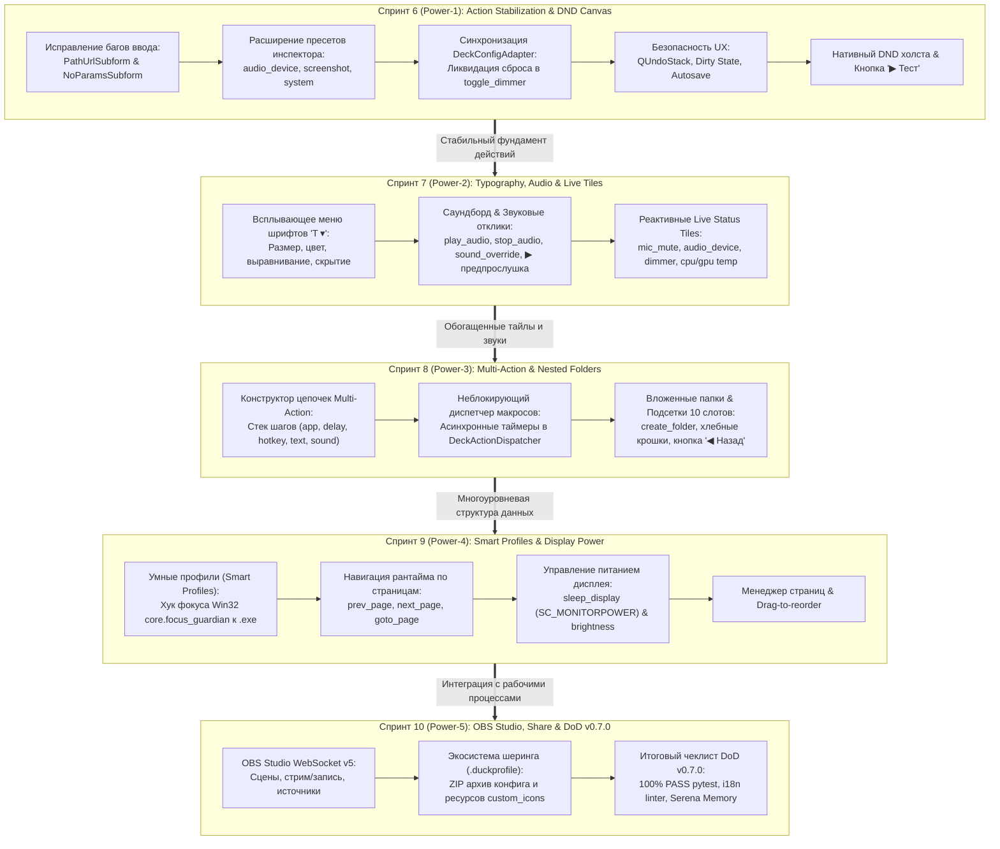

# DuckDeck Editor v0.7.0: Unified Power-Pack Master Roadmap & Actionable Architecture

> **Статус документа:** Утверждённый генеральный план и Actionable Roadmap  
> **Версия подсистемы:** DuckDeck Editor v0.7.0 (Power-Pack: Action Stability, Automation, Workflow & Smart Profiles)  
> **Базовый фундамент:** v0.6.0 (Завершены Спринты 1–5: Dark Obsidian v2, Singleton ⚙, Atomic I/O, Icon Ecosystem, Extended Actions, 260px Inspector, 418+ тестов 100% PASS)  
> **Источники синтеза:** Архитектурный аудит действий ([`edit_action.md`](file:///d:/Projects_X/duckdock/.md/deck/edit_action.md)) + Черновик возможностей ([`edit_fix.md`](file:///d:/Projects_X/duckdock/.md/deck/edit_fix.md))  
> **Целевая среда:** Windows 10/11 x64, Desktop GUI (PySide6 / Qt6, Python 3.12+)  
> **Дисплейный комплекс:** Dual-Display (Primary 27" 2560×1440 dGPU + Secondary 7" 1024×600 JRP7813S iGPU Touchscreen)  
> **Архитектурный закон:** [`GEMINI.md`](file:///d:/Projects_X/duckdock/GEMINI.md) (Zero-Bespoke, Platform-First, Feature-First Modularity, Weak Coupling через EventBus, Stealth Focus `Qt.NoFocus`, 100% RU/EN Localization-First).

---

## 1. Стратегический анализ и синтез требований

### 1.1. Контекст и текущий статус кодовой базы (v0.6.0)
В версии v0.6.0 успешно реализованы фундаментальные механизмы графической оболочки конфигуратора DuckDeck:
1. Завершены Спринты 1–5: современная дизайн-система Dark Obsidian v2, синглтон-менеджер жизненного цикла `DeckEditorManager`, изолированное окно 1080×740 на основном мониторе, атомарный I/O адаптер (`.tmp` -> `.bak` -> `.json`), диалог библиотеки иконок `IconLibraryDialog`, динамический стек подформ инспектора, увеличение рабочей высоты инспектора до 260 px и крупные контрастные иконки на холсте и тачскрине.
2. Проект защищен 418 модульными и интеграционными тестами со статусом **100% PASS**.

### 1.2. Проблема расхождения планов (`edit_action.md` vs `edit_fix.md`)
Комплексный аудит рабочей кодовой базы ([`edit_action.md`](file:///d:/Projects_X/duckdock/.md/deck/edit_action.md)) вскрыл критические расхождения между тремя слоями системы:
* **Каталог действий (`actions_registry.py`)**: содержит 29 детальных действий в 6 категориях.
* **Инспектор свойств (`ButtonPropertyForm`)**: содержит выпадающий список только с 9 пресетами (`ACTION_PRESET_KEYS`). 20 действий из 29 при назначении сбрасываются на «Хоткей» и показывают форму захвата клавиш.
* **Адаптер конфигурации (`DeckConfigAdapter`)**: не содержит правил нормализации для 13 действий каталога и принудительно сбрасывает их в `system: toggle_dimmer` (ночной режим).
* **Скрытые дефекты полей ввода**: в `PathUrlSubform` ключ `"executable": ""` перекрывает валидный путь `"path"`, оставляя поле ввода программы пустым для готовых кнопок («Терминал», «Калькулятор»). Для `close_window` отсутствует подформа и ошибочно отображается захват хоткея.

Одновременно с этим драфт [edit_fix.md](file:///d:/Projects_X/duckdock/.md/deck/edit_fix.md) закладывал Спринты 6–10 (Undo/Redo, DND, шрифты, мульти-действия, папки, умные профили, OBS WebSocket).  
**Вывод архитектурного аудита (`@deep-researcher`):** Реализация Спринтов 6–10 поверх нестабильного адаптера и рассогласованного инспектора привела бы к накоплению технического долга и порче конфигурационных файлов пользователей при перетаскивании или сохранении кнопок.

### 1.3. Принцип построения единого Power-Pack Roadmap v0.7.0
План объединяет устранение всех архитектурных дефектов и расширение функционала в единый последовательный цикл из 5 спринтов (Спринты 6–10):
* **Спринт 6 (Power-1):** Стабилизация ядра действий (устранение багов аудита), безопасный UX (Undo/Redo, Dirty State, Autosave) и нативный Drag-and-Drop на холсте.
* **Спринт 7 (Power-2):** Кастомизация типографики (`T ▾`), звуковой движок саундборда и реактивные динамические тайлы (Live Status Tiles).
* **Спринт 8 (Power-3):** Конструктор макро-цепочек (Multi-Action Sequence Builder) и иерархические вложенные папки (Nested Folders).
* **Спринт 9 (Power-4):** Умные профили (Auto-App Binding по фокусу .exe), управление дисплеем и менеджер страниц.
* **Спринт 10 (Power-5):** Интеграция с OBS Studio WebSocket, шеринг сетапов (`.duckprofile`) и итоговая приемка Definition of Done v0.7.0.

---

## 2. Сквозная архитектурная схема v0.7.0



---

## 3. Полный сводный реестр действий DuckDeck (29 Actions)

| № | Категория | ID действия в каталоге | Название в UI (RU / EN) | Иконка | Текущий статус в коде | Статус после аудита | Целевой спринт v0.7.0 | Результирующее поведение в v0.7.0 |
|---|---|---|---|:---:|---|---|:---:|---|
| **1** | **Мульти-действие** (`multi_action`) | `multi_action` | Мульти-действие / Multi Action | 🔀 | ❌ Заглушка | ⚠️ Сброс в Хоткей | **Спринт 8** | Полноценный визуальный блочный редактор макро-цепочки с задержками |
| **2** | | `multi_action_switch` | Переключатель мульти-действий | 🔂 | ❌ Заглушка | ⚠️ Сброс в Хоткей | **Спринт 8** | Двухпозиционное переключение независимых макро-цепочек (State 1 ⇄ 2) |
| **3** | **Навигация** (`navigation`) | `create_folder` | Создать папку / Create Folder | 📁 | ❌ Заглушка | ⚠️ Сброс в dimmer | **Спринт 8** | Контейнер подсетки (10 слотов) с хлебными крошками и кнопкой `◀ Назад` |
| **4** | | `switch_profile` | Сменить профиль / Switch Profile | 🗂️ | ❌ Заглушка | ⚠️ Сброс в dimmer | **Спринт 9** | Выбор целевого профиля из выпадающего списка в инспекторе |
| **5** | | `prev_page` | Предыдущая страница | ◀ | ⚠️ Свайп в UI есть | ⚠️ Сброс в dimmer | **Спринт 9** | Экшен кнопки: `bus.deck_page_changed.emit(current - 1)` |
| **6** | | `next_page` | Следующая страница | ▶ | ⚠️ Свайп в UI есть | ⚠️ Сброс в dimmer | **Спринт 9** | Экшен кнопки: `bus.deck_page_changed.emit(current + 1)` |
| **7** | | `goto_page` | Перейти на страницу | # | ⚠️ Частично | ⚠️ Сброс в dimmer | **Спринт 9** | Выбор номера/имени страницы в инспекторе с переходом по клику |
| **8** | | `page_indicator` | Индикатор страниц | 🔢 | ❌ Заглушка | ⚠️ Сброс в dimmer | **Спринт 9** | Информационный тайл текущей страницы `Page X / Y` |
| **9** | **Саундборд** (`soundboard`) | `play_audio` | Воспроизвести аудио / Play Audio | 🔊 | ❌ Заглушка | ⚠️ Сброс в dimmer | **Спринт 7** | Воспроизведение кастомных WAV/MP3 через `DeckSoundEngine` |
| **10** | | `stop_audio` | Остановить аудио / Stop Audio | 🔇 | ❌ Заглушка | ⚠️ Сброс в dimmer | **Спринт 7** | Мгновенный сброс всех активных звуковых потоков саундборда |
| **11** | **Stream Deck** (`stream_deck`) | `brightness` | Яркость экрана / Brightness | ☀️ | ❌ Заглушка | ⚠️ Сброс в dimmer | **Спринт 9** | Регулировка яркости через `core.dimmer` / WMI |
| **12** | | `sleep_display` | Спящий режим экрана | 🌙 | ❌ Заглушка | ⚠️ Сброс в dimmer | **Спринт 9** | Отключение экрана через Win32 `SendMessage SC_MONITORPOWER` |
| **13** | **Система** (`system`) | `hotkey` | Хоткей / Hotkey | ⌨️ | ✅ Реализовано | ✅ Работает | **Спринт 6** | Захват клавиш + защита Undo/Redo + DND |
| **14** | | `hotkey_switch` | Переключатель хоткеев | ⇄ | ✅ Реализовано | ✅ Работает | **Спринт 6** | Двухпозиционный переключатель (State 1 ⇄ 2) |
| **15** | | `website` | Открыть веб-сайт / Website | 🌐 | ✅ Реализовано | ✅ Работает | **Спринт 6** | Поле URL с автоподстановкой `https://` |
| **16** | | `open_website` | Открыть веб-сайт (синоним) | 🌐 | ✅ Реализовано | 🔄 Мапится на website | **Спринт 6** | Нормализация в `website` без дублирования кода |
| **17** | | `open_path` | Открыть путь / файл | 📂 | ✅ Реализовано | ✅ Работает | **Спринт 6** | Поле пути + кнопка обзора `QFileDialog` |
| **18** | | `open_app` | Запуск приложения | 🚀 | ✅ Реализовано | ⚠️ Баг executable="" | **Спринт 6** | **Fix:** `params.get('executable') or params.get('path')` |
| **19** | | `close_window` | Закрыть активное окно | ❌ | ✅ Реализовано | ⚠️ Ошибочный хоткей | **Спринт 6** | **Fix:** Подформа `NoParamsSubform` вместо `HotkeySubform` |
| **20** | | `text_macro` | Текстовый макрос | 📝 | ✅ Реализовано | ✅ Работает | **Спринт 6** | Поле ввода текста + опциональный Enter |
| **21** | | `multimedia` | Управление медиа | ⏯️ | ✅ Реализовано | ✅ Работает | **Спринт 6** | Комбобокс команд Windows VK_MEDIA_* |
| **22** | **Регулятор громкости** (`volume_controller`) | `auto_software_vol` | Громкость фокусного софта | 🎯 | ✅ В рантайме | ⚠️ Сброс в Хоткей | **Спринт 6** | **Fix:** Мапинг в `volume_control` (target: `focus_app`, mute) |
| **23** | | `master_volume_control` | Общая громкость | 🔊 | ✅ В рантайме | ⚠️ Сброс в Хоткей | **Спринт 6** | **Fix:** Мапинг в `volume_control` (target: `master`, mute) |
| **24** | | `mic_mute_control` | Управление микрофоном | 🎙️ | ✅ В рантайме | ⚠️ Сброс в Хоткей | **Спринт 6** | **Fix:** Мапинг в `volume_control` (target: `microphone`, mute) |
| **25** | | `output_device_toggle` | Смена аудиоустройства | 🎧 | ✅ В рантайме | ⚠️ Сброс в Хоткей | **Спринт 6** | **Fix:** Пресет `audio_device` + `AudioDeviceSubform` |
| **26** | | `mute_audio` | Заглушить звук | 🔇 | ✅ В рантайме | ⚠️ Сброс в dimmer | **Спринт 6** | **Fix:** Мапинг в `volume_control` (target: `master`, mute) |
| **27** | | `volume_up` | Громкость +5% | 🔉+ | ✅ В рантайме | ⚠️ Сброс в dimmer | **Спринт 6** | **Fix:** Мапинг в `volume_control` (target: `master`, up) |
| **28** | | `volume_down` | Громкость -5% | 🔉- | ✅ В рантайме | ⚠️ Сброс в dimmer | **Спринт 6** | **Fix:** Мапинг в `volume_control` (target: `master`, down) |
| **29** | | `toggle_device` | Переключить устройство | 🎧 | ✅ В рантайме | ⚠️ Сброс в dimmer | **Спринт 6** | **Fix:** Нормализация в `audio_device` (toggle) |
| **+** | **Stream Deck (Расширение)** | `obs_action` | OBS Studio Команды | 🎥 | 💡 Новое | 💡 Новое | **Спринт 10** | Сцены, запись, стрим через OBS WebSocket v5 |

---

## 4. Матрица ответственности (RACI) для команды агентов

| Спринт / Фокус задач | `@deep-researcher` | `@frontend-ui-designer` | `@ui-creator` | `@fullstack-builder` | `@bug-hunter` | `@code-review` |
| :--- | :---: | :---: | :---: | :---: | :---: | :---: |
| **Спринт 6: Action Pipeline Stabilization & DND** | Informed | **Responsible** | Support | **Accountable** | Support | Pre-Flight |
| **Спринт 7: Typography, Audio & Live Tiles** | Informed | Support | **Responsible** | Support | Support | Pre-Flight |
| **Спринт 8: Multi-Action & Nested Folders** | **Accountable** | Support | Informed | **Responsible** | Support | Pre-Flight |
| **Спринт 9: Smart Profiles & Page Navigation** | **Accountable** | Support | Informed | **Responsible** | Support | Pre-Flight |
| **Спринт 10: OBS Studio, Share & DoD v0.7.0** | Informed | **Responsible** | Support | **Accountable** | Support | Pre-Flight |

---

## 5. Детальный Actionable Roadmap по спринтам v0.7.0

### Спринт 6 (Power-1): Стабилизация пайплайна действий, DND холста и безопасность UX

> **Цель спринта:** Устранить все 4 критических дефекта расхождения каталога, адаптера и инспектора из `edit_action.md`, гарантировать сохранность пользовательских данных при редактировании кнопок, внедрить стек Undo/Redo (`QUndoStack`), отслеживание состояния несохраненных изменений (Dirty State & Autosave), нативный Drag-and-Drop (DND) на холсте и кнопку немедленного тестового запуска макросов с 27" экрана.

---

#### 6.0. Детальные подшаги реализации:

##### Шаг 6.1: Исправление чтения параметров ввода и создание подформы `NoParamsSubform`
* **Проблема:** В `PathUrlSubform.set_params()` вызов `params.get("executable", params.get("path", ""))` возвращает пустую строку `""`, если ключ `"executable": ""` присутствует в словаре (get не проверяет truthiness). В результате при выборе каталожных кнопок («Терминал», «Калькулятор») поле пути к приложению остается пустым. Кроме того, действие `close_window` (Закрыть окно) не имеет собственной подформы и ошибочно переключает инспектор на захват хоткея (`HotkeySubform`).
* **Технические изменения:**
  1. В [`modules/deck/editor/widgets/button_property_form.py`](file:///d:/Projects_X/duckdock/modules/deck/editor/widgets/button_property_form.py):
     - В `PathUrlSubform.set_params()` применить truthy-выборку:
       ```python
       target_val = params.get("executable") or params.get("path") or ""
       self.edit_input.setText(target_val)
       ```
     - Реализовать класс `NoParamsSubform(QWidget)` фиксированной высоты `INPUT_HEIGHT = 28 px`:
       - Компоновка: `QHBoxLayout` с отступами `(0, 0, 0, 0)` и интервалом `6 px`;
       - Индикаторная плашка: `QFrame` со стилем `InspectorNoParamsBanner` (фон `#1e293b`, скругление `6 px`, граница `1 px solid #334155`);
       - Иконка информации `ℹ️` (14 px) и метка `lbl_hint` со стилем `InspectorFieldHint`;
       - Локализация через метод `retranslate_ui()`: `t("deck.editor.inspector.hints.no_params_required")` (*"Действие не требует дополнительных параметров"* / *"Action requires no additional parameters"*).
     - В `ButtonPropertyForm._setup_ui()` зарегистрировать `NoParamsSubform` в динамическом стеке `self.params_stack` (Индекс 6).
     - В `_update_subform_visibility()` переключать стек на Индекс 6 для действий `close_window`, `system` (команды без параметров).
* **Локализация (`locales/*.json`):**
  - Ключ `deck.editor.inspector.hints.no_params_required`:
    - `ru`: `"Действие не требует дополнительных параметров"`
    - `en`: `"Action requires no additional parameters"`
* **Тестирование:**
  - `tests/unit/test_deck_property_form_subforms.py`: тест загрузки готовых кнопок `open_app` со словарем `{"executable": "", "path": "notepad.exe"}` — поле ввода должно содержать `"notepad.exe"`. Тест отображения `NoParamsSubform` для `close_window`.

---

##### Шаг 6.2: Интеллектуальный авто-мапинг каталожных действий звука в инспекторе
* **Проблема:** В каталоге `actions_registry.py` зарегистрировано 7 специализированных звуковых действий (`auto_software_vol`, `master_volume_control`, `mic_mute_control`, `mute_audio`, `volume_up`, `volume_down`, `toggle_device`), но в инспекторе есть только единый пресет `volume_control`. При выборе каталожной кнопки инспектор не распознает действие и сбрасывает его на «Хоткей» с потерей параметров.
* **Технические изменения:**
  1. В `ButtonPropertyForm.load_slot_data(dto: ButtonSlotDTO)`:
     - Реализовать нормализующий диспетчер каталожных действий перед поиском индекса в `combo_actions`:
       ```python
       raw_action = dto.action_type.strip().lower().replace(" ", "_")
       mapped_params = dict(dto.action_params) if dto.action_params else {}
       
       # Авто-мапинг регуляторов громкости
       if raw_action == "auto_software_vol":
           raw_action = "volume_control"
           mapped_params.setdefault("target", "focus_app")
           mapped_params.setdefault("command", "toggle_mute")
       elif raw_action in ("master_volume_control", "mute_audio"):
           raw_action = "volume_control"
           mapped_params.setdefault("target", "master")
           mapped_params.setdefault("command", "toggle_mute")
       elif raw_action == "mic_mute_control":
           raw_action = "volume_control"
           mapped_params.setdefault("target", "microphone")
           mapped_params.setdefault("command", "toggle_mute")
       elif raw_action == "volume_up":
           raw_action = "volume_control"
           mapped_params.setdefault("target", "master")
           mapped_params.setdefault("command", "volume_up")
       elif raw_action == "volume_down":
           raw_action = "volume_control"
           mapped_params.setdefault("target", "master")
           mapped_params.setdefault("command", "volume_down")
       elif raw_action in ("output_device_toggle", "toggle_device"):
           raw_action = "audio_device"
           mapped_params.setdefault("mode", "toggle")
       ```
     - Передавать `mapped_params` в подформу `subform_volume.set_params(mapped_params)` с корректным выставлением целевых комбобоксов.
* **Тестирование:**
  - Тест `test_volume_action_auto_mapping`: последовательная подача DTO с каждым из 7 звуковых действий — проверка, что комбобокс действий выбирает `volume_control` (или `audio_device`), а подформа выставляет корректный target/command.

---

##### Шаг 6.3: Расширение пресетов инспектора, подформы 28 px и устранение сброса в адаптере
* **Проблема:** Константа `ACTION_PRESET_KEYS` содержит только 9 пресетов. Действия категорий `audio_device`, `screenshot`, `system` отсутствуют в выпадающем списке. Метод `DeckConfigAdapter._normalize_action_type` при встрече нераспознанного типа аварийно возвращает `"system"`, а метод `_create_default_action` жестко подменяет его на `toggle_dimmer` (ночной режим), затирая пользовательский экшен.
* **Технические изменения:**
  1. В `button_property_form.py`:
     - Расширить `ACTION_PRESET_KEYS`:
       ```python
       ACTION_PRESET_KEYS = [
           "hotkey", "hotkey_switch", "website", "open_app", "open_path",
           "close_window", "text_macro", "multimedia", "volume_control",
           "audio_device", "screenshot", "system",
       ]
       ```
     - Разработать 3 новые подформы высотой `INPUT_HEIGHT = 28 px`:
       - `AudioDeviceSubform(QWidget)`: выбор режима (`toggle` — переключение наушники/динамики, `specific` — конкретное устройство из списка). Сигнал `params_changed(dict)`.
       - `ScreenshotSubform(QWidget)`: комбобокс цели (`primary_screen` / `active_window`) и компактный чекбокс `clipboard` (В буфер обмена). Сигнал `params_changed(dict)`.
       - `SystemSubform(QWidget)`: выбор системной команды (`toggle_dimmer`, `lock_workstation`, `sleep_display`). Сигнал `params_changed(dict)`.
     - Зарегистрировать подформы в `params_stack` (Индексы 7, 8, 9) и обновить `_update_subform_visibility()`.
  2. В [`modules/deck/editor/adapter.py`](file:///d:/Projects_X/duckdock/modules/deck/editor/adapter.py):
     - В `DeckConfigAdapter._normalize_action_type`: явно обрабатывать `"audio_device"`, `"screenshot"`, `"system"`, `"close_window"`.
     - В `DeckConfigAdapter.dto_to_slot()`: при слиянии параметров **НЕ** заменять `orig.action` дефолтным `toggle_dimmer`, если `norm_type` не совпадает с дефолтным списком. Сохранять исходный `orig.action.action_type` и существующие параметры Pydantic v2.
* **Локализация (`locales/*.json`):**
  - `deck.editor.inspector.actions_presets.audio_device`: `"Аудиоустройство"` / `"Audio Device"`
  - `deck.editor.inspector.actions_presets.screenshot`: `"Скриншот"` / `"Screenshot"`
  - `deck.editor.inspector.actions_presets.system`: `"Системная команда"` / `"System Command"`
  - `deck.editor.inspector.fields.audio_mode`: `"Режим"` / `"Mode"`
  - `deck.editor.inspector.fields.screenshot_target`: `"Область"` / `"Area"`
  - `deck.editor.inspector.fields.copy_to_clipboard`: `"В буфер"` / `"To Clipboard"`
  - `deck.editor.inspector.fields.system_command`: `"Команда"` / `"Command"`
* **Тестирование:**
  - Тест сохранения и загрузки кнопок с типами `audio_device`, `screenshot`, `system` через `DeckConfigAdapter` — проверка 100% сохранения атрибутов без мутации в `toggle_dimmer`.

---

##### Шаг 6.4: Архитектура стека истории Undo / Redo (`QUndoStack`)
* **Проблема:** Любое случайное действие (очистка кнопки, перезапись параметров, перетаскивание) необратимо перезаписывает текущую конфигурацию. Отсутствует возможность отмены (`Ctrl+Z`) и возврата (`Ctrl+Y`).
* **Технические изменения:**
  1. Создать модуль команд истории [`modules/deck/editor/commands.py`](file:///d:/Projects_X/duckdock/modules/deck/editor/commands.py) на базе `PySide6.QtGui.QUndoCommand`:
     - `AssignActionCommand(window, slot_index, new_dto, old_dto)`: назначение действия из ящика на слот холста. Метод `redo()` применяет `new_dto`, метод `undo()` восстанавливает `old_dto`.
     - `ClearSlotCommand(window, slot_index, old_dto)`: очистка слота холста (кнопка корзины 🗑️ или клавиша Del). `undo()` восстанавливает слот со всеми параметрами, иконкой и цветом.
     - `SwapButtonsCommand(window, src_slot, dst_slot, is_copy=False)`: перемещение/обмен или копирование кнопок между слотами при Drag-and-Drop.
     - `UpdatePropertyCommand(window, slot_index, prop_name, new_val, old_val)`: атомарное изменение отдельного свойства кнопки (title, color_accent, icon, action_params, hotkey).
  2. В [`modules/deck/editor/window.py`](file:///d:/Projects_X/duckdock/modules/deck/editor/window.py):
     - Инициализировать `self._undo_stack = QUndoStack(self)`;
     - Задать системные сочетания клавиш: `QKeySequence.Undo` (`Ctrl+Z`), `QKeySequence.Redo` (`Ctrl+Y`, `Ctrl+Shift+Z`);
     - Все мутации состояния слотов направлять строго через `self._undo_stack.push(command)`.
* **Тестирование:**
  - `tests/unit/test_deck_editor_undo.py`: назначить экшен на слот 0, нажать Undo (слот пуст), нажать Redo (слот заполнен). Проверить Undo для очистки корзиной и обмена кнопок.

---

##### Шаг 6.5: Отслеживание несохраненных изменений (Dirty State & Autosave)
* **Проблема:** Пользователь может закрыть окно конфигуратора и потерять сделанные настройки без предупреждения, либо вынужден постоянно нажимать `Ctrl+S`.
* **Технические изменения:**
  1. В `DeckEditorWindow`:
     - Связать `self._undo_stack.cleanChanged.connect(self._on_clean_changed)`:
       - При `isClean() == False` выставлять флаг `self._is_dirty = True` и обновлять заголовок окна: добавлять звездочку `*` (`DuckDeck Editor • [Page 1] *`);
       - При успешном сохранении (`save_configuration()`) вызывать `self._undo_stack.setClean()`, снимая звездочку.
     - Перехватить `closeEvent(event: QCloseEvent)`:
       - Если `self._is_dirty == True`, открывать стилизованный диалог Dark Obsidian v2 с кнопками:
         - **Сохранить (Save):** вызывает `save_configuration()`, принимает `event.accept()`;
         - **Не сохранять (Discard):** игнорирует изменения, принимает `event.accept()`;
         - **Отмена (Cancel):** отклоняет `event.ignore()`, окно остается открытым.
     - Внедрить дебаунсер автосохранения (`self._autosave_timer = QTimer(self)`):
       - Таймаут 500 мс (активируется при флаге `autosave_enabled: True` в настройках приложения);
       - По истечении таймаута автоматически вызывает сохранение на диск без блокировки UI.
* **Локализация (`locales/*.json`):**
  - `deck.editor.dialogs.unsaved_title`: `"Несохраненные изменения"` / `"Unsaved Changes"`
  - `deck.editor.dialogs.unsaved_message`: `"В конфигурации DuckDeck есть несохраненные изменения. Сохранить перед выходом?"` / `"There are unsaved changes in DuckDeck configuration. Save before closing?"`
  - `deck.editor.dialogs.save`: `"Сохранить"` / `"Save"`
  - `deck.editor.dialogs.discard`: `"Не сохранять"` / `"Don't Save"`
  - `deck.editor.dialogs.cancel`: `"Отмена"` / `"Cancel"`
* **Тестирование:**
  - Тест `test_dirty_state_indicator`: изменение свойства кнопки вызывает появление звездочки в заголовке, `save_configuration()` убирает ее. Тест диалога закрытия с эмуляцией кликов Save/Discard/Cancel.

---

##### Шаг 6.6: Нативный Drag-and-Drop (DND) на холсте редактора
* **Проблема:** Перенос действий из библиотеки на кнопки сейчас требует ручного клика и настройки через инспектор. Нельзя быстро поменять кнопки местами или перетащить действие прямо на нужный слот холста.
* **Технические изменения:**
  1. **DND из библиотеки действий (`ActionItemWidget`):**
     - В `ActionItemWidget` переопределить `mousePressEvent` и `mouseMoveEvent`:
       - При перемещении мыши с зажатой ЛКМ на расстояние > `QApplication.startDragDistance()` создавать `QDrag(self)`;
       - Формировать `QMimeData` с MIME-типом `application/x-duckdeck-action` и JSON-сериализацией DTO действия;
       - Создавать полупрозрачный пиксмап-превью карточки действия (drag pixmap 160×32 px).
  2. **DND между слотами холста (`EditorGridCell`):**
     - В `EditorGridCell` включить прием сброса: `self.setAcceptDrops(True)`;
     - Реализовать начало перетаскивания из ячейки: если слот не пустой, формировать `QMimeData` с MIME-типом `application/x-duckdeck-slot` и индексом исходного слота;
     - Обработка `dragEnterEvent` и `dragMoveEvent`:
       - Проверять наличие поддерживаемых MIME (`application/x-duckdeck-action` или `application/x-duckdeck-slot`);
       - Подсвечивать ячейку-мишень неоновым контуром 2 px `#38bdf8` через динамическое свойство `setProperty("drag_hover", "true")`;
     - Обработка `dragLeaveEvent`: сбрасывать `setProperty("drag_hover", "false")`;
     - Обработка `dropEvent`:
       - Сбрасывать подсветку `drag_hover`;
       - Если брошено действие из библиотеки: создавать `AssignActionCommand` на целевой слот;
       - Если брошен другой слот холста: проверять клавишу-модификатор `event.modifiers() & Qt.ControlModifier`. Если зажат `Ctrl` — выполнять копирование (Copy), иначе — взаимный обмен слотами (Swap) через `SwapButtonsCommand`.
* **Тестирование:**
  - `tests/unit/test_deck_editor_dnd.py`: программная эмуляция событий `QDropEvent` на ячейку — проверка создания команд в `QUndoStack`, корректности обмена и копирования данных слотов.

---

##### Шаг 6.7: Кнопка тестового запуска «▶ Тест» (Test Run) в инспекторе
* **Проблема:** Чтобы проверить работу настроенного макроса, хоткея или команды, пользователю приходится закрывать конфигуратор или переключаться на сенсорный 7" экран. Нет возможности быстрой проверки прямо из окна редактора.
* **Технические изменения:**
  1. В `ButtonPropertyForm`:
     - В шапке формы инспектора (рядом с кнопкой корзины `btn_delete`) добавить кнопку `btn_test`:
       - Фиксированный размер `28x28 px`, курсор `PointingHandCursor`;
       - Иконка `▶` со стилем `InspectorTestButton` (нейтральный серый `#94a3b8`, зеленый неоновый ховер `#10b981` и фоновая подсветка `rgba(16, 185, 129, 0.15)`);
       - Локализованный тултип `deck.editor.inspector.tooltips.test_action` (*"Протестировать действие"* / *"Test Run Action"*);
       - Сигнал `test_action_requested = Signal(int)` (передает индекс слота).
  2. В `DeckEditorWindow`:
     - Подключить сигнал `btn_test.clicked` к обработчику `_on_test_action_requested(slot_index: int)`:
       - Получать актуальный DTO слота;
       - Конвертировать в `DeckButtonConfig` через `DeckConfigAdapter.dto_to_slot()`;
       - Передавать в исполнитель действий:
         ```python
         from modules.deck.action_dispatcher import DeckActionDispatcher
         DeckActionDispatcher.execute_action(button_config.action)
         ```
       - Выполнять запуск в безопасном режиме (без перехвата фокуса у основного 27" экрана).
* **Локализация (`locales/*.json`):**
  - `deck.editor.inspector.tooltips.test_action`: `"Протестировать действие"` / `"Test Run Action"`
* **Тестирование:**
  - Тест клика на `btn_test`: проверка вызова `execute_action` с корректными параметрами текущего выбранного слота.

---

#### 6.8. Итоговая матрица приемки Спринта 6 (Definition of Done):
1. **Целостность данных:** Ни одно из 29 действий каталога не сбрасывается в «Хоткей» или `toggle_dimmer` при загрузке или сохранении в JSON.
2. **Безопасность редактирования:** Стек `QUndoStack` корректно отменяет и накатывает все операции (`Ctrl+Z` / `Ctrl+Y`).
3. **Защита от потери данных:** Индикатор Dirty State со звездочкой `*` и перехват `closeEvent` надежно предотвращают закрытие окна с несохраненными изменениями.
4. **Удобство DND:** Поддерживается перетаскивание действий из библиотеки на сетку и обмен слотов местами с подсветкой ячеек.
5. **Тестирование «на лету»:** Кнопка «▶ Тест» моментально исполняет действие выбранной кнопки.
6. **Автоматизированный контроль:** 100% модульных тестов `pytest tests/` имеют статус `PASS`, а линтер локализации `pytest tests/core/test_i18n_linter.py` подтверждает 100% паритет ключей RU/EN без хардкода строк.

---

#### Блок запуска шагов Спринта 6:
```text
#### Запуск реализации Спринта 6 (Шаги 6.1 - 6.7):
@fullstack-builder и @frontend-ui-designer реализуйте Спринт 6 из .md/deck/edit_deckv2.md:
1. Шаг 6.1: В PathUrlSubform.set_params примените truthy-выборку (params.get('executable') or params.get('path') or '') и создайте NoParamsSubform 28 px со стилизованной плашкой и локализованной подсказкой для close_window и системных действий.
2. Шаг 6.2: В ButtonPropertyForm.load_slot_data реализуйте авто-мапинг 7 каталожных действий звука (auto_software_vol, master_volume_control, mic_mute_control, mute_audio, volume_up, volume_down, toggle_device) в volume_control и audio_device.
3. Шаг 6.3: Расширьте ACTION_PRESET_KEYS пресетами audio_device, screenshot, system с подформами высотой 28 px. В DeckConfigAdapter исключите слепой сброс нераспознанных действий в toggle_dimmer.
4. Шаг 6.4: Создайте modules/deck/editor/commands.py с командами QUndoCommand (AssignActionCommand, ClearSlotCommand, SwapButtonsCommand, UpdatePropertyCommand) и интегрируйте QUndoStack в DeckEditorWindow с хоткеями Ctrl+Z и Ctrl+Y / Ctrl+Shift+Z.
5. Шаг 6.5: Реализуйте dirty-state отслеживание через undo_stack.cleanChanged, звездочку в заголовке окна, диалог подтверждения сохранения при closeEvent и таймер автосохранения на 500 мс.
6. Шаг 6.6: Внедрите нативный Drag-and-Drop: перетаскивание из ActionItemWidget (MIME application/x-duckdeck-action) на ячейки EditorGridCell с неоновой подсветкой drag_hover, а также перетаскивание между слотами холста (Swap при обычном сбросе, Copy при зажатом Ctrl).
7. Шаг 6.7: Добавьте кнопку '▶ Тест' (InspectorTestButton) в шапку инспектора для моментального тестового запуска действия активного слота через DeckActionDispatcher.execute_action.
8. Локализация: Обеспечьте 100% паритет ключей в locales/ru.json и locales/en.json согласно спецификации шагов 6.1 - 6.7.
Критерий завершения: 100% действий каталога стабильно настраиваются без сбросов, DND и Undo работают без сбоев, тесты pytest tests/unit/test_deck_*.py проходят на 100%.

#### Разработка и верификация тестов Спринта 6:
@bug-hunter разработай и дополни модульные тесты для Спринта 6:
1. Создай tests/unit/test_deck_editor_undo.py для проверки команд QUndoStack (Assign, Clear, Swap, Update).
2. Создай tests/unit/test_deck_editor_dnd.py для эмуляции Drag-and-Drop из ящика на ячейку и между слотами.
3. Дополни tests/unit/test_deck_property_form_subforms.py тестами новых подформ (NoParamsSubform, AudioDeviceSubform, ScreenshotSubform, SystemSubform).
4. Проверь прохождение всех тестов: pytest tests/unit/test_deck_*.py.

#### Pre-Flight проверка Спринта 6:
@code-review проведи аудит реализации Спринта 6:
1. Проверь отсутствие утечек памяти в QUndoStack и корректность освобождения ресурсов виджетов.
2. Проверь соблюдение лимита высоты инспектора INSPECTOR_HEIGHT = 260 px и отсутствие вертикального скролла.
3. Проверь чистоту MIME-сериализации при Drag-and-Drop и обработку невалидного payload.
4. Проверь 100% паритет локализации и отсутствие хардкода строк через pytest tests/core/test_i18n_linter.py.

#### Релиз и синхронизация памяти:
@git-release-master выполни чеклист Definition of Done:
1. Убедись, что все тесты pytest tests/ имеют 100% PASS.
2. Зафиксируй изменения коммитом Conventional Commits: feat(deck): implement action pipeline stabilization, undo-redo stack and native dnd canvas (Sprint 6).
3. Актуализируй changelog.md и Memory Bank проекта.
```

---

### Спринт 7 (Power-2): Кастомизация типографики, звуковой движок и Live Status Tiles

> **Цель спринта:** Предоставить пользователям расширенную настройку текста кнопки (всплывающее меню `T ▾`), индивидуальный выбор и предпрослушивание звука нажатия кнопки (`sound_override`), реализовать действия саундборда (`play_audio`, `stop_audio`), подформу `SoundboardSubform` и реактивные живые тайлы (Live Status Tiles: микрофон, аудиовыход, ночной режим, датчики температуры CPU/GPU) на холсте конфигуратора и на сенсорном 7" экране.

---

#### 7.0. Детальные подшаги реализации:

##### Шаг 7.1: Всплывающее меню настройки шрифта (`FontCustomizationPopover`) и расширение моделей
* **Проблема:**
  - Кнопка `btn_font` (`"T ▾"`) в `ButtonPropertyForm` отображается в интерфейсе, но клик по ней не обрабатывается (сигнал `font_settings_requested` никуда не подключен).
  - В модели `DeckButtonConfig` (`modules/deck/models.py`) отсутствуют поля типографики: `font_size`, `font_color`, `text_alignment`, `hide_title`. В `ButtonSlotDTO` (`modules/deck/editor/dto.py`) есть `font_size` и `font_color`, но отсутствуют `text_alignment` и `hide_title`.
  - В `DeckConfigAdapter` (`modules/deck/editor/adapter.py`) нет двусторонней передачи параметров шрифта: при загрузке и сохранении пользовательские размеры и цвета затираются дефолтными значениями.
  - На холсте конфигуратора (`EditorGridCell`) и на сенсорном 7" экране (`DeckButtonWidget`) размер шрифта и цвет жестко захардкожены константами и не реагируют на индивидуальные настройки пользователя.
* **Технические изменения:**
  1. В [`modules/deck/models.py`](file:///d:/Projects_X/duckdock/modules/deck/models.py):
     - В `DeckButtonConfig` добавить поля Pydantic v2 с валидацией:
       ```python
       font_size: int = Field(default=11, ge=8, le=24, description="Размер шрифта заголовка в px")
       font_color: str = Field(default="#d4d4d8", description="Цвет шрифта заголовка (HEX)")
       text_alignment: Literal["bottom", "center", "top"] = Field(
           default="bottom", description="Положение текста относительно иконки"
       )
       hide_title: bool = Field(default=False, description="Скрыть текст заголовка (режим чистой иконки)")
       ```
  2. В [`modules/deck/editor/dto.py`](file:///d:/Projects_X/duckdock/modules/deck/editor/dto.py):
     - В `ButtonSlotDTO` добавить поля:
       ```python
       text_alignment: str = "bottom"
       hide_title: bool = False
       ```
  3. В [`modules/deck/editor/adapter.py`](file:///d:/Projects_X/duckdock/modules/deck/editor/adapter.py):
     - В `slot_to_dto()`: извлекать и передавать `font_size`, `font_color`, `text_alignment`, `hide_title` из `DeckButtonConfig`.
     - В `dto_to_slot()`: сохранять эти 4 параметра при сборке `DeckButtonConfig`.
  4. Создать виджет всплывающего меню [`modules/deck/editor/widgets/font_popover.py`](file:///d:/Projects_X/duckdock/modules/deck/editor/widgets/font_popover.py):
     - Класс `FontCustomizationPopover(QWidget)` в эстетике Dark Obsidian v2:
       - Оконные флаги: `Qt.Popup | Qt.FramelessWindowHint`, атрибут `Qt.WA_ShowWithoutActivating` (инвариант Stealth Focus).
       - Размеры: `250x230 px`, фон `#121824`, рамка `1px solid #334155`, скругление `10px`, мягкая тень `QGraphicsDropShadowEffect(blurRadius=16, color=QColor(0,0,0,160))`.
       - *Секция 1 (Размер шрифта):* `QButtonGroup` с 4 кнопками выбора (`9px`, `11px` (default), `13px`, `15px`).
       - *Секция 2 (Выравнивание):* 3 кнопки с иконками/стрелками: ⬇ Снизу (`bottom`), ⬌ Центр (`center`), ⬆ Сверху (`top`).
       - *Секция 3 (Цвет текста):* 5 круговых цветовых чипов: `#f8fafc` (Белый), `#94a3b8` (Серый), `#38bdf8` (Cyan), `#f59e0b` (Amber), `#10b981` (Emerald) + кнопка сброса.
       - *Секция 4 (Скрытие заголовка):* Стилизованный `QCheckBox` («Скрыть заголовок» / «Hide title»).
       - Сигнал `font_changed = Signal(dict)`: при изменении любого параметра эмитит словарь `{"font_size": int, "font_color": str, "text_alignment": str, "hide_title": bool}`.
       - Метод `show_at_widget(target_widget: QWidget)`: расчет координат всплывающего окна относительно `btn_font` с авто-коррекцией выхода за границы экрана.
  5. В [`modules/deck/editor/widgets/button_property_form.py`](file:///d:/Projects_X/duckdock/modules/deck/editor/widgets/button_property_form.py):
     - Подключить `self.btn_font.clicked` к открытию `FontCustomizationPopover(self)`.
     - При получении сигнала `font_changed`:
       - Передавать изменения свойств (`font_size`, `font_color`, `text_alignment`, `hide_title`) через команды истории `UpdatePropertyCommand` для полной поддержки `QUndoStack` (`Ctrl+Z`).
       - Эмитить `property_changed.emit("font_size", val)` и т.д.
  6. В [`modules/deck/editor/widgets/grid_cell.py`](file:///d:/Projects_X/duckdock/modules/deck/editor/widgets/grid_cell.py) и [`modules/deck/widgets/deck_button.py`](file:///d:/Projects_X/duckdock/modules/deck/widgets/deck_button.py):
     - Реактивное применение параметров типографики:
       - При `hide_title == True` скрывать `lbl_title` (`setVisible(False)`) и вертикально центрировать `lbl_icon`.
       - При `text_alignment == "top"` размещать `lbl_title` над `lbl_icon` в `_content_layout`.
       - При `text_alignment == "bottom"` размещать `lbl_title` под `lbl_icon`.
       - При `text_alignment == "center"` размещать текст по центру тайла поверх полупрозрачной иконки.
       - Применять `font_size` и `font_color` к `lbl_title.setStyleSheet()`.
* **Локализация (`locales/*.json`):**
  - Ключи поповера:
    - `deck.editor.font_popover.title`: `"Настройка типографики"` / `"Typography Settings"`
    - `deck.editor.font_popover.font_size`: `"Размер шрифта"` / `"Font Size"`
    - `deck.editor.font_popover.alignment`: `"Положение"` / `"Position"`
    - `deck.editor.font_popover.align_top`: `"Сверху"` / `"Top"`
    - `deck.editor.font_popover.align_center`: `"По центру"` / `"Center"`
    - `deck.editor.font_popover.align_bottom`: `"Снизу"` / `"Bottom"`
    - `deck.editor.font_popover.text_color`: `"Цвет текста"` / `"Text Color"`
    - `deck.editor.font_popover.hide_title`: `"Скрыть заголовок"` / `"Hide Title"`
    - `deck.editor.font_popover.reset`: `"Сброс"` / `"Reset"`
* **Тестирование:**
  - `tests/unit/test_deck_font_popover.py`: тестирование инициализации `FontCustomizationPopover`, эмуляция кликов по размеру шрифта, выравниванию, цветовым чипам и чекбоксу; проверка эмиссии `font_changed`; тест сериализации и десериализации параметров в `DeckConfigAdapter`.

---

##### Шаг 7.2: Саундборд (`play_audio`, `stop_audio`), подформа `SoundboardSubform` и индивидуальный звук (`sound_override`)
* **Проблема:**
  - Действия каталога `play_audio` и `stop_audio` не имеют диспетчера в `DeckActionDispatcher` и сбрасываются адаптером.
  - `DeckSoundEngine` сейчас умеет воспроизводить только фиксированные WAV-файлы интерфейса (`tap`, `page_switch`, `error`, `success`) и не имеет методов для воспроизведения произвольных пользовательских аудиодорожек саундборда, остановки всех активных звуков (`stop_audio`) и раздельного управления громкостью эффектов саундборда.
  - В инспекторе свойств отсутствует форма настройки саундборда, регулятор громкости и предпрослушивание `▶`.
  - Нет графического интерфейса для назначения индивидуального звукового отклика клика кнопки (`sound_override`).
* **Технические изменения:**
  1. В [`modules/deck/sound_engine.py`](file:///d:/Projects_X/duckdock/modules/deck/sound_engine.py):
     - Расширить `DeckSoundEngine`:
       - Добавить пул активных эффектов саундборда `_soundboard_pool: list[QSoundEffect] = []` (до 8 одновременных звуков с авто-очисткой завершенных).
       - Метод `play_soundboard(file_path: str, volume: float = 1.0, stop_others: bool = False) -> bool`:
         - Разрешение относительного/абсолютного пути через `resolve_sound_path()`.
         - При `stop_others == True` вызов `stop_soundboard()`.
         - Создание `QSoundEffect` в пуле, установка громкости `clamped_vol = max(0.0, min(1.0, volume)) * self.volume`.
         - Запуск воспроизведения без блокировки главного UI-потока.
       - Метод `stop_soundboard() -> None`:
         - Остановка всех воспроизводящихся эффектов в `_soundboard_pool` и очистка завершенных.
       - Метод `preview_sound(file_path: str, volume: float = 1.0) -> None`:
         - Быстрая предпрослушка файла в конфигураторе с остановкой предыдущего превью.
  2. В [`modules/deck/models.py`](file:///d:/Projects_X/duckdock/modules/deck/models.py):
     - Создать модель Pydantic v2 `SoundboardParams`:
       ```python
       class SoundboardParams(BaseModel):
           """Параметры действия воспроизведения аудио саундборда."""
           file_path: str = Field(default="", description="Относительный или абсолютный путь к аудиофайлу")
           volume: float = Field(default=1.0, ge=0.0, le=1.0, description="Громкость воспроизведения от 0.0 до 1.0")
           stop_others: bool = Field(default=False, description="Остановить другие звуки саундборда перед запуском")
       ```
     - Зарегистрировать `SoundboardParams` в мапинге `DeckActionConfig.get_params_model()` для `"play_audio"`.
  3. В [`modules/deck/action_dispatcher.py`](file:///d:/Projects_X/duckdock/modules/deck/action_dispatcher.py):
     - Добавить ветки диспетчеризации:
       - `play_audio`: извлечение `file_path`, `volume`, `stop_others` и вызов `DeckSoundEngine.play_soundboard()`.
       - `stop_audio`: вызов `DeckSoundEngine.stop_soundboard()`.
  4. В [`modules/deck/editor/widgets/button_property_form.py`](file:///d:/Projects_X/duckdock/modules/deck/editor/widgets/button_property_form.py):
     - Разработать подформу `SoundboardSubform(QWidget)` фиксированной высоты `INPUT_HEIGHT = 28 px`:
       - Строка ввода пути `edit_sound_path` (`QLineEdit`) с плейсхолдером `*.wav, *.mp3`.
       - Кнопка обзора `btn_browse` (`📁`) с диалогом `QFileDialog.getOpenFileName(..., filter="Audio Files (*.wav *.mp3 *.ogg);;All Files (*.*)")`.
       - Кнопка предпрослушки `btn_preview` (`▶` / `⏹`) со стилем `InspectorTestButton`.
       - Компактный слайдер громкости `slider_vol` (0..100%) и процентная метка `lbl_vol_val` (`100%`).
       - Сигнал `params_changed(dict)`: передает `{"file_path": path, "volume": vol_float, "stop_others": False}`.
     - Зарегистрировать пресеты `play_audio` и `stop_audio` в `ACTION_PRESET_KEYS` (Индексы стека подформ).
     - Для `stop_audio` использовать `NoParamsSubform` с хинтом: *"Останавливает все активные звуки саундборда"*.
     - В секцию общих свойств кнопки добавить выпадающий список `combo_click_sound` для настройки `sound_override`:
       - Опции: *"По умолчанию (Кликер)"* (`None`), *"Без звука"* (`"muted"`), *"Кастомный файл..."* (`"custom"`).
       - При выборе кастомного файла — диалог обзора и кнопка предпрослушки `▶`.
       - Сохранение в `dto.sound_override` и `button_config.sound_override`.
  5. В [`modules/deck/editor/adapter.py`](file:///d:/Projects_X/duckdock/modules/deck/editor/adapter.py):
     - Добавить `"play_audio"` и `"stop_audio"` в `_normalize_action_type()`, исключая сброс в `toggle_dimmer`.
* **Локализация (`locales/*.json`):**
  - Ключи саундборда:
    - `deck.editor.inspector.actions_presets.play_audio`: `"Воспроизвести звук"` / `"Play Sound"`
    - `deck.editor.inspector.actions_presets.stop_audio`: `"Остановить звуки"` / `"Stop Audio"`
    - `deck.editor.inspector.fields.sound_file`: `"Аудиофайл"` / `"Audio File"`
    - `deck.editor.inspector.fields.sound_volume`: `"Громкость"` / `"Volume"`
    - `deck.editor.inspector.fields.click_sound`: `"Звук клика"` / `"Click Sound"`
    - `deck.editor.inspector.fields.click_sound_default`: `"По умолчанию"` / `"Default"`
    - `deck.editor.inspector.fields.click_sound_muted`: `"Без звука"` / `"Muted"`
    - `deck.editor.inspector.fields.click_sound_custom`: `"Выбрать файл..."` / `"Custom File..."`
    - `deck.editor.inspector.tooltips.preview_sound`: `"Предпрослушать звук"` / `"Preview Sound"`
    - `deck.editor.inspector.hints.stop_audio_hint`: `"Мгновенно глушит все играющие эффекты саундборда"` / `"Instantly mutes all active soundboard effects"`
* **Тестирование:**
  - `tests/unit/test_deck_soundboard.py`: тестирование воспроизведения через `DeckSoundEngine.play_soundboard()` и `stop_soundboard()`; проверка неблокирующего воспроизведения и пула эффектов; тестирование `SoundboardSubform` (выбор файла, слайдер громкости, кнопка предпрослушки); тест сохранения `sound_override` в DTO и адаптере.

---

##### Шаг 7.3: Подсистема живых динамических тайлов (Live Status Tiles)
* **Проблема:**
  - В `ButtonPropertyForm` отсутствует элемент управления для выбора источника статуса (`status_source`), пользователь не может привязать кнопку к реактивному системному статусу через графический интерфейс.
  - В `DeckView` есть частичная обработка `audio_device`, `mic_mute`, `dimmer`, но отсутствует поддержка датчиков телеметрии (`cpu_temp`, `gpu_temp` из LibreHardwareMonitor), а обновление бейджей не имеет единого визуального стандарта.
  - На холсте конфигуратора `EditorGridCell` статус не отображается, что затрудняет визуальную оценку макета кнопки в окне редактора на 27" экране.
  - Отсутствует цветовая градация порогов температуры (зеленый / желтый / красный) и индикация тревожного состояния.
* **Технические изменения:**
  1. В [`modules/deck/editor/widgets/button_property_form.py`](file:///d:/Projects_X/duckdock/modules/deck/editor/widgets/button_property_form.py):
     - В сетку инспектора (строка 3, рядом с выбором цвета и звука) добавить комбобокс `combo_status_source`:
       - Опции выбора:
         - `none` — *"Отключен"* / *"None"*
         - `mic_mute` — *"Микрофон (Mute / Unmute)"* / *"Microphone (Mute / Unmute)"*
         - `audio_device` — *"Аудиоустройство (Наушники / Динамики)"* / *"Audio Device (Headphones / Speakers)"*
         - `dimmer` — *"Ночной режим (Затемнение)"* / *"Night Dimmer (Brightness)"*
         - `cpu_temp` — *"Температура CPU (°C)"* / *"CPU Temperature (°C)"*
         - `gpu_temp` — *"Температура GPU (°C)"* / *"GPU Temperature (°C)"*
       - При изменении значения: `self.property_changed.emit("status_source", val if val != "none" else None)`.
  2. В [`modules/deck/widgets/deck_button.py`](file:///d:/Projects_X/duckdock/modules/deck/widgets/deck_button.py) и [`modules/deck/editor/widgets/grid_cell.py`](file:///d:/Projects_X/duckdock/modules/deck/editor/widgets/grid_cell.py):
     - Унифицировать виджет бейджа статуса `lbl_status`:
       - Позиционирование: компактный аккуратный чип под иконкой или поверх нее.
       - Базовый стиль: `font-size: 10px; font-weight: 600; padding: 2px 6px; border-radius: 4px; background: rgba(15, 23, 42, 0.85);`.
       - Метод `update_status(status_text: str, icon: Optional[str] = None, badge_color: Optional[str] = None)`:
         - Обновление текста метки `lbl_status.setText(status_text)`.
         - Если передан `badge_color` (например, `#ef4444` при высокой температуре) — акцентировать рамку тайла и цвет подложки бейджа.
     - В `EditorGridCell`: отображать демонстрационный бейдж статуса при выбранном `dto.status_source` (например, `🎙 UNMUTED`, `🎧 Realtek`, `CPU: 58°C`), обеспечивая точное совпадение визуала холста с 7" тачскрином.
  3. В [`modules/deck/view.py`](file:///d:/Projects_X/duckdock/modules/deck/view.py):
     - Подписаться на события шины `bus.telemetry_updated` (или сигналы пакетов LibreHardwareMonitor):
       - При получении пакета температур фильтровать кнопки сетки с `status_source == "cpu_temp"` и `status_source == "gpu_temp"`.
       - Логика цветовых порогов:
         - `< 60°C`: цвет `#10b981` (Emerald), текст `CPU: {temp}°C`
         - `60°C .. 74°C`: цвет `#f59e0b` (Amber), текст `CPU: {temp}°C`
         - `>= 75°C`: цвет `#ef4444` (Crimson Neon) + тревожная рамка, текст `CPU: {temp}°C ⚠️`
     - В методе `cleanup()`: гарантированная отписка от всех сигналов шины EventBus и остановка внутренних таймеров для предотвращения утечек памяти.
* **Локализация (`locales/*.json`):**
  - Ключи живых тайлов:
    - `deck.editor.inspector.fields.status_source`: `"Живой статус"` / `"Live Status"`
    - `deck.editor.inspector.status_sources.none`: `"Отключен"` / `"None"`
    - `deck.editor.inspector.status_sources.mic_mute`: `"Микрофон (Mute)"` / `"Microphone (Mute)"`
    - `deck.editor.inspector.status_sources.audio_device`: `"Аудиоустройство"` / `"Audio Device"`
    - `deck.editor.inspector.status_sources.dimmer`: `"Ночной режим"` / `"Night Dimmer"`
    - `deck.editor.inspector.status_sources.cpu_temp`: `"Температура CPU"` / `"CPU Temperature"`
    - `deck.editor.inspector.status_sources.gpu_temp`: `"Температура GPU"` / `"GPU Temperature"`
    - `deck.status.cpu_temp`: `"CPU: {temp}°C"` / `"CPU: {temp}°C"`
    - `deck.status.gpu_temp`: `"GPU: {temp}°C"` / `"GPU: {temp}°C"`
* **Тестирование:**
  - `tests/unit/test_deck_live_tiles.py`: программная эмуляция событий EventBus (`telemetry_updated`, `mic_muted`, `audio_device`, `dimmer`); проверка вызовов `update_status` и переключения цветовых порогов; проверка очистки подписок в `cleanup()`.

---

#### 7.4. Итоговая матрица приемки Спринта 7 (Definition of Done):
1. **Типографика и поповер:** Кнопка `T ▾` открывает компактное всплывающее меню `FontCustomizationPopover`. Размер шрифта (9–15px), цвет, выравнивание (сверху/центр/снизу) и скрытие текста заголовка мгновенно отображаются на холсте редактора и на 7" тачскрине, корректно сохраняются в JSON и поддерживают отмену `Ctrl+Z`.
2. **Саундборд:** Действия `play_audio` и `stop_audio` настраиваются через подформу `SoundboardSubform`, воспроизводят звуки через `DeckSoundEngine` в неблокирующем режиме с индивидуальной громкостью и возможностью мгновенной остановки.
3. **Звук клика (`sound_override`):** Для любой кнопки можно задать индивидуальный звуковой отклик, отключить звук клика или оставить системный кликер по умолчанию.
4. **Живые тайлы (Live Status Tiles):** Поддерживается выбор источника статуса (`mic_mute`, `audio_device`, `dimmer`, `cpu_temp`, `gpu_temp`). Бейджи температур реагируют на данные телеметрии с цветовой градацией (зеленый/желтый/красный), статус отображается как на тачскрине, так и на холсте редактора.
5. **Инварианты фокуса и производительности:** Воспроизведение звуков и обновление тайлов происходят без отбора фокуса у 27" экрана (`Qt.NoFocus`, `WS_EX_NOACTIVATE`) и без просадки FPS. В `cleanup()` все подписки отписываются от шины.
6. **Автоматизированный контроль:** 100% тестов `pytest tests/` имеют статус `PASS`, линтер локализации подтверждает 100% паритет ключей RU/EN без хардкода строк.

---

#### Блок запуска шагов Спринта 7:
```text
#### Запуск реализации Спринта 7 (Шаги 7.1 - 7.3):
@ui-creator и @fullstack-builder реализуйте Спринт 7 из .md/deck/edit_deckv2.md:
1. Шаг 7.1 (Типографика и поповер T ▾):
   - Добавьте поля font_size, font_color, text_alignment, hide_title в DeckButtonConfig (models.py) и ButtonSlotDTO (dto.py), синхронизируйте DeckConfigAdapter.
   - Разработайте виджет FontCustomizationPopover (font_popover.py) со стилями Dark Obsidian v2, селектором размера (9/11/13/15px), позицией (bottom/center/top), 5 цветовыми чипами и чекбоксом скрытия заголовка.
   - Подключите btn_font в ButtonPropertyForm к поповеру и командам QUndoStack.
   - Обновите отрисовку заголовка и выравнивания в EditorGridCell и DeckButtonWidget.
2. Шаг 7.2 (Саундборд и sound_override):
   - Расширьте DeckSoundEngine методами play_soundboard, stop_soundboard, preview_sound с неблокирующим пулом эффектов.
   - Создайте Pydantic модель SoundboardParams и диспетчеризацию действий play_audio, stop_audio в DeckActionDispatcher.
   - Разработайте SoundboardSubform 28 px в ButtonPropertyForm (путь, кнопка обзора, предпрослушка ▶, слайдер громкости) и добавьте комбобокс click_sound (sound_override).
   - Обновите DeckConfigAdapter для сохранения play_audio и stop_audio без сбросов.
3. Шаг 7.3 (Живые динамические тайлы Live Status Tiles):
   - Добавьте комбобокс combo_status_source в ButtonPropertyForm (none, mic_mute, audio_device, dimmer, cpu_temp, gpu_temp).
   - Внедрите бейдж статуса в EditorGridCell и обновите DeckButtonWidget.update_status() с цветовой градацией температур (<60°C зеленый, 60-74°C желтый, >=75°C красный).
   - Подпишите DeckView на события шины EventBus и обеспечьте корректный cleanup().
4. Локализация: Добавьте все ключи из шагов 7.1 - 7.3 в locales/ru.json и locales/en.json.
Критерий завершения: Типографика настраивается и отображается на обоих экранах, саундборд воспроизводит звуки без лагов, живые тайлы меняют статус и цвет по событиям шины.

#### Разработка и верификация тестов Спринта 7:
@bug-hunter разработай модульные и интеграционные тесты для Спринта 7:
1. Создай tests/unit/test_deck_font_popover.py для тестирования FontCustomizationPopover, эмиссии сигналов font_changed и сохранения в DTO/адаптере.
2. Создай tests/unit/test_deck_soundboard.py для проверки play_soundboard, stop_soundboard, SoundboardSubform и поля sound_override.
3. Создай tests/unit/test_deck_live_tiles.py для проверки подписки на EventBus, обновления бейджей статуса, порогов температур и отписки в cleanup().
4. Прогони все тесты: pytest tests/unit/test_deck_*.py (100% PASS).

#### Pre-Flight проверка Спринта 7:
@code-review проведи аудит реализации Спринта 7:
1. Проверь инвариант Stealth Focus: убедись, что FontCustomizationPopover и воспроизведение аудио не отбирают фокус у 27" экрана.
2. Проверь неблокирующий I/O: отсутствие time.sleep() при проигрывании аудио и корректное освобождение ресурсов в cleanup().
3. Проверь лимит высоты инспектора INSPECTOR_HEIGHT = 260 px для SoundboardSubform.
4. Проверь 100% паритет локализации: pytest tests/core/test_i18n_linter.py.

#### Релиз и синхронизация памяти:
@git-release-master выполни чеклист Definition of Done:
1. Убедись, что все тесты pytest tests/ имеют статус 100% PASS.
2. Зафиксируй изменения коммитом Conventional Commits: feat(deck): implement typography popover, soundboard engine and reactive live status tiles (Sprint 7).
3. Актуализируй changelog.md и Memory Bank проекта.
```

---

### Спринт 8 (Power-3): Цепочки макросов (Multi-Action) и вложенные папки

> **Цель спринта:** Превратить заглушки `multi_action`, `multi_action_switch` и `create_folder` в мощные интерактивные инструменты автоматизации: визуальный блочный редактор цепочек команд с настраиваемыми неблокирующими задержками и древовидные вложенные папки (до 3 уровней) с навигацией по хлебным крошкам на холсте конфигуратора и на сенсорном 7" экране.

---

#### 8.0. Детальные подшаги реализации:

##### Шаг 8.1: Pydantic v2 модели и неблокирующий диспетчер цепочек макросов (Multi-Action Engine)
* **Проблема:**
  - В каталоге действий зарегистрированы действия `multi_action` и `multi_action_switch`, однако в `models.py` они отсутствуют в `ActionType` и фабрика `DeckActionConfig.get_typed_params()` не имеет моделей типизации для них.
  - При попытке назначить эти действия адаптер `DeckConfigAdapter` сбрасывает их или затирает параметры.
  - В диспетчере `DeckActionDispatcher` нет инфраструктуры пошагового выполнения макро-команд: синхронные паузы (`time.sleep()`) недопустимы по инварианту Non-blocking I/O (замораживают интерфейс или блокируют рабочий поток пула).
  - Отсутствует защита от состояния гонки (race condition): повторное быстрое нажатие на кнопку во время исполнения длинного макроса может породить наложение хоткеев или непредсказуемое поведение окон.
* **Технические изменения:**
  1. В [`modules/deck/models.py`](file:///d:/Projects_X/duckdock/modules/deck/models.py):
     - Добавить в `ActionType`: `"multi_action"`, `"multi_action_switch"`, `"create_folder"`.
     - Создать модель отдельного шага макроса:
       ```python
       class MacroStepConfig(BaseModel):
           """Конфигурация отдельного шага цепочки макросов."""
           id: str = Field(default_factory=lambda: uuid.uuid4().hex[:8], description="Уникальный ID шага")
           step_type: Literal[
               "hotkey", "delay", "open_app", "open_path", "website",
               "text_macro", "multimedia", "volume_control", "audio_device",
               "play_audio", "system", "http_request"
           ] = Field(description="Тип исполняемого шага")
           params: Dict[str, Any] = Field(default_factory=dict, description="Параметры шага")
           enabled: bool = Field(default=True, description="Флаг активности шага")
       ```
     - Создать модель параметров одиночного мульти-действия:
       ```python
       class MultiActionParams(BaseModel):
           """Параметры одиночного мульти-действия."""
           steps: List[MacroStepConfig] = Field(default_factory=list, description="Список последовательных шагов")
           stop_on_error: bool = Field(default=True, description="Прервать цепочку при сбое любого шага")
       ```
     - Создать модель параметров переключателя мульти-действий (State 1 ⇄ 2):
       ```python
       class MultiActionSwitchParams(BaseModel):
           """Параметры двухпозиционного переключателя мульти-действий."""
           state_1_steps: List[MacroStepConfig] = Field(default_factory=list, description="Цепочка шагов для состояния 1")
           state_2_steps: List[MacroStepConfig] = Field(default_factory=list, description="Цепочка шагов для состояния 2")
           current_state: int = Field(default=1, ge=1, le=2, description="Текущее активное состояние (1 или 2)")
       ```
     - Зарегистрировать модели в методе `DeckActionConfig.get_typed_params()` для `"multi_action"` и `"multi_action_switch"`.
  2. В [`modules/deck/action_dispatcher.py`](file:///d:/Projects_X/duckdock/modules/deck/action_dispatcher.py):
     - Разработать класс `MultiActionRunner(QObject)` для безопасного выполнения последовательности шагов:
       - Конструктор принимает `button_id`, `steps: list[MacroStepConfig]`, `stop_on_error: bool`, `signals: WorkerSignals`.
       - Метод `start()` запускает выполнение с шага `0`.
       - Выполнение шага типа `"delay"`: извлечение `delay_ms = int(params.get("delay_ms", 100))` и шедулинг следующего шага через `QTimer.singleShot(delay_ms, self._execute_next_step)`.
       - Выполнение боевых шагов: делегирование в штатные методы (`send_hotkey`, `launch_process`, `execute_http_request`, `DeckSoundEngine.play_soundboard()`).
       - При успешном завершении шага — переход к следующему; при ошибке и `stop_on_error == True` — немедленный выход с эмиссией сигнала `finished(button_id, False, err_msg)`.
       - Защита от дребезга и повторного пуска: пока `MultiActionRunner` активен для данного `button_id`, повторные нажатия игнорируются с логом в дебаг.
  3. В [`modules/deck/editor/adapter.py`](file:///d:/Projects_X/duckdock/modules/deck/editor/adapter.py):
     - В `_normalize_action_type()` добавить `"multi_action"` и `"multi_action_switch"`.
     - Обеспечить 100% сериализацию и десериализацию списка шагов `steps` в `dto_to_slot()` и `slot_to_dto()`.
* **Локализация (`locales/*.json`):**
  - `deck.editor.inspector.actions_presets.multi_action`: `"Мульти-действие"` / `"Multi Action"`
  - `deck.editor.inspector.actions_presets.multi_action_switch`: `"Переключатель мульти-действий"` / `"Multi Action Switch"`
  - `deck.notify.macro_running`: `"Выполняется макрос: шаг {step}/{total}"` / `"Running macro: step {step}/{total}"`
  - `deck.notify.macro_completed`: `"Макрос выполнен успешно"` / `"Macro completed successfully"`
  - `deck.notify.macro_error`: `"Сбой макроса на шаге {step}: {error}"` / `"Macro failed at step {step}: {error}"`
* **Тестирование:**
  - `tests/unit/test_deck_multi_action_engine.py`: юнит-тесты валидации моделей `MacroStepConfig`, `MultiActionParams`, `MultiActionSwitchParams`; тесты асинхронного пошагового выполнения через `MultiActionRunner` с моками `QTimer.singleShot`; проверка флага `stop_on_error` и защиты от повторного пуска во время выполнения.

---

##### Шаг 8.2: Визуальный блочный конструктор шагов в инспекторе (MultiActionSubform)
* **Проблема:**
  - В инспекторе свойств (`ButtonPropertyForm`) нет элементов управления для сборки списка шагов макроса.
  - Действующий инвариант геометрии строго ограничивает доступную высоту: `INSPECTOR_HEIGHT = 260 px`. Традиционные громоздкие редакторы списков не помещаются в заданные габариты или порождают вертикальную прокрутку всей формы.
  - Необходим компактный эргономичный интерфейс Dark Obsidian v2: компактный список шагов с индикацией порядка, всплывающее меню добавления шага (`+ Шаг ▾`), кнопки перемещения (`▲`, `▼`), удаления (`🗑️`) и инлайн-панель настройки параметров активного шага высотой до 28 px.
* **Технические изменения:**
  1. Создать модуль подформы [`modules/deck/editor/widgets/multi_action_subform.py`](file:///d:/Projects_X/duckdock/modules/deck/editor/widgets/multi_action_subform.py):
     - Класс `MultiActionSubform(QWidget)` высотой до `180 px`:
       - **Верхний тулбар (28 px):**
         - Метка количества шагов `lbl_steps_count` со стилем `InspectorFieldHint`;
         - Кнопка `btn_add_step` (`"+ Шаг ▾"`, стиль `InspectorPillButton`) с выпадающим меню `QMenu`:
           - ⏱️ *Пауза (задержка)* (`delay`)
           - ⌨️ *Хоткей* (`hotkey`)
           - 🚀 *Запуск приложения* (`open_app`)
           - 📝 *Текстовый макрос* (`text_macro`)
           - 🔊 *Воспроизвести звук* (`play_audio`)
           - 🌐 *Веб-сайт* (`website`)
         - Кнопки перемещения шагов `btn_move_up` (`▲`) и `btn_move_down` (`▼`);
         - Кнопка удаления шага `btn_delete_step` (`🗑️`);
         - Чекбокс `chk_stop_on_error` (*"Остановить при сбое"* / *"Stop on error"*).
       - **Список шагов (высота 90 px):**
         - `QListWidget` со скруглением `6 px`, темным фоном `#0f172a`, рамкой `1 px solid #334155` и компактными ячейками высотой 22 px;
         - Элемент списка отображает: порядковый номер `[1]`, иконку типа и читаемое резюме (например: `[1] ⏱️ Пауза: 250 мс`, `[2] ⌨️ Хоткей: Ctrl+Shift+S`, `[3] 🚀 obs64.exe`).
       - **Инлайн-редактор выбранного шага (высота 28 px):**
         - Динамическая панель `step_editor_stack` (`QStackedWidget`), переключающаяся при выборе элемента списка:
           - Для `delay`: слайдер (50..3000 мс) + компактный спинбокс с шагом 50 мс;
           - Для `hotkey`: кнопка захвата клавиш аналогично `HotkeySubform`;
           - Для `open_app` / `open_path` / `website` / `play_audio`: мини-строка ввода пути/URL + кнопка обзора `📁`;
           - Для `text_macro`: компактная строка ввода текста.
       - Сигнал `params_changed = Signal(dict)`: при добавлении, изменении параметров, смене порядка или удалении шага эмитит обновленный словарь параметров `MultiActionParams`.
  2. В [`modules/deck/editor/widgets/button_property_form.py`](file:///d:/Projects_X/duckdock/modules/deck/editor/widgets/button_property_form.py):
     - Добавить `multi_action` и `multi_action_switch` в `ACTION_PRESET_KEYS`.
     - Зарегистрировать экземпляр `MultiActionSubform` в `self.params_stack`.
     - Для `multi_action_switch`: добавить селектор активного настраиваемого состояния (`[ Состояние 1 ]` / `[ Состояние 2 ]`), переключающий отображаемый список шагов соответствующего подсостояния.
     - Интегрировать изменения с командами `UpdatePropertyCommand` для полной поддержки `QUndoStack` (`Ctrl+Z` / `Ctrl+Y`).
* **Локализация (`locales/*.json`):**
  - `deck.editor.multi_action.add_step`: `"+ Шаг ▾"` / `"+ Step ▾"`
  - `deck.editor.multi_action.steps_count`: `"Шагов: {count}"` / `"Steps: {count}"`
  - `deck.editor.multi_action.empty_steps`: `"Список шагов пуст. Нажмите '+ Шаг' для добавления"` / `"No steps added. Click '+ Step' to add"`
  - `deck.editor.multi_action.types.delay`: `"Пауза (задержка)"` / `"Delay"`
  - `deck.editor.multi_action.types.hotkey`: `"Хоткей"` / `"Hotkey"`
  - `deck.editor.multi_action.types.open_app`: `"Запуск приложения"` / `"Launch App"`
  - `deck.editor.multi_action.types.open_path`: `"Открыть путь"` / `"Open Path"`
  - `deck.editor.multi_action.types.text_macro`: `"Текстовый макрос"` / `"Text Macro"`
  - `deck.editor.multi_action.types.play_audio`: `"Воспроизвести звук"` / `"Play Audio"`
  - `deck.editor.multi_action.types.website`: `"Веб-сайт"` / `"Website"`
  - `deck.editor.multi_action.delay_label`: `"Пауза"` / `"Delay"`
  - `deck.editor.multi_action.delay_ms`: `"{ms} мс"` / `"{ms} ms"`
  - `deck.editor.multi_action.stop_on_error`: `"Прерывать при сбое"` / `"Stop on Error"`
  - `deck.editor.multi_action.state_1_tab`: `"Состояние 1"` / `"State 1"`
  - `deck.editor.multi_action.state_2_tab`: `"Состояние 2"` / `"State 2"`
* **Тестирование:**
  - `tests/unit/test_deck_multi_action_subform.py`: тестирование виджета `MultiActionSubform`: добавление шагов разных типов, валидация лимита шагов (до 16 на цепочку), изменение параметров задержки, переупорядочивание вверх/вниз, удаление шагов, проверка генерации словаря параметров и эмиссии `params_changed`.

---

##### Шаг 8.3: Архитектура вложенных папок (Nested Folders / Sub-grids)
* **Проблема:**
  - 10 слотов на странице ограничивают пользователя при создании сложных сетапов (стриминг, разработка, игры). Без механизма папок пользователь вынужден создавать десятки отдельных страниц и перелистывать их свайпом.
  - В `models.py` структура страниц `DeckPageConfig` содержит плоский список `buttons: List[DeckButtonConfig]`. Нет схемы хранения подсеток, изолированных внутри папок.
  - Действие каталога `create_folder` не имеет валидных моделей данных и при попытке сохранения в JSON сбрасывается адаптером `DeckConfigAdapter` в дефолтное системное действие.
* **Технические изменения:**
  1. В [`modules/deck/models.py`](file:///d:/Projects_X/duckdock/modules/deck/models.py):
     - Создать модель параметров папки:
       ```python
       class FolderParams(BaseModel):
           """Параметры папки DuckDeck."""
           folder_id: str = Field(description="Уникальный ID подсетки папки")
           folder_name: str = Field(default="", description="Пользовательское название папки")
           parent_folder_id: Optional[str] = Field(default=None, description="ID родительской подсетки или None для корня")
           depth_level: int = Field(default=1, ge=1, le=3, description="Глубина вложенности папки (макс 3 уровня)")
       ```
     - В `DeckPageConfig`:
       - Добавить поле подсеток:
         ```python
         sub_grids: Dict[str, List[DeckButtonConfig]] = Field(
             default_factory=dict,
             description="Словарь подсеток папок текущей страницы, ключ: folder_id (10 слотов)",
         )
         ```
     - В `DeckActionConfig.get_typed_params()` добавить ветку для `"create_folder"` -> `FolderParams`.
  2. В [`modules/deck/editor/adapter.py`](file:///d:/Projects_X/duckdock/modules/deck/editor/adapter.py):
     - Добавить `"create_folder"` в `_normalize_action_type()`.
     - Реализовать методы работы с подсетками в `DeckConfigAdapter`:
       - `get_folder_slots(page_id: str, folder_id: str) -> list[ButtonSlotDTO]`: возвращает 10 слотов вложенной подсетки. Если подсетка еще не создана — автоматически инициализирует ее, резервируя слот `0` под кнопку `◀ Назад`.
       - `save_folder_slots(page_id: str, folder_id: str, slots: list[ButtonSlotDTO]) -> None`: сохраняет модифицированные слоты подсетки обратно в модель `DeckPageConfig.sub_grids`.
     - Защита от циклов и лимит глубины: проверка, что родительский стек не содержит текущий `folder_id`, а `depth_level <= 3`. При попытке создать папку на уровне 3 выдавать понятное предупреждение.
  3. В [`modules/deck/editor/widgets/button_property_form.py`](file:///d:/Projects_X/duckdock/modules/deck/editor/widgets/button_property_form.py):
     - Создать компактную подформу `FolderSubform(QWidget)` фиксированной высоты `28 px`:
       - Поле ввода названия папки `edit_folder_name` (`QLineEdit`);
       - Кнопка прямого перехода в папку `btn_open_folder` (`"Войти в папку ➔"`, стиль `InspectorPillButton`);
       - Метка текущей глубины вложенности `lbl_depth` (`Уровень: 1/3`).
* **Локализация (`locales/*.json`):**
  - `deck.editor.inspector.actions_presets.create_folder`: `"Создать папку"` / `"Create Folder"`
  - `deck.editor.folder.folder_name`: `"Название папки"` / `"Folder Name"`
  - `deck.editor.folder.folder_name_placeholder`: `"Например: Звуки, Стрим, Игры"` / `"e.g. Sounds, Stream, Games"`
  - `deck.editor.folder.open_folder`: `"Войти в папку ➔"` / `"Open Folder ➔"`
  - `deck.editor.folder.back_button_title`: `"Назад"` / `"Back"`
  - `deck.editor.folder.depth_level`: `"Уровень: {level}/3"` / `"Level: {level}/3"`
  - `deck.editor.folder.max_depth_reached`: `"Достигнута максимальная глубина вложенности (3 уровня)"` / `"Maximum folder depth reached (3 levels)"`
* **Тестирование:**
  - `tests/unit/test_deck_nested_folders.py`: юнит-тесты валидации `FolderParams`, проверка инициализации `sub_grids` в `DeckPageConfig`, сохранение и извлечение подсеток через `DeckConfigAdapter`, валидация резервирования слота `0` под возврат `◀ Назад`, проверка отклонения создания папок с глубиной > 3.

---

##### Шаг 8.4: Навигация по папкам на холсте и сенсорном экране (Breadcrumbs & Navigation)
* **Проблема:**
  - Окно конфигуратора на основном 27" экране (`DeckEditorWindow`) отображает только плоскую сетку корневой страницы: отсутствует возможность погружения внутрь папки для настройки ее кнопок и возврата обратно.
  - На 7" сенсорном экране (`DeckView`) клик по кнопке с типом `create_folder` ни к чему не приводит: нет рантайм-логики переключения текущей сетки кнопок на слоты подсетки папки и возврата по кнопке «Назад».
  - Отсутствует визуальный компонент навигации «Хлебные крошки» (Breadcrumbs), что лишает пользователя контекста того, на каком уровне и в какой папке он сейчас находится.
* **Технические изменения:**
  1. Создать виджет навигации [`modules/deck/editor/widgets/breadcrumbs_bar.py`](file:///d:/Projects_X/duckdock/modules/deck/editor/widgets/breadcrumbs_bar.py):
     - Класс `BreadcrumbsBar(QWidget)` высотой `28 px` в стиле Dark Obsidian v2:
       - Горизонтальная компоновка со стрелочными разделителями: `[ 🏠 Главная ] ❯ [ 📁 Стриминг ] ❯ [ 📁 Звуки ]`;
       - Кликабельные сегменты пути со стилем `BreadcrumbLink` (нейтральный серый `#94a3b8`, неоновый голубой ховер `#38bdf8`);
       - Активный текущий сегмент подсвечен полужирным белым шрифтом `#f8fafc`;
       - Сигнал `crumb_clicked = Signal(str)`: эмитит ID целевого уровня при клике на любой родительский сегмент в цепочке;
       - Метод `set_path(path_items: list[tuple[str, str]])`: обновляет цепочку крошек `[(level_id, title), ...]`.
  2. В [`modules/deck/editor/window.py`](file:///d:/Projects_X/duckdock/modules/deck/editor/window.py) и [`modules/deck/editor/widgets/grid_canvas.py`](file:///d:/Projects_X/duckdock/modules/deck/editor/widgets/grid_canvas.py):
     - Разместить `BreadcrumbsBar` в верхней части холста (над сеткой 2x5).
     - Внедрить стек навигации редактора: `self._folder_nav_stack: list[dict] = [{"id": "root", "name": t("deck.editor.breadcrumbs.root")}]`.
     - Обработка открытия папки:
       - По двойному клику на ячейку с папкой на холсте (или по клику на кнопку «Войти в папку ➔» в инспекторе) пушить папку в `_folder_nav_stack`;
       - Загружать слоты подсетки `adapter.get_folder_slots()` на холст;
       - Слот `0` подсетки визуально блокировать для смены типа действия, помечая как системную кнопку возврата `[ ◀ Назад ]` (при этом разрешая менять акцентный цвет кнопки);
       - Обновлять `BreadcrumbsBar`.
     - Обработка возврата:
       - Клик по слоту `0` (`[ ◀ Назад ]`) или клик по родительскому сегменту хлебных крошек возвращает холст на уровень выше с авто-сохранением состояния слотов текущей папки в `QUndoStack`.
  3. В [`modules/deck/view.py`](file:///d:/Projects_X/duckdock/modules/deck/view.py) (рантайм 7" сенсорного экрана):
     - Добавить рантайм-стек папок: `self._runtime_folder_stack: list[str] = []`.
     - При тапе на кнопку с `action_type == "create_folder"`:
       - Извлекать `folder_id` из параметров;
       - Проигрывать звук перехода `DeckSoundEngine.play("page_switch")`;
       - Сохранять текущий контекст в `_runtime_folder_stack`;
       - Мгновенно отрисовывать 10 кнопок подсетки из `page_config.sub_grids[folder_id]`;
       - Слот `0` отображает кнопку `[ ◀ Назад ]`.
     - При тапе на кнопку `[ ◀ Назад ]` (действие `navigation` с параметром `action: "folder_back"`):
       - Извлекать предыдущий ID из `_runtime_folder_stack`;
       - Проигрывать звук перехода и восстанавливать предыдущую сетку кнопок;
       - При переключении глобальной страницы профиля (свайпом или хоткеем) — автоматически сбрасывать `_runtime_folder_stack` в корень.
     - Интеграция с EventBus: эмиссия `bus.deck_folder_navigated.emit(folder_id, folder_name)` для реактивных модулей.
* **Локализация (`locales/*.json`):**
  - `deck.editor.breadcrumbs.root`: `"Главная"` / `"Home"`
  - `deck.editor.breadcrumbs.separator`: `"❯"` / `"❯"`
  - `deck.editor.folder.back_to_parent`: `"Назад в '{name}'"` / `"Back to '{name}'"`
* **Тестирование:**
  - `tests/unit/test_deck_breadcrumbs_and_nav.py`: тестирование виджета `BreadcrumbsBar` (отрисовка сегментов, клики по предкам, эмиссия `crumb_clicked`); тест навигации вглубь и возврата назад на холсте `DeckEditorWindow`; интеграционный тест `test_deck_runtime_folder_navigation` для `DeckView` с эмуляцией тач-событий входа в папку и выхода назад.

---

#### 8.5. Итоговая матрица приемки Спринта 8 (Definition of Done):
1. **Неблокирующий Multi-Action движок:** цепочки команд выполняются пошагово с точными неблокирующими задержками через `QTimer.singleShot` без зависания GUI. Повторные клики во время исполнения цепочки отклоняются дебаунсером.
2. **Эргономичный блочный конструктор:** `MultiActionSubform` полностью укладывается в бюджет инспектора `INSPECTOR_HEIGHT = 260 px`, позволяет добавлять, настраивать параметры, перемещать и удалять шаги с поддержкой отмены через `QUndoStack` (`Ctrl+Z`).
3. **Иерархические папки:** любая кнопка холста может быть преобразована в контейнер вложенной папки из 10 слотов. Данные подсеток сериализуются в `sub_grids` конфигурации без потерь.
4. **Хлебные крошки и навигация:** на холсте редактора и на 7" тачскрине навигация работает синхронно: вход по клику/тапу, возврат по слоту `[ ◀ Назад ]` или клику по крошке пути, глубина ограничена 3 уровнями с защитой от циклов.
5. **Инварианты платформы:** строгое соблюдение `Qt.NoFocus` и `WS_EX_NOACTIVATE` на 7" экране, неблокирующий I/O без `time.sleep()`.
6. **Автоматизированный контроль:** 100% тестов `pytest tests/` имеют статус `PASS`, линтер локализации подтверждает 100% паритет ключей RU/EN без хардкода строк.

---

#### Блок запуска шагов Спринта 8:
```text
#### Запуск реализации Спринта 8 (Шаги 8.1 - 8.4):
@fullstack-builder и @frontend-ui-designer реализуйте Спринт 8 из .md/deck/edit_deckv2.md:
1. Шаг 8.1 (Multi-Action Engine):
   - Добавьте в models.py модели MacroStepConfig, MultiActionParams, MultiActionSwitchParams, зарегистрируйте в ActionType и DeckActionConfig.get_typed_params().
   - Реализуйте неблокирующий MultiActionRunner в action_dispatcher.py на базе QTimer.singleShot без блокировки UI, с поддержкой stop_on_error и защитой от состояния гонки.
   - Синхронизируйте DeckConfigAdapter для сохранения и загрузки шагов макроса.
2. Шаг 8.2 (Визуальный конструктор MultiActionSubform):
   - Разработайте модуль widgets/multi_action_subform.py (высота до 180 px): тулбар '+ Шаг ▾', кнопки ▲/▼/🗑️, компактный список шагов 90 px, инлайн-редактор выбранного шага 28 px.
   - Интегрируйте подформу в ButtonPropertyForm для multi_action и multi_action_switch (с табами Состояние 1 / 2) с поддержкой команд QUndoStack.
3. Шаг 8.3 (Архитектура вложенных папок):
   - Создайте модель FolderParams и добавьте словарь sub_grids: Dict[str, List[DeckButtonConfig]] в DeckPageConfig.
   - Реализуйте в DeckConfigAdapter методы get_folder_slots и save_folder_slots с авто-резервированием слота 0 под кнопку [◀ Назад] и лимитом глубины до 3 уровней.
   - Добавьте подформу FolderSubform 28 px в ButtonPropertyForm с кнопкой 'Войти в папку ➔'.
4. Шаг 8.4 (Хлебные крошки и навигация):
   - Создайте виджет BreadcrumbsBar (widgets/breadcrumbs_bar.py) в стиле Dark Obsidian v2 и интегрируйте его над холстом сетки в DeckEditorWindow.
   - Реализуйте погружение в папку и возврат назад на холсте редактора и в рантайме 7" экрана DeckView (с сохранением стека и воспроизведением звука перехода).
5. Локализация: Добавьте все ключи из шагов 8.1 - 8.4 в locales/ru.json и locales/en.json с соблюдением 100% паритета.
Критерий завершения: Макросы выполняются последовательно с паузами без лагов UI, вложенные папки открываются и возвращаются назад на 27" холсте и на 7" тачскрине, тесты pytest tests/unit/test_deck_*.py проходят на 100%.

#### Разработка и верификация тестов Спринта 8:
@bug-hunter разработай и дополни модульные и интеграционные тесты для Спринта 8:
1. Создай tests/unit/test_deck_multi_action_engine.py для проверки моделей MacroStepConfig, MultiActionParams, пошагового таймера MultiActionRunner и защиты от дребезга.
2. Создай tests/unit/test_deck_multi_action_subform.py для проверки добавления, настройки задержек, перемещения и удаления шагов в MultiActionSubform.
3. Создай tests/unit/test_deck_nested_folders.py для валидации FolderParams, сериализации sub_grids в DeckConfigAdapter и лимита вложенности 3 уровней.
4. Создай tests/unit/test_deck_breadcrumbs_and_nav.py для тестирования BreadcrumbsBar и навигации по папкам на холсте и в DeckView.
5. Прогони все тесты: pytest tests/unit/test_deck_*.py (100% PASS).

#### Pre-Flight проверка Спринта 8:
@code-review проведи аудит реализации Спринта 8:
1. Проверь неблокирующий I/O: полное отсутствие time.sleep() в MultiActionRunner и безопасную очистку таймеров QTimer.singleShot.
2. Проверь соблюдение лимита геометрии инспектора INSPECTOR_HEIGHT = 260 px для MultiActionSubform и FolderSubform.
3. Проверь защиту от циклических ссылок в подсетках папок и строгое соблюдение лимита глубины (не более 3 уровней).
4. Проверь сохранение инвариантов Stealth Focus (Qt.NoFocus, WS_EX_NOACTIVATE) на 7" экране при навигации по папкам.
5. Проверь 100% паритет локализации: pytest tests/core/test_i18n_linter.py.

#### Релиз и синхронизация памяти:
@git-release-master выполни чеклист Definition of Done:
1. Убедись, что все тесты pytest tests/ имеют статус 100% PASS.
2. Зафиксируй изменения коммитом Conventional Commits: feat(deck): implement multi-action macro engine, visual step builder, nested folders and breadcrumbs (Sprint 8).
3. Актуализируй .md/changelog.md, .md/backend.md и Memory Bank проекта.
```

---

### Спринт 9 (Power-4): Умные профили (Smart Profiles), управление дисплеем и менеджер страниц

> **Цель спринта:** Реализовать автоматическое переключение профилей по активному окну Windows (.exe) с околонулевым оверхедом Win32 хука фокуса, боевые действия управления питанием экрана (`sleep_display`, `brightness`), рантайм-навигацию по страницам деки (`prev_page`, `next_page`, `goto_page`, `switch_profile`, `page_indicator`) и расширенный менеджер страниц с Drag-to-Reorder пагинатором, контекстным меню и пресетами шаблонов.

---

#### 9.0. Детальные подшаги реализации:

##### Шаг 9.1: Умные профили с привязкой к процессам Windows (Smart App Binding)
* **Проблема:**
  - Сейчас DuckDeck требует ручного переключения профилей и страниц (жестами свайпа на 7" экране или через конфигуратор).
  - Геймеры и авторы контента нуждаются в автоматической адаптации деки: при переходе в Photoshop, Blender, OBS Studio, DaVinci Resolve или игру на основном 27" мониторе DuckDeck на 7" экране обязан моментально переключаться на соответствующий рабочий профиль без физического касания экрана.
  - При сворачивании целевого софта или переходе на Рабочий стол дек должен бесшовно возвращаться на дефолтный профиль (Fallback Profile).
  - Фоновый поток Win32 хука в `core/focus_guardian.py` уже получает события `EVENT_SYSTEM_FOREGROUND`, но сейчас он лишь сохраняет `hwnd` и не транслирует имя исполняемого файла (`process_name`) в шину `EventBus`.
  - Прямой опрос `psutil.Process(pid).name()` на каждое системное событие фокуса порождает недопустимый для фонового демона оверхед и лаги в играх. Требуется низкоуровневый Win32 API (`win32process.GetWindowThreadProcessId` + `QueryFullProcessImageNameW` через `ctypes.windll.kernel32`) с LRU-кэшированием дескрипторов, обеспечивающий задержку обработки менее `0.1 мс`.
  - В `models.py` структура `DeckPageConfig` не имеет полей для связывания с `.exe`, а в UI отсутствует диалог со списком запущенных процессов и кнопкой обзора файлов.
* **Технические изменения:**
  1. В [`core/focus_guardian.py`](file:///d:/Projects_X/duckdock/core/focus_guardian.py):
     - Реализовать ультралегкий метод `get_window_process_name(hwnd: int) -> Optional[str]`:
       - Извлечение PID через `win32process.GetWindowThreadProcessId(hwnd)`.
       - Открытие процесса дескриптором `kernel32.OpenProcess(PROCESS_QUERY_LIMITED_INFORMATION, False, pid)`.
       - Чтение полного пути через `kernel32.QueryFullProcessImageNameW`, извлечение базового имени (`os.path.basename`) в нижнем регистре (например, `"photoshop.exe"`, `"obs64.exe"`).
       - Локальный LRU-кэш на 128 записей `(hwnd -> process_name)` для мгновенного разрешения без повторных системных вызовов.
     - В методе `_on_foreground_changed(hwnd)`:
       - Если `not self.is_subscreen_window(hwnd)`: извлекать `proc_name = self.get_window_process_name(hwnd)` и эмитировать сигнал `primary_app_focused = Signal(str, int)` (`proc_name`, `hwnd`).
  2. В [`core/event_bus.py`](file:///d:/Projects_X/duckdock/core/event_bus.py):
     - Добавить событие `primary_app_focused = Signal(str)` (передает имя `.exe` активного окна в нижнем регистре).
  3. В [`modules/deck/models.py`](file:///d:/Projects_X/duckdock/modules/deck/models.py):
     - В модель `DeckPageConfig` добавить поля:
       ```python
       app_binding: Optional[str] = Field(
           default=None,
           description="Имя исполняемого файла (.exe) для автоматического переключения на страницу при фокусе приложения",
       )
       is_default: bool = Field(
           default=False,
           description="Флаг дефолтного профиля/страницы для автоматического возврата (Fallback)",
       )
       ```
     - В модель `DeckRootConfig` добавить глобальный переключатель:
       ```python
       auto_switch_profiles: bool = Field(
           default=True,
           description="Флаг автоматической смены профилей по активному приложению Windows",
       )
       ```
  4. В [`modules/deck/view.py`](file:///d:/Projects_X/duckdock/modules/deck/view.py):
     - Подписаться на сигнал `bus.primary_app_focused`:
       - При получении `proc_name`: если `self.root_config.auto_switch_profiles` включен:
         - Найти среди `self.root_config.pages` страницу с `p.app_binding and p.app_binding.lower() == proc_name.lower()`.
         - Если найдена и не является активной: переключить `self.set_active_page(target_page.id, emit_signal=True)`.
         - Если совпадений нет: если текущая страница имеет `app_binding` (пользователь свернул привязанное приложение), найти страницу с `p.is_default == True` (или дефолтную первую страницу) и вернуть фокус на нее.
  5. В инспекторе и диалогах редактора:
     - Разработать диалог `SmartProfileBindingDialog(QDialog)` в стиле Dark Obsidian v2:
       - Поле ввода имени `.exe` с кнопкой системного обзора `📁` (`QFileDialog` с фильтром `Исполняемые файлы (*.exe)`);
       - Таблица/список текущих запущенных пользовательских процессов Windows через `psutil` с фильтрацией фоновых служб;
       - Чекбокс `chk_is_default` (*"Использовать как профиль по умолчанию (Fallback)"*);
       - Кнопки `[ Сохранить ]` и `[ Сбросить привязку ]`.
* **Локализация (`locales/*.json`):**
  - `deck.editor.smart_profiles.dialog_title`: `"Привязка приложения к странице"` / `"App Binding for Page"`
  - `deck.editor.smart_profiles.exe_label`: `"Исполняемый файл (.exe)"` / `"Executable (.exe)"`
  - `deck.editor.smart_profiles.browse`: `"Обзор..."` / `"Browse..."`
  - `deck.editor.smart_profiles.running_apps`: `"Запущенные приложения"` / `"Running Applications"`
  - `deck.editor.smart_profiles.is_default`: `"Профиль по умолчанию (Fallback)"` / `"Default Fallback Profile"`
  - `deck.editor.smart_profiles.clear_binding`: `"Сбросить привязку"` / `"Clear Binding"`
  - `deck.editor.smart_profiles.auto_switch`: `"Автоматически переключать профили"` / `"Auto-Switch Profiles"`
  - `deck.notify.profile_auto_switched`: `"DuckDeck: переключено на '{page}' ({app})"` / `"DuckDeck: switched to '{page}' ({app})"`
* **Тестирование:**
  - `tests/unit/test_deck_smart_profiles.py`:
    - Проверка сериализации и десериализации полей `app_binding` и `is_default` в `DeckPageConfig`.
    - Тестирование `get_window_process_name(hwnd)` с моками `OpenProcess` и `QueryFullProcessImageNameW`.
    - Тестирование реакции `DeckView._on_primary_app_focused`: переход на страницу `photoshop.exe`, возврат на fallback-страницу при переходе на `desktop.exe`.
    - Проверка игнорирования смены фокуса при `auto_switch_profiles == False`.

---

##### Шаг 9.2: Действия рантайм-навигации по страницам (`prev_page`, `next_page`, `goto_page`, `switch_profile`, `page_indicator`)
* **Проблема:**
  - В каталоге действий `actions_registry.py` присутствуют 5 навигационных действий (`prev_page`, `next_page`, `goto_page`, `switch_profile`, `page_indicator`).
  - В адаптере `DeckConfigAdapter._normalize_action_type()` эти действия не распознаются и при сохранении принудительно сбрасываются в ночной режим `toggle_dimmer`.
  - В диспетчере `DeckActionDispatcher` блок `navigation` только выводит текстовое уведомление `bus.deck_notification`, но физически не переключает страницы на сенсорном 7" экране.
  - Действие `page_indicator` ошибочно трактуется как кликабельная команда, хотя является реактивным информационным тайлом (Live Status Tile), отображающим текущую позицию `Страница X / Y`.
* **Технические изменения:**
  1. В [`modules/deck/models.py`](file:///d:/Projects_X/duckdock/modules/deck/models.py):
     - Расширить модель параметров навигации `NavigationParams`:
       ```python
       class NavigationParams(BaseModel):
           """Параметры навигации по страницам и профилям DuckDeck."""
           nav_type: Literal[
               "prev_page", "next_page", "goto_page", "switch_profile", "page_indicator"
           ] = Field(default="next_page", description="Тип навигационного действия")
           target_page_id: Optional[str] = Field(default=None, description="ID целевой страницы для goto_page")
           target_profile: Optional[str] = Field(default=None, description="Имя профиля для switch_profile")
       ```
     - В `ActionType` зарегистрировать: `"prev_page"`, `"next_page"`, `"goto_page"`, `"switch_profile"`, `"page_indicator"`.
  2. В [`modules/deck/editor/adapter.py`](file:///d:/Projects_X/duckdock/modules/deck/editor/adapter.py):
     - В `_normalize_action_type()` нормализовать каталожные действия `prev_page`, `next_page`, `goto_page`, `switch_profile`, `page_indicator` в канонический тип `navigation` с сохранением `nav_type` и целевых параметров в `params`.
  3. В [`modules/deck/action_dispatcher.py`](file:///d:/Projects_X/duckdock/modules/deck/action_dispatcher.py):
     - В обработке `action_type == "navigation"` добавить ветвление:
       - `nav_type == "prev_page"`: вызов `bus.deck_page_navigation_requested.emit("prev")`.
       - `nav_type == "next_page"`: вызов `bus.deck_page_navigation_requested.emit("next")`.
       - `nav_type == "goto_page"`: извлечение `target_page_id` и эмиссия `bus.deck_page_changed.emit(target_page_id)`.
       - `nav_type == "switch_profile"`: извлечение `target_profile` и эмиссия `bus.deck_page_changed.emit(target_profile)`.
       - `nav_type == "page_indicator"`: холостой клик (информационный тайл) со звуковым откликом `button_click.wav`.
  4. В [`modules/deck/view.py`](file:///d:/Projects_X/duckdock/modules/deck/view.py):
     - Подписаться на сигнал `bus.deck_page_navigation_requested(str)`:
       - При аргументе `"prev"`: вызывать штатный `self.prev_page()`.
       - При аргументе `"next"`: вызывать штатный `self.next_page()`.
     - Для `page_indicator`: интегрировать в механизм `_sync_live_tiles()` динамическое обновление статусной строки плитки `f"Стр. {curr_idx + 1}/{len(display_pages)}"`.
  5. В [`modules/deck/editor/widgets/button_property_form.py`](file:///d:/Projects_X/duckdock/modules/deck/editor/widgets/button_property_form.py):
     - Добавить пресет `navigation` в `ACTION_PRESET_KEYS`.
     - Разработать подформу `NavigationSubform(QWidget)` фиксированной высоты `INPUT_HEIGHT = 28 px`:
       - Комбобокс режима навигации (`prev_page`, `next_page`, `goto_page`, `switch_profile`, `page_indicator`);
       - Динамический селектор целевой страницы (отображается только для `goto_page` и `switch_profile`), заполняемый списком страниц текущей конфигурации;
       - Эмиссия сигнала `params_changed(dict)`.
* **Локализация (`locales/*.json`):**
  - `deck.editor.inspector.actions_presets.navigation`: `"Навигация по страницам"` / `"Page Navigation"`
  - `deck.editor.navigation.mode`: `"Режим навигации"` / `"Navigation Mode"`
  - `deck.editor.navigation.prev_page`: `"Предыдущая страница"` / `"Previous Page"`
  - `deck.editor.navigation.next_page`: `"Следующая страница"` / `"Next Page"`
  - `deck.editor.navigation.goto_page`: `"Перейти на страницу..."` / `"Go to Page..."`
  - `deck.editor.navigation.switch_profile`: `"Сменить профиль..."` / `"Switch Profile..."`
  - `deck.editor.navigation.page_indicator`: `"Индикатор текущей страницы"` / `"Page Indicator"`
  - `deck.editor.navigation.select_target`: `"Целевая страница"` / `"Target Page"`
  - `deck.live.page_indicator_format`: `"Стр. {current}/{total}"` / `"Page {current}/{total}"`
* **Тестирование:**
  - `tests/unit/test_deck_page_navigation_actions.py`:
    - Тест сохранения и загрузки действий `navigation` через `DeckConfigAdapter`.
    - Тест вызова `DeckActionDispatcher` с типами `prev_page` и `next_page` — проверка эмиссии `bus.deck_page_navigation_requested`.
    - Тест реакции `DeckView`: смена страниц по внешним сигналам и проверка текста `page_indicator`.

---

##### Шаг 9.3: Управление питанием дисплея и ступенчатой яркостью (`sleep_display`, `brightness`)
* **Проблема:**
  - В каталоге действий в категории `Stream Deck` объявлены действия `sleep_display` (Спящий режим экрана) и `brightness` (Яркость экрана), но они являются заглушками и сбрасываются адаптером в `toggle_dimmer`.
  - Пользователю физически необходимы:
    1. Кнопка выключения подсветки дисплеев при отходе от рабочего места без усыпления ОС Windows (`SendMessage SC_MONITORPOWER`);
    2. Кнопка ступенчатого изменения затемнения экрана (диммера) без захода в настройки (+10% / -10% / точные 50%/80% / вкл/выкл ночного режима).
* **Технические изменения:**
  1. В [`modules/deck/models.py`](file:///d:/Projects_X/duckdock/modules/deck/models.py):
     - Создать модель параметров питания дисплея:
       ```python
       class DisplayPowerParams(BaseModel):
           """Параметры управления питанием дисплея."""
           command: Literal["sleep_display", "wake_display"] = Field(
               default="sleep_display", description="Команда энергосбережения дисплеев"
           )
       ```
     - Создать модель параметров регулировки яркости:
       ```python
       class BrightnessParams(BaseModel):
           """Параметры управления яркостью и затемнением."""
           mode: Literal["step_up", "step_down", "set_level", "toggle_night"] = Field(
               default="step_down", description="Режим регулировки яркости"
           )
           step_percent: int = Field(default=10, ge=5, le=50, description="Шаг изменения (%)")
           target_level: float = Field(default=0.5, ge=0.0, le=0.95, description="Точный уровень затемнения")
       ```
     - Добавить `sleep_display` и `brightness` в `ActionType` и зарегистрировать их модели в `DeckActionConfig.get_typed_params()`.
  2. В [`modules/deck/editor/adapter.py`](file:///d:/Projects_X/duckdock/modules/deck/editor/adapter.py):
     - Включить `"sleep_display"` и `"brightness"` в `_normalize_action_type()` с сохранением всех атрибутов.
  3. В [`modules/deck/action_dispatcher.py`](file:///d:/Projects_X/duckdock/modules/deck/action_dispatcher.py):
     - Реализовать выполнение `sleep_display`:
       ```python
       HWND_BROADCAST = 0xFFFF
       WM_SYSCOMMAND = 0x0112
       SC_MONITORPOWER = 0xF170
       # 2 = Отключить подсветку дисплеев
       ctypes.windll.user32.SendMessageW(HWND_BROADCAST, WM_SYSCOMMAND, SC_MONITORPOWER, 2)
       ```
     - Реализовать выполнение `brightness`:
       - В зависимости от `mode` эмитировать сигналы в EventBus:
         - `step_up` / `step_down`: `bus.dimmer_step_requested.emit(delta_percent)`
         - `set_level`: `bus.dimmer_set_level_requested.emit(target_level)`
         - `toggle_night`: `bus.dimmer_toggle_requested.emit()`
  4. В [`core/event_bus.py`](file:///d:/Projects_X/duckdock/core/event_bus.py), [`ui/dimmer_overlay.py`](file:///d:/Projects_X/duckdock/ui/dimmer_overlay.py) и [`ui/main_window.py`](file:///d:/Projects_X/duckdock/ui/main_window.py):
     - В `EventBus` добавить сигналы:
       - `dimmer_step_requested = Signal(int)` (относительное изменение в процентах, например `+10` или `-10`);
       - `dimmer_set_level_requested = Signal(float)` (абсолютный уровень 0.0 - 0.95).
     - В `MainWindow` подключить обработчики:
       - Для `dimmer_step_requested`: плавно сдвигать `self.dimmer.opacity` на `delta / 100.0` с ограничением в диапазоне `[0.0, 0.95]`.
       - Для `dimmer_set_level_requested`: вызывать `self.dimmer.set_dimmer_level(level, animated=True)`.
  5. В [`modules/deck/editor/widgets/button_property_form.py`](file:///d:/Projects_X/duckdock/modules/deck/editor/widgets/button_property_form.py):
     - Добавить подформу `BrightnessSubform(QWidget)` высотой `28 px`:
       - Комбобокс режимов: *«Уменьшить яркость (-10%)»*, *«Увеличить яркость (+10%)»*, *«Задать точный уровень»*, *«Переключить ночной режим»*;
       - Спинбокс процента яркости при выборе точного уровня;
     - Для `sleep_display` использовать подформу `NoParamsSubform` с подсказкой *"Отключает подсветку дисплеев Win32 SC_MONITORPOWER"*.
* **Локализация (`locales/*.json`):**
  - `deck.editor.inspector.actions_presets.sleep_display`: `"Спящий режим экрана"` / `"Sleep Display"`
  - `deck.editor.inspector.actions_presets.brightness`: `"Яркость экрана"` / `"Screen Brightness"`
  - `deck.editor.brightness.mode`: `"Режим яркости"` / `"Brightness Mode"`
  - `deck.editor.brightness.step_down`: `"Уменьшить яркость (-10%)"` / `"Decrease Brightness (-10%)"`
  - `deck.editor.brightness.step_up`: `"Увеличить яркость (+10%)"` / `"Increase Brightness (+10%)"`
  - `deck.editor.brightness.set_level`: `"Установить точный уровень"` / `"Set Specific Level"`
  - `deck.editor.brightness.toggle_night`: `"Переключить ночной режим"` / `"Toggle Night Dimmer"`
  - `deck.editor.brightness.level_percent`: `"Уровень: {pct}%"` / `"Level: {pct}%"`
  - `deck.notify.display_sleeping`: `"Дисплеи переведены в спящий режим"` / `"Displays powered down"`
  - `deck.notify.brightness_adjusted`: `"Яркость экрана: {pct}%"` / `"Screen brightness: {pct}%"`
* **Тестирование:**
  - `tests/unit/test_deck_display_power.py`:
    - Тест отправки `SendMessageW(HWND_BROADCAST, WM_SYSCOMMAND, SC_MONITORPOWER, 2)` с моком WinAPI ctypes.
    - Тест ступенчатого изменения яркости через `bus.dimmer_step_requested` и валидация границ `[0.0, 0.95]`.
    - Тест сохранения `BrightnessParams` и `DisplayPowerParams` в адаптере конфигурации.

---

##### Шаг 9.4: Расширенный менеджер страниц, Drag-to-Reorder и пресеты шаблонов
* **Проблема:**
  - В панели пагинации холста [`PageNavigationBar`](file:///d:/Projects_X/duckdock/modules/deck/editor/widgets/pagination_bar.py) объявлены сигналы ПКМ (`rename_page_requested`, `duplicate_page_requested`, `clear_page_requested`, `delete_page_requested`), но в окне редактора `DeckEditorWindow` нет обработчиков этих сигналов, что делает контекстное меню неработающим.
  - Нельзя изменить порядок страниц перетаскиванием (отсутствует Drag-to-Reorder для кружков страниц).
  - Отсутствует возможность создания страницы из готовых тематических шаблонов («Стример», «Разработчик», «Геймер»), из-за чего пользователь вынужден вручную собирать каждую типовую кнопку с нуля.
* **Технические изменения:**
  1. В [`modules/deck/editor/widgets/pagination_bar.py`](file:///d:/Projects_X/duckdock/modules/deck/editor/widgets/pagination_bar.py):
     - Внедрить поддержку нативного перетаскивания кнопок страниц:
       - Переопределить `mousePressEvent` и `mouseMoveEvent` для кнопок страниц: при смещении курсора > 8 px начинать `QDrag` с MIME `application/x-duckdeck-page-reorder` и индексом исходной страницы;
       - В `PageNavigationBar` включить `setAcceptDrops(True)`:
         - `dragEnterEvent` / `dragMoveEvent`: отображение неонового маркера-разделителя между кнопками;
         - `dropEvent`: вычисление целевого индекса и эмиссия сигнала `page_reordered = Signal(int, int)` (`src_index`, `dst_index`).
  2. В [`modules/deck/editor/commands.py`](file:///d:/Projects_X/duckdock/modules/deck/editor/commands.py):
     - Реализовать команду истории `ReorderPagesCommand(window, src_idx, dst_idx)` для поддержки `Ctrl+Z` при смене порядка страниц.
     - Реализовать команду `DeletePageCommand(window, page_idx, page_config)` для возможности отмены случайного удаления страницы.
  3. В [`modules/deck/editor/window.py`](file:///d:/Projects_X/duckdock/modules/deck/editor/window.py):
     - Подключить сигналы `PageNavigationBar`:
       - `page_reordered`: выполнение `ReorderPagesCommand`, обновление порядка в `config.pages` и установка флага Dirty State.
       - `rename_page_requested(page_idx)`: стилизованный диалог `QInputDialog` с локализацией и проверкой непустого имени.
       - `duplicate_page_requested(page_idx)`: глубокое копирование `DeckPageConfig`, генерация новых UUID кнопок, вставка страницы следом за текущей и переход на нее.
       - `clear_page_requested(page_idx)`: стилизованный диалог подтверждения Dark Obsidian v2 и очистка всех 10 слотов страницы.
       - `delete_page_requested(page_idx)`: проверка `len(config.pages) > 1` (запрет удаления единственной страницы) и подтверждение удаления.
  4. В [`modules/deck/editor/widgets/header_bar.py`](file:///d:/Projects_X/duckdock/modules/deck/editor/widgets/header_bar.py):
     - При нажатии `btn_add_page` открывать диалог создания страницы с выбором пресета:
       - **Пустая страница (Empty Page)**: 10 свободных слотов.
       - **Стример (Streamer Pack)**: OBS Запись, OBS Стрим, Скриншот, Микрофон, Звуки саундборда, Discord Deafen.
       - **Разработчик (Developer Pack)**: Терминал Windows, VS Code, Git commit, Браузер, Хоткеи отладки.
       - **Геймер (Gamer Pack)**: Громкость игры, Скриншот окна, Дискорд Deafen, Таймер, Ночной режим.
* **Локализация (`locales/*.json`):**
  - `deck.editor.pages.rename_dialog_title`: `"Переименовать страницу"` / `"Rename Page"`
  - `deck.editor.pages.rename_dialog_prompt`: `"Новое название страницы:"` / `"New page name:"`
  - `deck.editor.pages.duplicate_suffix`: `" (Копия)"` / `" (Copy)"`
  - `deck.editor.pages.clear_dialog_title`: `"Очистить страницу"` / `"Clear Page"`
  - `deck.editor.pages.clear_dialog_msg`: `"Очистить все 10 кнопок на странице '{name}'?"` / `"Clear all 10 buttons on page '{name}'?"`
  - `deck.editor.pages.delete_dialog_title`: `"Удалить страницу"` / `"Delete Page"`
  - `deck.editor.pages.delete_dialog_msg`: `"Удалить страницу '{name}' безвозвратно?"` / `"Permanently delete page '{name}'?"`
  - `deck.editor.pages.cannot_delete_last`: `"Нельзя удалить единственную оставшуюся страницу"` / `"Cannot delete the only remaining page"`
  - `deck.editor.templates.dialog_title`: `"Создание страницы: выбор шаблона"` / `"New Page: Select Template"`
  - `deck.editor.templates.empty`: `"Чистая страница (10 слотов)"` / `"Empty Page (10 slots)"`
  - `deck.editor.templates.streamer`: `"Стриминг (OBS Studio + Звуки + Микрофон)"` / `"Streaming (OBS Studio + Sounds + Mic)"`
  - `deck.editor.templates.developer`: `"Разработка (Терминал + IDE + Хоткеи)"` / `"Development (Terminal + IDE + Shortcuts)"`
  - `deck.editor.templates.gamer`: `"Игровой режим (Звук софта + Скриншот + Дискорд)"` / `"Gaming (App Audio + Screenshot + Discord)"`
* **Тестирование:**
  - `tests/unit/test_deck_page_management.py`:
    - Тест переупорядочивания страниц DND и отката через `QUndoStack.undo()`.
    - Тест дублирования страницы: проверка глубокого копирования и уникальности ID кнопок.
    - Тест валидации запрета удаления единственной оставшейся страницы.
    - Тест создания страницы из шаблонов с проверкой предзаполненных действий.

---

#### 9.5. Итоговая матрица приемки Спринта 9 (Definition of Done):
1. **Умные профили Windows:** фоновое отслеживание смены активного окна Win32 выполняется с задержкой < 0.1 мс и нулевой просадкой FPS в играх, обеспечивая мгновенное переключение сетки на 7" экране и fallback на дефолтный профиль.
2. **Боевая навигация:** действия `prev_page`, `next_page`, `goto_page`, `switch_profile` листают сетку в реальном времени на сенсорном 7" экране; тайл `page_indicator` реактивно отображает текущий номер страницы.
3. **Управление дисплеем:** кнопка `sleep_display` отключает экраны через Win32 `SC_MONITORPOWER`; кнопка `brightness` ступенчато и плавно регулирует уровень ночного затемнения `DimmerOverlay`.
4. **Эргономичный менеджер страниц:** поддерживается нативное перетаскивание (Drag-to-Reorder) страниц в пагинаторе, рабочее контекстное меню ПКМ (переименование, дублирование, очистка, удаление с защитой) и шаблоны создания страниц.
5. **Инварианты платформы:** строгое соблюдение `Qt.NoFocus` и `WS_EX_NOACTIVATE` на 7" экране, неблокирующий I/O без `time.sleep()`.
6. **Автоматизированный контроль:** 100% тестов `pytest tests/` имеют статус `PASS`, линтер локализации подтверждает 100% паритет ключей RU/EN без хардкода строк.

---

#### Блок запуска шагов Спринта 9:
```text
#### Запуск реализации Спринта 9 (Шаги 9.1 - 9.4):
@fullstack-builder и @frontend-ui-designer реализуйте Спринт 9 из .md/deck/edit_deckv2.md:
1. Шаг 9.1 (Smart App Binding):
   - В core/focus_guardian.py добавьте ультралегкий метод get_window_process_name(hwnd) через Win32 API и LRU-кэш (< 0.1 мс оверхеда). При смене активного окна эмитируйте bus.primary_app_focused.
   - В models.py добавьте app_binding и is_default в DeckPageConfig, а также auto_switch_profiles в DeckRootConfig.
   - В DeckView подпишитесь на bus.primary_app_focused и реализуйте мгновенную смену страницы с откатом на fallback-профиль.
   - Разработайте диалог SmartProfileBindingDialog в стиле Dark Obsidian v2 для выбора процесса из списка запущенных приложений или обзора .exe.
2. Шаг 9.2 (Рантайм-навигация по страницам):
   - Расширьте NavigationParams в models.py и адаптере DeckConfigAdapter типами prev_page, next_page, goto_page, switch_profile, page_indicator.
   - В DeckActionDispatcher и DeckView реализуйте обработку переходов по страницам через bus.deck_page_navigation_requested и реактивное обновление тайла page_indicator.
   - Разработайте NavigationSubform 28 px в ButtonPropertyForm с динамическим комбобоксом страниц.
3. Шаг 9.3 (Управление дисплеем и яркостью):
   - Реализуйте выполнение sleep_display через SendMessageW(HWND_BROADCAST, WM_SYSCOMMAND, SC_MONITORPOWER, 2).
   - Внедрите BrightnessParams и подформу BrightnessSubform 28 px с обработкой bus.dimmer_step_requested (+/- 10%) и точных уровней затемнения в MainWindow / DimmerOverlay.
4. Шаг 9.4 (Менеджер страниц и шаблоны):
   - В PageNavigationBar реализуйте нативный Drag-to-Reorder кнопок страниц с сигналом page_reordered.
   - В DeckEditorWindow и commands.py реализуйте обработку сигналов ПКМ: переименование, дублирование, очистку, удаление (с защитой последней страницы) и отмену через QUndoStack.
   - Добавьте выбор пресетов шаблонов (Empty, Streamer, Developer, Gamer) при добавлении новой страницы в HeaderBar.
5. Локализация: Добавьте все ключи из шагов 9.1 - 9.4 в locales/ru.json и locales/en.json с соблюдением 100% паритета.
Критерий завершения: Переключение окон на 27" экране меняет страницы на деке, кнопки пагинации листают сетку, спящий режим гасит экраны, Drag-to-Reorder страниц работает с отменой по Ctrl+Z.

#### Разработка и верификация тестов Спринта 9:
@bug-hunter разработай модульные и интеграционные тесты для Спринта 9:
1. Создай tests/unit/test_deck_smart_profiles.py для тестирования get_window_process_name, подписки на bus.primary_app_focused и авто-переключения страниц с возвратом на fallback.
2. Создай tests/unit/test_deck_page_navigation_actions.py для проверки адаптера навигации, вызовов DeckActionDispatcher (prev/next/goto) и живого тайла page_indicator.
3. Создай tests/unit/test_deck_display_power.py для проверки Win32 SC_MONITORPOWER (с моком ctypes), ступенчатой регулировки яркости диммера и валидации границ 0.0 - 0.95.
4. Создай tests/unit/test_deck_page_management.py для тестирования Drag-to-Reorder страниц, Undo/Redo команд ReorderPagesCommand, клонирования и запрета удаления последней страницы.
5. Прогони все тесты: pytest tests/unit/test_deck_*.py (100% PASS).

#### Pre-Flight проверка Спринта 9:
@code-review проведи аудит реализации Спринта 9:
1. Проверь производительность Win32 хука: вызов get_window_process_name обязан выполняться быстрее 0.1 мс, исключая просадки FPS и лаги в полноэкранных играх.
2. Проверь инварианты Stealth Focus: убедись, что диалоги и смены профилей не отбирают фокус у основного 27" экрана.
3. Проверь целостность конфигурации: защита от удаления единственной страницы и корректная сериализация в deck_config.json.
4. Проверь 100% паритет локализации: pytest tests/core/test_i18n_linter.py.

#### Релиз и синхронизация памяти:
@git-release-master выполни чеклист Definition of Done:
1. Убедись, что все тесты pytest tests/ имеют статус 100% PASS.
2. Зафиксируй изменения коммитом Conventional Commits: feat(deck): implement smart profiles app binding, display power controls, runtime page navigation and page manager (Sprint 9).
3. Актуализируй .md/changelog.md, .md/backend.md и Memory Bank проекта.
```

---

### Спринт 10 (Power-5): Интеграция с OBS Studio WebSocket, шеринг сетапов и DoD v0.7.0

> **Цель спринта:** Интегрировать полнофункциональное неблокирующее управление стримом и записью через OBS Studio WebSocket v5 на нативном `PySide6.QtWebSockets`, разработать защищенный механизм экспорта/импорта профилей `.duckprofile` с защитой от Zip Slip, провести сквозную проверку инвариантов и оформить релиз Power-Pack v0.7.0.

---

#### 10.0. Детальные подшаги реализации:

##### Шаг 10.1: Асинхронный клиент OBS Studio WebSocket v5 и боевые действия стриминга
* **Проблема:**
  - В каталоге действий отсутствуют нативные команды интеграции с OBS Studio. Для стримеров ключевая ценность DuckDeck — управление сценами, трансляцией, записью и источниками без переключения окон (`Alt+Tab`) и потери фокуса у игры на основном 27" экране.
  - Подключение сторонних Python-библиотек (например, `obsws-python`) несет риск сторонних зависимостей и скрытых блокировок потока. Использование нативного `PySide6.QtWebSockets.QWebSocket` обеспечивает Zero-Bespoke подход, полную интеграцию в Qt Event Loop и нулевые внешние зависимости.
  - OBS Studio может быть не запущен, либо закрыт во время работы DuckDock. Клиент не должен зависать, приводить к падению приложения или спамить ошибками: он обязан работать в фоновом режиме с умным авто-переподключением (таймер 5 сек с дебаунсером).
  - Стримеру критически важен статус Tally: при включенной записи или стриме кнопка на 7" сенсорном экране должна подсвечиваться живым статусом (пульсирующий красный цвет 🔴 / бейдж `REC` / `LIVE`).
* **Технические изменения:**
  1. В [`modules/deck/models.py`](file:///d:/Projects_X/duckdock/modules/deck/models.py):
     - Создать модель параметров OBS:
       ```python
       class ObsActionParams(BaseModel):
           """Параметры действий OBS Studio WebSocket v5."""
           command: Literal[
               "switch_scene",
               "toggle_record",
               "toggle_stream",
               "toggle_source",
               "toggle_audio_mute",
           ] = Field(default="switch_scene", description="Команда OBS")
           scene_name: Optional[str] = Field(default=None, description="Имя целевой сцены")
           source_name: Optional[str] = Field(default=None, description="Имя источника для переключения видимости")
           source_id: Optional[int] = Field(default=None, description="ID элемента сцены (sceneItemId)")
           audio_input_name: Optional[str] = Field(default=None, description="Имя аудиовхода OBS для заглушения")
       ```
     - Зарегистрировать `"obs_action"` в `ActionType` и в `DeckActionConfig.get_typed_params()`.
  2. Создать модуль ядра OBS [`modules/deck/services/obs_client.py`](file:///d:/Projects_X/duckdock/modules/deck/services/obs_client.py):
     - Класс `ObsWebSocketClient(QObject)` (Singleton):
       - Инкапсулирует `QWebSocket` (PySide6.QtWebSockets);
       - Поддержка протокола OBS WebSocket v5 (JSON RPC over WebSocket):
         - Хэндшейк: перехват `OpCode 0 (Hello)`, чтение `challenge` и `salt`, генерация хэша аутентификации `base64(sha256(base64(sha256(pwd + salt)) + challenge))` при заданном пароле;
         - Отправка `OpCode 1 (Identify)` с подпиской на события `EventSubscriptions = 33` (Scenes, Outputs, Inputs);
         - Переход в состояние `CONNECTED` при получении `OpCode 2 (Identified)`;
         - Обработка `OpCode 5 (Event)`:
           - `RecordStateChanged` -> эмиссия `record_state_changed = Signal(bool)` (флаг `outputActive`);
           - `StreamStateChanged` -> эмиссия `stream_state_changed = Signal(bool)` (флаг `outputActive`);
           - `CurrentProgramSceneChanged` -> эмиссия `scene_changed = Signal(str)` (поле `sceneName`);
           - `InputMuteStateChanged` -> эмиссия `input_mute_changed = Signal(str, bool)`;
         - Отправка запросов `OpCode 6 (Request)`:
           - `SetCurrentProgramScene` (`sceneName`);
           - `ToggleRecord` / `StartRecord` / `StopRecord`;
           - `ToggleStream` / `StartStream` / `StopStream`;
           - `SetSceneItemEnabled` (`sceneName`, `sceneItemId`, `sceneItemEnabled`);
           - `ToggleInputMute` (`inputName`);
       - Авто-реконнект: при `disconnected` или ошибках сокета запуск `_reconnect_timer = QTimer(self)` с интервалом 5000 мс (не спамит логами, при очередном тике пытается мягко переподключиться);
       - Метод `get_available_scenes() -> list[str]` для динамического наполнения комбобокса сцен.
  3. В [`modules/deck/action_dispatcher.py`](file:///d:/Projects_X/duckdock/modules/deck/action_dispatcher.py):
     - Ветвление для `action_type == "obs_action"`: передача типизированных параметров в `ObsWebSocketClient.instance().dispatch_command(params)` без блокировки UI.
  4. В [`modules/deck/view.py`](file:///d:/Projects_X/duckdock/modules/deck/view.py) и механизме Live Tiles:
     - Подписаться на сигналы `ObsWebSocketClient`:
       - `record_state_changed(bool)`: если активна запись — тайл `toggle_record` переводится в тревожное состояние (пульсация красным фоном `#ef4444`, метка `REC 🔴`);
       - `stream_state_changed(bool)`: если активен стрим — тайл `toggle_stream` подсвечивается фиолетовым фоном `#8b5cf6` с меткой `LIVE 🟣`;
       - `scene_changed(str)`: кнопки смены сцены подсвечивают контур `#38bdf8`, если имя сцены совпадает с активной в OBS.
  5. В [`modules/deck/editor/widgets/button_property_form.py`](file:///d:/Projects_X/duckdock/modules/deck/editor/widgets/button_property_form.py):
     - Добавить `"obs_action"` в `ACTION_PRESET_KEYS`.
     - Создать подформу `ObsSubform(QWidget)` фиксированной высоты `INPUT_HEIGHT = 28 px`:
       - Комбобокс выбора команды OBS (`switch_scene`, `toggle_record`, `toggle_stream`, `toggle_source`, `toggle_audio_mute`);
       - Динамическое поле ввода/комбобокса имени сцены или источника;
       - Индикатор связи: точка статуса подключения `● В сети` (`#10b981`) или `○ Отключен` (`#64748b`);
       - Сигнал `params_changed(dict)`.
* **Локализация (`locales/*.json`):**
  - `deck.editor.inspector.actions_presets.obs_action`: `"OBS Studio"` / `"OBS Studio"`
  - `deck.editor.obs.command`: `"Команда OBS"` / `"OBS Command"`
  - `deck.editor.obs.switch_scene`: `"Сменить сцену"` / `"Switch Scene"`
  - `deck.editor.obs.toggle_record`: `"Запись (Старт/Стоп)"` / `"Record (Start/Stop)"`
  - `deck.editor.obs.toggle_stream`: `"Стрим (Старт/Стоп)"` / `"Stream (Start/Stop)"`
  - `deck.editor.obs.toggle_source`: `"Видимость источника"` / `"Toggle Source Visibility"`
  - `deck.editor.obs.toggle_audio_mute`: `"Заглушить звук OBS"` / `"Toggle Audio Mute"`
  - `deck.editor.obs.scene_name`: `"Имя сцены"` / `"Scene Name"`
  - `deck.editor.obs.source_name`: `"Имя источника"` / `"Source Name"`
  - `deck.editor.obs.audio_input`: `"Аудиовход"` / `"Audio Input"`
  - `deck.editor.obs.status_connected`: `"● В сети"` / `"● Online"`
  - `deck.editor.obs.status_disconnected`: `"○ Отключен"` / `"○ Offline"`
  - `deck.live.obs_recording`: `"REC 🔴"` / `"REC 🔴"`
  - `deck.live.obs_streaming`: `"LIVE 🟣"` / `"LIVE 🟣"`
* **Тестирование:**
  - `tests/unit/test_deck_obs_client.py`:
    - Проверка инициализации `ObsActionParams` валидатором Pydantic v2.
    - Тест протокола OBS v5: мок `QWebSocket`, проверка отправки `OpCode 1 (Identify)` с хэшем аутентификации.
    - Тест отправки команд `OpCode 6` (`SetCurrentProgramScene`, `ToggleRecord`).
    - Тест реактивной обработки `OpCode 5` (`RecordStateChanged`, `StreamStateChanged`).
    - Тест устойчивости к сбоям: отсутствие исключений при закрытом сокете и корректная работа таймера авто-реконнекта.

---

##### Шаг 10.2: Экосистема шеринга пользовательских сетапов (`.duckprofile`) и безопасность архивов
* **Проблема:**
  - Пользователи хотят делиться своими готовыми профилями (для стриминга, игр, работы с графикой и видео) или переносить их между ПК.
  - Простой экспорт JSON-файла не решает задачу: кнопки ссылаются на кастомные графические иконки из локальной директории `resources/deck/custom_icons/`, которые отсутствуют на другой машине.
  - Распаковка архивов от третьих лиц несет критическую уязвимость **Zip Slip (Path Traversal)**: злоумышленник может внедрить в ZIP файлы с путями `../../../../Windows/System32` или перезаписать исполняемые файлы DuckDock.
  - При импорте профиля возможны конфликты идентификаторов страниц/кнопок и коллизии имен файлов иконок.
* **Технические изменения:**
  1. Создать модуль сервиса шеринга [`modules/deck/services/profile_sharer.py`](file:///d:/Projects_X/duckdock/modules/deck/services/profile_sharer.py):
     - Класс `ProfileSharer`:
       - `export_profile(profile_config: DeckProfileConfig, target_zip_path: str) -> bool`:
         - Формирует `manifest.json`:
           ```json
           {
             "format": "duckprofile",
             "format_version": "1.0",
             "app_version": "0.7.0",
             "profile_name": "Streamer Pack",
             "created_at": "2026-11-22T18:00:00Z",
             "icons_count": 5
           }
           ```
         - Сериализует профиль в `profile.json` через UTF-8 JSON.
         - Сканирует все кнопки профиля (включая вложенные подсетки `sub_grids`) и собирает файлы кастомных иконок из `resources/deck/custom_icons/`.
         - Упаковывает `manifest.json`, `profile.json` и иконки в поддиректорию `icons/` архива через `zipfile.ZipFile(target_zip_path, 'w', compression=zipfile.ZIP_DEFLATED)`.
       - `import_profile(source_zip_path: str, target_icons_dir: str) -> tuple[bool, Optional[DeckProfileConfig], str]`:
         - **Строгая защита от атак Zip Slip и Path Traversal:**
           ```python
           dest_dir = os.path.abspath(target_icons_dir)
           for member in archive.infolist():
               # Защита от абсолютных путей и выхода за пределы целевой папки
               target_path = os.path.abspath(os.path.join(dest_dir, member.filename))
               if os.path.commonpath([dest_dir, target_path]) != dest_dir:
                   raise SecurityError(f"Zip Slip attack detected in filename: {member.filename}")
           ```
         - **Лимиты безопасности (Anti-Zip Bomb):**
           - Максимальный размер распакованного архива: не более 50 МБ;
           - Максимальное количество файлов: не более 200;
           - Белый список расширений для `icons/`: строго `.png`, `.jpg`, `.jpeg`, `.svg`, `.webp`, `.gif`.
         - Валидация манифеста: проверка `format == "duckprofile"`.
         - Валидация профиля: строгая десериализация через `DeckProfileConfig.model_validate_json(raw_json)`.
         - **Разрешение коллизий:**
           - Генерация нового UUID для профиля и страниц (`uuid4()`), если профиль с таким ID уже существует;
           - Для иконок: вычисление SHA-256 хэша файла. Если файл с таким именем уже существует, но имеет другой хэш — добавление короткого суффикса `_{hash[:6]}` к имени и обновление пути в кнопках.
  2. В [`modules/deck/editor/widgets/header_bar.py`](file:///d:/Projects_X/duckdock/modules/deck/editor/widgets/header_bar.py):
     - В `EditorHeaderBar` рядом с кнопкой сохранения `btn_save` добавить кнопки шеринга:
       - `btn_export`: стиль `HeaderIconButton`, иконка `📤`, тултип `deck.editor.header.tooltips.export_profile`;
       - `btn_import`: стиль `HeaderIconButton`, иконка `📥`, тултип `deck.editor.header.tooltips.import_profile`;
     - Сигналы: `export_profile_requested = Signal()`, `import_profile_requested = Signal()`.
  3. В [`modules/deck/editor/window.py`](file:///d:/Projects_X/duckdock/modules/deck/editor/window.py):
     - Подключить обработчики в `DeckEditorWindow`:
       - `_on_export_profile()`:
         - Вызов диалога сохранения файла `QFileDialog.getSaveFileName` с фильтром `DuckDeck Profile (*.duckprofile)`;
         - Вызов `ProfileSharer.export_profile()`, показ уведомления об успешном экспорте.
       - `_on_import_profile()`:
         - Вызов диалога выбора файла `QFileDialog.getOpenFileName` с фильтром `DuckDeck Profile (*.duckprofile)`;
         - Вызов `ProfileSharer.import_profile()`;
         - При успехе: добавление импортированного профиля в `config.profiles`, немедленное обновление `ProfileComboBox`, автоматическое переключение на импортированный профиль без перезапуска приложения и показ уведомления об успехе;
         - При ошибке валидации или атаке безопасности: стилизованный диалог предупреждения Dark Obsidian v2.
* **Локализация (`locales/*.json`):**
  - `deck.editor.header.tooltips.export_profile`: `"Экспортировать профиль в .duckprofile"` / `"Export Profile to .duckprofile"`
  - `deck.editor.header.tooltips.import_profile`: `"Импортировать профиль из .duckprofile"` / `"Import Profile from .duckprofile"`
  - `deck.editor.share.export_success_title`: `"Экспорт завершен"` / `"Export Completed"`
  - `deck.editor.share.export_success_msg`: `"Профиль '{name}' успешно экспортирован"` / `"Profile '{name}' successfully exported"`
  - `deck.editor.share.import_success_title`: `"Импорт завершен"` / `"Import Completed"`
  - `deck.editor.share.import_success_msg`: `"Профиль '{name}' успешно импортирован и добавлен в список"` / `"Profile '{name}' successfully imported and added to the list"`
  - `deck.editor.share.security_error_title`: `"Ошибка безопасности импорта"` / `"Import Security Error"`
  - `deck.editor.share.security_error_msg`: `"Обнаружен небезопасный путь или файл в архиве: {details}"` / `"Unsafe path or file detected in archive: {details}"`
  - `deck.editor.share.corrupted_profile`: `"Файл профиля поврежден или имеет неверный формат"` / `"Profile file is corrupted or invalid"`
* **Тестирование:**
  - `tests/unit/test_deck_profile_sharing.py`:
    - Тест экспорта профиля с кастомными иконками и проверка содержимого ZIP-архива (`manifest.json`, `profile.json`, `icons/`).
    - Тест импорта валидного профиля и автоматического обновления конфигурации.
    - **Тест безопасности (Zip Slip):** эмуляция архива с вредоносным путем `../../evil.txt` — проверка гарантированного перехвата `SecurityError` и отсутствия записи файлов за пределы целевой папки.
    - **Тест безопасности (Zip Bomb & Size Limit):** проверка отклонения архивов с превышением лимита размера 50 МБ.
    - Тест разрешения коллизий имен иконок по SHA-256.

---

##### Шаг 10.3: Итоговый релизный чеклист Definition of Done (DoD) и стабилизация v0.7.0
* **Проблема:**
  - Релиз мажорного обновления Power-Pack v0.7.0 объединяет масштабные изменения за 5 спринтов (Undo/Redo, DND, Live Tiles, Multi-Action, папки, Smart Profiles, OBS, Share).
  - Требуется строгая верификация отсутствия регрессий, утечек памяти, нарушений инвариантов фокуса и непереведенных строк перед фиксацией релиза.
* **Технические изменения:**
  1. Комплексный прогон тестового набора:
     - Запуск полного набора тестов: `pytest tests/` — 100% статус `PASS` (целевой ориентир: 450+ тестов).
     - Запуск линтера чистоты локализации: `pytest tests/core/test_i18n_linter.py`:
       - 100% паритет ключей между `locales/ru.json` и `locales/en.json`;
       - Отсутствие хардкода строковых литералов в UI коде (AST-сканер);
       - Проверка консистентности плейсхолдеров интерполяции `{var}`.
  2. Актуализация документации:
     - Обновление [.md/changelog.md](file:///d:/Projects_X/duckdock/.md/changelog.md): оформление секции `## [0.7.0] — 2026-11-XX` со списками Added, Changed, Fixed по стандарту Keep a Changelog.
     - Обновление [.md/backend.md](file:///d:/Projects_X/duckdock/.md/backend.md): актуализация архитектурной Mermaid-схемы, контрактов `ObsWebSocketClient`, `ProfileSharer`, новых сигналов EventBus и структур `sub_grids`.
  3. Синхронизация семантической памяти и Memory Bank:
     - Обновление слепка `architecture` и `deck_power_pack` в MCP Serena (`serena:write_memory`).
     - Актуализация `activeContext.md` и `progress.md` в MCP Memory Bank.
  4. Фиксация версии:
     - Синхронизация версии `version = "0.7.0"` в `pyproject.toml`.
  5. Релизный коммит:
     - Подготовка чистого коммита по стандарту Conventional Commits: `feat(release): duckdeck v0.7.0 power-pack master release`.

---

#### 10.4. Итоговая матрица приемки Спринта 10 (Definition of Done):
1. **Неблокирующий OBS WebSocket v5:** клиент на базе `PySide6.QtWebSockets` стабильно выполняет смену сцен, старт/стоп записи и стрима без блокировки GUI и без внешних pip-библиотек; авто-реконнект восстанавливает связь при старте OBS в процессе работы.
2. **Живой Tally-статус:** кнопки записи и стрима реактивно отображают красный пульсирующий статус (`REC 🔴`) и фиолетовый (`LIVE 🟣`) на 7" сенсорном экране.
3. **Безопасный шеринг сетапов:** экспорт и импорт `.duckprofile` упаковывает и распаковывает конфигурацию с кастомными иконками, гарантируя 100% защиту от атак Zip Slip, Path Traversal и Zip Bomb с дедупликацией файлов по SHA-256.
4. **Инварианты платформы:** строгое соблюдение `Qt.NoFocus` и `WS_EX_NOACTIVATE` на 7" экране, нулевой оверхед на 27" монитор.
5. **Автоматизированный контроль:** 100% тестов `pytest tests/` имеют статус `PASS` (450+ тестов), линтер локализации подтверждает 100% паритет ключей RU/EN без хардкода строк.
6. **Синхронизация документации и памяти:** актуализированы `changelog.md`, `backend.md`, `pyproject.toml`, память Serena и Memory Bank.

---

#### Блок запуска шагов Спринта 10:
```text
#### Запуск реализации Спринта 10 (Шаги 10.1 - 10.3):
@fullstack-builder и @frontend-ui-designer реализуйте Спринт 10 из .md/deck/edit_deckv2.md:
1. Шаг 10.1 (OBS Studio WebSocket v5):
   - Добавьте модель ObsActionParams в models.py и зарегистрируйте тип obs_action в ActionType и DeckActionConfig.get_typed_params().
   - Реализуйте неблокирующий клиент ObsWebSocketClient в services/obs_client.py на базе PySide6.QtWebSockets.QWebSocket (поддержка протокола OBS v5 OpCode 0/1/2/5/6, SHA256-хэширование аутентификации, подписка на события записи, стрима и сцен, авто-реконнект с таймером 5000 мс).
   - Интегрируйте выполнение команд в DeckActionDispatcher.
   - Реализуйте динамический Live Tally в DeckView: красная индикация REC 🔴 при записи, фиолетовая LIVE 🟣 при стриме, контурная подсветка активной сцены.
   - Разработайте подформу ObsSubform (28 px) в ButtonPropertyForm с комбобоксом команд, именем сцены/источника и точкой статуса сети.
2. Шаг 10.2 (Экспорт и импорт .duckprofile):
   - Создайте модуль services/profile_sharer.py с классом ProfileSharer: экспорт в защищенный ZIP (.duckprofile) с manifest.json, profile.json и иконками из resources/deck/custom_icons/.
   - Реализуйте строгую защиту от Zip Slip (проверка os.path.commonpath), ограничение размера (до 50 МБ, до 200 файлов, белый список картинок), валидацию через Pydantic v2 и разрешение коллизий иконок по SHA-256.
   - Добавьте кнопки 📤 и 📥 в EditorHeaderBar и свяжите их в DeckEditorWindow с диалогами файлов и мгновенным добавлением профиля в ProfileComboBox.
3. Шаг 10.3 (Подготовка релизной документации и локализации):
   - Добавьте все ключи локализации шагов 10.1 - 10.2 в locales/ru.json и locales/en.json со 100% паритетом.
   - Подготовьте проект к закрытию релиза v0.7.0.
Критерий завершения: OBS клиент управляет сценами и стримом без зависаний, экспорт/импорт .duckprofile работает безопасно с упаковкой иконок, 100% тестов проходят успешно.

#### Разработка и верификация тестов Спринта 10:
@bug-hunter разработай модульные и интеграционные тесты для Спринта 10:
1. Создай tests/unit/test_deck_obs_client.py для проверки ObsActionParams, протокола OBS WebSocket v5 (мок QWebSocket, хэндшейк OpCode 1, запросы OpCode 6, события OpCode 5, авто-реконнект при дисконнекте).
2. Создай tests/unit/test_deck_profile_sharing.py для тестирования экспорта профиля с иконками, импорта валидного .duckprofile, разрешения коллизий ID и SHA-256 иконок.
3. Протестируй безопасность: попытка импорта архива с Zip Slip (../../evil.txt) обязана возбуждать SecurityError, попытка загрузки архива > 50 МБ обязана отклоняться.
4. Прогони все тесты кодовой базы: pytest tests/ (100% PASS, 450+ тестов).
5. Прогони линтер локализации: pytest tests/core/test_i18n_linter.py (100% PASS).

#### Pre-Flight проверка Спринта 10:
@code-review проведи генеральный Pre-Flight аудит релиза v0.7.0:
1. Проверь неблокирующий сокет: отсутствие сетевых зависаний UI и утечек дескрипторов при отключенном OBS Studio.
2. Проверь безопасность распаковки архивов .duckprofile: исключение атак Path Traversal / Zip Slip через os.path.commonpath.
3. Проверь соблюдение всех фундаментальных инвариантов GEMINI.md (Stealth Focus Qt.NoFocus, WS_EX_NOACTIVATE на 7" экране, бюджет инспектора 260 px).
4. Проверь 100% паритет локализации: отсутствие незарегистрированных ключей и хардкода строк в UI.

#### Релиз и синхронизация памяти v0.7.0:
@git-release-master выполни финальный чеклист Definition of Done:
1. Убедись, что все тесты pytest tests/ имеют статус 100% PASS.
2. Актуализируй .md/changelog.md: оформи релизную секцию ## [0.7.0] — 2026-11-XX (Added, Changed, Fixed).
3. Актуализируй .md/backend.md: обнови Mermaid-схему архитектуры, спецификации ObsWebSocketClient и ProfileSharer.
4. Обнови семантическую память Serena: serena:write_memory(memory_name="architecture", content=...) и memory_name="deck_power_pack".
5. Обнови Memory Bank проекта: activeContext.md и progress.md.
6. Синхронизируй версию 0.7.0 в pyproject.toml.
7. Зафиксируй релиз коммитом Conventional Commits: feat(release): duckdeck v0.7.0 power-pack master release.
```

---

## 6. Сводная дорожная карта релизов DuckDeck

```
  v0.6.0 (Текущая стабильная)   ===>   v0.7.0-alpha (Спринты 6–7)   ===>   v0.7.0-beta (Спринты 8–9)   ===>   v0.7.0-RELEASE (Спринт 10)
  ─────────────────────────────        ──────────────────────────          ─────────────────────────          ──────────────────────────
  • Dark Obsidian v2 Shell             • Fix Action Mappings & Subforms    • Multi-Action Macro Builder       • OBS Studio WebSocket v5
  • Singleton Manager ⚙                • QUndoStack (Ctrl+Z / Ctrl+Y)      • Nested Folders (Sub-grids)       • .duckprofile Export/Import
  • Atomic I/O Adapter (.tmp/.bak)     • Dirty State & Safe Close Dialog   • Breadcrumbs Navigation [◀ Назад] • 100% Tests PASS & Coverage
  • Icon Ecosystem & Dialog            • Native DND (Canvas Swap/Copy)     • Smart Profiles (.exe Hook)       • i18n Linter 100% Parity
  • 260px Height Dynamic Inspector     • Test Run Button '▶ Тест'          • Display Power (Sleep/Brightness) • Serena Semantic Memory Update
  • Contrast Canvas & Touch Tiles      • Typography Popover 'T ▾'          • Page Context Manager
  • 418 Tests 100% PASS                • Soundboard & Live Status Tiles
```

---

## 7. Технические инварианты и правила реализации

1. **Инвариант фокуса (Stealth Focus & Anti-Cursor Warp):**
   * Все вызовы тестового запуска макросов (`Test Run`), переключения сцен OBS, звуков саундборда и смены страниц с 7" экрана обязаны сохранять `Qt.NoFocus` и `WS_EX_NOACTIVATE`. Фокус клавиатуры и курсор мыши не должны отбираться у активной игры или среды разработки на основном 27" мониторе.
2. **Инвариант геометрии инспектора (260 px Budget):**
   * Все вновь создаваемые подформы параметров (`NoParamsSubform`, `AudioDeviceSubform`, `ScreenshotSubform`, `SystemSubform`, `SoundboardSubform`, `NavigationSubform`, `MultiActionSubform`) обязаны укладываться в геометрию `INSPECTOR_HEIGHT = 260 px` и `INPUT_HEIGHT = 28 px` без появления вертикальной полосы прокрутки.
3. **Инвариант неблокирующего рантайма (Non-blocking I/O):**
   * Все сетевые запросы (OBS WebSocket, HTTP), воспроизведение звуков саундборда и паузы между шагами макросов (`Multi-Action Delay`) запрещено реализовывать через блокирующие вызовы (`time.sleep()`, синхронные сокеты). Допускаются только `QTimer.singleShot`, `QThreadPool` или `asyncio`.
4. **Инвариант двуязычной локализации (Localization-First):**
   * Прямой хардкод текстовых литералов в коде UI категорически запрещен. Любой новый элемент интерфейса, тултип, пункт контекстного меню или сообщение диалога обязаны немедленно добавляться в оба файла: `locales/ru.json` и `locales/en.json` с проверкой сканером `tests/core/test_i18n_linter.py`.
5. **Инвариант атомарности конфигурации:**
   * Все изменения профилей, страниц, папок и макросов сохраняются на диск исключительно через транзакционный фасад `DeckConfigAdapter.save_deck_config_atomic()` с созданием бэкапа `.bak` и заменой `os.replace()`.

---

## 8. Сквозная матрица комплексной верификации v0.7.0 (End-to-End Regression & DoD)

Комплексный приемочный протокол выполняется после завершения Спринта 10 перед слиянием и выпуском релиза v0.7.0.

### 8.1. Сквозные функциональные сценарии (E2E Integration Flows)
- [ ] **Целостность иерархии (Спринты 6 + 8):**
  - [ ] Создание папки -> вход в подсетку -> назначение действий -> выход по кнопке `◀ Назад`.
  - [ ] Перетаскивание (DND) кнопок между корневой сеткой и подсеткой папки.
  - [ ] Нажатие `Ctrl+Z` (Undo) после удаления/очистки кнопки-папки с восстановлением всех 10 вложенных слотов.
- [ ] **Реактивность рантайма и живые статусы (Спринты 7 + 9 + 10):**
  - [ ] Одновременная работа саундборда (воспроизведение WAV), мониторинга OBS (Tally `REC 🔴` / `LIVE 🟣`) и индикатора страницы `Page X / Y` без задержек GUI.
  - [ ] Фокусное переключение профилей по хуку Win32: переключение на `.exe` мгновенно активирует целевую страницу, а сворачивание — возвращает fallback-профиль.
- [ ] **Полный цикл шеринга `.duckprofile` (Спринты 6–10):**
  - [ ] Создание комплексного профиля, содержащего: макро-цепочку Multi-Action, вложенную папку, кастомную иконку, привязку к .exe и действие OBS Studio.
  - [ ] Экспорт в `.duckprofile` -> проверка содержимого архива (`manifest.json`, `profile.json`, `icons/`).
  - [ ] Импорт на чистую конфигурацию -> проверка 100% сохранения всех 29 типов действий и параметров.

### 8.2. Аудит фундаментальных архитектурных инвариантов (GEMINI.md)
- [ ] **Stealth Focus & Anti-Cursor Warp:**
  - [ ] Ни один клик по 7" экрану (включая саундборд, смену сцен OBS, переход по страницам и папкам) не перехватывает фокус у окна активной игры/IDE на 27" экране.
  - [ ] Окно `DeckEditorWindow` на 27" мониторе работает строго в рамках `1080×740`, а инспектор сохраняет бюджет высоты `260 px` без вертикального скролла.
- [ ] **Non-blocking I/O & UI Responsiveness:**
  - [ ] Задержки в Multi-Action работают через асинхронные таймеры `QTimer`, отсутствие `time.sleep()`.
  - [ ] Недоступный сервер OBS WebSocket не вызывает зависаний интерфейса (работает мягкий дебаунс-реконнект 5000 мс).
- [ ] **Атомарность и отказоустойчивость I/O:**
  - [ ] Сбои питания или аварийное завершение процесса DuckDock во время сохранения не повреждают `deck_config.json` (проверка цепочки `.tmp` -> `.bak` -> `.json`).

### 8.3. Автоматизированный контроль качества
- [ ] **Полный прогон тестового набора:** `pytest tests/` — 100% PASS (целевой объем: 450+ тестов).
- [ ] **Линтер локализации (Bilingual-First):** `pytest tests/core/test_i18n_linter.py` — 100% PASS:
  - 100% паритет ключей между `locales/ru.json` и `locales/en.json`;
  - Нулевое количество строковых литералов в UI коде (AST-сканер);
  - Полная идентичность переменных интерполяции `{var}` во всех текстах.

---

### Блок финального закрытия релиза v0.7.0:
```text
#### Сквозной Pre-Flight аудит v0.7.0:
@code-review проведи финальный сквозной аудит по Разделу 8 из .md/deck/edit_deckv2.md:
1. Проверь отсутствие регрессий во всех 29 действиях каталога.
2. Проверь чистоту кросс-модульных связей (отсутствие прямых импортов между modules/deck и другими модулями).
3. Проверь соблюдение инвариантов Stealth Focus и 260px бюджета инспектора.
4. Запусти pytest tests/ и test_i18n_linter.py.

#### Выпуск релиза и синхронизация памяти:
@git-release-master заверши релиз v0.7.0 Power-Pack:
1. Подтверди выполнение всех пунктов чеклиста Раздела 8.
2. Синхронизируй версию 0.7.0 в pyproject.toml.
3. Актуализируй .md/changelog.md, .md/backend.md, Serena Memory (architecture, deck_power_pack) и Memory Bank.
4. Оформи релизный коммит: feat(release): duckdeck v0.7.0 power-pack master release.
```

