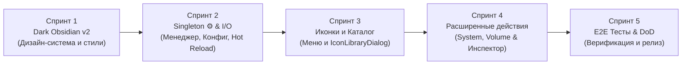
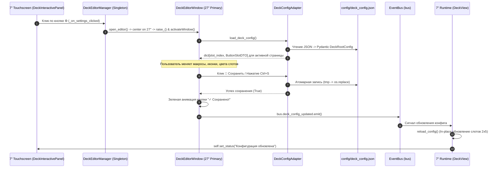
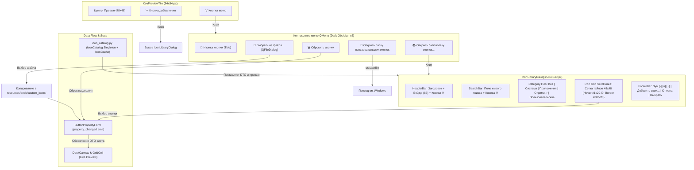
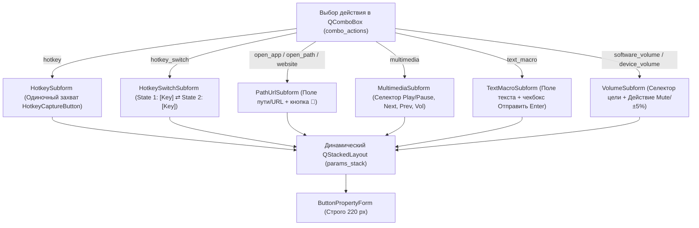
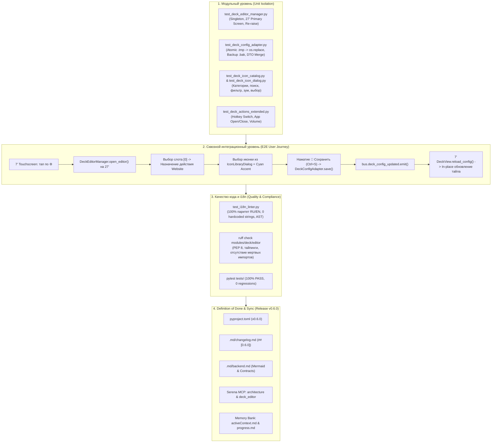

# DuckDeck Button & Touchbar Editor: Единый мастер-план функциональной интеграции (v0.6.0 Master Roadmap)

> **Статус документа:** Активный закон реализации и Actionable Roadmap
> **Версия подсистемы:** DuckDeck Editor v0.6.0 (Functional Core, Extended Actions & Obsidian v2 Refresh)
> **Целевая среда:** Windows 10/11 x64, Desktop GUI (PySide6 / Qt6, Python 3.12+)
> **Дисплейное окружение:** Двухмониторный комплекс:
>
> - **Основной монитор (Primary 27" 2560×1440 dGPU):** Окно конфигуратора `DeckEditorWindow` (1080×740 px) + диалог `IconLibraryDialog` (580×640 px).
> - **Вспомогательный экран (Secondary 7" 1024×600 JRP7813S iGPU):** Сенсорная оболочка DuckDock (`DeckView` 944×600 px).
>   **Базовый архитектурный стандарт:** `GEMINI.md` (Zero-Bespoke Invariant, Platform-First, Feature-First Modularity, Weak Coupling через EventBus, Bilingual Localization-First).
>   **Ключевой принцип:** **DRY & Unified Button Template Invariant** — использование единой Pydantic v2 схемы `DeckButtonConfig` и единого движка исполнения `DeckActionDispatcher` для базовых пресетов и кастомных кнопок без дублирования сущностей.

---

## 1. Концепция и цели единого плана

Предыдущий этап (v0.5.0, [.md/deck/edit_but.md](file:///d:/Projects_X/duckdock/.md/deck/edit_but.md)) заложил кликабельный каркас (UI Shell) конфигуратора: холст 2×5 + тачбар, сплиттер 70/30, аккордеон действий, формы инспектора и интерактивный захват клавиш.

Настоящий мастер-план объединяет системную интеграцию рантайма и результаты визуального аудита ключевых функций (Рис. 1–4) в **5 последовательных рабочих спринтов**:



---

## 2. Краткий паспорт спринтов

|    Спринт    | Фокус и ключевая цель                                                                                                                                                                                                         | Основные затронутые файлы                                                                                                                        |               Ответственные роли                |
| :----------: | :---------------------------------------------------------------------------------------------------------------------------------------------------------------------------------------------------------------------------- | :----------------------------------------------------------------------------------------------------------------------------------------------- | :---------------------------------------------: |
| **Спринт 1** | **Dark Obsidian v2 Visual Refresh**: устранение плоской блеклости, внедрение глубины Surface 0–3, неонового акцента `#38bdf8` и приглушенных индексов `[0]..[9]`.                                                             | `styles.py`, `grid_cell.py`, `touchbar_section.py`, `button_property_form.py`, `action_drawer.py`                                                |    `@ui-creator`<br>`@frontend-ui-designer`     |
| **Спринт 2** | **Core & I/O Integration**: вызов по кнопке ⚙ из `interactive_panel.py` через `DeckEditorManager`, атомарное сохранение `config/deck_config.json` через `DeckConfigAdapter`, реактивный `bus.deck_config_updated` Hot Reload. | `interactive_panel.py`, `modules/deck/editor/manager.py`, `modules/deck/editor/adapter.py`, `modules/deck/view.py`, `core/event_bus.py`          |     `@fullstack-builder`<br>`@code-review`      |
| **Спринт 3** | **Icon Ecosystem**: всплывающее меню `QMenu` опций иконки (`v`), модальный диалог библиотеки иконок `IconLibraryDialog` (`+`), декларативный каталог `icon_catalog.py`, фильтрация и зум.                                     | `key_preview_tile.py`, `icon_catalog.py`, `widgets/icon_library_dialog.py`, `locales/*.json`                                                     |    `@frontend-ui-designer`<br>`@ui-creator`     |
| **Спринт 4** | **Extended Actions & Dynamic Inspector**: внедрение 8 действий `System` (включая `Hotkey Switch`, `Open`, `Close`, `Multimedia`) и 4 действий `Volume Controller`, адаптивный стек подформ в `ButtonPropertyForm`.            | `actions_registry.py`, `models.py`, `action_dispatcher.py`, `button_property_form.py`, `locales/*.json`                                          | `@fullstack-builder`<br>`@frontend-ui-designer` |
| **Спринт 5** | **E2E Testing, DoD & Hardening**: модульные тесты новых компонентов, интеграционный сценарий полного цикла, 100% паритет локализации (AST-линтер), обновление документации и памяти Serena.                                   | `tests/unit/test_deck_*.py`, `tests/integration/test_deck_editor_e2e.py`, `tests/core/test_i18n_linter.py`, `.md/backend.md`, `.md/changelog.md` |     `@bug-hunter`<br>`@git-release-master`      |

---

## 3. Матрица ответственности (RACI)

| Спринт / Компонент                             | `@deep-researcher` | `@frontend-ui-designer` |  `@ui-creator`  | `@fullstack-builder` |  `@bug-hunter`  | `@code-review` |
| :--------------------------------------------- | :----------------: | :---------------------: | :-------------: | :------------------: | :-------------: | :------------: |
| **Спринт 1: Палитра Dark Obsidian v2**         |      Informed      |         Support         | **Responsible** |       Support        |    Informed     |   Pre-Flight   |
| **Спринт 2: Singleton ⚙, I/O и Hot Reload**    |  **Accountable**   |         Support         |    Informed     |   **Responsible**    |     Support     |   Pre-Flight   |
| **Спринт 3: Меню и Библиотека иконок**         |      Support       |     **Responsible**     |   Accountable   |       Support        |     Support     |   Pre-Flight   |
| **Спринт 4: Расширенные действия и инспектор** |  **Accountable**   |         Support         |    Informed     |   **Responsible**    |     Support     |   Pre-Flight   |
| **Спринт 5: E2E Тесты, DoD и Release**         |      Informed      |         Support         |    Informed     |       Support        | **Responsible** |   Pre-Flight   |

---

## 4. Детальный Actionable Roadmap по спринтам

### Спринт 1: Дизайн-система Dark Obsidian v2 (Визуальный фундамент)

#### 1.0. Архитектурный аудит и анализ узких мест (@deep-researcher, @frontend-ui-designer, @ui-creator)

Перед реализацией дизайн-системы Dark Obsidian v2 зафиксированы ключевые инженерные, алгоритмические и интерфейсные инварианты:

| Узкое место / Риск                               | Первопричина в кодовой базе                                                                                                                                                                                                                                                                                                                                                                           | Архитектурное решение и инвариант                                                                                                                                                                                                                        |
| :----------------------------------------------- | :---------------------------------------------------------------------------------------------------------------------------------------------------------------------------------------------------------------------------------------------------------------------------------------------------------------------------------------------------------------------------------------------------- | :------------------------------------------------------------------------------------------------------------------------------------------------------------------------------------------------------------------------------------------------------- |
| **Разрыв обратной совместимости токенов**        | Прямая замена старых констант (`BG_WINDOW`, `BG_PANEL`, `BG_CARD` и др.) на `SURFACE_*` сломает существующие модули и тесты `tests/unit/test_deck_editor_*.py`.                                                                                                                                                                                                                                       | **Layered Palette & Re-export Shims:** внедрение 4 уровней поверхностей (`SURFACE_0_CANVAS`...`SURFACE_3_HOVER`) с обязательным сохранением прежних констант в виде алиасов в [styles.py](file:///d:/Projects_X/duckdock/modules/deck/editor/styles.py). |
| **Конфликт инлайн-стилей `setStyleSheet`**       | В [grid_cell.py](file:///d:/Projects_X/duckdock/modules/deck/editor/widgets/grid_cell.py#L71), [touchbar_section.py](file:///d:/Projects_X/duckdock/modules/deck/editor/widgets/touchbar_section.py#L87) и [touchbar_strip.py](file:///d:/Projects_X/duckdock/modules/deck/editor/widgets/touchbar_strip.py#L91) захардкожены цвета (`#2e2e36`, `#232b3e`, `#71717a`), которые перебивают каскад QSS. | Полная очистка виджетов от инлайн-стилей. Вынос всех правил шрифтов, цветов и ховеров в централизованную таблицу `EDITOR_MAIN_QSS` по классам и `objectName`.                                                                                            |
| **Смена динамического свойства `selected` в Qt** | Изменение `self.setProperty("selected", "true")` в PySide6 не обновляет рамку на лету без принудительной ре-полировки стиля виджета.                                                                                                                                                                                                                                                                  | Применение паттерна `self.style().unpolish(self); self.style().polish(self);` при переключении выбора слота или секции. Сохранение фиксированных отступов для исключения дрожания интерфейса при появлении рамки 2px.                                    |
| **Контрастность типографики (WCAG AA)**          | На темных подложках Surface 2/3 индексы слотов `[0]..[9]` сливались, либо давали лишний визуальный шум, а вторичные лейблы не имели достаточного контраста.                                                                                                                                                                                                                                           | Внедрение палитры Slate: индексы слотов получают приглушенный `#475569` (Slate 600), вторичный текст — `#94a3b8` (Slate 400), основной заголовок — контрастный `#f8fafc` (Slate 50, WCAG > 14:1).                                                        |
| **Сохранение Stealth Focus (`GEMINI.md` §1.3)**  | Конфигуратор работает на основном 27" мониторе (`Qt.StrongFocus`), но элементы холста (ячейки 96x96, тачбар) не должны вызывать системных звуков Windows при кликах и не должны перехватывать глобальный фокус у субскрина.                                                                                                                                                                           | Ячейки холста и секции тачбара обрабатывают `mousePressEvent` без активации клавиатурного фокуса (`setFocusPolicy(Qt.NoFocus)` для графических элементов сетки).                                                                                         |

---

#### 1.1. Концепция 4-уровневой системы поверхностей Dark Obsidian v2 (@ui-creator)

Вместо плоской темно-серой схемы (v0.5.0), **Dark Obsidian v2** формирует объемное рабочее пространство профессиональной пультовой консоли класса High-End NOC / Datacenter:

1. **Surface 0 (Deep Canvas / Void) — `#0b0d13`:** Абсолютный глубокий фон окна редактора и рабочего пространства холста. Создает эффект «погружения» сетки кнопок в корпус устройства.
2. **Surface 1 (Panels & Shell) — `#0f141f` (Border `#1e2638`):** Основа структурных блоков — шапка `HeaderBar`, постоянная нижняя панель инспектора `KeyPropertyInspector` и ящик библиотеки действий `ActionDrawer`.
3. **Surface 2 (Interactive Cards & Slots) — `#141924` (Border `#202a3c`):** Осязаемые физические объекты — ячейки сетки 96×96 px, подложка интерактивного тачбара 528×68 px, плитка превью иконки `KeyPreviewTile` (84×84 px) и глубокие поля ввода `QLineEdit` (`#101522`).
4. **Surface 3 (Hover & Active Focus) — `#1c2940` (Accent Glow `#38bdf8`):** Интерактивные состояния — мягкое всплытие ячеек при наведении курсора и неоновый контур 2px `#38bdf8` при выборе активного слота или секции тачбара.

---

#### 1.2. Пошаговый план реализации Спринта 1 (@frontend-ui-designer)

- [x] **Шаг 1.1: Архитектура дизайн-токенов Surface 0–3 и Backward Compatibility Shims ([modules/deck/editor/styles.py](file:///d:/Projects_X/duckdock/modules/deck/editor/styles.py))**
  - Объявить 4 уровня поверхностей и палитру акцентов Dark Obsidian v2:

    ```python
    SURFACE_0_CANVAS = "#0b0d13"       # Deep Canvas / Void
    SURFACE_1_PANEL = "#0f141f"        # Panels, Drawer, Inspector base
    SURFACE_2_CARD = "#141924"         # Cells, Preview Tile, Inputs base
    SURFACE_3_HOVER = "#1c2940"        # Hover background & Active Selection

    BORDER_SURFACE_1 = "#1e2638"       # Тонкая граница панелей
    BORDER_SURFACE_2 = "#202a3c"       # Граница интерактивных ячеек
    BORDER_FOCUS_NEON = "#38bdf8"      # Неоновый акцент выделения
    BORDER_FOCUS_BASE = "#0078d4"      # Синий базовый фокус

    TEXT_SLOT_INDEX = "#475569"        # Приглушенные индексы [0]..[9] (Slate 600)
    TEXT_PRIMARY_HIGH = "#f8fafc"      # Основной текст (Slate 50)
    TEXT_SECONDARY_MED = "#94a3b8"     # Вторичный текст (Slate 400)
    TEXT_MUTED_SUBTLE = "#64748b"      # Подписи и плейсхолдеры (Slate 500)
    ```

  - Обеспечить 100% обратную совместимость через Re-export Shims:
    ```python
    BG_WINDOW = SURFACE_0_CANVAS
    BG_PANEL = SURFACE_1_PANEL
    BG_CARD = SURFACE_2_CARD
    BG_STRIP = SURFACE_1_PANEL
    BG_CELL = SURFACE_2_CARD
    BG_CELL_HOVER = SURFACE_3_HOVER
    BORDER_SUBTLE = BORDER_SURFACE_1
    BORDER_CELL = BORDER_SURFACE_2
    BORDER_SELECTED_GLOW = BORDER_FOCUS_NEON
    ```

- [x] **Шаг 1.2: Рефакторинг ячеек сетки `EditorGridCell` и устранение инлайн-стилей ([modules/deck/editor/widgets/grid_cell.py](file:///d:/Projects_X/duckdock/modules/deck/editor/widgets/grid_cell.py), [modules/deck/editor/styles.py](file:///d:/Projects_X/duckdock/modules/deck/editor/styles.py))**
  - В `_setup_ui()` класса `EditorGridCell`:
    - Удалить все прямые вызовы `setStyleSheet()` у `lbl_index`, `lbl_icon` и `lbl_title`.
    - Задать элементам селекторы классов для точного каскада: `lbl_index.setProperty("class", "CellIndexLabel")`, `lbl_icon.setProperty("class", "CellIconLabel")`, `lbl_title.setProperty("class", "CellTitleLabel")`.
    - Задать `self.setFocusPolicy(Qt.NoFocus)` для соблюдения инварианта Stealth Focus.
  - В `EDITOR_MAIN_QSS` ([styles.py](file:///d:/Projects_X/duckdock/modules/deck/editor/styles.py)):
    - Базовый вид ячейки: фон `SURFACE_2_CARD` (`#141924`), граница `1px solid BORDER_SURFACE_2` (`#202a3c`), скругление `12px`.
    - Состояние ховера `:hover`: фон `SURFACE_3_HOVER` (`#1c2940`), граница `1px solid #2e3d5c`.
    - Состояние выбора `[selected="true"]`: фон `SURFACE_2_CARD`, яркая неоновая рамка `2px solid BORDER_FOCUS_NEON` (`#38bdf8`).
    - Стилизация индекса `.CellIndexLabel`: цвет `TEXT_SLOT_INDEX` (`#475569`), размер `10px`, `font-weight: 600`.
    - Стилизация заголовка `.CellTitleLabel`: цвет `TEXT_SECONDARY_MED` (`#94a3b8`), размер `11px`, `font-weight: 500`. При ховере ячейки — `TEXT_PRIMARY_HIGH` (`#f8fafc`).

- [x] **Шаг 1.3: Стилизация подложки холста и секций тачбара `EditorTouchbarStrip` ([modules/deck/editor/widgets/touchbar_strip.py](file:///d:/Projects_X/duckdock/modules/deck/editor/widgets/touchbar_strip.py), [modules/deck/editor/widgets/touchbar_section.py](file:///d:/Projects_X/duckdock/modules/deck/editor/widgets/touchbar_section.py))**
  - В [touchbar_strip.py](file:///d:/Projects_X/duckdock/modules/deck/editor/widgets/touchbar_strip.py):
    - Заменить хардкод цвета разделителя `#232b3e` на `BORDER_SURFACE_1` (`#1e2638`).
    - В `EDITOR_MAIN_QSS` настроить подложку `EditorTouchbarStrip`: фон `SURFACE_1_PANEL` (`#0f141f`), окантовка `1px solid BORDER_SURFACE_1`, скругление `12px`.
  - В [touchbar_section.py](file:///d:/Projects_X/duckdock/modules/deck/editor/widgets/touchbar_section.py):
    - Удалить инлайн-стили текстовых меток медиа-секции и датчиков телеметрии CPU/GPU.
    - В `EDITOR_MAIN_QSS` стилизовать `TouchbarSectionWidget`:
      - В покое: фон `transparent`, граница `1px solid transparent`, скругление `10px`.
      - Ховер `:hover`: фон `SURFACE_3_HOVER` (`#1c2940`), граница `1px solid #2e3d5c`.
      - Выбор `[selected="true"]`: акцентная рамка `2px solid BORDER_FOCUS_NEON` (`#38bdf8`), фон `#192338`.

- [x] **Шаг 1.4: Инспектор свойств `ButtonPropertyForm` и плитка `KeyPreviewTile` ([modules/deck/editor/widgets/key_preview_tile.py](file:///d:/Projects_X/duckdock/modules/deck/editor/widgets/key_preview_tile.py), [modules/deck/editor/widgets/button_property_form.py](file:///d:/Projects_X/duckdock/modules/deck/editor/widgets/button_property_form.py))**
  - Плитка предварительного просмотра `KeyPreviewTile`:
    - Размер 84×84 px, фон `SURFACE_2_CARD` (`#141924`), граница `1px solid BORDER_SURFACE_2` (`#202a3c`), скругление `10px`.
    - Микро-кнопки `+` (загрузка/библиотека) и `v` (меню опций иконки): размер 20×20 px, скругление 5 px, фон `SURFACE_3_HOVER` (`#1c2940`), граница `1px solid #2e3d5c`.
    - Ховер микро-кнопок: неоновая подсветка контура `BORDER_FOCUS_NEON` (`#38bdf8`) и яркий символ `#ffffff`.
  - Поля ввода и элементы инспектора в `EDITOR_MAIN_QSS`:
    - Поля ввода `QLineEdit.InspectorLineEdit`: глубокий контрастный фон `#101522`, граница `1px solid BORDER_SURFACE_1`, цвет текста `TEXT_PRIMARY_HIGH` (`#f8fafc`).
    - Фокус полей `:focus`: неоновый контур `1.5px solid BORDER_FOCUS_NEON`.
    - Кнопка удаления действия `InspectorDeleteButton`: в покое `#64748b`, при ховере алый акцент `#ef4444` на контрастной подложке `#2a171b`.

- [x] **Шаг 1.5: Оформление каталога действий `ActionDrawer` и поиска `ActionSearchBar` ([modules/deck/editor/widgets/action_drawer.py](file:///d:/Projects_X/duckdock/modules/deck/editor/widgets/action_drawer.py), [modules/deck/editor/widgets/search_bar.py](file:///d:/Projects_X/duckdock/modules/deck/editor/widgets/search_bar.py), [modules/deck/editor/widgets/action_category.py](file:///d:/Projects_X/duckdock/modules/deck/editor/widgets/action_category.py), [modules/deck/editor/widgets/action_item.py](file:///d:/Projects_X/duckdock/modules/deck/editor/widgets/action_item.py))**
  - Панель `ActionDrawer`: подложка `SURFACE_1_PANEL` (`#0f141f`), левый разделитель `QSplitter` 2px `BORDER_SURFACE_1` с ховером `BORDER_FOCUS_NEON` (`#38bdf8`).
  - Поисковая строка `ActionSearchBar`: фон поля ввода `SURFACE_2_CARD` (`#141924`), граница `1px solid BORDER_SURFACE_2`, иконка лупы `#64748b`, при фокусе контур `BORDER_FOCUS_NEON`.
  - Заголовки аккордеона `ActionCategoryHeader`: фон `SURFACE_1_PANEL`, нижняя граница `BORDER_SURFACE_1`, шеврон окрашивается в `BORDER_FOCUS_NEON` при раскрытии категории.
  - Карточки действий `ActionItemCard`: при ховере принимают фон `SURFACE_3_HOVER` (`#1c2940`), подложка иконки `ActionItemIconBox` — `SURFACE_2_CARD` с тонкой рамкой `BORDER_SURFACE_2`.

- [x] **Шаг 1.6: Верификация стилей, тесты целостности QSS и регрессионный прогон ([tests/unit/test_deck_editor_window.py](file:///d:/Projects_X/duckdock/tests/unit/test_deck_editor_window.py))**
  - Добавить тест `tests/unit/test_deck_editor_styles.py`:
    - Проверка наличия всех токенов `SURFACE_0`..`SURFACE_3` и валидность HEX-форматов.
    - Проверка применения `EDITOR_MAIN_QSS` к окну редактора без синтаксических ошибок Qt.
    - Проверка переключения динамического свойства `selected` ячейки `EditorGridCell` и секции `TouchbarSectionWidget`.
  - Полный запуск сьюта `pytest tests/unit/test_deck_editor*.py` и линтера `pytest tests/core/test_i18n_linter.py`.

---

#### Actionable Prompts для запуска Спринта 1:

```text
#### Запуск шага 1.1 (Токены Dark Obsidian v2 и Shims):
@frontend-ui-designer реализуй шаг 1.1 Спринта 1 из @edit_func.md :
1. Внедри 4-уровневую систему токенов поверхностей (SURFACE_0_CANVAS #0b0d13, SURFACE_1_PANEL #0f141f, SURFACE_2_CARD #141924, SURFACE_3_HOVER #1c2940) и палитру Slate в modules/deck/editor/styles.py.
2. Сохрани 100% обратную совместимость через Re-export Shims (BG_WINDOW, BG_PANEL, BG_CARD, BG_CELL, BORDER_SUBTLE и др.).
3. Критерий завершения: modules/deck/editor/styles.py экспортирует обновленные токены, существующие импорты не сломаны, синтаксис QSS валиден.

#### Pre-Flight проверка шага 1.1:
@code-review проведи аудит шага 1.1:
Проверь отсутствие разрывов обратной совместимости констант палитры и чистоту экспорта токенов.
```

```text
#### Запуск шагов [1.2 - 1.3] (Рефакторинг GridCell, Touchbar и устранение инлайн-стилей):
@frontend-ui-designer и @ui-creator реализуйте шаги 1.2 и 1.3 Спринта 1 из @edit_func.md :
1. Очисти modules/deck/editor/widgets/grid_cell.py от инлайн-вызовов setStyleSheet() у lbl_index, lbl_icon и lbl_title, назначив селекторы классов CellIndexLabel, CellIconLabel, CellTitleLabel.
2. В modules/deck/editor/styles.py настрой стилизацию EditorGridCell: фон Surface 2, ховер Surface 3, приглушенные индексы [0]..[9] (#475569) и неоновую рамку выделения 2px #38bdf8.
3. Очисти modules/deck/editor/widgets/touchbar_section.py и touchbar_strip.py от инлайн-цветов, настроив подложку Surface 1 и подсветку активных секций в styles.py.
4. Критерий завершения: Ячейки и тачбар корректно подхватывают тему Obsidian v2, клик переключает неоновую рамку без визуальных артефактов и дрожания геометрии.

#### Pre-Flight проверка шагов [1.2 - 1.3]:
@code-review проведи аудит шагов 1.2 и 1.3:
Проверь чистоту QSS-селекторов, отсутствие жестких цветов в виджетах и корректность unpolish/polish при смене selected.
```

```text
#### Запуск шагов [1.4 - 1.5] (Инспектор ButtonPropertyForm, KeyPreviewTile и ActionDrawer):
@frontend-ui-designer реализуй шаги 1.4 и 1.5 Спринта 1 из @edit_func.md :
1. Освежи KeyPreviewTile: фон Surface 2, микро-кнопки [+] и [v] 20x20 px со скруглением 5 px и неоновым ховером #38bdf8.
2. Стилизуй инпуты инспектора в styles.py: глубокий фон #101522, контрастный текст #f8fafc и неоновый фокус 1.5px #38bdf8.
3. Оформи ActionDrawer, строку поиска ActionSearchBar и аккордеон действий: фон Surface 1/2, неоновые шевроны категорий и ховер карточек действий Surface 3.
4. Критерий завершения: Инспектор и библиотека действий соответствуют визуальным контрастам WCAG AA и палитре Dark Obsidian v2.

#### Pre-Flight проверка шагов [1.4 - 1.5]:
@code-review проведи аудит шагов 1.4 и 1.5:
Проверь контрастность текстовых меток, поведение скроллбаров и отсутствие хардкода стилей.
```

```text
#### Запуск шага 1.6 (Верификация, модульные тесты и приемка):
@bug-hunter выполни шаг 1.6 Спринта 1 из @edit_func.md :
1. Запусти полный прогон существующих тестов: pytest tests/unit/test_deck_editor*.py.
2. Проверь прохождение линтера локализации: pytest tests/core/test_i18n_linter.py.
3. Добавь тест tests/unit/test_deck_editor_styles.py на целостность палитры Dark Obsidian v2 (наличие SURFACE_0..3, HEX-валидация, применение темы к окну).
4. Критерий завершения: 100% тестов PASS, отсутствие регрессий в интерфейсе редактора.
```

---

### Спринт 2: Системная интеграция вызова ⚙, Config Adapter и Hot Reload

#### 2.0. Архитектурный аудит и анализ узких мест (@deep-researcher, @fullstack-builder, @ui-creator)

Перед реализацией системной интеграции и двустороннего адаптера данных зафиксированы ключевые инженерные риски, инварианты целостности и UX-требования:

| Узкое место / Риск                                                          | Первопричина в кодовой базе                                                                                                                                                                                                | Архитектурное решение и инвариант                                                                                                                                                                                                                                                                          |
| :-------------------------------------------------------------------------- | :------------------------------------------------------------------------------------------------------------------------------------------------------------------------------------------------------------------------- | :--------------------------------------------------------------------------------------------------------------------------------------------------------------------------------------------------------------------------------------------------------------------------------------------------------- |
| **Угон фокуса и курсора при открытии редактора (`GEMINI.md` §1.3)**         | Тач по кнопке ⚙ на 7" мониторе (`WS_EX_NOACTIVATE`) может вызвать паразитный перехват курсора мыши или перевод фокуса Windows на скрытую оболочку DuckDock.                                                                | **Targeted Desktop Focus & Anti-Cursor Warp:** `DeckEditorManager` явно открывает окно на `primaryScreen` (27" dGPU), применяет `activateWindow()`, `raise_()`, а окно DuckDock на 7" экране сохраняет свойство `WS_EX_NOACTIVATE` и `Qt.NoFocus`. Курсор мыши не перемещается принудительно на тач-экран. |
| **Повреждение конфигурации при сбое I/O (Race Condition / Zero-Byte File)** | Прямая запись через `open(path, "w")` приводит к очистке файла до 0 байт при падении процесса или отключении питания в момент записи.                                                                                      | **Atomic Replace Pattern:** Запись конфигурации осуществляется строго через временный файл `.tmp` в той же файловой системе (`config/deck_config.json.tmp`) с последующим атомарным вызовом `os.replace()` и созданием резервной копии `.bak`.                                                             |
| **Потеря расширенных полей Pydantic v2 при маппинге DTO ↔ Config**          | В презентационной модели `ButtonSlotDTO` присутствуют только базовые поля (`slot_index`, `title`, `icon`, `hotkey`), а в `DeckButtonConfig` содержатся `status_source`, `color_accent`, `sound_override`, `toggle_action`. | **Full-Fidelity DTO/Config Preservation:** `DeckConfigAdapter` хранит исходный объект `DeckButtonConfig` или выполняет дифференциальное слияние (Merge), обновляя только модифицированные пользователем поля и сохраняя нетронутыми `status_source`, `sound_override` и `toggle_action`.                   |
| **Разрушение многостраничной структуры (Pages 1..8)**                       | Редактор редактирует текущую активную страницу, при сохранении нельзя перезаписывать весь `DeckRootConfig` только одной страницей.                                                                                         | **Root Config Context Preservation:** `DeckEditorWindow` загружает полный `DeckRootConfig`, связывает `PageNavigationBar` с конкретными страницами из списка `root_config.pages`, а при сохранении обновляет массив кнопок только для целевой страницы, сохраняя остальные страницы без изменений.         |
| **Визуальный фриз и мерцание при Hot Reload (`DeckView`)**                  | Полное пересоздание сетки `DeckGrid` и инстансов `DeckButtonWidget` при получении сигнала сбросит тактильные анимации и состояние тайлов.                                                                                  | **In-Place Reactive Tile Update:** В `DeckView` метод `reload_config()` обновляет конфигурации существующих кнопок по индексам слотов `0..9` через `btn_widget.update_config()`, исключая пересоздание виджетов и мерцание холста.                                                                         |
| **Обратная связь сохранения в UI (Save Feedback)**                          | Пользователь на основном 27" экране не понимает, применились ли изменения, если кнопка «Сохранить» статична.                                                                                                               | **Tactile Save Button & Transient Checkmark:** Кнопка «💾 Сохранить» в `EditorHeaderBar` при успешном сохранении меняет цвет на изумрудный `#10b981`, иконку на `✓` и текст на `"Сохранено!"` с автоматическим возвратом через `QTimer` (2000 мс).                                                         |

---

#### 2.1. Концепция системной интеграции и I/O архитектура (@deep-researcher, @ui-creator)

Спринт 2 связывает визуальный интерфейс редактора на 27" основном мониторе с боевым рантаймом на 7" тачскрине через слабую связанность `EventBus`:



---

#### 2.2. Пошаговый детальный план реализации Спринта 2 (@fullstack-builder, @frontend-ui-designer)

- [x] **Шаг 2.1: Singleton-менеджер `DeckEditorManager` ([modules/deck/editor/manager.py](file:///d:/Projects_X/duckdock/modules/deck/editor/manager.py))**
  - Реализовать класс `DeckEditorManager`:
    - Потокобезопасный синглтон-паттерн управления окном редактора.
    - Атрибут `_editor_window: Optional[DeckEditorWindow] = None`.
    - Метод `open_editor(parent: Optional[QWidget] = None, page_id: Optional[str] = None) -> DeckEditorWindow`:
      - Если `_editor_window is None` или окно было закрыто/уничтожено (`shiboken6.isValid` / `sip.isdeleted`): инстанцировать `DeckEditorWindow(parent=None)` (без родителя, независимое top-level окно ОС).
      - Выполнить проверку и центрирование на основном экране через `QGuiApplication.primaryScreen()` (геометрия 1080×740 px).
      - Если окно свернуто: `_editor_window.showNormal()`.
      - Вызвать `_editor_window.show()`, `_editor_window.raise_()`, `_editor_window.activateWindow()`.
      - Если передан `page_id`: переключить редактор на соответствующую страницу.
    - Метод `get_instance() -> Optional[DeckEditorWindow]`: получение активного экземпляра окна без создания.
    - Метод `close_editor() -> None`: закрытие окна с освобождением ресурсов.
  - Сохранение инварианта фокуса: вызов менеджера не нарушает атрибуты `WS_EX_NOACTIVATE` главного окна DuckDock.

- [x] **Шаг 2.2: Подключение вызова по кнопке ⚙ в `DeckInteractivePanel` ([modules/deck/widgets/interactive_panel.py](file:///d:/Projects_X/duckdock/modules/deck/widgets/interactive_panel.py))**
  - В методе `_on_settings_clicked(self) -> None`:
    - Исключить заглушку `self.show_notification(t("deck.interactive.settings_in_dev"))`.
    - Выполнить отложенный (lazy) импорт: `from modules.deck.editor.manager import DeckEditorManager`.
    - Передать текущую активную страницу DuckDeck в вызов: `DeckEditorManager.open_editor(page_id=self._get_current_page_id())`.
    - Отправить краткое тактильное уведомление в тикер: `self.show_notification(t("deck.interactive.opening_editor"))`.
  - Добавить соответствующий ключ локализации в словари RU/EN:
    - RU: `"deck.interactive.opening_editor": "Запуск редактора на основном экране..."`
    - EN: `"deck.interactive.opening_editor": "Opening editor on primary display..."`

- [x] **Шаг 2.3: Двусторонний адаптер `DeckConfigAdapter` ([modules/deck/editor/adapter.py](file:///d:/Projects_X/duckdock/modules/deck/editor/adapter.py))**
  - Класс `DeckConfigAdapter`:
    - Метод `slot_to_dto(button_config: DeckButtonConfig) -> ButtonSlotDTO`:
      - Трансляция `slot_index`, `title`, `icon`, `color_accent`.
      - Определение типа действия и категории для отображения в инспекторе.
      - Извлечение строки хоткея из параметров `HotkeyParams` (например, `"Ctrl + Shift + D"`).
    - Метод `dto_to_slot(dto: ButtonSlotDTO, original_config: Optional[DeckButtonConfig] = None) -> DeckButtonConfig`:
      - Если передан `original_config`: обновление полей `title`, `icon`, `color_accent`, `action` с сохранением `status_source`, `sound_override`, `toggle_action` и дополнительных метаданных.
      - Если оригинального конфига нет (новый слот): создание нового валидного экземпляра `DeckButtonConfig` со всеми дефолтными атрибутами Pydantic v2.
    - Метод `load_page_slots(root_config: DeckRootConfig, page_id_or_index: str | int) -> dict[int, ButtonSlotDTO]`:
      - Извлечение всех слотов `0..9` для указанной страницы (по ID или индексу). Слоты без кнопок инициализируются пустыми `ButtonSlotDTO(slot_index=i)`.
    - Метод `apply_slots_to_page(root_config: DeckRootConfig, page_id_or_index: str | int, slots: dict[int, ButtonSlotDTO]) -> DeckRootConfig`:
      - Интеграция обновленных кнопок в массив `page.buttons` с сохранением сортировки по `slot_index`.
    - Метод `save_deck_config_atomic(cfg: DeckRootConfig, file_path: str = "config/deck_config.json") -> bool`:
      - Создание родительской директории `os.makedirs(os.path.dirname(file_path), exist_ok=True)`.
      - Сериализация в красивый форматированный JSON (`cfg.model_dump_json(indent=2)`).
      - Запись во временный файл `f"{file_path}.tmp"` с кодировкой `utf-8`.
      - При наличии существующего файла: создание копии `f"{file_path}.bak"`.
      - Атомарная замена `os.replace(f"{file_path}.tmp", file_path)`.
      - Логирование успешного сохранения и обработка исключений `IOError`, `ValidationError` с откатом.

- [x] **Шаг 2.4: Кнопка «Сохранить» в `EditorHeaderBar` и хоткей `Ctrl+S` ([modules/deck/editor/widgets/header_bar.py](file:///d:/Projects_X/duckdock/modules/deck/editor/widgets/header_bar.py), [modules/deck/editor/window.py](file:///d:/Projects_X/duckdock/modules/deck/editor/window.py))**
  - В `EditorHeaderBar`:
    - Добавить стилизованную кнопку действия `self.btn_save = QPushButton(self)`.
    - Стилизация Dark Obsidian v2:
      - Базовый вид: фон `#10b981` (Emerald 500) или приглушенный `#1e293b` с неоновым контуром, иконка `💾`, текст `t("deck.editor.header.save")`.
      - Состояние успешного сохранения: временная смена фона на изумрудный градиент `#059669`, текст `t("deck.editor.header.saved")` и иконка `✓`.
    - Сигнал `save_requested = Signal()` при клике.
    - Метод `show_save_success()`: запуск одноразового таймера `QTimer` на 2000 мс для сброса кнопки в исходное состояние.
  - В `DeckEditorWindow`:
    - Подключение сочетания клавиш `QShortcut(QKeySequence("Ctrl+S"), self, self.save_configuration)`.
    - Слот `save_configuration()`:
      - Сбор текущего состояния слотов `self._button_slots` через `DeckConfigAdapter`.
      - Атомарное сохранение в файл конфигурации `config/deck_config.json`.
      - Вызов `header_bar.show_save_success()`.
      - Эмиссия глобального сигнала `bus.deck_config_updated.emit()`.
      - Отображение статуса в консоли и тултипе.

- [x] **Шаг 2.5: Реактивный `bus.deck_config_updated` Hot Reload ([core/event_bus.py](file:///d:/Projects_X/duckdock/core/event_bus.py), [modules/deck/view.py](file:///d:/Projects_X/duckdock/modules/deck/view.py))**
  - В [core/event_bus.py](file:///d:/Projects_X/duckdock/core/event_bus.py):
    - Зарегистрировать сигнал `deck_config_updated = Signal()` с аннотацией: _"Сигнал горячей перезагрузки конфигурации макро-панели DuckDeck"_.
  - В [modules/deck/view.py](file:///d:/Projects_X/duckdock/modules/deck/view.py):
    - В `_subscribe_eventbus()`: подключить `bus.deck_config_updated.connect(self._on_deck_config_updated)`.
    - В `_unsubscribe_eventbus()`: обеспечить безопасное отключение `bus.deck_config_updated.disconnect(self._on_deck_config_updated)`.
    - В методе `_on_deck_config_updated()`:
      - Вызов `self.load_config()` для перечитывания свежего файла с диска.
      - Мгновенное обновление тайлов активной страницы `self.set_active_page(self.active_page_id, emit_signal=False, animated_dots=False)`.
      - Передача статуса в бегущую строку/тикер: `self.set_status(t("deck.interactive.config_reloaded"))`.
  - Синхронизация словарей локализации:
    - RU: `"deck.interactive.config_reloaded": "Конфигурация DuckDeck успешно обновлена"`
    - EN: `"deck.interactive.config_reloaded": "DuckDeck configuration reloaded"`

- [x] **Шаг 2.6: Модульные тесты интеграции, атомарности I/O и регрессионный прогон ([tests/unit/test_deck_editor_io.py](file:///d:/Projects_X/duckdock/tests/unit/test_deck_editor_io.py))**
  - Разработать набор тестов `tests/unit/test_deck_editor_io.py`:
    - Тестирование `DeckEditorManager`: проверка Singleton, повторный вызов не создает второго окна, `activateWindow()` вызывается, корректное закрытие.
    - Тестирование `DeckConfigAdapter`:
      - Прямая конвертация `DeckButtonConfig -> ButtonSlotDTO` и обратная `ButtonSlotDTO -> DeckButtonConfig`.
      - Проверка сохранения дополнительных полей (`status_source`, `color_accent`, `sound_override`, `toggle_action`).
      - Тест атомарной записи: проверка создания `.tmp`, корректная замена основного файла, создание `.bak`.
      - Устойчивость к битым данным и откат к дефолту.
    - Тестирование реактивности: эмиссия `bus.deck_config_updated` вызывает `reload_config()` в `DeckView`.
  - Полный запуск тестового сьюта `pytest tests/` и проверка линтера `pytest tests/core/test_i18n_linter.py`.

---

#### Actionable Prompts для запуска Спринта 2:

```text
#### Запуск шагов [2.1 - 2.2] (Singleton DeckEditorManager и интеграция кнопки ⚙):
@fullstack-builder реализуй шаги 2.1 и 2.2 Спринта 2 из @edit_func.md :
1. Создай modules/deck/editor/manager.py с классом DeckEditorManager (Singleton, методы open_editor, get_instance, close_editor, центрирование на primaryScreen 27" dGPU, сохранение инварианта Stealth Focus).
2. В modules/deck/widgets/interactive_panel.py замени заглушку в _on_settings_clicked() на вызов DeckEditorManager.open_editor(page_id=...) с отложенным импортом и уведомлением в тикер.
3. Добавь ключ локализации deck.interactive.opening_editor в locales/ru.json и locales/en.json.
4. Критерий завершения: Тап по кнопке ⚙ открывает окно конфигуратора на основном мониторе без зависаний и без увода фокуса у тачскрина.

#### Pre-Flight проверка шагов [2.1 - 2.2]:
@code-review проведи аудит реализации шагов 2.1 и 2.2:
Проверь соблюдение инварианта Stealth Focus, отсутствие циклических импортов между modules.deck.editor и modules.deck.widgets, и корректность центрирования окна.
```

```text
#### Запуск шага 2.3 (Двусторонний DeckConfigAdapter и атомарное сохранение):
@fullstack-builder реализуй шаг 2.3 Спринта 2 из @edit_func.md :
1. Создай modules/deck/editor/adapter.py с классом DeckConfigAdapter:
   - Методы slot_to_dto() и dto_to_slot() со 100% сохранением полей Pydantic v2 (status_source, color_accent, sound_override, toggle_action);
   - Методы load_page_slots() и apply_slots_to_page() для сохранения контекста многостраничного DeckRootConfig;
   - Метод save_deck_config_atomic() с безопасной записью через .tmp, бэкапом .bak и os.replace().
2. Напиши юнит-тесты на проверку целостности полей при двойной конвертации DTO <-> Config.
3. Критерий завершения: Адаптер бесшовно сериализует и десериализует конфигурацию без потери расширенных полей, файловая запись атомарна.

#### Pre-Flight проверка шага 2.3:
@code-review проведи аудит шага 2.3:
Проверь надежность атомарной записи при сбоях I/O, корректность обработки ошибок валидации Pydantic и отсутствие утечек данных между страницами.
```

```text
#### Запуск шагов [2.4 - 2.5] (Кнопка Сохранить, хоткей Ctrl+S и реактивный Hot Reload):
@frontend-ui-designer и @fullstack-builder реализуйте шаги 2.4 и 2.5 Спринта 2 из @edit_func.md :
1. В modules/deck/editor/widgets/header_bar.py добавь кнопку '💾 Сохранить' со стилями Dark Obsidian v2, анимацией успеха '✓ Сохранено!' (2000 мс) и сигналом save_requested.
2. В modules/deck/editor/window.py привяжи хоткей Ctrl+S, вызови сохранение через DeckConfigAdapter и эмитируй bus.deck_config_updated.
3. В core/event_bus.py зарегистрируй сигнал deck_config_updated = Signal().
4. В modules/deck/view.py подпишись на bus.deck_config_updated, реализуй _on_deck_config_updated() с in-place обновлением кнопок 2x5 и уведомлением в тикер.
5. Обеспечь 100% паритет ключей локализации для кнопки сохранения и статусов в locales/ru.json и locales/en.json.
6. Критерий завершения: Нажатие кнопки 'Сохранить' или Ctrl+S мгновенно обновляет виджеты кнопок на 7" экране без перезапуска приложения и без мерцания.

#### Pre-Flight проверка шагов [2.4 - 2.5]:
@code-review проведи аудит реализации шагов 2.4 и 2.5:
Проверь правильность отписки от шины событий в DeckView, отсутствие утечек таймеров в HeaderBar и соблюдение Localization-First.
```

```text
#### Запуск шага 2.6 (Верификация, модульные тесты и сдача Спринта 2):
@bug-hunter выполни шаг 2.6 Спринта 2 из @edit_func.md :
1. Разработай комплексный тест tests/unit/test_deck_editor_io.py, покрывающий Singleton менеджера, маппинг адаптера, атомарность записи и реактивность EventBus.
2. Запусти полный прогон тестов: pytest tests/.
3. Запусти проверку линтера локализации: pytest tests/core/test_i18n_linter.py.
4. Критерий завершения: 100% тестов PASS, 0 ошибок в линтере локализации, готовность к переходу к Спринту 3.
```

---

### Спринт 3: Экосистема управления иконками (Контекстное меню и Библиотека иконок)

#### 3.0. Архитектурный аудит и анализ узких мест (@deep-researcher, @frontend-ui-designer, @ui-creator)

Перед реализацией каталога и интерактивной библиотеки иконок зафиксированы ключевые инженерные, алгоритмические и интерфейсные инварианты:

| Узкое место / Риск                                     | Первопричина в кодовой базе                                                                                                                        | Архитектурное решение и инвариант                                                                                                                                                                                                                                                                                                                             |
| :----------------------------------------------------- | :------------------------------------------------------------------------------------------------------------------------------------------------- | :------------------------------------------------------------------------------------------------------------------------------------------------------------------------------------------------------------------------------------------------------------------------------------------------------------------------------------------------------------ | ------------------------------------------------------------------------------------------------------- |
| **Фриз UI при рендеринге каталога (100+ иконок)**      | Создание сотен `QPixmap` на лету в основном потоке интерфейса вызывает задержки при открытии диалога и скроллинге.                                 | **In-Memory Pixmap Caching & Batch Ingestion:** Внедрение класса `IconCache` внутри `icon_catalog.py`. Иконки кэшируются по ключу/пути с предмасштабированием под сетку (SmoothTransformation). Загрузка пользовательской папки выполняется безопасно с фильтрацией валидных графических форматов.                                                            |
| **Разрушение путей к иконкам при переносе приложения** | Сохранение абсолютных путей `D:/Projects_X/...` в `DeckButtonConfig` ломает отображение при экспорте профилей или смене пути проекта.              | **Normalized Relative Icon Paths:** Все встроенные системные иконки и бренды используют относительные пути от корня `resources/` (например, `deck/icons/system/mute.png`) или семантические URN-префиксы (`sys:audio_mute`, `app:discord`). Пользовательские файлы сохраняются в `resources/deck/custom_icons/` с хранением пути относительно корня ресурсов. |
| **Двуязычный полнотекстовый поиск (Search Friction)**  | Поиск только по имени файла `discord.png` не найдет иконку, если пользователь введет «дискорд» или «чат».                                          | **Bilingual Semantic Keywords:** Структура `IconEntryDTO` содержит локализованные метаданные: списки ключевых слов на двух языках (`keywords_ru` и `keywords_en`). Фильтрация выполняется нормализованным lower-case сопоставлением без учета регистра.                                                                                                       |
| **Сохранение Stealth Focus (`GEMINI.md` §1.3)**        | Модальный диалог `IconLibraryDialog` на основном мониторе не должен блокировать тач-события или перехватывать системный фокус у вторичного экрана. | **Modal-to-Editor Parenting:** Диалог инстанцируется с `parent=DeckEditorWindow`, использует флаги `Qt.Dialog                                                                                                                                                                                                                                                 | Qt.WindowCloseButtonHint` и позиционируется строго по центру родительского окна на основном 27" экране. |
| **Утечки памяти диалога и контекстного меню**          | Создание новых экземпляров `QMenu` и `IconLibraryDialog` без очистки приводит к утечке объектов в Qt C++ куче.                                     | **Resource Cleanup & Parent Ownership:** Контекстное меню создается как дочерний объект `btn_menu`, а `IconLibraryDialog` освобождает ресурсы через `setAttribute(Qt.WA_DeleteOnClose, True)` или переиспользуется через ленивую инициализацию инспектора.                                                                                                    |
| **Консистентность палитры Dark Obsidian v2**           | Стандартный `QMenu` в Windows 10/11 имеет белую/серую тему с резкими системными границами, выбиваясь из темного стиля Obsidian.                    | **Dedicated Dark Obsidian QSS for Menus & Dialog:** Полная стилизация `QMenu`, `QMenu::item`, `QMenu::separator` и всех подкомпонентов диалога в `styles.py` с использованием токенов `SURFACE_1_PANEL`, `SURFACE_2_CARD`, `SURFACE_3_HOVER` и акцента `#38bdf8`.                                                                                             |

---

#### 3.1. Концепция и UI/UX архитектура экосистемы иконок (@ui-creator, @deep-researcher)

Экосистема управления иконками объединяет контекстное меню быстрого доступа на плитке превью и полнофункциональный модальный браузер библиотеки:



##### 1. Анатомия всплывающего контекстного меню `v` (QMenu)

- Позиционируется под кнопкой `btn_menu` с выравниванием по правому краю.
- Структура пунктов:
  1. _Неактивный заголовок:_ `🎨` `t("deck.editor.menu.icon.header")` (_"Иконка кнопки"_ / _"Button Icon"_).
  2. _Выбрать из файла...:_ `📁` `t("deck.editor.menu.icon.set_from_file")` — открывает системный `QFileDialog` с фильтром `Images (*.png *.svg *.ico *.jpg *.webp)`. Выбранный файл копируется в `resources/deck/custom_icons/` с генерацией безопасного имени.
  3. _Открыть библиотеку иконок...:_ `📚` `t("deck.editor.menu.icon.open_library")` — открывает `IconLibraryDialog`.
  4. _Разделитель (`addSeparator()`)_.
  5. _Открыть папку пользовательских иконок:_ `📂` `t("deck.editor.menu.icon.open_folder")` — открывает папку `resources/deck/custom_icons/` в Проводнике через `os.startfile`.
  6. _Сбросить иконку:_ `🗑️` `t("deck.editor.menu.icon.reset_icon")` — возвращает базовую иконку действия или дефолтный символ.

##### 2. Анатомия модального диалога `IconLibraryDialog` (580×640 px)

- **Header Bar (48 px):** Тонкая подложка Surface 1 (`#0f141f`), иконка каталога `📚`, локализованный заголовок `t("deck.editor.dialog.icon_library.title")`, бейдж счетчика найденных иконок `(86)`, кнопка закрытия `✕`.
- **Search & Filter Zone (86 px):**
  - Поле ввода `SearchBar` с иконкой лупы `🔍`, плейсхолдером `t("deck.editor.dialog.icon_library.search_placeholder")`, кнопкой мгновенного сброса `✕`.
  - Лента категорий (Horizontal Pills Strip): кнопки-чипы со счетчиками:
    - `"Все"` `(86)`, `"Система"` `(28)`, `"Приложения"` `(34)`, `"Медиа & Стриминг"` `(16)`, `"Пользовательские"` `(8)`.
- **Icon Grid View (Scroll Area, ~450 px):**
  - Темный фон Surface 0 (`#0b0d13`).
  - Сетка тайлов иконок (`IconTileWidget`):
    - Размер превью по умолчанию: 48×48 px (шаг сетки 64×64 px с отступами).
    - Стиль тайла: подложка Surface 2 (`#141924`), тонкая рамка `#202a3c`, скругление 8 px.
    - Состояние Hover: всплытие фона в Surface 3 (`#1c2940`), неоновое свечение границы `#38bdf8`.
    - Состояние Selected: заливка Surface 3, плотная акцентная рамка 2px `#38bdf8`.
    - Поддержка форматов: как растровые/векторные изображения (SVG/PNG/ICO/JPG), так и текстовые Unicode-символы/эмодзи высокого разрешения.
    - Тултип с локализованным названием и тегами при наведении курсора.
- **Footer Action Bar (56 px):**
  - Слева: селектор масштаба превью (Zoom Controls): `[-]` (36 px), `[=]` (48 px), `[+]` (60 px) и текстовая ссылка `t("deck.editor.dialog.icon_library.add_custom")`.
  - Справа: кнопка «Отмена» (`QPushButton`, Surface 2) и кнопка «Выбрать» (`QPushButton`, Accent Blue `#0078d4` / Hover `#0284c7`).

---

#### 3.2. Пошаговый детальный план реализации Спринта 3 (@frontend-ui-designer, @ui-creator, @fullstack-builder)

- [ ] **Шаг 3.1: Контекстное меню кнопки `v` в `KeyPreviewTile` и стили QMenu ([modules/deck/editor/widgets/key_preview_tile.py](file:///d:/Projects_X/duckdock/modules/deck/editor/widgets/key_preview_tile.py), [modules/deck/editor/styles.py](file:///d:/Projects_X/duckdock/modules/deck/editor/styles.py))**
  - В `KeyPreviewTile`:
    - Реализовать метод `_show_icon_context_menu(self) -> None`:
      - Создание `QMenu` со стилями Dark Obsidian v2.
      - Добавление неактивного заголовка через кастомный `QWidgetAction` или стилизованный пункт меню: `t("deck.editor.menu.icon.header")`.
      - Пункт `t("deck.editor.menu.icon.set_from_file")` -> вызывает диалог выбора файла, копирует файл в `resources/deck/custom_icons/`, эмитит `icon_selected(file_path)`.
      - Пункт `t("deck.editor.menu.icon.open_library")` -> эмитит сигнал `open_library_requested`.
      - Пункт `t("deck.editor.menu.icon.open_folder")` -> открывает директорию `resources/deck/custom_icons/` через `os.startfile(os.path.abspath(...))`.
      - Пункт `t("deck.editor.menu.icon.reset_icon")` -> эмитит `icon_selected("")` (сброс к дефолтной иконке).
      - Расчет координат выпадающего меню под кнопкой `btn_menu`.
    - Подключить сигнал `btn_menu.clicked.connect(self._show_icon_context_menu)`.
    - Подключить сигнал `btn_add.clicked.connect(self.open_library_requested.emit)`.
  - В `styles.py`:
    - Добавить в `EDITOR_MAIN_QSS` правила для `QMenu`, `QMenu::item`, `QMenu::item:selected`, `QMenu::separator`:
      ```css
      QMenu {
        background-color: #0f141f;
        border: 1px solid #202a3c;
        border-radius: 8px;
        padding: 6px;
      }
      QMenu::item {
        background-color: transparent;
        color: #f8fafc;
        padding: 6px 12px;
        border-radius: 4px;
        font-size: 13px;
      }
      QMenu::item:selected {
        background-color: #1c2940;
        color: #38bdf8;
      }
      QMenu::separator {
        height: 1px;
        background-color: #202a3c;
        margin: 4px 6px;
      }
      ```

- [ ] **Шаг 3.2: Декларативный каталог иконок и DTO `icon_catalog.py` ([modules/deck/editor/icon_catalog.py](file:///d:/Projects_X/duckdock/modules/deck/editor/icon_catalog.py))**
  - Создать модуль `modules/deck/editor/icon_catalog.py`:
    - Классы данных DTO:
      - `IconEntryDTO`: `id: str`, `name: str`, `category: str`, `path_or_glyph: str`, `is_glyph: bool`, `keywords_ru: list[str]`, `keywords_en: list[str]`.
      - `IconCategoryDTO`: `id: str`, `title_key: str`, `icon_count: int`.
    - Класс кэша `IconCache`:
      - Внутренний словарь `_pixmap_cache: dict[tuple[str, int], QPixmap]`.
      - Метод `get_pixmap(path_or_glyph: str, size: int) -> QPixmap`: возвращает предмасштабированный `QPixmap` с `Qt.SmoothTransformation` или рендерит глиф на прозрачном фоне.
    - Класс синглтона `IconCatalog`:
      - Метод `get_categories() -> list[IconCategoryDTO]`.
      - Метод `get_icons(category: Optional[str] = None, search_query: str = "") -> list[IconEntryDTO]`.
      - Встроенная библиотека иконок:
        - `system`: Аудио (громкость, мьют, микрофон), Мониторинг (CPU, GPU, RAM, Температура), Экран (Диммер, Скриншот, Блокировка), Настройки.
        - `apps`: Браузеры (Chrome, Firefox, Edge), Мессенджеры (Discord, Telegram), Гейминг (Steam, Epic, OBS Studio).
        - `media`: Play/Pause, Next, Prev, Stop, Shuffle, Repeat.
        - `glyphs`: Популярные эмодзи и символы (🎮, 🎙️, 🔊, ⚡, 🔔, ⚙️, 🖥️, 🚀, 💡, 🛡️).
      - Метод `scan_custom_icons() -> list[IconEntryDTO]`: сканирует директорию `resources/deck/custom_icons/` (поддерживает `.png`, `.svg`, `.ico`, `.jpg`, `.webp`) и автоматически регистрирует их в категории `custom`.
      - Метод `save_custom_icon(source_path: str) -> str`: копирует файл в `resources/deck/custom_icons/`, возвращает относительный путь.

- [ ] **Шаг 3.3: Модальный диалог `IconLibraryDialog` ([modules/deck/editor/widgets/icon_library_dialog.py](file:///d:/Projects_X/duckdock/modules/deck/editor/widgets/icon_library_dialog.py))**
  - Реализовать класс `IconLibraryDialog(QDialog)`:
    - Конструктор `__init__(self, parent: Optional[QWidget] = None, current_icon: str = "")`:
      - `setFixedSize(580, 640)`, модальность `Qt.ApplicationModal`.
      - Центрирование относительно `parent` (окна `DeckEditorWindow`).
      - Применение класса `"IconLibraryDialog"` и стилей Dark Obsidian v2.
    - Компоненты диалога:
      - `HeaderBar`: заголовок `t("deck.editor.dialog.icon_library.title")`, счетчик икон-бейджа, кнопка `✕`.
      - `SearchBar`: инпут с иконкой поиска, плейсхолдером и кнопкой `✕` для очистки. По сигналу `textChanged` выполняет живую фильтрацию сетки.
      - `CategoryPillsStrip`: полоса кнопок категорий (Pills) с бейджами количеств. Клик фильтрует сетку по категории.
      - `QScrollArea` + контейнер сетки `QGridLayout`:
        - Размещение карточек `IconTileWidget`.
        - Отзывчивый рендеринг: при наведении подсветка Surface 3, при клике выделение контуром 2px `#38bdf8`.
        - Двойной клик по тайлу сразу выбирает иконку и закрывает диалог (`accept()`).
      - `FooterBar`:
        - Кнопки зума сетки `[-]` (36 px), `[=]` (48 px), `[+]` (60 px).
        - Ссылка-кнопка `"Добавить свои иконки..."` (`QFileDialog` или открытие папки).
        - Кнопки `"Отмена"` (`reject()`) и `"Выбрать"` (`accept()`).
    - Публичный метод `get_selected_icon() -> str`: возвращает путь к файлу или строку символа выбранной иконки.
    - Метод `retranslate_ui()`: реактивное обновление всех надписей и категорий.

- [ ] **Шаг 3.4: Сквозная интеграция событий выбора иконки в инспекторе ([modules/deck/editor/widgets/button_property_form.py](file:///d:/Projects_X/duckdock/modules/deck/editor/widgets/button_property_form.py), [modules/deck/editor/window.py](file:///d:/Projects_X/duckdock/modules/deck/editor/window.py))**
  - В `ButtonPropertyForm`:
    - Подключить сигнал `preview_tile.open_library_requested` к вызову модального диалога `IconLibraryDialog`.
    - При подтверждении выбора в диалоге (`dialog.exec() == QDialog.Accepted`):
      - Получить выбранную иконку: `selected = dialog.get_selected_icon()`.
      - Обновить плитку: `self.preview_tile.set_icon(selected)`.
      - Отправить сигнал: `self.property_changed.emit("icon", selected)`.
  - В `DeckEditorWindow`:
    - В обработчике `_on_property_changed(self, prop_name: str, value: Any)`:
      - При `prop_name == "icon"`: обновить иконку в текущем `active_slot_dto.icon = str(value)`.
      - Обновить превью в соответствующей ячейке холста `self.canvas.update_cell_icon(slot_index, str(value))`.
      - Отметить наличие несохраненных изменений в `header_bar`.

- [ ] **Шаг 3.5: Двуязычная локализация RU/EN со 100% паритетом ([locales/ru.json](file:///d:/Projects_X/duckdock/locales/ru.json), [locales/en.json](file:///d:/Projects_X/duckdock/locales/en.json))**
  - Добавить словарь `deck.editor.menu.icon`:
    - `header`: RU _"Иконка кнопки"_, EN _"Button Icon"_
    - `set_from_file`: RU _"Выбрать из файла..."_, EN _"Choose from File..."_
    - `open_library`: RU _"Открыть библиотеку иконок DuckDeck..."_, EN _"Open DuckDeck Icon Library..."_
    - `open_folder`: RU _"Открыть папку пользовательских иконок"_, EN _"Open Custom Icons Folder"_
    - `reset_icon`: RU _"Сбросить иконку"_, EN _"Reset Icon"_
  - Добавить словарь `deck.editor.dialog.icon_library`:
    - `title`: RU _"Библиотека иконок DuckDeck"_, EN _"DuckDeck Icon Library"_
    - `search_placeholder`: RU _"Поиск по названию или тегам..."_, EN _"Search by name or tags..."_
    - `categories.all`: RU _"Все"_, EN _"All"_
    - `categories.system`: RU _"Система"_, EN _"System"_
    - `categories.apps`: RU _"Приложения"_, EN _"Applications"_
    - `categories.media`: RU _"Медиа & Стриминг"_, EN _"Media & Streaming"_
    - `categories.glyphs`: RU _"Символы & Эмодзи"_, EN _"Glyphs & Emoji"_
    - `categories.custom`: RU _"Пользовательские"_, EN _"Custom Icons"_
    - `add_custom`: RU _"+ Добавить свои иконки..."_, EN _"+ Add Custom Icons..."_
    - `zoom_tooltip`: RU _"Масштаб сетки"_, EN _"Grid Zoom"_
    - `btn_select`: RU _"Выбрать"_, EN _"Select"_
    - `btn_cancel`: RU _"Отмена"_, EN _"Cancel"_
    - `no_results`: RU _"Иконки не найдены"_, EN _"No icons found"_
    - `files_filter`: RU _"Изображения (_.png _.svg _.ico _.jpg _.webp)"_, EN _"Images (_.png _.svg _.ico _.jpg _.webp)"_

- [ ] **Шаг 3.6: Модульные тесты и проверка линтера ([tests/unit/test_deck_icon_catalog.py](file:///d:/Projects_X/duckdock/tests/unit/test_deck_icon_catalog.py), [tests/unit/test_deck_icon_dialog.py](file:///d:/Projects_X/duckdock/tests/unit/test_deck_icon_dialog.py))**
  - Разработать `tests/unit/test_deck_icon_catalog.py`:
    - Тест загрузки встроенных категорий и иконок.
    - Тест кэширования `IconCache` (повторный запрос возвращает тот же `QPixmap`).
    - Тест двуязычной фильтрации по ключевым словам (поиск по `"звук"` и `"volume"` находит одну и ту же системную иконку).
    - Тест создания директории и сканирования `resources/deck/custom_icons/`.
  - Разработать `tests/unit/test_deck_icon_dialog.py`:
    - Тест инициализации `IconLibraryDialog`, применения геометрии 580×640 px.
    - Тест переключения категорий и живой фильтрации через поле поиска.
    - Тест смены зума сетки (36 / 48 / 60 px).
    - Тест выбора иконки и вызова `accept()`.
  - Прогон проверки: `pytest tests/unit/test_deck_icon_*.py` и `pytest tests/core/test_i18n_linter.py`.

---

#### 3.3. Чек-лист верификации и Definition of Done (DoD) Спринта 3 (@bug-hunter)

- [ ] Клик по кнопке `v` на плитке `KeyPreviewTile` открывает темное контекстное меню с 5 пунктами в стиле Dark Obsidian v2.
- [ ] Клик по кнопке `+` или пункту меню «Открыть библиотеку» центрирует модальный диалог `IconLibraryDialog` (580×640 px) на 27" экране.
- [ ] Живой поиск фильтрует иконки без лагов интерфейса как по русским, так и по английским ключевым словам.
- [ ] Переключение категорий (Pills) корректно обновляет сетку и счетчики.
- [ ] Одинарный клик подсвечивает иконку контуром `#38bdf8`, двойной клик сразу применяет её к активному слоту.
- [ ] Добавление файлов через «Выбрать из файла...» безопасно копирует файл в `resources/deck/custom_icons/` и обновляет превью слота на холсте.
- [ ] 100% паритет словарей локализации (`pytest tests/core/test_i18n_linter.py` завершается со статусом `PASS`).
- [ ] Все новые тесты каталога и диалога проходят успешно (`pytest tests/unit/test_deck_icon_*.py`).

---

#### Блоки запуска шагов Спринта 3:

```text
#### Запуск шагов [3.1 - 3.2] (Контекстное меню QMenu и Каталог иконок):
@frontend-ui-designer и @ui-creator реализуйте шаги 3.1 и 3.2 Спринта 3 из @edit_func.md :
1. В modules/deck/editor/widgets/key_preview_tile.py добавьте контекстное меню кнопки 'v' со стилями Dark Obsidian v2 и пунктами выбора файла, открытия библиотеки, перехода к папке и сброса.
2. В modules/deck/editor/styles.py добавьте QSS-правила для QMenu (темный фон #0f141f, рамка #202a3c, hover #1c2940).
3. Создайте модуль modules/deck/editor/icon_catalog.py с классами IconEntryDTO, IconCategoryDTO, IconCache и IconCatalog, набором системных, прикладных и глифовых иконок, и двуязычными тегами поиска.
4. Добавьте поддержку пользовательской папки resources/deck/custom_icons/ с авто-сканированием.
Критерий завершения: Меню открывается по клику на 'v', каталог корректно отдает структурированные иконки и кэширует QPixmap.

#### Pre-Flight проверка шагов [3.1 - 3.2]:
@code-review проведи аудит реализации шагов 3.1 и 3.2:
Проверь правильность позиционирования QMenu, очистку ресурсов, производительность кэша IconCache и нормализацию путей к иконкам.
```

```text
#### Запуск шагов [3.3 - 3.4] (Диалог библиотеки иконок и сквозная интеграция):
@ui-creator и @frontend-ui-designer реализуйте шаги 3.3 и 3.4 Спринта 3 из @edit_func.md :
1. Создайте модальный диалог modules/deck/editor/widgets/icon_library_dialog.py (580x640 px, HeaderBar, SearchBar, Category Pills, сетка тайлов с поддержкой зума 36/48/60 px, FooterBar).
2. Подключите сигнал двойного клика и кнопки 'Выбрать' к возврату выбранной иконки.
3. В ButtonPropertyForm свяжите кнопку '+' и пункт меню 'Открыть библиотеку' с показом IconLibraryDialog.
4. В DeckEditorWindow свяжите изменение иконки слота со сквозным обновлением превью ячейки холста DeckCanvas.
Критерий завершения: Пользователь может открыть библиотеку, найти иконку по тегам, изменить зум сетки и применить иконку к кнопке в один клик.

#### Pre-Flight проверка шагов [3.3 - 3.4]:
@code-review проведи аудит реализации шагов 3.3 и 3.4:
Проверь соблюдение палитры Dark Obsidian v2, отсутствие утечек памяти диалога (WA_DeleteOnClose / Parent), отзывчивость живого поиска и точность контрастов WCAG.
```

```text
#### Запуск шагов [3.5 - 3.6] (Синхронизация локализации, модульные тесты и сдача DoD):
@bug-hunter и @frontend-ui-designer выполните шаги 3.5 и 3.6 Спринта 3 из @edit_func.md :
1. Добавьте все новые ключи локализации меню и диалога в locales/ru.json и locales/en.json со 100% паритетом.
2. Разработайте модульные тесты tests/unit/test_deck_icon_catalog.py (кэш, поиск, DTO, сканирование папки).
3. Разработайте тесты виджета tests/unit/test_deck_icon_dialog.py (инициализация, фильтрация, зум, выбор иконки).
4. Запустите проверку тестов и линтера локализации:
   pytest tests/unit/test_deck_icon_*.py
   pytest tests/core/test_i18n_linter.py
5. Критерий завершения: 100% тестов PASS, 0 предупреждений линтера локализации, Спринт 3 полностью закрыт по чеклисту DoD.

#### Pre-Flight проверка шагов [3.5 - 3.6]:
@code-review проведи итоговый аудит реализации Спринта 3:
Проверь чистоту diff, отсутствие хардкода строк в UI (AST-проверка), 100% паритет RU/EN и готовность к переходу к Спринту 4.
```

---

### Спринт 4: Расширенные действия и динамический инспектор параметров

#### 4.0. Архитектурный аудит и анализ узких мест (@deep-researcher, @frontend-ui-designer, @ui-creator)

Перед реализацией расширенного набора действий и динамического инспектора параметров зафиксированы ключевые инженерные, алгоритмические и интерфейсные инварианты:

| Узкое место / Риск                                                         | Первопричина в кодовой базе                                                                                                                                                                                                             | Архитектурное решение и инвариант                                                                                                                                                                                                                                                                                                                                    |
| :------------------------------------------------------------------------- | :-------------------------------------------------------------------------------------------------------------------------------------------------------------------------------------------------------------------------------------- | :------------------------------------------------------------------------------------------------------------------------------------------------------------------------------------------------------------------------------------------------------------------------------------------------------------------------------------------------------------------- |
| **Бюджет высоты инспектора (Strict Height Invariant ≤220 px)**             | Динамическая подмена параметров для разных типов действий (например, Hotkey Switch с 2 состояниями или Volume Controller с 2 селекторами) может вызвать вертикальный скроллбар и поломать геометрию окна 1080×740 px.                   | **Strict Single-Row Subform Budget:** Высота контейнера подформ строго ограничена 32 px. Для сложных действий (Hotkey Switch) применяется компактная двухколоночная горизонтальная компоновка (State 1 слева, State 2 справа в одну строку). Высота `ButtonPropertyForm` остается строго 220 px без появления скроллбаров.                                           |
| **Полиморфизм и валидация параметров Pydantic v2 (`models.py`)**           | Текущий `ActionType` ограничен 7 типами, а новые действия (`website`, `open_path`, `open_app`, `close_window`, `text_macro`, `multimedia`, `hotkey_switch`, `software_volume`, `device_volume`) не имеют типизированных схем валидации. | **Discriminated Sub-Param Schemas:** Расширение `ActionType` и добавление специализированных Pydantic v2 моделей (`WebsiteParams`, `HotkeySwitchParams`, `OpenPathParams`, `OpenAppParams`, `CloseWindowParams`, `TextMacroParams`, `MultimediaParams`, `SoftwareVolumeParams`, `DeviceVolumeParams`) с интеграцией в фабрику `DeckActionConfig.get_typed_params()`. |
| **Неблокирующее исполнение в пуле `QThreadPool` (`action_dispatcher.py`)** | Симуляция мультимедиа-команд через Win32 API (`keybd_event` / `SendInput`), открытие тяжелых файлов через `os.startfile` и обращения к Core Audio (PyCaw) могут приводить к зависанию GUI потока при системных задержках.               | **Isolated Worker Execution & COM CoInitialize:** Все действия выполняются строго в рабочих потоках `ActionRunnable` с обязательным вызовом `CoInitialize()` / `CoUninitialize()`, защитой тайм-аутами и неблокирующей передачей результатов через `WorkerSignals` (finished/started).                                                                               |
| **Безопасность выполнения внешних команд (Security Invariant)**            | Риск инъекции шелл-команд при запуске исполняемых файлов или открытие небезопасных схем URL (`file:///`, выполнение батников без параметров).                                                                                           | **Sanitized Execution & URL Scheme Whitelist:** Строгая валидация URL (`http://`, `https://`), экранирование аргументов командной строки через `shlex.split`, запуск процессов строго через `subprocess.Popen(args, shell=False)` без посредничества `cmd.exe`.                                                                                                      |
| **Двухпозиционный триггер Hotkey Switch (State 1 ↔ State 2)**              | Переключатель требует независимой смены заголовка, иконки и сочетания клавиш при каждом тапе с сохранением текущего состояния в рантайме `DeckButtonWidget`.                                                                            | **Dual-State Runtime Invariant:** Модель `HotkeySwitchParams` хранит конфигурацию обоих состояний (`state_1`, `state_2`), а `DeckButtonWidget` переключает активный индекс состояния при клике, динамически перерисовывая иконку и заголовок тайла на 7" экране.                                                                                                     |
| **Отсутствие визуальной настройки цвета акцента кнопки**                   | Поле `color_accent` присутствует в `DeckButtonConfig`, но в инспекторе свойства не было элементов для его выбора, что ограничивало кастомизацию.                                                                                        | **Compact Accent Color Swatch Strip:** Внедрение горизонтальной палитры из 5 фирменных неоновых акцентов (Cyan `#38bdf8`, Emerald `#10b981`, Amber `#f59e0b`, Rose `#f43f5e`, Violet `#a855f7`) непосредственно под плиткой `KeyPreviewTile`.                                                                                                                        |
| **Двуязычный поиск действий (Bilingual Discovery Invariant)**              | Пользователь может искать новые действия как на русском («звук», «громкость», «сайт», «запуск»), так и на английском («volume», «mute», «web», «launch»).                                                                               | **Bilingual Semantic Keywords in ActionsRegistry:** Все 12 новых действий получают расширенный список тегов поиска в `actions_registry.py` на обоих языках (RU и EN) со 100% паритетом.                                                                                                                                                                              |

---

#### 4.1. Концепция и UX/UI архитектура динамического инспектора (@ui-creator, @deep-researcher)

Инспектор кнопки `ButtonPropertyForm` сохраняет компактную геометрию (высота 220 px) и использует динамический `QStackedLayout` для бесшовной смены полей параметров выбранного действия:

```text
┌──────────────────────────────────────────────────────────────────────────────────────────────────┐
│  Шапка инспектора: [ System: Hotkey Switch                  ]                              [🗑️] │
├──────────────────────────────────────────────────────────────────────────────────────────────────┤
│  ┌────────────┐   Title:   [ REC TOGGLE                 ] [T ▾]                                  │
│  │   [+] [v]  │   Actions: [ Hotkey Switch           ▾ ]                                         │
│  │     🔴     │   Params:  ┌──────────────────────────────────────────────────────────────────┐  │
│  │ (Preview)  │   (Stack)  │ State 1: [Ctrl+Shift+F9]  ⇄  State 2: [Ctrl+Shift+F10]          │  │
│  └────────────┘            └──────────────────────────────────────────────────────────────────┘  │
│  [●][●][●][●][●] Accent: Cyan (#38bdf8), Emerald, Amber, Rose, Violet                            │
└──────────────────────────────────────────────────────────────────────────────────────────────────┘
```



##### Архитектура подформ параметров:

1. **`HotkeySubform` (Страница 0):**
   - Одиночная кнопка захвата `HotkeyCaptureButton` (размер по высоте 28 px).
2. **`HotkeySwitchSubform` (Страница 1):**
   - Две компактные кнопки захвата в одну строку с разделителем `⇄`:
     - Слева: `State 1` (начальное состояние: заголовок/хоткей).
     - Справа: `State 2` (активное состояние: заголовок/хоткей).
3. **`PathUrlSubform` (Страница 2):**
   - Поле `QLineEdit` (28 px) с адаптивным плейсхолдером (`"https://..."` для URL или `"C:\Program Files\..."` для программ) + кнопка обзора `📂` (вызов системного `QFileDialog`).
4. **`MultimediaSubform` (Страница 3):**
   - Выпадающий список `QComboBox` мультимедийных команд Windows с иконками:
     - `⏯️ Воспроизведение / Пауза` (`VK_MEDIA_PLAY_PAUSE = 0xCD`)
     - `⏭️ Следующий трек` (`VK_MEDIA_NEXT_TRACK = 0xB0`)
     - `⏮️ Предыдущий трек` (`VK_MEDIA_PREV_TRACK = 0xB1`)
     - `⏹️ Остановить` (`VK_MEDIA_STOP = 0xB2`)
     - `🔇 Отключить звук` (`VK_VOLUME_MUTE = 0xAD`)
     - `🔊 Увеличить громкость (+5%)` (`VK_VOLUME_UP = 0xAF`)
     - `🔉 Уменьшить громкость (-5%)` (`VK_VOLUME_DOWN = 0xAE`)
5. **`TextMacroSubform` (Страница 4):**
   - Поле `QLineEdit` для вводимой строки + компактный чекбокс `↵ Enter` (нажатие Enter после вставки).
6. **`VolumeSubform` (Страница 5):**
   - Два связанных селектора `QComboBox`:
     - Селектор цели: _"Активное приложение (в фокусе)"_, _"Общий звук (Master)"_, _"Микрофон (Input)"_.
     - Селектор действия: _"Переключить Mute"_, _"Громкость +5%"_, _"Громкость -5%"_.

---

#### 4.2. Пошаговый детальный план реализации Спринта 4 (@fullstack-builder, @frontend-ui-designer)

- [ ] **Шаг 4.1: Расширение каталога действий и поисковых тегов ([modules/deck/editor/actions_registry.py](file:///d:/Projects_X/duckdock/modules/deck/editor/actions_registry.py))**
  - Пополнить категорию `system` в `get_default_action_catalog()`:
    - `website`: открытие URL в браузере по умолчанию (теги: `website`, `url`, `browser`, `link`, `web`, `сайт`, `ссылка`, `браузер`).
    - `hotkey_switch`: двухпозиционный переключатель (теги: `switch`, `toggle`, `state`, `hotkey`, `свитч`, `переключатель`, `триггер`).
    - `open_path`: открытие папки или документа через `os.startfile` (теги: `path`, `folder`, `file`, `document`, `папка`, `файл`, `документ`).
    - `open_app`: запуск бинарника с аргументами и рабочей папкой (теги: `app`, `launch`, `run`, `exe`, `program`, `запуск`, `программа`).
    - `close_window`: закрытие активного окна / приложения (теги: `close`, `kill`, `exit`, `quit`, `закрыть`, `выход`).
    - `text_macro`: быстрая вставка текстового шаблона (теги: `text`, `macro`, `type`, `paste`, `текст`, `макрос`, `вставка`).
    - `multimedia`: управление воспроизведением и громкостью Windows (теги: `media`, `play`, `pause`, `next`, `prev`, `track`, `медиа`, `трек`, `плеер`).
  - Пополнить категорию `volume_controller`:
    - `auto_software_vol`: управление громкостью активного процесса в фокусе (теги: `focus`, `volume`, `app`, `громкость`, `фокус`).
    - `master_volume_control`: общее управление звуком ПК (теги: `master`, `sound`, `audio`, `мастер`, `звук`, `общий`).
    - `mic_mute_control`: управление микрофоном (теги: `mic`, `microphone`, `mute`, `микрофон`, `мьют`).
    - `output_device_toggle`: быстрое переключение наушники / динамики (теги: `device`, `headphones`, `speakers`, `наушники`, `динамики`).

- [ ] **Шаг 4.2: Типизированные Pydantic v2 модели параметров ([modules/deck/models.py](file:///d:/Projects_X/duckdock/modules/deck/models.py)) и синхронизация DTO ([modules/deck/editor/dto.py](file:///d:/Projects_X/duckdock/modules/deck/editor/dto.py))**
  - В `models.py`:
    - Расширить `ActionType`:
      ```python
      ActionType = Literal[
          "hotkey", "hotkey_switch", "audio_device", "launch",
          "website", "open_path", "open_app", "close_window",
          "text_macro", "multimedia", "volume_control",
          "http_request", "screenshot", "system", "navigation",
      ]
      ```
    - Создать Pydantic модели:
      - `WebsiteParams(BaseModel)`: `url: str`.
      - `HotkeySwitchState(BaseModel)`: `title: str`, `keys: list[str]`, `icon: Optional[str] = None`.
      - `HotkeySwitchParams(BaseModel)`: `state_1: HotkeySwitchState`, `state_2: HotkeySwitchState`.
      - `OpenPathParams(BaseModel)`: `path: str`.
      - `OpenAppParams(BaseModel)`: `executable: str`, `args: list[str] = []`, `working_dir: Optional[str] = None`.
      - `CloseWindowParams(BaseModel)`: `target: Literal["active_window", "by_process"] = "active_window"`, `process_name: Optional[str] = None`.
      - `TextMacroParams(BaseModel)`: `text: str`, `send_enter: bool = False`.
      - `MultimediaParams(BaseModel)`: `command: Literal["play_pause", "next_track", "prev_track", "stop", "mute", "volume_up", "volume_down"]`.
      - `VolumeControlParams(BaseModel)`: `target: Literal["focus_app", "master", "microphone"] = "focus_app"`, `command: Literal["toggle_mute", "volume_up", "volume_down", "set_level"] = "toggle_mute"`, `step_percent: int = 5`.
    - Обновить фабричный метод `DeckActionConfig.get_typed_params()` для поддержки всех новых моделей.
  - В `dto.py`:
    - Добавить поля `action_params: dict[str, Any] = Field(default_factory=dict)` и `color_accent: str = "#38bdf8"` в `ButtonSlotDTO`.

- [ ] **Шаг 4.3: Движок выполнения действий в `action_dispatcher.py` ([modules/deck/action_dispatcher.py](file:///d:/Projects_X/duckdock/modules/deck/action_dispatcher.py))**
  - Реализовать методы исполнения в `ActionRunnable.run()`:
    - _Website / Open Path:_ безопасное открытие через `os.startfile(target)` с проверкой существования пути или валидности схемы `http/https`.
    - _Open App:_ запуск через `subprocess.Popen([executable] + args, cwd=working_dir, shell=False)`.
    - _Close Window:_ мягкая отправка `WM_CLOSE` через Win32 API (`win32gui.PostMessage(hwnd, win32con.WM_CLOSE, 0, 0)`) для активного окна.
    - _Text Macro:_ симуляция набора текста через `pyautogui.write()` или отправка в буфер обмена с последующим `Ctrl+V` (для корректной поддержки кириллицы и спецсимволов) + опциональный `VK_RETURN`.
    - _Multimedia:_ генерация виртуальных скан-кодов Win32 через `keybd_event`:
      ```python
      VK_MAPPING = {
          "play_pause": 0xCD, "next_track": 0xB0, "prev_track": 0xB1,
          "stop": 0xB2, "mute": 0xAD, "volume_up": 0xAF, "volume_down": 0xAE
      }
      ctypes.windll.user32.keybd_event(vk_code, 0, 0, 0)
      ctypes.windll.user32.keybd_event(vk_code, 0, 2, 0) # KEYEVENTF_KEYUP
      ```
    - _Volume Controller:_ управление громкостью через `core.audio_manager` или прямые вызовы `pycaw.SimpleAudioVolume` для процесса в фокусе (`GetForegroundWindow()`).
  - Обеспечить потокобезопасность и возврат статусов через `WorkerSignals.finished(button_id, success, message)`.

- [ ] **Шаг 4.4: Архитектура динамических подформ в `ButtonPropertyForm` и селектор цвета `color_accent` ([modules/deck/editor/widgets/button_property_form.py](file:///d:/Projects_X/duckdock/modules/deck/editor/widgets/button_property_form.py))**
  - Под плиткой `KeyPreviewTile` добавить компактный стрип выбора акцентного цвета `ColorAccentPicker` (5 круглых свотчей 18×18 px: Cyan `#38bdf8`, Emerald `#10b981`, Amber `#f59e0b`, Rose `#f43f5e`, Violet `#a855f7`). При клике эмитить сигнал `property_changed("color_accent", hex_color)`.
  - Внедрить `QStackedLayout` для строки параметров действия:
    - Подформа 0: `HotkeySubform` (текущая реализация).
    - Подформа 1: `HotkeySwitchSubform` (две кнопки захвата State 1 / State 2).
    - Подформа 2: `PathUrlSubform` (инпут пути + кнопка `📂`).
    - Подформа 3: `MultimediaSubform` (комбобокс медиа-команд).
    - Подформа 4: `TextMacroSubform` (инпут текста + чекбокс Enter).
    - Подформа 5: `VolumeSubform` (селектор цели + действие).
  - При смене типа действия в `combo_actions` мгновенно активировать соответствующий индекс стэка без дрожания высоты (строго 220 px).
  - Реализовать сохранение параметров подформы в `action_params` активного слота.

- [ ] **Шаг 4.5: Двуязычная локализация RU/EN со 100% паритетом ([locales/ru.json](file:///d:/Projects_X/duckdock/locales/ru.json), [locales/en.json](file:///d:/Projects_X/duckdock/locales/en.json))**
  - Добавить описания всех новых действий в `deck.editor.drawer.actions.*`:
    - `website`, `hotkey_switch`, `open_path`, `close_window`, `text_macro`, `multimedia`, `auto_software_vol`, `master_volume_control`, `mic_mute_control`, `output_device_toggle`.
  - Добавить переводы подписей полей подформ в `deck.editor.inspector.*`:
    - `fields.url`, `fields.path`, `fields.executable`, `fields.state_1`, `fields.state_2`, `fields.media_command`, `fields.macro_text`, `fields.send_enter`, `fields.vol_target`, `fields.vol_action`.
  - Добавить названия медиа-команд и целей громкости в `deck.editor.inspector.media_commands.*` и `deck.editor.inspector.volume_targets.*`.
  - Проверить 100% паритет ключей через линтер.

- [ ] **Шаг 4.6: Модульные тесты новых действий, валидации Pydantic и подформ инспектора ([tests/unit/test_deck_actions_extended.py](file:///d:/Projects_X/duckdock/tests/unit/test_deck_actions_extended.py), [tests/unit/test_deck_property_form.py](file:///d:/Projects_X/duckdock/tests/unit/test_deck_property_form.py))**
  - Разработать `tests/unit/test_deck_actions_extended.py`:
    - Валидация Pydantic v2 моделей для каждого нового типа действий.
    - Тестирование `action_dispatcher.py` на симуляцию мультимедийных кодов (мокирование Win32 `keybd_event`).
    - Тестирование безопасного запуска программ и URL (мокирование `os.startfile` и `subprocess.Popen`).
  - Разработать `tests/unit/test_deck_property_form.py`:
    - Проверка динамического переключения стэка подформ при изменении `combo_actions`.
    - Проверка соблюдения бюджета высоты (`form.height() == 220`).
    - Проверка сохранения цвета акцента `color_accent` при клике на свотч.
    - Проверка инварианта `retranslate_ui()` без потери введенных параметров.
  - Прогон проверок: `pytest tests/unit/test_deck_*.py` и `pytest tests/core/test_i18n_linter.py`.

---

#### 4.3. Чек-лист верификации и Definition of Done (DoD) Спринта 4 (@bug-hunter)

- [ ] В реестре `actions_registry.py` зарегистрированы все 12 новых действий с двуязычными поисковыми тегами (RU/EN).
- [ ] Модели `models.py` строго валидируют параметры всех новых типов действий через Pydantic v2.
- [ ] Диспетчер `action_dispatcher.py` безопасно выполняет все команды в неблокирующем потоке пула.
- [ ] Мультимедийные команды (Play/Pause, Next, Prev, Volume) корректно симулируются в Windows.
- [ ] В `ButtonPropertyForm` динамически подменяются поля параметров для каждого типа действия.
- [ ] Высота формы инспектора строго фиксирована на 220 px (отсутствуют вертикальные скроллбары и визуальные артефакты).
- [ ] Селектор `color_accent` корректно меняет неоновый цвет акцента кнопки на превью и сохраняет его в конфиг.
- [ ] 100% паритет словарей RU/EN (`pytest tests/core/test_i18n_linter.py` завершается со статусом `PASS`).
- [ ] Все модульные тесты проходят со статусом 100% PASS (`pytest tests/unit/test_deck_actions_extended.py`, `test_deck_property_form.py`).

---

#### Actionable Prompts для запуска Спринта 4:

```text
#### Запуск шагов [4.1 - 4.2] (Каталог действий, Pydantic v2 модели и DTO):
@fullstack-builder реализуй шаги 4.1 и 4.2 Спринта 4 из @edit_func.md :
1. В modules/deck/editor/actions_registry.py пополни категории 'system' и 'volume_controller' 12 новыми действиями (website, hotkey_switch, open_path, open_app, close_window, text_macro, multimedia, auto_software_vol, master_volume_control, mic_mute_control, output_device_toggle) с двуязычными тегами поиска (RU/EN).
2. В modules/deck/models.py расширь ActionType и добавь дискриминированные Pydantic v2 модели (WebsiteParams, HotkeySwitchParams, OpenPathParams, OpenAppParams, CloseWindowParams, TextMacroParams, MultimediaParams, VolumeControlParams) с фабрикой get_typed_params().
3. В modules/deck/editor/dto.py синхронизируй ButtonSlotDTO, добавив поля action_params и color_accent.
4. Критерий завершения: Каталог отдает полные списки действий с тегами, модели Pydantic v2 валидируют параметры без ошибок, DTO поддерживает расширенные данные.

#### Pre-Flight проверка шагов [4.1 - 4.2]:
@code-review проведи аудит реализации шагов 4.1 и 4.2:
Проверь чистоту дискриминации типов в Pydantic v2, отсутствие конфликтов в реестре действий и консистентность DTO.
```

```text
#### Запуск шага 4.3 (Движок исполнения расширенных действий в ActionDispatcher):
@fullstack-builder реализуй шаг 4.3 Спринта 4 из @edit_func.md :
1. В modules/deck/action_dispatcher.py добавь обработчики выполнения новых действий внутри ActionRunnable.run():
   - Безопасный запуск URL и путей через os.startfile с валидацией http/https;
   - Запуск бинарников через subprocess.Popen(shell=False);
   - Мягкое закрытие активного окна через Win32 WM_CLOSE (PostMessage);
   - Набор текстового макроса с поддержкой кириллицы и опциональным Enter;
   - Мультимедийные команды через Win32 keybd_event (VK_MEDIA_PLAY_PAUSE, NEXT, PREV, STOP, MUTE, VOL_UP, VOL_DOWN);
   - Неблокирующее управление громкостью через Core Audio (SimpleAudioVolume).
2. Изолируй вызовы в потоке пула с CoInitialize/CoUninitialize и возвратом статусов через WorkerSignals.
3. Критерий завершения: Все команды безопасно исполняются в пуле потоков без блокировки интерфейса и вызывают корректные системные реакции Windows.

#### Pre-Flight проверка шага 4.3:
@code-review проведи аудит реализации шага 4.3:
Проверь безопасность запуска процессов (shlex, валидация путей, whitelist схем), корректность симуляции keybd_event и потокобезопасность COM-вызовов.
```

```text
#### Запуск шагов [4.4 - 4.5] (Динамические подформы инспектора, палитра акцентов и локализация):
@frontend-ui-designer и @ui-creator реализуйте шаги 4.4 и 4.5 Спринта 4 из @edit_func.md :
1. В modules/deck/editor/widgets/button_property_form.py:
   - Добавь под KeyPreviewTile горизонтальный стрип выбора цвета акцента ColorAccentPicker (5 неоновых цветов Cyan, Emerald, Amber, Rose, Violet);
   - Внедри QStackedLayout для динамической смены подформ параметров (Hotkey, Hotkey Switch, Path/URL, Multimedia, Text Macro, Volume Control);
   - Обеспечь строгое соблюдение бюджета высоты формы (строго 220 px без скроллбаров и дрожания геометрии);
   - Реализуй сбор параметров из активной подформы в action_params слота.
2. В locales/ru.json и locales/en.json добавь переводы всех новых действий, подписей полей подформ, медиа-команд и целей громкости со 100% паритетом.
3. Реализуй retranslate_ui() в подформах для мгновенного Hot Reload без сброса введенных данных.
4. Критерий завершения: Выбор любого действия в инспекторе переключает целевую подформу, высота формы сохраняется ровно 220 px, палитра акцентов работает, локализация RU/EN полностью синхронизирована.

#### Pre-Flight проверка шагов [4.4 - 4.5]:
@code-review проведи аудит реализации шагов 4.4 и 4.5:
Проверь точность геометрии инспектора (бюджет 220 px), отсутствие хардкода строк в подформах (AST-линтер) и сохранение данных при смене языка.
```

```text
#### Запуск шага 4.6 (Модульные тесты, проверка линтера локализации и сдача DoD):
@bug-hunter выполни шаг 4.6 Спринта 4 из @edit_func.md :
1. Разработай модульные тесты tests/unit/test_deck_actions_extended.py (валидация параметров Pydantic v2, мокирование keybd_event, безопасный запуск процессов).
2. Разработай тесты виджетов tests/unit/test_deck_property_form.py (переключение подформ, высота 220 px, выбор color_accent, in-place retranslate).
3. Запусти проверку полного набора тестов и линтера локализации:
   pytest tests/unit/test_deck_*.py
   pytest tests/core/test_i18n_linter.py
4. Критерий завершения: 100% тестов PASS, 0 предупреждений линтера локализации, Спринт 4 полностью закрыт по чеклисту DoD.

#### Pre-Flight проверка шага 4.6:
@code-review проведи итоговый аудит готовности Спринта 4:
Проверь чистоту diff, отсутствие регрессий в существующих модулях и готовность к финальному Спринту 5 (E2E & Release).
```

---

### Спринт 5: E2E тестирование, i18n чеклист и Definition of Done (DoD)

#### 5.0. Архитектурный аудит и анализ узких мест верификации и релиза (@deep-researcher, @bug-hunter)

Перед разработкой тестового пакета и выполнением релизного протокола зафиксированы критические риски, инженерные ограничения и архитектурные инварианты:

| Узкое место / Риск                                                               | Первопричина в кодовой базе                                                                                                                                                                                              | Архитектурное решение и инвариант                                                                                                                                                                                                                                                                                     |
| :------------------------------------------------------------------------------- | :----------------------------------------------------------------------------------------------------------------------------------------------------------------------------------------------------------------------- | :-------------------------------------------------------------------------------------------------------------------------------------------------------------------------------------------------------------------------------------------------------------------------------------------------------------------- |
| **Порча боевого `config/deck_config.json` при тестах**                           | Вызов `DeckConfigAdapter.save_deck_config()` в интеграционных или модульных тестах перезапишет рабочий пользовательский файл настроек.                                                                                   | **Filesystem Sandbox Fixture (`tmp_path`):** Создание автофикстуры `isolated_deck_env` в `conftest.py`, подменяющей константу `CONFIG_PATH` через `unittest.mock.patch` на временную директорию. Боевой конфиг DuckDock остается строго неприкосновенным.                                                             |
| **Падение тестов в Headless/CI окружении (No Display / Multi-Screen Mock)**      | При вызове `DeckEditorManager.open_editor()` обращение к `QGuiApplication.primaryScreen()` в окружении без физического дисплея вернет `None`, приводя к `AttributeError: 'NoneType' object has no attribute 'geometry'`. | **Headless Screen Fallback & Mock Fixture:** Реализация защитного fallback-кода в `manager.py` (если экран не обнаружен — использовать дефолтную геометрию `(100, 100, 1080, 740)`), а в тестах использовать фикстуру `mock_primary_screen` с виртуальным разрешением 2560×1440.                                      |
| **Побочные эффекты WinAPI в модульных тестах действий (`DeckActionDispatcher`)** | Тестирование действий `hotkey_switch`, `app_open`, `app_close`, `volume_*` может посылать реальные синтетические клики клавиш (`keybd_event`) в ОС или порождать фоновые процессы `subprocess.Popen`.                    | **Strict Subsystem Isolation & WinAPI Mocking:** Полное мокирование низкоуровневых фасадов `keybd_event`, `SendInput`, `subprocess.Popen` и COM-интерфейса `IPolicyConfig` в `tests/unit/test_deck_actions_extended.py`. Проверяются аргументы вызовов и Pydantic-валидация, а не реальные системные мутации Windows. |
| **Утечка подписок и фантомные события шины (`EventBus Weak Coupling`)**          | Если экземпляр `DeckEditorWindow` или боевого `DeckView` подписался на `bus.deck_config_updated` в тесте и не отписался при завершении, последующие тесты получат лишние вызовы обработчиков.                            | **EventBus Isolation & Teardown Protocol:** Гарантированная очистка подписчиков `bus.deck_config_updated` в фикстуре `teardown`, а также реализация метода `cleanup()` во всех тестируемых виджетах.                                                                                                                  |
| **Скрытый хардкод строковых литералов в динамических подформах**                 | В формах `ButtonPropertyForm` (подформы Hotkey Switch, Multimedia, Volume) и диалоге `IconLibraryDialog` разработчик может случайно оставить сырые строки на кириллице или английском в обход `t(...)`.                  | **AST-Linter Automated Enforcement:** Расширение линтера `tests/core/test_i18n_linter.py` обязательным AST-сканированием всех файлов пакета `modules/deck/editor/`. Ни один коммит и слияние не допускаются при наличии хотя бы одной нелокализованной UI-строки.                                                     |
| **Нарушение инварианта Stealth Focus (`GEMINI.md` §1.3) при открытии редактора** | Вызов `DeckEditorManager.open_editor()` не должен активировать корневое окно DuckDock на 7" мониторе и не должен перехватывать курсор мыши у основного экрана.                                                           | **Stealth Focus E2E Assertion:** В интеграционном E2E тесте проверяется сохранение стиля `WS_EX_NOACTIVATE` и политики `Qt.NoFocus` у сенсорной оболочки при открытии и сохранении данных в редакторе на 27" экране.                                                                                                  |

---

#### 5.1. Концепция верификации и архитектура тестового пайплайна (@deep-researcher, @fullstack-builder)

Пайплайн Спринта 5 представляет собой 4-уровневую систему тотального контроля качества (Quality Gate):



---

#### 5.2. Пошаговый детальный план реализации Спринта 5 (@bug-hunter, @fullstack-builder, @git-release-master)

- [ ] **Шаг 5.1: Модульные тесты ядра конфигуратора и I/O адаптера**
  - Создать [tests/unit/test_deck_editor_manager.py](file:///d:/Projects_X/duckdock/tests/unit/test_deck_editor_manager.py):
    - `test_manager_singleton_identity`: многократные вызовы `DeckEditorManager.get_instance()` возвращают идентичный инстанс.
    - `test_manager_open_creates_window_on_primary_screen`: проверка создания окна 1080×740 px и центрирования относительно экрана `QGuiApplication.primaryScreen()`.
    - `test_manager_reopen_reactivates_existing_window`: повторный вызов `open_editor()` не инстанцирует второе окно, а вызывает `showNormal()`, `raise_()`, `activateWindow()`.
    - `test_manager_switch_page_on_open`: передача аргумента `page_id="page_2"` корректно переключает активную страницу на холсте.
    - `test_manager_close_cleans_reference`: закрытие окна корректно сбрасывает ссылку в менеджере.
  - Создать [tests/unit/test_deck_config_adapter.py](file:///d:/Projects_X/duckdock/tests/unit/test_deck_config_adapter.py):
    - `test_adapter_load_valid_config`: чтение конфигурации и корректное заполнение словаря DTO активной страницы.
    - `test_adapter_dto_to_config_merge_preserves_extra_fields`: редактирование полей `title` и `icon` в DTO не затирает расширенные поля `status_source`, `sound_override`, `color_accent`, `toggle_action` в результирующем `DeckButtonConfig`.
    - `test_adapter_save_atomic_write_and_backup`: проверка записи во временный файл `.tmp`, атомарной замены `os.replace` и создания резервной копии `.bak`.
    - `test_adapter_corrupted_json_recovery`: симуляция поврежденного файла JSON — адаптер корректно восстанавливает данные из `.bak` или откатывается к дефолтной структуре.

- [ ] **Шаг 5.2: Модульные тесты каталога и диалога иконок**
  - Создать [tests/unit/test_deck_icon_catalog.py](file:///d:/Projects_X/duckdock/tests/unit/test_deck_icon_catalog.py):
    - `test_icon_catalog_categories_and_items`: проверка доступности категорий `lucide`, `streamdeck`, `standard` и валидности путей/SVG.
    - `test_icon_catalog_search_filtering`: поиск по подстроке имени (например, `"mic"`, `"sound"`) и по ключевым тегам на русском и английском языках.
    - `test_icon_catalog_category_filtering`: проверка корректной фильтрации списка иконок при выборе конкретной категории.
  - Создать [tests/unit/test_deck_icon_dialog.py](file:///d:/Projects_X/duckdock/tests/unit/test_deck_icon_dialog.py):
    - `test_icon_dialog_initialization_and_modal_state`: проверка геометрии 580×640 px, модального режима `setWindowModality(Qt.ApplicationModal)`.
    - `test_icon_dialog_search_input_updates_grid`: ввод текста в `QLineEdit` поисковой строки скрывает нерелевантные иконки и оставляет совпадения.
    - `test_icon_dialog_zoom_slider`: перемещение слайдера зума масштабирует размер превью иконок в диапазоне 24..64 px.
    - `test_icon_dialog_selection_and_signal`: клик по иконке в сетке + нажатие «Выбрать» эмитит сигнал `icon_selected(icon_path)` и закрывает диалог.
    - `test_icon_dialog_retranslate_ui`: переключение языка обновляет плейсхолдер поиска, кнопки и заголовок диалога.

- [ ] **Шаг 5.3: Модульные тесты расширенных действий и динамического инспектора**
  - Создать [tests/unit/test_deck_actions_extended.py](file:///d:/Projects_X/duckdock/tests/unit/test_deck_actions_extended.py):
    - `test_action_hotkey_switch_toggle`: диспетчер корректно чередует состояния state_1/state_2, посылая соответствующие хоткеи и обновляя заголовок/иконку кнопки.
    - `test_action_app_open_safe_execution`: валидация пути исполняемого файла, запуск через `subprocess.Popen` (мокированный), перехват `FileNotFoundError`.
    - `test_action_app_close_graceful`: отправка сигнала закрытия процессу с обработкой отсутствующего окна/процесса.
    - `test_action_multimedia_keys`: диспетчер передает корректные виртуальные коды `VK_MEDIA_*` через WinAPI фасад.
    - `test_action_volume_controller`: диспетчер выполняет вызовы управления громкостью (`set`, `step_up`, `step_down`, `toggle_mute`).
    - `test_actions_pydantic_validation_safety`: проверка валидации параметров Pydantic v2 (обработка невалидных или отсутствующих аргументов без краша процесса).
  - Создать [tests/unit/test_deck_property_form_subforms.py](file:///d:/Projects_X/duckdock/tests/unit/test_deck_property_form_subforms.py):
    - `test_property_form_stacked_layout_switching`: смена типа действия в комбобоксе переключает видимую подформу в `QStackedLayout` с сохранением жесткого бюджета высоты 220 px.
    - `test_property_form_color_accent_picker`: выбор цвета в `ColorAccentPicker` обновляет превью и передается в DTO слота.
    - `test_property_form_retranslate_preserves_inputs`: смена языка интерфейса обновляет все текстовые метки подформ без сброса введенных значений.

- [ ] **Шаг 5.4: Комплексный сквозной интеграционный сценарий полного пути (E2E User Journey)**
  - Обновить [tests/integration/test_deck_editor_e2e.py](file:///d:/Projects_X/duckdock/tests/integration/test_deck_editor_e2e.py), добавив полнофункциональный сценарий `test_deck_editor_full_runtime_integration_journey`:
    - **Фаза A (Запуск и открытие):** Инициализация `DeckView` (944×600) в изолированной файловой среде (`tmp_path`); симуляция клика по кнопке ⚙ в `interactive_panel`; `DeckEditorManager` открывает `DeckEditorWindow` (1080×740); подтверждается, что `WS_EX_NOACTIVATE` у `DeckView` не нарушен.
    - **Фаза B (Выбор и конфигурирование слота):** Клик по ячейке [0] на холсте редактора -> открытие формы параметров -> выбор типа действия `"website"` -> ввод URL `"https://github.com"` -> ввод названия `"GitHub"`.
    - **Фаза C (Выбор иконки из библиотеки и цвета):** Клик по `+` на плитке превью -> открытие `IconLibraryDialog` -> фильтрация по `"code"` -> выбор иконки -> диалог закрыт, иконка применилась в превью; клик по цвету Cyan `#38bdf8` в `ColorAccentPicker`.
    - **Фаза D (Сохранение и Hot Reload):** Нажатие кнопки «💾 Сохранить» (или комбинации `Ctrl+S`) -> `DeckConfigAdapter` атомарно пишет конфиг -> кнопка на 2 секунды становится зеленой «✓ Сохранено!» -> эмитится сигнал `bus.deck_config_updated`.
    - **Фаза E (Реакция рантайма на тачскрине):** Боевой `DeckView` ловит сигнал -> вызывает `reload_config()` -> проверяется, что тайл [0] в `DeckView` получил новый тайтл `"GitHub"`, новую иконку и цвет `#38bdf8` без пересоздания сетки и без потери фокуса.

- [ ] **Шаг 5.5: Строгий аудит локализации и AST-линтер**
  - Запуск и верификация [tests/core/test_i18n_linter.py](file:///d:/Projects_X/duckdock/tests/core/test_i18n_linter.py):
    - 100% паритет ключей словарей: `set(ru.keys()) == set(en.keys())`.
    - Паритет аргументов интерполяции: одинаковые токены `{name}`, `{slot}`, `{count}` в RU и EN.
    - AST-сканирование всех файлов пакета `modules/deck/editor/`: подтверждение полного отсутствия строковых литералов с кириллицей вне вызовов `t(...)`.
    - Проверка реализации `retranslate_ui()` во всех виджетах редактора (`HeaderBar`, `DeckCanvasWidget`, `GridCellWidget`, `TouchbarSectionWidget`, `KeyPropertyInspector`, `ButtonPropertyForm`, `ActionLibraryDrawer`, `IconLibraryDialog`).

- [ ] **Шаг 5.6: Протокол Definition of Done, релиз v0.6.0 и синхронизация памяти (`GEMINI.md` §4)**
  - Прогон полного набора тестов: `pytest tests/` (100% PASS, 0 failures, 0 regressions).
  - Проверка стиля кода: `ruff check modules/deck/editor`.
  - Версионирование: фиксация `version = "0.6.0"` в [pyproject.toml](file:///d:/Projects_X/duckdock/pyproject.toml).
  - Журнал изменений: добавление секции `## [0.6.0] — YYYY-MM-DD` в [.md/changelog.md](file:///d:/Projects_X/duckdock/.md/changelog.md) по стандарту Keep a Changelog.
  - Спецификация архитектуры: актуализация схем, Mermaid-диаграммы и сигналов `EventBus` в [.md/backend.md](file:///d:/Projects_X/duckdock/.md/backend.md).
  - Семантическая память Serena: обновление слепков `deck_editor` и `architecture` через `serena:write_memory`.
  - Memory Bank проекта: обновление `activeContext.md` и `progress.md`.

---

#### 5.3. Интерактивные блоки промптов запуска Спринта 5 по стандарту GEMINI.md §5

```text
#### Запуск шагов [5.1 - 5.3] (Разработка модульных тестов ядра, иконок и действий):
@bug-hunter реализуй шаги 5.1, 5.2 и 5.3 Спринта 5 из @edit_func.md :
1. Создай тесты ядра и адаптера в tests/unit/test_deck_editor_manager.py и tests/unit/test_deck_config_adapter.py (Singleton, центрирование на primaryScreen, атомарная запись .tmp -> os.replace, создание .bak, DTO Merge).
2. Создай тесты каталога иконок и диалога в tests/unit/test_deck_icon_catalog.py и tests/unit/test_deck_icon_dialog.py (категории, поиск, фильтр, зум 24..64 px, сигнал icon_selected, retranslate_ui).
3. Создай тесты расширенных действий в tests/unit/test_deck_actions_extended.py и tests/unit/test_deck_property_form_subforms.py (Hotkey Switch, App Open/Close, Volume Controller, QStackedLayout с бюджетом 220 px, ColorAccentPicker).
4. Запусти изолированный прогон: pytest tests/unit/test_deck_*.py
Критерий завершения: 100% модульных тестов PASS, мокирование WinAPI/subprocess без побочных эффектов.

#### Pre-Flight проверка шагов [5.1 - 5.3]:
@code-review проведи аудит модульных тестов шагов [5.1 - 5.3]:
Проверь чистоту фикстур, изоляцию файловой системы через tmp_path, отсутствие прямых вызовов WinAPI и отсутствие мерцающих тестов (flaky tests).
```

```text
#### Запуск шага 5.4 (Сквозной интеграционный сценарий E2E полного цикла):
@bug-hunter реализуй шаг 5.4 Спринта 5 из @edit_func.md :
1. В tests/integration/test_deck_editor_e2e.py добавь сквозной сценарий test_deck_editor_full_runtime_integration_journey:
   - Инициализация 7" DeckView в изоляции -> клик по ⚙ -> открытие DeckEditorWindow на 27" экране (Stealth Focus инвариант);
   - Выбор слота [0] -> назначение действия Website ("GitHub") -> выбор иконки из IconLibraryDialog -> выбор акцента Cyan;
   - Сохранение через Ctrl+S -> проверка анимации кнопки "✓ Сохранено!" -> эмит bus.deck_config_updated;
   - Прием сигнала в боевом DeckView -> in-place обновление тайла [0] с новым тайтлом, иконкой и цветом.
2. Запусти интеграционный тест: pytest tests/integration/test_deck_editor_e2e.py
Критерий завершения: E2E сценарий 100% PASS, подтверждено отсутствие перехвата фокуса и целостность Hot Reload.

#### Pre-Flight проверка шага 5.4:
@code-review проведи аудит E2E сценария:
Проверь корректность обработки Qt-событий (processEvents), отсутствие зависаний таймеров QTimer и чистоту teardown.
```

```text
#### Запуск шага 5.5 (Аудит локализации и AST-линтер):
@fullstack-builder выполни шаг 5.5 Спринта 5 из @edit_func.md :
1. Запусти линтер локализации: pytest tests/core/test_i18n_linter.py
2. Убедись в 100% паритете ключей между locales/ru.json и locales/en.json для всех новых подформ, действий и диалога иконок.
3. Проверь отсутствие хардкода строковых литералов в модулях editor через AST-анализ.
Критерий завершения: 6/6 тестов test_i18n_linter.py PASS, 0 нелокализованных строк в UI.
```

```text
#### Запуск шага 5.6 (Definition of Done, релиз v0.6.0 и синхронизация памяти):
@git-release-master и @deep-researcher выполните шаг 5.6 Спринта 5 согласно GEMINI.md §4:
1. Выполните полный прогон тестового набора: pytest tests/ (100% PASS) и ruff check modules/deck/editor.
2. Зафиксируйте версию 0.6.0 в pyproject.toml.
3. Добавьте подробное описание релиза v0.6.0 в .md/changelog.md по стандарту Keep a Changelog.
4. Обновите архитектурную схему, описание EventBus и контрактов редактора в .md/backend.md.
5. Актуализируйте семантическую память Serena:
   - serena:write_memory(memory_name="deck_editor", ...)
   - serena:write_memory(memory_name="architecture", ...)
6. Актуализируйте Memory Bank проекта duckdock: activeContext.md и progress.md.
Критерий завершения: Все тесты зелёные, кодовая база, спецификации, changelog и семантическая память полностью синхронизированы.

#### Итоговый Pre-Flight аудит релиза v0.6.0:
@code-review проведи финальный предрелизный аудит DuckDeck v0.6.0:
Проверь соблюдение всех законов модульности GEMINI.md §6, чистоту git diff, отсутствие утечек памяти и готовность ветки к слиянию.
```

---

## 5. Итоговый эталонный шаблон кнопки (`DeckButtonConfig` JSON Schema)

Пример кастомной кнопки после редактирования и атомарного сохранения:

```json
{
  "id": "btn_custom_obs_stream",
  "slot_index": 0,
  "name": "OBS Stream Toggle",
  "title": "STREAM",
  "category": "system",
  "icon": "🔴",
  "icon_path": "resources/deck/custom_icons/obs_stream.png",
  "icon_size": 48,
  "color_accent": "#ef4444",
  "background_color": "#141924",
  "status_source": null,
  "sound_override": null,
  "action": {
    "action_type": "hotkey_switch",
    "params": {
      "state_1": {
        "title": "START REC",
        "keys": ["ctrl", "shift", "f9"],
        "icon": "resources/deck/custom_icons/rec_idle.png"
      },
      "state_2": {
        "title": "STOP REC",
        "keys": ["ctrl", "shift", "f10"],
        "icon": "resources/deck/custom_icons/rec_active.png"
      }
    }
  },
  "toggle_action": null
}
```

Данная структура строго валидируется существующими Pydantic v2 моделями [modules/deck/models.py](file:///d:/Projects_X/duckdock/modules/deck/models.py), полностью устраняет дублирование кода и сохраняет 100% обратную совместимость со всеми версиями DuckDock.
