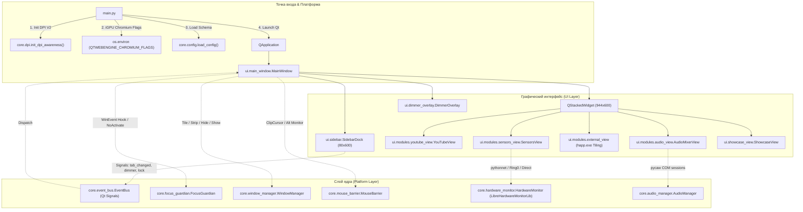

# DuckDock / TouchWM: План реализации функционала (Roadmap & Feature Backlog)

> **Статус документа:** Активный план реализации первой очереди (v0.2.0 - v1.0.0)  
> **Целевая конфигурация:** Windows 10/11 x64, два монитора: 27" Primary (dGPU) + 7" 1024×600 (JRP7813S Touchscreen на iGPU AMD Radeon Graphics, Ryzen 7 7700).  
> **Архитектурный закон:** `GEMINI.md` (Platform-First, Zero-Bespoke, Stealth Focus, CASO Mitigation, Per-Monitor DPI V2).

---

## 1. Архитектурная схема взаимодействия модулей

---

## 2. Поэтапный план реализации (Спринты разработки)

### Спринт 1: Фундамент WinAPI, Стелс-фокус и устойчивость дисплея (P0)

* **Цель:** Исключить сворачивание игр и потерю фокуса при любых касаниях 7" экрана, исключить дрифт курсора мыши и зафиксировать геометрию при выходе из сна.

1. **Фоновый хук Focus Guardian (`core/focus_guardian.py`)**:
   - Реализация потокобезопасного `SetWinEventHook(EVENT_SYSTEM_FOREGROUND)` с циклом `GetMessage` в выделенном `QThread`.
   - Запоминание дескриптора `last_primary_hwnd` только при нахождении активного окна в координатах 27" монитора.
   - Автоматический возврат фокуса через связку `AttachThreadInput` + `SetForegroundWindow` с настраиваемой задержкой `80 ms` (на время завершения клика) при перехвате фокуса сторонними окнами 7" экрана.
   - Публичные методы контракта: `start_hook() -> bool`, `stop_hook() -> None`.

2. **Перехват тач-событий и Anti-Cursor Warp**:
   - Глобальный Qt Event Filter на уровне `QApplication`: перехват `QEvent.TouchBegin`, `QEvent.TouchEnd`, `QEvent.MouseButtonRelease`.
   - Фоновый трекер позиции курсора на 27" мониторе (обновление при движении мыши по экрану 1).
   - Мгновенный возврат курсора в `last_primary_cursor_pos` через `25 ms` после отрыва пальца от сенсора.

3. **Аппаратный барьер мыши (`core/mouse_barrier.py`) через `ClipCursor`**:
   - Перевод логики с нестабильного таймера `SetCursorPos` на нативный WinAPI `user32.ClipCursor(&RECT)`.
   - Курсор аппаратно запирается в пределах геометрии 27" экрана.
   - Монитор клавиши `Alt`: при удержании `Alt` вызывается `ClipCursor(NULL)`, позволяя переместить мышь на 7" монитор.
   - Интеграция инициализации барьера в `MainWindow`.

4. **Display Topology Resilience & Hotplug**:
   - Реализация `MainWindow.nativeEvent` с перехватом системного сообщения `WM_DISPLAYCHANGE` (0x007E).
   - Подписка на сигналы `QGuiApplication.screenAdded` / `screenRemoved` -> автоматический вызов `reposition_to_subscreen()`.
   - Автоматическая адаптация ширины рабочей зоны под `1024×600` (JRP7813S) или `800×600`.

---

### Спринт 2: Менеджер сторонних окон и бесшовный тайлинг (P1)

* **Цель:** Превратить DuckDock в надежный Tiling Window Manager для внешних утилит (`happ.exe`, `aida64.exe`).

1. **Фоновый ProcessWatcher (`core/window_manager.py`)**:
   - Фоновый мониторинг процессов из `config.json` (`tracked_apps`) по таймеру (1.5–2 сек).
   - При обнаружении нового процесса: снятие рамок (`WS_CAPTION`, `WS_THICKFRAME`, `WS_MINIMIZEBOX`, `WS_MAXIMIZEBOX`) и кэширование HWND.
   - Обработка закрытия или перезапуска процессов (очистка кэша мертвых дескрипторов).

2. **Управление видимостью при смене вкладок (`ui/main_window.py`)**:
   - При переходе на вкладку 2 (`happ`): позиционирование в рабочую зону `(X = win.x + 80, Y = win.y, W = 944, H = 600)` и отображение через `ShowWindow(SW_SHOWNOACTIVATE)`.
   - При переходе на любую другую вкладку: вызов `ShowWindow(SW_HIDE)` для скрытия чужого окна (чтобы оно не перекрывало другие виджеты).
   - Восстановление из системного трея при нажатии иконки на сайдбаре.

---

### Спринт 3: Модуль сенсорного аудиомикшера (PyCaw Audio Mixer) (P1) [Завершено]

* **Цель:** Предоставить удобный тач-интерфейс для регулировки громкости и отключения звука отдельных приложений.

1. **Ядро аудиосессий (`core/audio_manager.py`)** [x]:
   - Взаимодействие с Windows Core Audio API через `pycaw`.
   - Чтение Master Volume и активных сессий (Discord, Telegram, Chrome/Браузер, Игры, Медиаплееры).
   - Извлечение имени процесса и иконки приложения для визуализации в UI.
   - Методы: `get_sessions()`, `set_session_volume(pid, level)`, `toggle_session_mute(pid)`.

2. **Интерфейс микшера (`ui/modules/audio_view.py`)** [x]:
   - Замена плейсхолдера вкладки 3 на функциональный экран.
   - Главный слайдер Master Volume (высота ползунка 40px, крупные кнопки Mute).
   - Сетка/список приложений с индивидуальными ползунками и кнопками Mute в один тап (Hitbox min 48×48px).
   - Динамическое обновление списка при запуске новых приложений со звуком.

---

### Спринт 4: Полнофункциональный медиахаб YouTube на iGPU (P1) [Завершено]

* **Цель:** Энергоэффективный медиаплеер с изоляцией на iGPU, постоянным профилем Google, защитой от зависания плеера при блокировке рекламы, кастомной тач-темой под 944×600 и сквозным управлением треками.

1. **Постоянный профиль Chromium и обход Google Auth Block (`core/web_profile.py`)**:
   - Создание синглтона `WebProfileManager` с путями в `%LOCALAPPDATA%/DuckDock/web_profile/storage` и `.../cache`.
   - Настройка `QWebEngineProfile.HttpCacheType.DiskHttpCache` с жестким лимитом `256 МБ` (`setHttpCacheMaximumSize(256 * 1024 * 1024)`).
   - Подмена `User-Agent` на чистый десктопный Chrome (Windows x64) для исключения ошибки авторизации Google *"This browser or app may not be secure"*.
   - Включение `PlaybackRequiresUserGesture = False` для бесшовного автовоспроизведения.

2. **Двухуровневый блокировщик рекламы (`core/web_interceptor.py` + JS-сторож)**:
   - **Сетевой уровень (`AdBlockInterceptor`)**: перехват `QWebEngineUrlRequestInterceptor`, отсекающий баннерные и трекерные домены (`googlesyndication.com`, `doubleclick.net`, `googleadservices.com`, `youtube.com/api/stats/ads`, `play.google.com/log`).
   - **DOM/JS уровень (`resources/js/ytm_touch_adblock.js`)**: предотвращение черного экрана/зависания плеера:
     - Наблюдение через `MutationObserver` за появлением `.ad-showing`.
     - Принудительная перемотка видеорекламы (`video.currentTime = video.duration`) и ускорение `playbackRate = 16.0`.
     - Автоклик по кнопкам пропуска `.ytp-ad-skip-button`, `.ytp-ad-skip-button-modern`.
     - Автоудаление промо-баннеров (`ytmusic-mealbar-promo-renderer`, диалоги Premium).

3. **Touch UI Injection под геометрию 944×600 (`resources/css/ytm_touch_theme.css`)**:
   - Инжекция через `QWebEngineScript` на этапе `DocumentReady`:
     - Полное скрытие верхней навигационной панели (`ytmusic-nav-bar`) для освобождения вертикального пространства.
     - Увеличение высоты панели плеера (`ytmusic-player-bar`) до 84px с темным фоном `#0f1117`.
     - Кнопка воспроизведения/паузы увеличена до 64×64px (scale 1.3), кнопки Prev/Next — 48×48px.
     - Полоса прогресса (`#progress-bar`, `tp-yt-paper-slider`) расширена до 14px с крупным ползунком 24×24px.
     - Автоматическое подавление диалогов неактивности (`ytmusic-you-there-renderer`).

4. **Сквозной Mini Media Bar в Сайдбаре (`ui/sidebar.py`, `core/event_bus.py`)**:
   - Двунаправленный мост между страницей YouTube Music и оболочкой через `runJavaScript` / `EventBus`:
     - Снятие названия трека и исполнителя (`.title.ytmusic-player-bar`, `.byline.ytmusic-player-bar`).
     - Сигналы `bus.media_state_changed` и `bus.media_action_requested` (`toggle_play`, `next`, `prev`).
   - Компактный сенсорный блок в нижней части сайдбара (ширина 80px): название трека бегущей строкой + крупные кнопки ⏮ ⏯ ⏭.
   - Строгий инвариант `Qt.NoFocus` на всех кнопках управления плеером для сохранения фокуса на основном экране 27".

5. **Этапы реализации и критерии приемки**:
   - **4.1**: `core/web_profile.py` — профиль, кэш 256МБ, UA Chrome, тест сохранения cookies.
   - **4.2**: `core/web_interceptor.py` — блокировка сетевых ad-запросов.
   - **4.3**: `resources/css/ytm_touch_theme.css` + `resources/js/ytm_touch_adblock.js` — стили и авто-скип.
   - **4.4**: Интеграция в `ui/modules/youtube_view.py`.
   - **4.5**: Интеграция `MiniMediaBar` в `ui/sidebar.py` с сохранением Stealth Focus.
   - **4.6**: Модульные тесты профиля и интерцептора в `tests/unit/test_web_profile.py`.

---

### Спринт 5: Сенсорный дашборд NOC 944×600 на LibreHardwareMonitorLib (P2)

* **Цель:** Полностью автономный, высокоинформативный аппаратный NOC-дашборд без пустых зон и без зависимости от AIDA64, с прямым сбором телеметрии через `LibreHardwareMonitorLib` (Ring 0 / UAC).

1. **Архитектурный фундамент и сбор данных (`core/`)**:
   - **5.1. Интеграция `LibreHardwareMonitorLib.dll` (`core/hardware_monitor.py`)** — *[@fullstack-builder]*:
     - Подключение сборки через `pythonnet` (`clr.AddReference`), размещение DLL в `resources/bin/LibreHardwareMonitorLib.dll`.
     - Реализация класса `HardwareMonitor` с управлением жизненным циклом `Computer.Open()` / `Close()`.
     - Реализация `IVisitor` для обхода сенсоров: CPU (Ryzen 7 7700 Tctl/Tdie, Package Power W), GPU (dGPU Core/Hotspot, VRAM, Power), RAM, Storage (NVMe), Motherboard Super I/O (Fans RPM, Pump).
   - **5.2. Строгая типизированная модель `TelemetrySnapshot` (`core/telemetry_model.py`)** — *[@fullstack-builder]*:
     - Датакласс с полями CPU Temp/Load/Clock/Power, GPU Temp/Hotspot/Load/VRAM/Power/Fan, RAM used/total, Storage Temp/Activity, Chassis Fans RPM, Network RX/TX, Ping, Uptime.
   - **5.3. Асинхронный сборщик телеметрии (`core/telemetry_worker.py`)** — *[@fullstack-builder]*:
     - Фоновый опрос датчиков LHM и замер ICMP Ping в отдельном `QThread` (интервал 1000 мс).
     - Полная изоляция от GUI-потока: 0% дропов FPS и отсутствие микрофризов в интерфейсе.
     - Эмиссия сигнала `bus.sensors_updated(snapshot: TelemetrySnapshot)`.
   - **5.4. Буфер истории метрик (`core/telemetry_history.py`)** — *[@fullstack-builder]*:
     - Кольцевой буфер `RingBuffer(maxlen=60)` для 60-секундной истории ключевых графиков (CPU Temp, GPU Temp, Load, Net).

2. **Пользовательский интерфейс и виджеты 944×600 (`ui/`)**:
   - **5.5. Аппаратный Sparkline-виджет на `QPainter` (`ui/widgets/sparkline.py`)** — *[@frontend-ui-designer]*:
     - Легковесный рендеринг кривой со сглаживанием (`QPainterPath`) и полупрозрачным градиентом.
     - Адаптивная пороговая палитра: <60°C Cyan (`#38bdf8`), 60–78°C Amber (`#f59e0b`), >80°C Crimson (`#ef4444`).
     - Отрисовка на iGPU (AMD Radeon Graphics), 0% нагрузки на дискретную графику.
   - **5.6. Двухуровневый NOC-дашборд 944×600 (`ui/modules/sensors_view.py`)** — *[@frontend-ui-designer] + [@fullstack-builder]*:
     - **Header Bar (36px):** Индикатор `● LibreHardwareMonitor (Direct Ring0)`, статус UAC, системный Uptime.
     - **Верхний ярус (Hero Cards 2× ~260px):**
       - **CPU Master:** Крупная температура Tctl/Tdie (36px), загрузка ядер %, эффективная частота GHz, кулер/помпа RPM, ватты, живой 60s график.
       - **GPU Master:** Крупная температура dGPU + Hotspot, загрузка %, VRAM Bar (занято/всего ГБ), обороты кулеров, живой 60s график.
     - **Нижний ярус (NOC Grid 4× ~220px):**
       - **RAM DDR5:** Использовано ГБ / Всего ГБ, полоса заполнения, кэш.
       - **Network Traffic & Ping:** Скорость Download/Upload в MB/s + пинг до шлюза/DNS.
       - **NVMe Storage:** Температура SSD, % активности чтения/записи.
       - **Chassis & Motherboard:** Обороты корпусных вентиляторов, напряжения линий питания.
     - **Инвариант Stealth Focus:** Строгий `Qt.NoFocus` на всех элементах управления и карточках.

3. **Тестирование, аудит и релиз**:
   - **5.7. Модульные тесты (`tests/unit/test_hardware_monitor.py`, `test_sparkline.py`)** — *[@bug-hunter]*:
     - Мокирование объектов LHM IVisitor и проверка корректной трансформации в `TelemetrySnapshot`.
     - Тестирование буфера `RingBuffer` на отсутствие утечек памяти.
     - Проверка fallback-поведения при отсутствии прав администратора.
   - **5.8. Pre-Flight аудит и инварианты** — *[@code-review]*:
     - Проверка `Stealth Focus`, времени отклика UI, корректного завершения потока `telemetry_worker` при закрытии приложения.
   - **5.9. Релизная фиксация v0.1.5** — *[@git-release-master]*:
     - Обновление changelog.md, семантической памяти Serena и Memory Bank.

---

### Спринт 6: Тач-жесты, Dimmer и автономная сборка (P2/P3)

* **Цель:** Максимальное удобство управления пальцем (QoL) и автономный дистрибутив.

1. **Тач-жесты (Swipe Engine)**:
   - Распознавание свайпа двумя пальцами сверху вниз: быстрое включение/выключение затемнения экрана (Dimmer).
   - Распознавание свайпа слева направо от сайдбара: циклическое переключение между активными вкладками.

2. **PyInstaller билд и автоматизация (`build.bat`, `build_exe.py`)**:
   - Сборка переносимого `dist/DuckDock.exe` со всеми зависимостями (PySide6, WebEngine, pycaw, LibreHardwareMonitorLib.dll, pythonnet).
   - Внедрение манифеста с флагом `dpiAware=true/pmv2`, `requireAdministrator` и гарантированным стартом на энергосберегающем GPU (iGPU).

---

## 3. Матрица рисков и зависимостей

| Задача | Критическая зависимость | Риск | Стратегия смягчения |
| :--- | :--- | :--- | :--- |
| **Focus Guardian** | Win32 API (`SetWinEventHook`) | Зависание хука при блокировке очереди сообщений | Вынос цикла сообщений Win32 в отдельный `QThread` |
| **Mouse Barrier** | Win32 API (`ClipCursor`) | Застревание мыши на основном экране при сбое | Сброс `ClipCursor(NULL)` при `app.aboutToQuit()` и по тайм-ауту/Alt |
| **Window Manager** | Права доступа к процессам (`happ.exe`) | Ошибка `AccessDenied` при запуске приложения от имени Администратора | Проверка привилегий; запуск DuckDock с идентичным уровнем прав (UAC) |
| **Audio Mixer** | COM-инициализация `pycaw` | Ошибка COM threading model (`CoInitialize`) | Явный вызов `pythoncom.CoInitialize()` в потоке опроса сессий |
| **YouTube WebEngine** | Память и нагрузка iGPU | Утечки кэша Chromium | Ограничение дискового кэша до 256 МБ, флаги `--disable-gpu-compositing` |
| **Hardware Monitor** | .NET CLR / Ring 0 (`LibreHardwareMonitorLib`) | Ошибка инициализации драйвера Ring 0 при отсутствии прав UAC | Манифест UAC `requireAdministrator`, fallback-индикация на базовый `psutil` |

---

## 4. Чеклист готовности (Definition of Done)

- [ ] В полноэкранной игре на основном мониторе любое касание 7" экрана не приводит к сворачиванию игры и потере фокуса.
- [ ] Курсор мыши после тача возвращается в исходную точку на 27" мониторе в течение 25–30 мс.
- [ ] Окно `happ.exe` автоматически вписывается в рабочую зону 944×600 без рамок и скрывается при переходе на другие вкладки.
- [x] Аудиомикшер корректно отображает список запущенных приложений и позволяет регулировать громкость пальцем.
- [x] YouTube Music сохраняет авторизацию пользователя и блокирует рекламные ролики.
- [x] Датчики LibreHardwareMonitorLib корректно отображают температуру (Ryzen Tctl/Tdie, GPU Hotspot), загрузку и кулеры на экране 1024×600 без сторонних приложений.
- [ ] Выход из спящего режима (Sleep/Wake) и переподключение HDMI не ломают привязку окна к 7" дисплею.
- [x] Все модульные тесты `pytest` проходят успешно.
