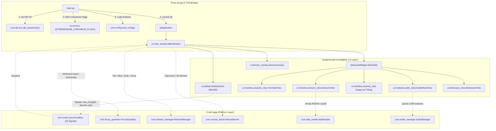

# DuckDock / TouchWM: План реализации функционала (Roadmap & Feature Backlog)

> **Статус документа:** Активный план реализации первой очереди (v0.2.0 - v1.0.0)  
> **Целевая конфигурация:** Windows 10/11 x64, два монитора: 27" Primary (dGPU) + 7" 1024×600 (JRP7813S Touchscreen на iGPU AMD Radeon Graphics, Ryzen 7 7700).  
> **Архитектурный закон:** `GEMINI.md` (Platform-First, Zero-Bespoke, Stealth Focus, CASO Mitigation, Per-Monitor DPI V2).

---

## 1. Архитектурная схема взаимодействия модулей

---

## 2. Поэтапный план реализации (Спринты разработки)

### Спринт 1: Фундамент WinAPI, Стелс-фокус и устойчивость дисплея (P0)

* **Цель:** Исключить сворачивание игр и потерю фокуса при любых касаниях 7" экрана, исключить дрифт курсора мыши и зафиксировать геометрию при выходе из сна.

1. **Фоновый хук Focus Guardian (`core/focus_guardian.py`)**:
   - Реализация потокобезопасного `SetWinEventHook(EVENT_SYSTEM_FOREGROUND)` с циклом `GetMessage` в выделенном `QThread`.
   - Запоминание дескриптора `last_primary_hwnd` только при нахождении активного окна в координатах 27" монитора.
   - Автоматический возврат фокуса через связку `AttachThreadInput` + `SetForegroundWindow` с настраиваемой задержкой `80 ms` (на время завершения клика) при перехвате фокуса сторонними окнами 7" экрана.
   - Публичные методы контракта: `start_hook() -> bool`, `stop_hook() -> None`.

2. **Перехват тач-событий и Anti-Cursor Warp**:
   - Глобальный Qt Event Filter на уровне `QApplication`: перехват `QEvent.TouchBegin`, `QEvent.TouchEnd`, `QEvent.MouseButtonRelease`.
   - Фоновый трекер позиции курсора на 27" мониторе (обновление при движении мыши по экрану 1).
   - Мгновенный возврат курсора в `last_primary_cursor_pos` через `25 ms` после отрыва пальца от сенсора.

3. **Аппаратный барьер мыши (`core/mouse_barrier.py`) через `ClipCursor`**:
   - Перевод логики с нестабильного таймера `SetCursorPos` на нативный WinAPI `user32.ClipCursor(&RECT)`.
   - Курсор аппаратно запирается в пределах геометрии 27" экрана.
   - Монитор клавиши `Alt`: при удержании `Alt` вызывается `ClipCursor(NULL)`, позволяя переместить мышь на 7" монитор.
   - Интеграция инициализации барьера в `MainWindow`.

4. **Display Topology Resilience & Hotplug**:
   - Реализация `MainWindow.nativeEvent` с перехватом системного сообщения `WM_DISPLAYCHANGE` (0x007E).
   - Подписка на сигналы `QGuiApplication.screenAdded` / `screenRemoved` -> автоматический вызов `reposition_to_subscreen()`.
   - Автоматическая адаптация ширины рабочей зоны под `1024×600` (JRP7813S) или `800×600`.

---

### Спринт 2: Менеджер сторонних окон и бесшовный тайлинг (P1)

* **Цель:** Превратить DuckDock в надежный Tiling Window Manager для внешних утилит (`happ.exe`, `aida64.exe`).

1. **Фоновый ProcessWatcher (`core/window_manager.py`)**:
   - Фоновый мониторинг процессов из `config.json` (`tracked_apps`) по таймеру (1.5–2 сек).
   - При обнаружении нового процесса: снятие рамок (`WS_CAPTION`, `WS_THICKFRAME`, `WS_MINIMIZEBOX`, `WS_MAXIMIZEBOX`) и кэширование HWND.
   - Обработка закрытия или перезапуска процессов (очистка кэша мертвых дескрипторов).

2. **Управление видимостью при смене вкладок (`ui/main_window.py`)**:
   - При переходе на вкладку 2 (`happ`): позиционирование в рабочую зону `(X = win.x + 80, Y = win.y, W = 944, H = 600)` и отображение через `ShowWindow(SW_SHOWNOACTIVATE)`.
   - При переходе на любую другую вкладку: вызов `ShowWindow(SW_HIDE)` для скрытия чужого окна (чтобы оно не перекрывало другие виджеты).
   - Восстановление из системного трея при нажатии иконки на сайдбаре.

---

### Спринт 3: Модуль сенсорного аудиомикшера (PyCaw Audio Mixer) (P1) [Завершено]

* **Цель:** Предоставить удобный тач-интерфейс для регулировки громкости и отключения звука отдельных приложений.

1. **Ядро аудиосессий (`core/audio_manager.py`)** [x]:
   - Взаимодействие с Windows Core Audio API через `pycaw`.
   - Чтение Master Volume и активных сессий (Discord, Telegram, Chrome/Браузер, Игры, Медиаплееры).
   - Извлечение имени процесса и иконки приложения для визуализации в UI.
   - Методы: `get_sessions()`, `set_session_volume(pid, level)`, `toggle_session_mute(pid)`.

2. **Интерфейс микшера (`ui/modules/audio_view.py`)** [x]:
   - Замена плейсхолдера вкладки 3 на функциональный экран.
   - Главный слайдер Master Volume (высота ползунка 40px, крупные кнопки Mute).
   - Сетка/список приложений с индивидуальными ползунками и кнопками Mute в один тап (Hitbox min 48×48px).
   - Динамическое обновление списка при запуске новых приложений со звуком.

---

### Спринт 4: Полнофункциональный медиахаб YouTube на iGPU (P1)

* **Цель:** Энергоэффективный медиаплеер с изоляцией на iGPU, блокировкой рекламы и крупными тач-контролами.

1. **Постоянный профиль Chromium и кэш**:
   - Создание изолированного `QWebEngineProfile` с хранением cookies и кэша в `%LOCALAPPDATA%/DuckDock/web_profile` (сохранение авторизации Google).

2. **Блокировщик рекламы (`core/web_interceptor.py`)**:
   - Перехватчик URL-запросов `QWebEngineUrlRequestInterceptor` для блокировки рекламных скриптов, трекеров и видеовставок (`googlesyndication`, `doubleclick`, рекламные домены).

3. **Touch CSS/JS Injection**:
   - Автоматическая инжекция пользовательских стилей (`QWebEngineScript`):
     - Увеличение элементов управления воспроизведением, прогресс-бара и кнопок навигации.
     - Скрытие лишних полей и шапок, оптимизация под разрешение 1024×600 / 800×600.

4. **Системный Media Overlay (SMTC)**:
   - Подключение `winsdk.windows.media.control` (Windows Media Control) для отображения глобального статуса воспроизведения (название трека, исполнитель, кнопки ⏮ / ⏯ / ⏭) поверх любого окна.

---

### Спринт 5: Сенсорный дашборд AIDA64 и адаптация 1024×600 (P2)

* **Цель:** Высокоинформативный NOC-дашборд без пустых зон и с точными показаниями датчиков.

1. **Нормализация парсера AIDA64 (`core/aida_reader.py`)**:
   - Исправление коллизии `TCPU`: разделение температуры (`TCPU` / `TCPUDIE`) и загрузки ядер (`SCPUUTI` / `psutil.cpu_percent`).
   - Типизированная модель `TelemetrySnapshot`:
     - CPU Temp, CPU Load %, CPU Clock GHz.
     - GPU Temp (dGPU), GPU Load %, VRAM Usage.
     - RAM Usage % и объем (ГБ).
     - Сетевая скорость (RX/TX KB/s) и Ping.

2. **Адаптивный UI 1024×600 (`ui/modules/sensors_view.py`)**:
   - Расширение сетки под ширину 944px (6–8 карточек вместо 4).
   - Легковесные Sparkline-графики динамики температур CPU и GPU через `QPainter` (нулевая нагрузка на dGPU, 60 FPS на iGPU).

---

### Спринт 6: Тач-жесты, Dimmer и автономная сборка (P2/P3)

* **Цель:** Максимальное удобство управления пальцем (QoL) и автономный дистрибутив.

1. **Тач-жесты (Swipe Engine)**:
   - Распознавание свайпа двумя пальцами сверху вниз: быстрое включение/выключение затемнения экрана (Dimmer).
   - Распознавание свайпа слева направо от сайдбара: циклическое переключение между активными вкладками.

2. **PyInstaller билд и автоматизация (`build.bat`, `build_exe.py`)**:
   - Сборка переносимого `dist/DuckDock.exe` со всеми зависимостями (PySide6, WebEngine, pycaw).
   - Внедрение манифеста с флагом `dpiAware=true/pmv2` и гарантированным стартом на энергосберегающем GPU (iGPU).

---

## 3. Матрица рисков и зависимостей

| Задача | Критическая зависимость | Риск | Стратегия смягчения |
| :--- | :--- | :--- | :--- |
| **Focus Guardian** | Win32 API (`SetWinEventHook`) | Зависание хука при блокировке очереди сообщений | Вынос цикла сообщений Win32 в отдельный `QThread` |
| **Mouse Barrier** | Win32 API (`ClipCursor`) | Застревание мыши на основном экране при сбое | Сброс `ClipCursor(NULL)` при `app.aboutToQuit()` и по тайм-ауту/Alt |
| **Window Manager** | Права доступа к процессам (`happ.exe`) | Ошибка `AccessDenied` при запуске приложения от имени Администратора | Проверка привилегий; запуск DuckDock с идентичным уровнем прав (UAC) |
| **Audio Mixer** | COM-инициализация `pycaw` | Ошибка COM threading model (`CoInitialize`) | Явный вызов `pythoncom.CoInitialize()` в потоке опроса сессий |
| **YouTube WebEngine** | Память и нагрузка iGPU | Утечки кэша Chromium | Ограничение дискового кэша до 256 МБ, флаги `--disable-gpu-compositing` |

---

## 4. Чеклист готовности (Definition of Done)

- [ ] В полноэкранной игре на основном мониторе любое касание 7" экрана не приводит к сворачиванию игры и потере фокуса.
- [ ] Курсор мыши после тача возвращается в исходную точку на 27" мониторе в течение 25–30 мс.
- [ ] Окно `happ.exe` автоматически вписывается в рабочую зону 944×600 без рамок и скрывается при переходе на другие вкладки.
- [x] Аудиомикшер корректно отображает список запущенных приложений и позволяет регулировать громкость пальцем.
- [ ] YouTube Music сохраняет авторизацию пользователя и блокирует рекламные ролики.
- [ ] Датчики AIDA64 корректно отображают температуру и загрузку CPU/GPU на экране 1024×600 без пустого места.
- [ ] Выход из спящего режима (Sleep/Wake) и переподключение HDMI не ломают привязку окна к 7" дисплею.
- [ ] Все модульные тесты `pytest` проходят успешно.
