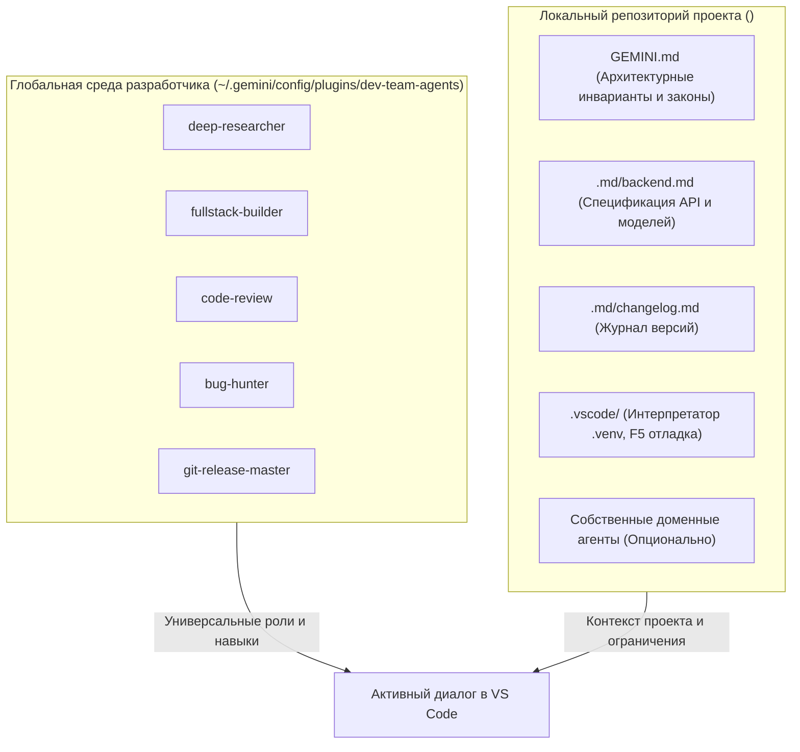

# Руководство по архитектурной инициализации проектов (Universal Project Bootstrap & Archetype Engine)

> **Статус документа:** Эталонный дизайн-документ и интерактивная архитектурная спецификация  
> **Назначение:** Развертывание каркаса любого проекта AI-агентом из пустой директории с поддержкой различных типов приложений (Web SPA, Desktop PySide6, CLI/Daemon)  
> **Ключевой принцип:** *Platform-First, Zero-Bespoke Invariant & Archetype Profiling*

---

## 1. Универсальные архитектурные принципы кодовой базы

Вне зависимости от выбранного направления (веб, десктоп или консольная служба), система опирается на сквозные инженерные стандарты:

### 1.1. Platform-First & Zero-Bespoke Invariant
Архитектура приложения строго разделяется на два независимых слоя:
1. **Слой фундамента (Platform / Foundation Primitives)**: низкоуровневые многократно используемые компоненты ядра (универсальные таблицы, окна/диалоги, шина событий, криптография, сетевые утилиты, асинхронные транзакции БД, форматирование).
2. **Слой прикладных фич (Feature / Domain Modules)**: экраны, окна, бизнес-контроллеры и прикладные сценарии.

> [!IMPORTANT]
> **Zero-Bespoke Invariant (Запрет на локальные/кустарные решения):**  
> Если типовая задача (вывод таблицы со списком, показ диалогового окна, валидация полей ввода, асинхронный воркер, дебаунс) встречается в системе, **строго запрещено** реализовывать ее локально («bespoke») внутри конкретного экрана или обработчика. Функционал обязан делегироваться платформенному примитиву ядра.

### 1.2. Deep Modules & Thin Controllers (Глубокие модули и тонкие контроллеры)
- **Deep Modules (Глубокие модули)**: Компоненты фундамента имеют простой, минималистичный внешний API, инкапсулируя внутри всю сложность (ресайз колонок, sticky-шапки, LIFO-стек закрытия окон по Esc, кэширование, обработку ошибок).
- **Thin Controllers (Тонкие контроллеры)**: Прикладные компоненты экранов/окон занимаются только сборкой данных и вызовом методов ядра, не дублируя внутреннюю логику виджетов.

### 1.3. Decoupled by Design (Слабая связанность через события и контракты)
- Модули ядра не имеют зависимостей от прикладных экранов.
- Межмодульное общение строится через централизованную шину событий (`EventBus`) или сигналы (в PySide/PyQt), исключая прямое вмешательство в скрытое состояние чужих классов.

### 1.4. Single Source of Truth (SSOT)
Любая константа, формула расчета, парсер сетевого адреса или дизайн-токен (цвета, шрифты, отступы) определяются ровно в одном месте в проекте (`core/utils`, `tokens.css` или `tokens.qss`).

### 1.5. Non-Destructive Migrations & WAL Integrity
- **Целостность SQLite**: Любые транзакции записи выполняются через сериализующий шлюз `write_gate_session()`. При завершении приложения обязательно выполняется `PRAGMA wal_checkpoint(TRUNCATE)`.
- **Неразрушающие миграции**: Изменение моделей в `storage/models.py` не должно приводить к удалению пользовательской БД. Миграции выполняются через проверку `PRAGMA table_info` и `ALTER TABLE ADD COLUMN`.

### 1.6. Port Resilience & Safe Startup
- Приложение обязано проверять занятость сетевого порта до старта HTTP-сервера. При обнаружении конфликта выводится понятное сообщение с указанием конфликтующего порта и рекомендацией сменить его в `.env`.

---

## 2. Модель распределения AI-агентов: Global vs Local

Для работы в среде VS Code / Antigravity принята **гибридная модель**:



1. **Глобальные агенты (Shared Core)**:
   - Расположены в каталоге пользователя: `~/.gemini/config/plugins/dev-team-agents`.
   - Доступны во всех проектах без дублирования на диске.
   - Единая точка обновления навыков команды.
2. **Локальный контекст проекта**:
   - Правила проекта, доменные ограничения и стековые инварианты фиксируются в файле `GEMINI.md` в корне репозитория.
   - Локальная папка `.agents/` генерируется **только при необходимости** передачи проекта сторонней команде в Git-репозитории.

---

## 3. Спецификация для копирования: `PROJECT_BOOTSTRAP.md`

> **Инструкция пользователю:**  
> Скопируйте текст из блока ниже, сохраните его как `PROJECT_BOOTSTRAP.md` в пустую папку вашего нового проекта и отправьте агенту команду:  
> `@[.agents/agents/deep-researcher] Прочитай PROJECT_BOOTSTRAP.md, проведи блиц-опрос (если параметры не заполнены) и выполни инициализацию проекта с фазы 0 по фазу 6.`

```markdown
# PROJECT_BOOTSTRAP: Интерактивный генератор каркаса проекта

> **Инструкция для AI-агента:**
> Ты выступаешь в роли Senior DevOps & Lead Software Architect.
> Твоя задача:
> 1. Проверить секцию `[PROJECT CONFIGURATION]`. Если параметры не заполнены или указано `INTERACTIVE: true` — **проведи блиц-опрос пользователя (4 вопроса)** и заполни параметры.
> 2. Определить целевой архетип (`web_spa`, `desktop_gui`, `cli_daemon`) и сгенерировать точную структуру каталогов.
> 3. Последовательно выполнить развертывание окружения, скриптов Windows, VS Code обвязки, демо-данных и запустить автотесты.

---

## 1. Конфигурация проекта (Параметры и Архетип)

```yaml
INTERACTIVE: false             # true: агент задает блиц-вопросы; false: берет параметры ниже
PROJECT_NAME: "duckdock"
PROJECT_TITLE: "DuckDock / TouchWM"
PROJECT_DESCRIPTION: "Кастомный Tiling Window Manager и сенсорный дашборд для вспомогательного 7'' экрана 800x600"
VERSION: "0.1.0"
AUTHOR: "Nexus"

# АРХЕТИП ПРОЕКТА (Выбрать один):
# 1. "web_spa"     -> FastAPI Backend + Vanilla JS SPA (No-NPM) + SQLite WAL
# 2. "desktop_gui" -> PySide6 (Qt) Desktop UI + QSS Дизайн-токены + Asyncio
# 3. "cli_daemon"  -> Консольная утилита / Демон (Typer/Rich) + SQLite
ARCHETYPE: "desktop_gui"

# СЕТЕВЫЕ ПАРАМЕТРЫ (Для web_spa):
PORT: 0
HOST: "127.0.0.1"

# БАЗА ДАННЫХ И ХРАНИЛИЩЕ:
DATABASE: "none"             # sqlite (aiosqlite + WAL + WriteGate) | none
STORAGE_WAL: false

# СБОРКА WINDOWS:
STANDALONE_EXE: true           # PyInstaller Windows сборка (.exe)

# АРХИТЕКТУРНЫЙ ФУНДАМЕНТ (Platform Foundation Primitives):
FOUNDATION_MODULES:
  table_grid: false            # Универсальная таблица (Auto-width/Resize, Sticky Header)
  modal_stack: false           # Менеджер модалок/диалогов (LIFO-стек по Esc)
  event_bus: true              # Централизованная шина событий (Qt Signals / PubSub)
  core_utils: true             # Базовые утилиты (DPI, WinAPI хелперы, форматирование)
  ui_showcase: true            # Демо-экран (/ui-kit или ShowcaseWindow) для проверки компонентов
  seed_data: false             # Генератор демо-данных для моментального теста при старте

# РЕЖИМ АГЕНТОВ:
AGENTS_MODE: "global"          # "global" (dev-team-agents) | "local" (.agents/)
```

---

## 2. Протокол интерактивного Блица и Архитектурной консультации

> **Интеллектуальный режим для Агента:**
> Пользователь может ответить на блиц двумя способами:
> 1. Выбрать конкретные пункты (например: `1A, 2A, 3A, 4A`).
> 2. **Просто описать свою идею своими словами** (например: *"Хочу утилиту для пинга серверов и сбора логов по расписанию с графиками"* или *"Нужно десктопное приложение для учета оборудования с экспортом в Excel"*).
> 
> Если пользователь описывает идею в свободной форме, агент **не требует сухих букв ответов**, а:
> - Анализирует требования к UI, фоновым задачам, ОС и хранилищу.
> - **Сам рекомендует наиболее подходящий архетип** с кратким обоснованием («*Для вашей задачи идеален Desktop GUI на PySide6, так как требуется работа с системным треем и нативными диалогами файлов...*»).
> - Запрашивает быстрое подтверждение («*Разворачиваем этот стек?*») и после согласия сразу приступает к генерации.

### Вопросы Блица (если пользователь предпочитает прямой опрос):

1. **Тип и направление приложения (Архетип):**
   - [A] **Web SPA (Рекомендуется)**: FastAPI + быстрый браузерный Vanilla JS интерфейс (без npm/node), адаптивная верстка, легкий доступ по локальной сети.
   - [B] **Desktop GUI**: Нативное окно Windows на PySide6 (Qt), QSS-стили, интеграция с системным треем, нативные диалоги.
   - [C] **CLI / Background Daemon**: Консольная утилита с цветным выводом Rich или системный фоновый сервис/служба.

2. **База данных и хранилище:**
   - [A] **SQLite + WAL (Рекомендуется)**: Локальная быстрая БД с защитой от параллельных блокировок через WriteGate.
   - [B] **Без базы данных**: Конфигурационные файлы JSON/YAML и работа в оперативной памяти.

3. **Сборка в автономный EXE-файл:**
   - [A] **Да (PyInstaller)**: Готовые скрипты `build.bat` и `build_exe.py` для генерации одного переносимого файла `.exe`.
   - [B] **Нет**: Запуск исключительно разработчиком через Python/`.venv`.

4. **Демо-данные и витрина компонентов (Showcase):**
   - [A] **Включить (Рекомендуется)**: Добавить генератор демо-данных `seed.py` и витрину UI для мгновенной проверки внешнего вида с первой секунды.
   - [B] **Минималистичный старт**: Только чистое базовое ядро.

---

## 3. Матрица структуры каталогов по Архетипам

### Общая обвязка (Присутствует во всех проектах):
```text
<PROJECT_ROOT>/
├── .gitignore
├── .vscode/                   # Готовое рабочее место VS Code
│   ├── settings.json          # Привязка .venv, pytest, format on save
│   ├── launch.json            # Отладка по клавише F5
│   └── extensions.json        # Рекомендуемые расширения
├── GEMINI.md                  # Законы проекта и инварианты Platform-First
├── README.md                  # Документация и быстрый старт
├── pyproject.toml             # Зависимости, ruff и pytest (0 warnings)
├── requirements.txt           # Зафиксированные версии пакетов
├── .env.example & .env        # Настройки среды
├── run.bat                    # Production/Normal лаунчер
├── dev.bat                    # Dev-лаунчер с авто-перезагрузкой и открытием UI
├── build.bat & build_exe.py   # PyInstaller компилятор под Windows x64
├── pytest.ini                 # Настройки pytest с маркерами core / integration
├── .md/
│   ├── changelog.md           # Sliding-window журнал версий (v0.1.0)
│   ├── backend.md             # Архитектурная схема, Mermaid и контракты
│   └── design_document.md     # Спецификация и Roadmap
└── tests/
    ├── conftest.py            # Изолированные фикстуры
    └── unit/test_health.py    # Базовый тест работоспособности
```

### Специфика для Архетипа 1: `web_spa` (FastAPI + Vanilla SPA)
```text
<PROJECT_NAME>/
├── __init__.py
├── app.py                     # FastAPI сервер + lifespan + static
├── core/                      # Config (Pydantic), Logger, Network/String Utils
├── storage/                   # Async SQLite + WriteGate + Models
├── api/routes.py              # Роуты /health, /api/v1/..., /ui-kit
└── web/
    ├── static/
    │   ├── css/ (tokens.css, base.css, style.css)
    │   └── js/
    │       ├── app.js
    │       └── modules/
    │           ├── core/ (event-bus.js, utils.js)
    │           └── ui/ (table-grid.js, modal-stack.js)
    └── index.html & ui_kit.html
```

### Специфика для Архетипа 2: `desktop_gui` (PySide6 / Qt)
```text
<PROJECT_NAME>/
├── __init__.py
├── app.py                     # Точка входа QApplication + Event Loop
├── core/                      # Config, Logger, EventBus (Qt Signals/Slots)
├── storage/                   # SQLite / File Storage
└── ui/
    ├── main_window.py         # Главное окно приложения
    ├── showcase_window.py     # Витрина UI-виджетов
    ├── styles/
    │   ├── tokens.qss         # Цветовая палитра, шрифты, отступы
    │   └── theme.qss          # Стилизация компонентов Qt
    └── components/            # [Foundation Primitives]
        ├── table_grid.py      # Наследованный QTableView с авто-шириной и поиском
        ├── dialog_stack.py    # Менеджер модальных диалогов с Esc-стеком
        └── toast.py           # Всплывающие уведомления поверх окна
```

### Специфика для Архетипа 3: `cli_daemon` (Консоль / Демон)
```text
<PROJECT_NAME>/
├── __init__.py
├── app.py                     # Точка входа Typer CLI / Runner службы
├── core/                      # Config, Logger, Background Worker Engine
├── storage/                   # SQLite WAL / Bulk Ingestion
└── cli/
    ├── commands/              # Команды консоли (start, status, scan, export)
    └── ui/                    # [Foundation Primitives] Таблицы Rich, Progress Bars
```

---

## 4. Пошаговые фазы выполнения для Агента

### ФАЗА 0: Профайлинг и инициализация Git
1. Распарсить параметры или провести блиц-опрос.
2. Инициализировать репозиторий:
   ```powershell
   git init -b main
   ```

### ФАЗА 1: Генерация конфигураций и законов проекта
1. Создать `.gitignore` (исключить `.venv/`, `dist/`, `build/`, `*.db`, `*.db-wal`, `__pycache__/`, `.env`).
2. Сгенерировать конфигурацию VS Code (`.vscode/`):
   - **`settings.json`**:
     ```json
     {
       "python.defaultInterpreterPath": "${workspaceFolder}/.venv/Scripts/python.exe",
       "python.testing.pytestEnabled": true,
       "python.testing.pytestArgs": ["tests"],
       "editor.formatOnSave": true,
       "files.trimTrailingWhitespace": true
     }
     ```
   - **`launch.json`**: готовый профиль запуска по клавише **F5** с отладчиком под выбранный архетип.
3. Создать `pyproject.toml` и `requirements.txt`:
   - Для `web_spa`: `fastapi`, `uvicorn[standard]`, `pydantic-settings`, `aiosqlite`, `sqlalchemy>=2.0`, `pytest`, `pytest-asyncio`, `httpx`, `pyinstaller`.
   - Для `desktop_gui`: `PySide6`, `pydantic-settings`, `aiosqlite`, `sqlalchemy>=2.0`, `pytest`, `pytest-asyncio`, `pyinstaller`.
   - Для `cli_daemon`: `typer[all]`, `rich`, `pydantic-settings`, `aiosqlite`, `pytest`, `pytest-asyncio`, `pyinstaller`.
4. Сгенерировать `GEMINI.md`:
   - Закрепить принципы **Platform-First**, **Zero-Bespoke Invariant**, **Deep Modules**.
   - Закрепить правила работы с БД: `write_gate_session()`, SQLite WAL, неразрушающие миграции через `PRAGMA table_info`.
   - Закрепить проверку портов и версионирование статики (`?v=0.1.0`).
   - Назначить роли агентов: `@deep-researcher`, `@fullstack-builder`, `@code-review`, `@bug-hunter`.
5. Сгенерировать `.md/changelog.md` (версия `0.1.0` Scaffolding) и `.md/backend.md`.

### ФАЗА 2: Развертывание изолированного окружения (.venv)
Выполнить в терминале:
```powershell
python -m venv .venv
.\.venv\Scripts\python.exe -m pip install --upgrade pip
.\.venv\Scripts\python.exe -m pip install -r requirements.txt
```

### ФАЗА 3: Создание кода ядра и платформенных примитивов
1. **Архитектурный фундамент (Foundation Layer)**:
   - Создать универсальные модули ядра (TableGrid, ModalStack/Dialogs, EventBus, Utils).
   - В `storage/db.py`: реализовать `write_gate_session()`, а при завершении работы — вызов `PRAGMA wal_checkpoint(TRUNCATE)`.
2. **Точка входа и роутинг**:
   - В начале `app.py`: добавить `sys.path.insert(0, str(Path(__file__).resolve().parent.parent))` для защиты путей импорта при запуске из любого каталога.
   - В `core/config.py`: добавить функцию проверки занятости порта через сокет с информативным предупреждением (`WinError 10048`).
   - Зарегистрировать роут `/health` (для web) или команду `health` (для cli).
3. **Демо-данные и витрина (Showcase)**:
   - Создать `seed.py`, наполняющий локальную БД 10–20 тестовыми записями.
   - Добавить экран витрины компонентов (`/ui-kit` или `showcase_window.py`) для мгновенного визуального тестирования дизайн-системы.

### ФАЗА 4: Развертывание обвязки запуска и сборки под Windows
1. **`run.bat`**: Production лаунчер с проверкой `.venv`, установкой зависимостей и перехватом кодов ошибок.
2. **`dev.bat`**: Лаунчер разработки:
   - Для `web_spa`: запуск Uvicorn с `--reload` и авто-открытие браузера через надежный неблокирующий таймер `ping -n 3 127.0.0.1 >nul & start http://...`.
   - Для `desktop_gui`: запуск с выводом консольных логов и отслеживанием изменений.
3. **`build_exe.py` и `build.bat`**:
   - Настройка компилятора PyInstaller под выбранный архетип (для desktop: `--noconsole`, для web/cli: с консолью).
   - Обязательная передача `--hidden-import` для скрытых зависимостей (`uvicorn.logging`, `uvicorn.loops.asyncio`, `uvicorn.protocols.http.auto`, `aiosqlite`, либо плагинов PySide6).
   - Упаковка стилей, шаблонов и ресурсов через `--add-data`.

### ФАЗА 5: Автоматическая верификация и начальный коммит
1. Запустить тесты:
   ```powershell
   .\.venv\Scripts\pytest.exe -v
   ```
2. Наполнить базу демо-данными:
   ```powershell
   .\.venv\Scripts\python.exe seed.py
   ```
3. Сформировать первичный коммит в Git:
   ```powershell
   git add .
   git commit -m "feat: initial project scaffold via PROJECT_BOOTSTRAP [skip ci]"
   ```
**Критерий успеха**: 100% тестов пройдено (0 warnings), база наполнена демо-данными, проект запускается в один клик через `dev.bat`.
```

---

## 4. Эталонные скрипты и конфигурации DX

### 4.1. Лаунчер разработки `dev.bat` (Web SPA пример)
```bat
@echo off
setlocal enabledelayedexpansion
title {{PROJECT_TITLE}} [DEV MODE]
cd /d "%~dp0"

echo ===================================================
echo   {{PROJECT_TITLE}} - Development Server
echo ===================================================
echo.

if not exist ".venv\Scripts\python.exe" (
    call run.bat
    exit /b 0
)

echo [*] Запуск в режиме горячей перезагрузки (Hot Reload)...
:: Надежный таймер Windows без ошибок перенаправления ввода
start /b cmd /c "ping -n 3 127.0.0.1 >nul & start http://{{HOST}}:{{PORT}}"
".venv\Scripts\python.exe" -m uvicorn {{PROJECT_NAME}}.app:app --host {{HOST}} --port {{PORT}} --reload

if %ERRORLEVEL% NEQ 0 (
    echo [!] Сервер аварийно остановлен.
    pause
)
```

### 4.2. Конфигурация компилятора `build_exe.py` (с защитой скрытых импортов)
```python
"""
Универсальный компилятор проекта в автономный Windows EXE.
Запуск: .\\.venv\\Scripts\\python.exe build_exe.py
"""
import sys
import subprocess
from pathlib import Path

BASE_DIR = Path(__file__).resolve().parent
PROJECT_NAME = "{{PROJECT_NAME}}"
ARCHETYPE = "{{ARCHETYPE}}"  # web_spa | desktop_gui | cli_daemon

def build():
    print(f"[*] Сборка автономного исполняемого файла {PROJECT_NAME}.exe ({ARCHETYPE})...")
    dist_dir = BASE_DIR / "dist"
    build_dir = BASE_DIR / "build"
    
    cmd = [
        sys.executable,
        "-m", "PyInstaller",
        f"--name={PROJECT_NAME}",
        "--onefile",
        "--noconfirm",
        "--clean",
        f"--paths={BASE_DIR}",
        f"--distpath={dist_dir}",
        f"--workpath={build_dir}",
        f"--collect-submodules={PROJECT_NAME}",
    ]
    
    if ARCHETYPE == "web_spa":
        static_dir = BASE_DIR / PROJECT_NAME / "web" / "static"
        if static_dir.exists():
            cmd.append(f"--add-data={static_dir};{PROJECT_NAME}/web/static")
        # Обязательные скрытые импорты Uvicorn для исключения сбоев в MEIPASS
        for mod in [
            "uvicorn.logging",
            "uvicorn.loops",
            "uvicorn.loops.asyncio",
            "uvicorn.protocols",
            "uvicorn.protocols.http",
            "uvicorn.protocols.http.auto",
            "uvicorn.lifespan",
            "uvicorn.lifespan.on",
            "aiosqlite",
        ]:
            cmd.append(f"--hidden-import={mod}")
            
    elif ARCHETYPE == "desktop_gui":
        cmd.append("--noconsole")  # Запуск без мигающего черного окна консоли
        for mod in ["PySide6.QtCore", "PySide6.QtGui", "PySide6.QtWidgets", "aiosqlite"]:
            cmd.append(f"--hidden-import={mod}")

    entry_point = BASE_DIR / PROJECT_NAME / "app.py"
    cmd.append(str(entry_point))
    
    result = subprocess.run(cmd)
    if result.returncode == 0:
        print(f"\n[+] Сборка завершена успешно! Файл готов: dist/{PROJECT_NAME}.exe")
    else:
        print(f"\n[!] Ошибка сборки. Код возврата: {result.returncode}")
        sys.exit(result.returncode)

if __name__ == "__main__":
    build()
```

### 4.3. Конфигурация отладки в VS Code (`.vscode/launch.json`)
```json
{
  "version": "0.2.0",
  "configurations": [
    {
      "name": "Python: {{PROJECT_TITLE}} (F5)",
      "type": "debugpy",
      "request": "launch",
      "program": "${workspaceFolder}/{{PROJECT_NAME}}/app.py",
      "console": "integratedTerminal",
      "justMyCode": true,
      "env": {
        "PYTHONPATH": "${workspaceFolder}"
      }
    },
    {
      "name": "Python: Запуск Pytest",
      "type": "debugpy",
      "request": "launch",
      "module": "pytest",
      "args": ["-v"],
      "console": "integratedTerminal"
    }
  ]
}
```

### 4.4. Базовый скрипт демо-данных `seed.py`
```python
"""
Наполнение базы данных демонстрационными данными для моментальной проверки интерфейса.
Запуск: .\\.venv\\Scripts\\python.exe seed.py
"""
import asyncio
from {{PROJECT_NAME}}.storage.db import write_gate_session
from {{PROJECT_NAME}}.storage.models import ItemModel  # Заменяется на целевую модель

SAMPLE_DATA = [
    {"name": f"Device-0{i}", "ip": f"192.168.1.{10+i}", "status": "active" if i % 2 == 0 else "offline"}
    for i in range(1, 16)
]

async def seed():
    print("[*] Наполнение базы демо-данными...")
    async with write_gate_session() as session:
        for record in SAMPLE_DATA:
            session.add(ItemModel(**record))
        await session.commit()
    print("[+] 15 записей успешно загружены в базу. Таблица готова к демонстрации!")

if __name__ == "__main__":
    asyncio.run(seed())
```

---

## 5. Архитектурные риски, узкие места и стратегии миграции (DuckDock / TouchWM)

При реализации проекта **DuckDock / TouchWM** на базе архетипа `desktop_gui` зафиксированы следующие аппаратно-программные риски и проектные решения:

### 5.1. Риск 1: Захват фокуса Chromium (`QWebEngineView`) при `WS_EX_NOACTIVATE`
* **Суть проблемы:** `QWebEngineView` порождает дочерние процессы рендеринга Chromium (`Chrome_WidgetWin_1`). При клике по полосам прокрутки или элементам видеоплеера нативный движок Chromium производит вызов `SetFocus`, перехватывая активное окно у Windows вопреки флагам родительского окна Qt.
* **Решение и инвариант:**
  1. Разделение страницы YouTube на два режима: **Медиа-режим** (по умолчанию) и **Клавиатурный ввод** (активируется тумблером `lock_toolB` на сайдбаре).
  2. В медиа-режиме устанавливать `QWebEngineView.installEventFilter` и глушить `QEvent.FocusIn`, передавая клики через JS-инъекцию без передачи Windows Focus.

### 5.2. Риск 2: Гонки потоков и Deadlocks при `AttachThreadInput`
* **Суть проблемы:** Механика возврата фокуса окну на основном мониторе (`FocusGuardian`) использует Win32 связку `AttachThreadInput` + `SetForegroundWindow`. Если игра на 27" мониторе находится под защитой античита (BattlEye, Easy Anti-Cheat, Vanguard) или перегружена, вызов `AttachThreadInput` может заблокировать очередь оконных сообщений самого DuckDock.
* **Решение и инвариант:**
  1. Выполнять операцию возврата фокуса в выделенном легковесном потоке `QThread / threading.Thread` с жестким тайм-аутом.
  2. Внедрить fallback-метод возврата фокуса без `AttachThreadInput` через имитацию холостого нажатия `keybd_event(VK_MENU, 0, 0, 0)` перед `SetForegroundWindow`.

### 5.3. Риск 3: Межадаптерная синхронизация CASO (Cross-Adapter Scan-Out)
* **Суть проблемы:** Вспомогательный экран 7" подключен к iGPU (AMD Radeon Graphics процессора Ryzen 7 7700), а основной 27" — к dGPU. При неконтролируемом запуске Chromium или тяжелых QPainter операций на dGPU кадры будут копироваться по PCIe в память iGPU, вызывая микрофризы (frame pacing drops) в играх на основном мониторе.
* **Решение и инвариант:**
  1. Явная передача флагов запуска Chromium до создания `QApplication`:
     `os.environ["QTWEBENGINE_CHROMIUM_FLAGS"] = "--enable-gpu-rasterization --enable-zero-copy --disable-gpu-compositing"`.
  2. Принудительное ограничение кадровой частоты интерфейса DuckDock до 60 FPS (`QSurfaceFormat.setSwapInterval(1)`).

### 5.4. Риск 4: Per-Monitor DPI Scaling Mismatch
* **Суть проблемы:** Основной монитор 27" может иметь нестандартный масштаб (125% или 150%), тогда как 7" экран 800×600 обязан работать строго с масштабом 100%. При позднем вызове функций DPI Awareness координаты окон `SetWindowPos` сместятся и интерфейс выйдет за физические границы экрана.
* **Решение и инвариант:**
  1. Самым первым вызовом в `main.py` (до любых импортов PySide6) вызывать:
     `ctypes.windll.user32.SetProcessDpiAwarenessContext(ctypes.c_void_p(-4))` (`DPI_AWARENESS_CONTEXT_PER_MONITOR_AWARE_V2`) или `ctypes.windll.shcore.SetProcessDpiAwareness(2)`.

### 5.5. Риск 5: Нестабильность дескрипторов сторонних окон (`happ.exe`)
* **Суть проблемы:** Утилиты наподобие `happ` при нажатии на крестик могут полностью уничтожать окно и пересоздавать новый дескриптор `HWND` при разворачивании из системного трея. Кэшированный `hwnd` становится невалидным (`ERROR_INVALID_WINDOW_HANDLE`).
* **Решение и инвариант:**
  1. В `WindowManager` хранить связку `(exe_name, pid, cached_hwnd)`.
  2. Перед каждой операцией проверять `win32gui.IsWindow(cached_hwnd)`. Если окно невалидно — выполнять автоматический редискавери через `EnumWindows` + `GetWindowThreadProcessId`.

### 5.6. Риск 6: Сброс топологии дисплеев при выходе из сна (HDMI Hotplug)
* **Суть проблемы:** При переходе ПК в спящий режим вспомогательный экран по HDMI может отключиться раньше основного. Windows сбрасывает координаты виртуального стола, перемещая окно DuckDock на 27" монитор.
* **Решение и инвариант:**
  1. Реализовать `NativeEventFilter` с перехватом системного сообщения `WM_DISPLAYCHANGE`.
  2. Использовать `QTimer.singleShot(600, self.reposition_to_subscreen)` для корректного ожидания готовности DWM перед повторной фиксацией геометрии `800x600`.

